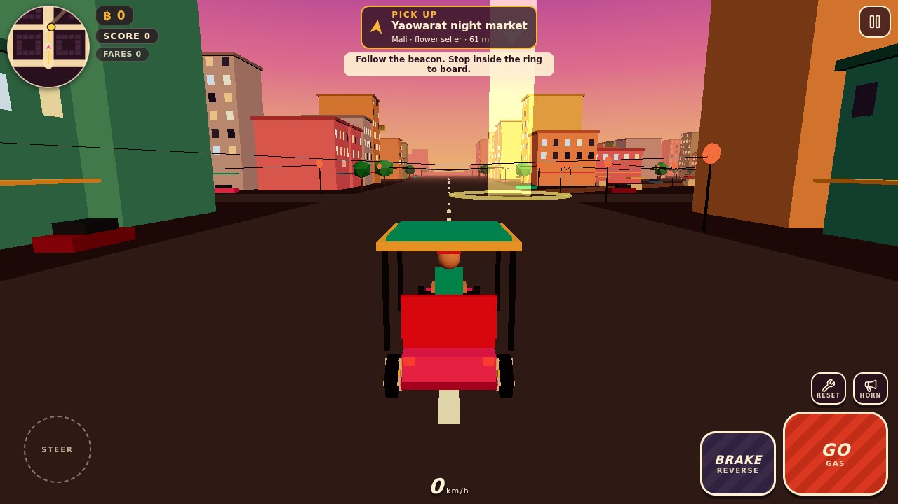
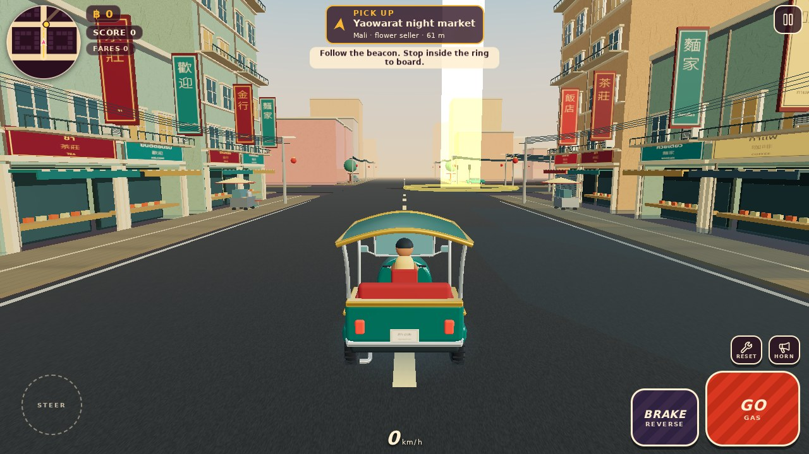
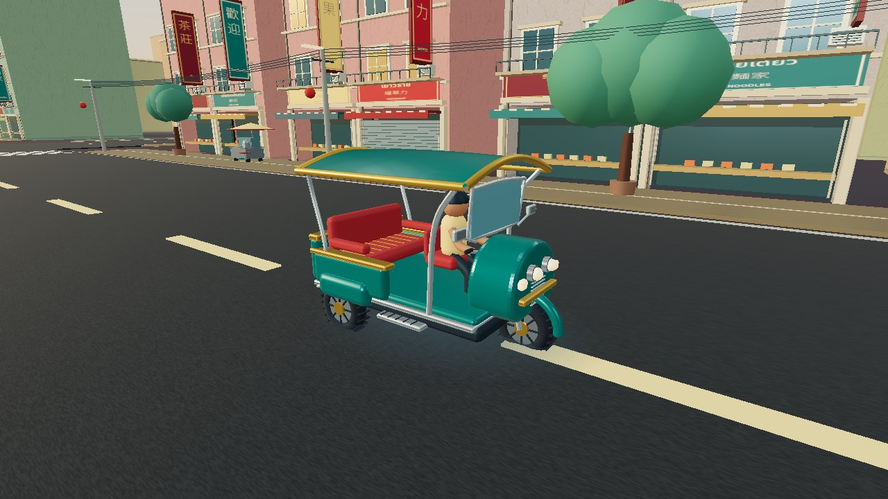
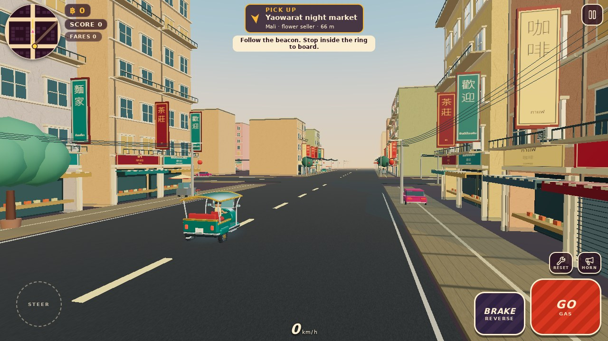
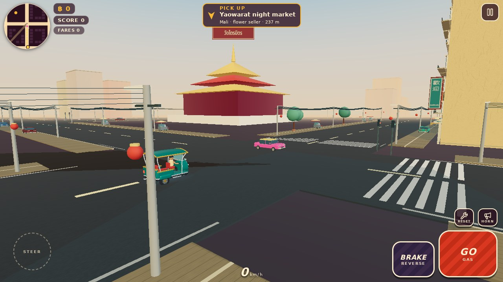
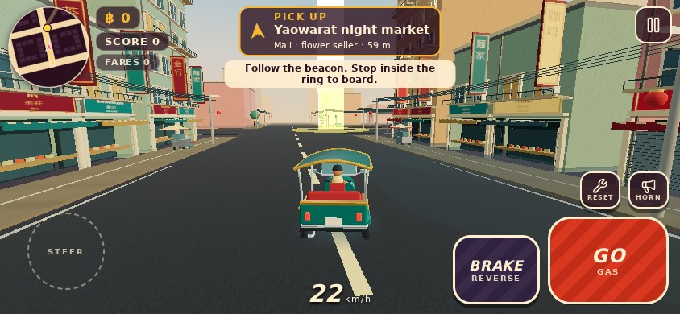
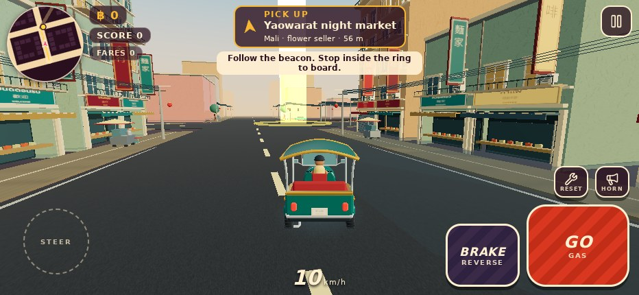

# Yaowarat golden-hour graphics overhaul

This draft replaces the primitive player vehicle with an original articulated GLB
and turns the existing Yaowarat corridor into a continuous stylized shophouse street.
It is a substantial first art pass, not certification of premium-mobile performance.
Start point: main `61e6bdef1c155909c6135d14f5b21170ec631533`.

## Initial audit and retained foundations

- Buildings were opaque boxes with flat window planes and unshaped roofs. There was
  no shop recess, framing, balcony, or surface texture pipeline.
- The player vehicle used flat boxes for its body, roof, frame, and fender. Its
  basic proportions suggested a tricycle but lacked recognizable Thai bodywork.
- Traffic merged every material into a single Lambert vertex-color surface. That
  removed differences between glass, rubber, metal, and paint; wheels were boxes.
- Whole-district instancing disabled culling; distant parked models and repeated
  parts could all submit triangles. Global material caches could retain disposed
  resources, and traffic removal did not dispose owned resources.
- Lighting lacked material response/environment reflections and contact grounding.
  Some canvas-generated labels depended on OS fonts (tofu in Linux Chromium).
- Gameplay, deterministic road graph, mission list, collision/recovery physics,
  traffic decision loop, multitouch controls, pause/restart, and HUD were retained.
  The camera interpolation and collision avoidance remain; its chase pose is slightly
  lower/closer to show the hero and street silhouettes.

## Actual art and architecture

- `public/assets/models/hero-tuktuk.glb`: **606,816 bytes**, **29,068 triangles**,
  32 authored mesh nodes, 13 materials. Dimensions about **2.12 × 2.45 × 3.49 m**.
  Original extruded curved nose, arched canopy, brass edgework, curved tubular supports,
  fender, suspension forks, mirrors, headlamp/indicator lenses, sculpted side pods,
  chrome steps/exhaust, treaded tires and hubs, upholstered seats, driver/passenger.
  Named steering/wheel/handlebar/passenger nodes integrate with existing simulation.
  The license-plate texture is added as a small runtime mesh to the GLB cabin group.
- Seven committed original PNG textures: asphalt, weathered plaster, sidewalk paving,
  horizontal bilingual shop signs, vertical Chinese signs with Thai captions,
  Thai landmark labels, and a fictional Bangkok license plate. All are ≤2048 px;
  transfer total **328,831 bytes**, estimated RGBA+mip allocation **10.50 MiB**.
  These are compact painted surface maps, not a full scanned multi-map PBR library.
- The full **620 m Yaowarat road chain** gets narrow twin-bay shophouses with real
  recessed ground floors, shutters, window frames/mullions/sills, floor bands, balcony
  railings, striped awnings, projecting two-sided signs, AC units and downpipes.
  Adjacent streets use compatible materials/facades with fewer Chinatown extras.
- Curated collision-checked food-cart pockets plus reused deterministic prop placement:
  stainless carts, wheels, display cases, pots, umbrellas, sidewalk seating, planted
  trees, roadside cables, utility poles, street lamps, lanterns, crossings/edge stripes.
- Moving taxis, sedans and scooters keep their existing simulation and collision sizes.
  Detailed static delivery vans share parked-car envelopes; moving buses are deferred.
  Signal lenses read the actual traffic system's nine-second phase, not an unrelated
  visual timer. Physics and traffic behavior are unchanged by the getter.
- `assets.ts` centralizes same-origin paths, GLTFLoader, required-texture loading,
  visible loading/failure/retry behavior, and resource ownership/disposal. Textures
  are loaded before scene construction. No decoder/CDN/auth dependency is introduced.
- `StaticBatch` consolidates indexed colored/PBR prop pieces by material class and
  spatial cell. Facades and infrastructure use bounded chunks and normal culling.
  Fast mode shortens decoration/fog/render distance and uses DPR 1; Pretty caps DPR 1.5.
  Existing sustained-low-FPS fallback remains active. No postprocessing dependency.
- Explicit sRGB textures/output, ACES filmic tone mapping, warm key/cool ambient fill,
  modest room-environment reflections, sky gradient and haze. Architectural shadows
  are static footprint projections; the hero uses a soft contact decal. No recurring
  real-time shadow-map passes, bloom or expensive screen-space effects.
- Context loss pauses gameplay and shows a recovery overlay; restoration reuses the
  scene and returns to the paused menu. Restart does not construct another city.

## Map/collision scope

Yaowarat alone narrows from 32 m to 20 m. Its existing frontage row moves 8 m toward
that road; rendering and collision use the same moved footprint objects. The node
positions, all road/shortcut connectivity, traffic lane offsets and mission targets
are unchanged. All 63 road/shortcut centerlines and all pickup/destination envelopes
are checked for clearance. Curbs are visual paving surfaces, not new invisible walls.
New cart bodies use the same collision-checked placement and obstacle-registration
contract as existing props; umbrellas/awnings/signs are overhead decorations.

This is still a fictional rectangular district. Real Yaowarat curves, one-way flows,
Odeon roundabout, landmark positions, alley access restrictions and authentic building
addresses need a separate map-focused PR. The existing landmark structures remain
simplified; their Thai labels are now reliable across font environments.

## Rendered evidence

These are actual WebGL captures, not concept art. The before capture runs the exact
base commit. The chase captures use the same spawn/heading and HUD; road narrowing
and the slightly adjusted chase pose account for framing differences. Hero/street
views use a **development-only** inspection camera. The intersection captures actual
traffic after advancing its deterministic simulation; it is not scripted vehicle art.
Mobile captures are **simulated viewports**, not screenshots from a physical iPhone.

| Before                                          | After                                         |
| ----------------------------------------------- | --------------------------------------------- |
|  |  |







## Measurements and verification

See `measurements.json` for all frame samples, renderer string, and restart counts.
Environment: Chromium 153, Linux, **ANGLE Vulkan SwiftShader software renderer**,
1280×720, DPR 1, Vite development build. Twelve chase-view samples per quality.

| Measured median                   |   Pretty |     Fast |
| --------------------------------- | -------: | -------: |
| Draw calls                        |      198 |      129 |
| Submitted triangles               |  142,946 |  101,618 |
| Observed frame interval (approx.) | 293.4 ms | 291.9 ms |

The test environment rendered around **3 FPS** and **did not meet the 30 FPS target**.
Fast reduced submissions; its similar software-rendered timing does not establish a useful speedup.
This is not evidence of iPhone GPU speed, thermal behavior, Safari memory limits,
or 30 FPS. Those remain unverified. At a real iPhone DPR of 3, the DPR cap changes
Pretty/Fast pixel cost; the DPR-1 software run does not exercise that difference.
Unique full-scene geometry/index/attribute buffers total about **59.50 MiB** (an
estimate from CPU-side arrays, not a driver memory reading). Textures/PMREM, render
targets, JS arrays, browser and driver overhead add to total process memory.

Passed checks:

- Game TypeScript; workspace TypeScript project-reference build; production Vite build.
  Vite still warns about the 1.23 MB minified graphics/application bundle (348 KB gzip).
- GLB parse, articulated node contract, normals, vehicle dimensions/ground alignment,
  transfer/triangle budgets, PNG integrity and texture dimensions.
- All road/shortcut centerlines and mission targets clear; >595 m simulated Yaowarat
  drive with traffic, zero unexpected centerline collisions; live-scene cart/prop traversal, steering, reverse,
  recovery, traffic node/coordinate stability and mission route reachability.
- 17 browser integration categories: all assets load; no JS/HTTP/critical WebGL errors;
  moving traffic; pickup/delivery/scoring; passenger visibility; pause; shift/free
  clocks; five stable restarts; concurrent steering/pedal contacts and independent
  release; front steering animation; 844×390 and 932×430 resizing; portrait auto-pause;
  genuine WEBGL_lose_context/restoration; missing GLB and missing texture retry states.
- Five repeated restarts held GPU allocation counters at 493 geometries/10 textures,
  root scene children at 10 and collision obstacles at 469. This establishes restart
  stability for this scene, not a general long-session/no-leak proof.

## Sources, licenses and authenticity

Everything shipped is original MIT game art; see `public/assets/LICENSE.md`. Noto font
binaries (SIL OFL) are downloaded only for authoring, not shipped. No external model
was imported. The CC-BY Sketchfab Thai tuk-tuk candidate was considered, but its
usable downloadable model could not be verified in this environment; the custom
model avoids unverifiable licensing/download dependencies.

Reference research (visual/cultural guidance only; no copied photographs or signage logos):

- Tourism Authority of Thailand, Chinatown streets/food/vendors/landmarks:
  https://www.tourismthailand.org/Articles/the-adventure-through-bangkok-s-chinatown
- Tourism Authority of Thailand, gold-shop/night-market context:
  https://www.tourismthailand.org/Restaurant/yaowarat-night-market
- Candidate not imported:
  https://sketchfab.com/3d-models/taxi-tuk-tuk-thailand-1980-n130919-7dc19abf105d41b687c852c196052f26
- Three.js color management and GLTFLoader ownership:
  https://threejs.org/manual/pages/color-management.html
  https://threejs.org/docs/pages/GLTFLoader.html

Generic signs use real terms: เยาวราช (Yaowarat), ร้านทอง (gold shop), ก๋วยเตี๋ยว
(noodles), กาแฟ (coffee), อาหาร (food), ชา (tea), ยินดีต้อนรับ (welcome), ผลไม้
(fruit), with appropriate Chinese wording. Local/native-reader art review is still
recommended before treating the street as an accurate replica.

## Remaining art and next milestone

The hero and continuous facade corridor are implemented, but the district is not yet
at a finished Nintendo-quality art standard. Specific gaps: landmark architecture,
limited building-age/paint-wear variants, recognizable shop merchandise/interior art,
pedestrian/vendor character art and animation, more detailed windshield/interior
surfaces, dynamic traffic wheel animation, distant LOD transitions, and artist-tuned
color/lighting variations. Windows use stylized opaque glass, not costly transmission.
Static architectural shadows approximate sunlight and do not shadow moving vehicles
or every prop. There are no normal/roughness atlases, Draco/Meshopt or KTX2 decoders;
with <1 MB art transfer, adding decoder cost was not justified in this first pass.

**Recommended next milestone:** capture a representative 60-second driving route on
the user's actual iPhone in Safari in both quality modes, including sustained frame
rate and memory/context behavior. Tune budgets/LOD from that evidence, then author
2–3 distinctive storefront/food-stall variants and improve the Chinatown gate and
Wat Traimit within their explicit collision envelopes. Do not start a broad map
rewrite or promote mobile-performance claims before that device test.

## Reproduce in a cloud development environment

Use the existing pnpm workspace installation. No Unity/Blender or user desktop is required.
From the repo root:

```sh
node artifacts/tuk-tuk-rush/scripts/author-models.mjs
python artifacts/tuk-tuk-rush/scripts/author-textures.py  # Pillow; fonts fetched to temp cache
node artifacts/tuk-tuk-rush/scripts/check-assets.mjs
node --import ./node_modules/.pnpm/node_modules/tsx/dist/loader.mjs artifacts/tuk-tuk-rush/scripts/check-gameplay.ts
PORT=5173 BASE_PATH=/ pnpm --filter @workspace/tuk-tuk-rush typecheck
PORT=5173 BASE_PATH=/ pnpm --filter @workspace/tuk-tuk-rush build
PORT=5173 BASE_PATH=/ pnpm --filter @workspace/tuk-tuk-rush dev
```

Run `visual-qa.mjs` with Playwright available and optional `CHROMIUM_PATH` (installed
Chromium path), `PLAYWRIGHT_MODULE` (module path) and `GAME_URL` environment variables.
The application does not depend on Playwright. QA imports it only when run.
Development capture/diagnostic hooks are eliminated from the production build.
