# Bangkok architectural environment pass

This branch replaces PR #11's broad box-and-fascia recipe with narrower, independently designed buildings, dimensional ground floors, regional rooflines, occupied storefronts, and a spatially culled architecture renderer. It preserves the compact map and driving systems. This is a substantial environment improvement, not a declaration that the city artwork or iPhone performance is finished.

Base: `77e06e98b349a7dfdc5c6cea0fedc29fa334506a`, the merge of PR #11. No older alternative map/driving PR was incorporated.

## Architectural audit of PR #11

- `world.ts` produces 1,908 roadside parcels at 26m steps with 22 × 22m footprints. Heights follow short periodic sequences. The road-facing yaw is already correct and must be retained.
- `architecture.ts` emits a full solid cuboid for every building. Shop openings, windows and trim sit in front of the wall. Four families share most of their composition; side and rear surfaces are largely uninterrupted.
- `signage.ts` supplies twelve trade signs, generally one broad fascia per parcel. The bundled fonts contain only 26 Thai/space code points and five Chinese/space code points. Loading a font successfully does not establish coverage for a new word.
- Compact Bangkok deliberately skips `streetscape.ts`, `miniatureFacade.ts`, `signatureFacadeArt.ts` and `streetLife.ts`. Their original district coordinates, small-lot dimensions and population cap cannot simply be copied into a 4km city.
- `StaticBatch` clones and transforms geometry for every primitive, expands indexed geometry, merges it, then hashes vertices. This becomes costly with a much richer city. Its old material grouping key also omitted important state such as emissive maps, opacity and depth writing.
- River and road bounds culling introduced in PR #10 is correct and retained. Renderer disposal already deduplicates geometries, materials and textures; the new art keeps this ownership model.

Reused: road graph, parcel orientation, collision helpers, map transform/discovery, missions, river rendering/bounds, local licensed fonts, shaped canvas sign layouts, instanced pedestrian body parts, and the original district renderer. Adapted: shop-cabinet composition, recessed counters, shutters, lanterns, railings and street-visible merchandise ideas from the original Chinatown artwork. Replaced: compact-city facade selection, flat parcel shells, generic sign distribution, and the architecture geometry assembly path.

## New architecture

`buildingGrammar.ts` assigns identities from position and frontage yaw, rather than insertion order. Regional grammars select function, floor count, materials, setbacks, window rhythm, roof, occupancy and signage. Unequal frontage subdivisions create two to four narrow buildings inside most heritage parcels; modern lots can remain one larger property. The original 1,908 roadside collision parcels remain. There are also 565 validated background parcels and independently validated mall approach planters.

Fourteen structural typologies cover shophouses, arcades, timber buildings, noodle shops, gold shops, concrete commercial properties, guesthouses, apartments, retail buildings, offices, workshops, warehouses, river houses and residences. Closed shutters and residential doors break the commercial repetition.

`architecture.ts` constructs segmented walls around recessed rooms and windows. Piers, floor slabs and reveals frame openings; they are not signs painted onto a full front wall. Exposed end elevations have their own masonry openings. Selected corner businesses have a second side entrance. Gables, stepped parapets, sawtooth roofs, balcony stacks, roof cabinets and retail overhangs change volume and silhouette. Shop-specific counters, pots, stools, fruit crates, gold displays, coffee equipment and workshop parts provide small occupied scenes.

`HERO_STREETS` provides five authored typology sequences within the same grammar and renderer: Yaowarat/Gate, Song Wat/Talat Noi, Wat Pho approaches, Siam retail, and ICONSIAM river approaches. These are curated fictional compositions attached to existing parcels, not surveyed replicas of every shop. They are easy to extend without introducing another scene architecture.

`architecturalBatch.ts` writes reusable box instances into 120m cells with per-instance color and atlas surface IDs. Arches, roof prisms and other shaped pieces use directly written indexed vertex buffers. No mesh, transformed geometry clone or material clone is created for each architectural piece. A small original color atlas and a shared PBR mask atlas distinguish plaster, concrete, brick, tiles, timber, shutters/metal, cloth and contemporary panels.

Detail separation:

| Layer | Fast | Pretty |
|---|---|---|
| Defining volume, roofs, shop shells, canopies and sign cabinets | 420m bounds culling | 650m bounds culling |
| Dimensional window grids and nearby fittings | approximately 175m, with cell overlap | approximately 240m, with cell overlap |
| Distant facade bands | replaces nearby layer beyond its range | replaces nearby layer beyond its range |
| Fine rails, repairs, AC grilles and small trims | omitted | 150m |
| Pedestrians | at most 20 nearby | at most 32 nearby |

Buildings retain their characteristic volumes in Fast mode. Night windows/signs have their own shared material ownership. Region-specific crowds are concentrated near active hero streets; their paths and evade movements use a conservative spatial broad phase followed by the existing exact road/collider checks.

## Neighborhood changes

| Area | Architectural result |
|---|---|
| Chinatown / Yaowarat | Narrow attached frontages, gold/noodle/tea uses, unequal projecting cabinets, lanterns, upper-floor reveals and contrasting rooflines. Chinese and Thai lettering is now supported by the bundled fonts. |
| Talat Noi / Song Wat | Timber shutters, exposed side-window reveals, workshop parts, sawtooth warehouses, quieter galleries/cafes, pots and weathered plaster/brick. |
| Old Town / Wat Pho | Lower heritage rows, arcades, tiled gables, residential doors, precinct-edge walls and calmer colors. Existing temple art remains separate from shops. |
| Siam / Ratchaprasong | Larger retail volumes, curtain-wall vocabulary, overhangs, tower setbacks, advertising panels and a compressed elevated rail/skywalk vocabulary along the appropriate shopping corridor. |
| Silom / Sukhumvit | Office slabs and apartment volumes mixed with lower properties; balcony stacks, roof equipment and planted plots replace periodic uniform towers. |
| ICONSIAM / riverfront | A distinct stepped mall with four articulated faces, glass panels, golden ribs/crowns, lit terraces, approach planters and original small river craft. |
| Banglamphu / Khao San / Thonburi / connectors | Different mixtures of guesthouses, timber residences, market uses, workshops and quieter parcels. The survey's quiet street is on the west bank. |

## Matched player-height screenshots

Both versions use the same world/map coordinates, camera poses, viewport (844 × 390), quality and simulated time. These fixed surveys are art inspections, not claims that the driver traveled between all their positions. The separate browser recording uses actual browser throttle/brake inputs and the normal chase camera during each corridor clip.

The full folders contain seven areas × Fast/Pretty × sunset/night, five additional corner views, and natural startup chase views. Sunset is elapsed 0; night is elapsed 600 seconds. Automatic quality switching is held out of the paused matched surveys; each measurement records the actual mode.

| Area, Pretty sunset | PR #11 | This branch |
|---|---|---|
| Chinatown | 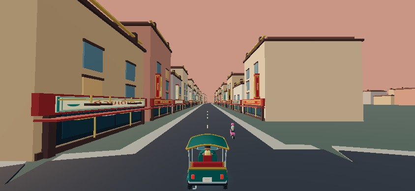 | 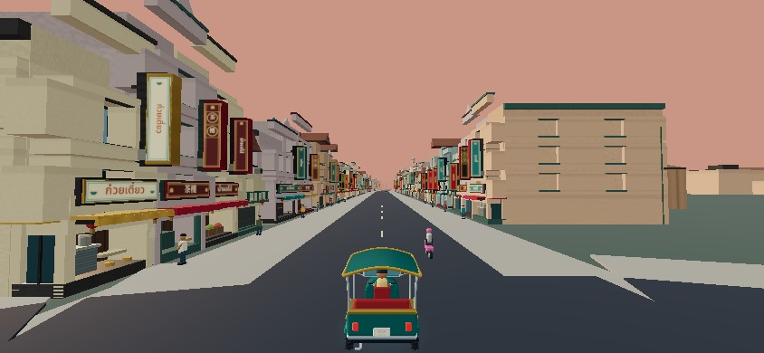 |
| Talat Noi | 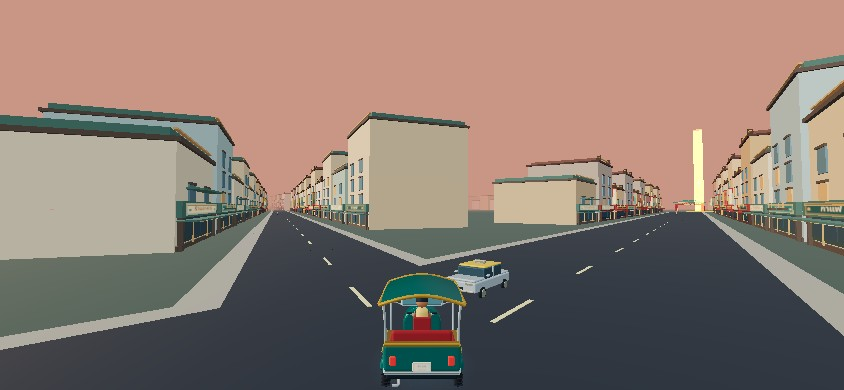 | 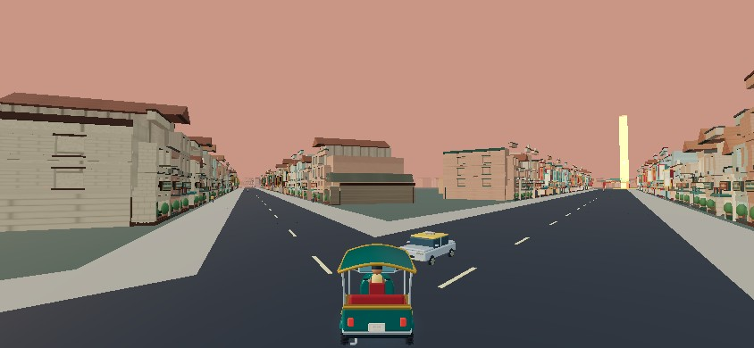 |
| Old Town | 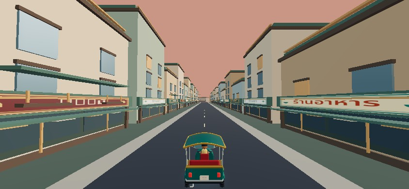 | 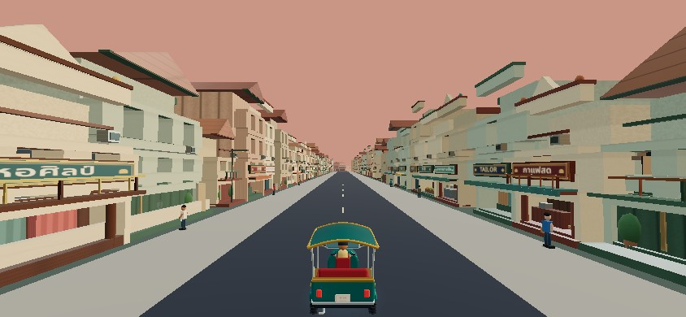 |
| Siam | 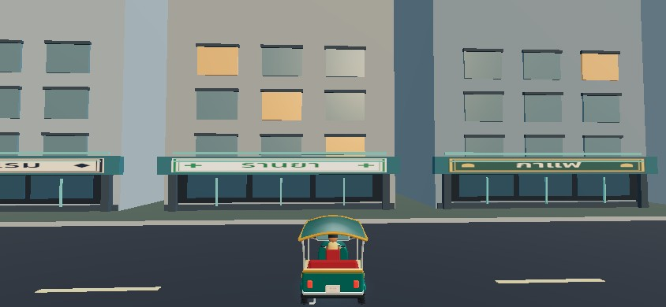 | 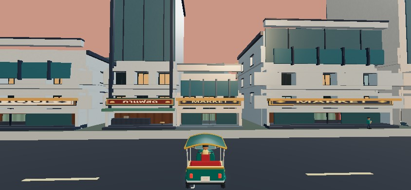 |
| ICONSIAM | 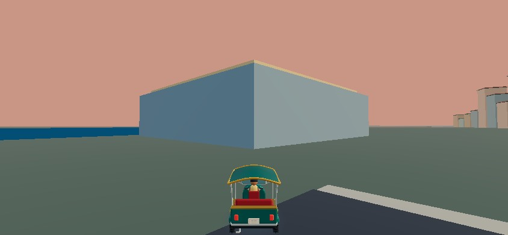 | 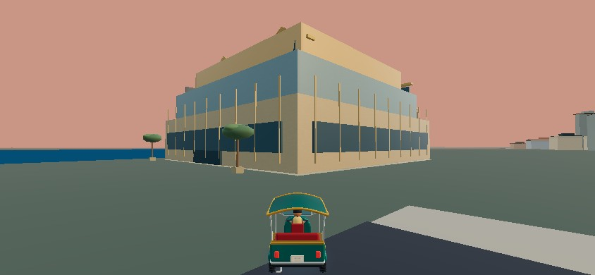 |
| Silom | 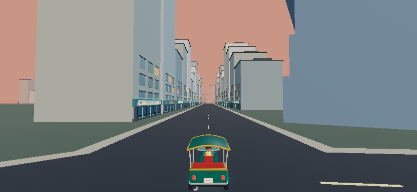 | 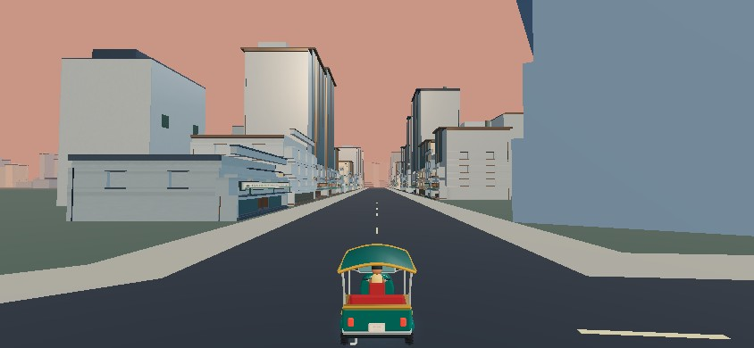 |
| Quiet west-bank street | 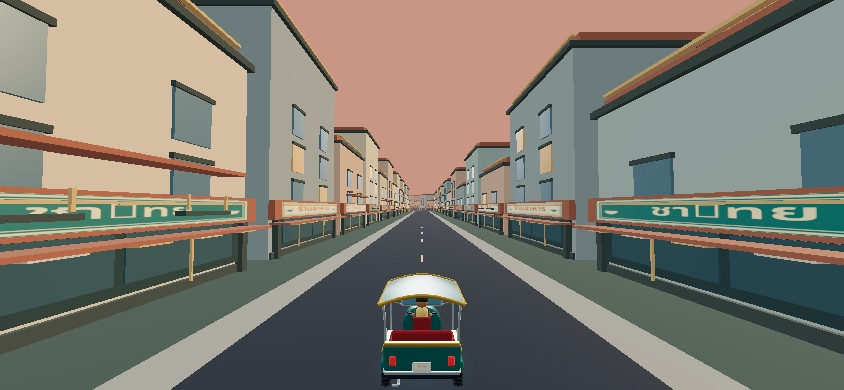 | 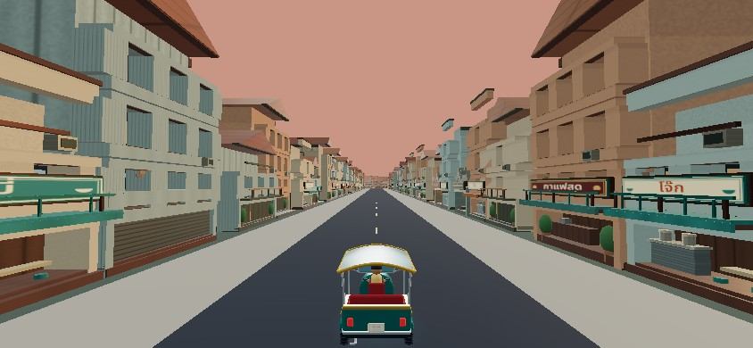 |

| Chinatown | Sunset | Night |
|---|---|---|
| Fast | 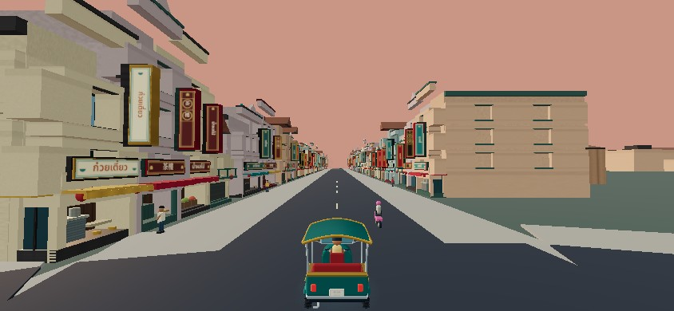 | 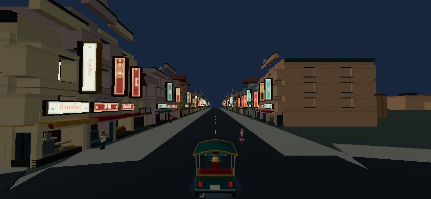 |
| Pretty |  | 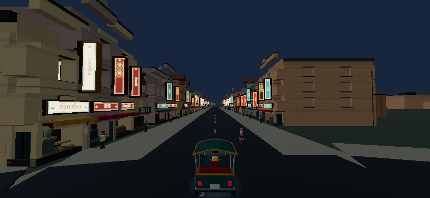 |

[Chinatown corner](after/chinatown-corner.jpg) · [Talat Noi corner](after/talatnoi-corner.jpg) · [Old Town corner](after/oldtown-corner.jpg) · [Siam corner](after/siam-corner.jpg) · [ICONSIAM corner](after/icon-corner.jpg)

## Performance

<!-- PERFORMANCE -->
| Survey median | PR #11 | New branch |
|---|---:|---:|
| Fast calls | 78.0 | 127.0 |
| Fast triangles | 41,110.0 | 165,626.0 |
| Fast frameMs | 99.1 | 183.6 |
| Pretty calls | 170.0 | 224.0 |
| Pretty triangles | 83,038.0 | 226,494.0 |
| Pretty frameMs | 96.8 | 216.9 |

First-render load: **6.96s → 6.36s** in these Vite runs (cache/environment sensitive).
CPU vertex/index/instance buffer bytes: **66.12 → 89.92** MiB.
Material-referenced texture pixels: **1,871,872.00 → 2,199,552.00**.
Chrome reported used JS heap: **414.85 → 414.85** MiB.

Three fresh Node processes per version give median construction times:
- PR #11: world 747ms; art mesh 7156ms; retained array buffers 82.4 MiB; post-build RSS 649.8 MiB.
- New branch: world 1138ms; art mesh 4215ms; retained array buffers 95.5 MiB; post-build RSS 569.8 MiB.

The construction path improves, while resident scene data and rendering work increase. Software frame times are substantially slower than 30 FPS and do not establish the hardware target. The draw/triangle increase is a real mobile risk, not something hidden by the passing tests.
<!-- /PERFORMANCE -->

Raw data: [baseline browser survey](before/measurements.json), [new browser survey](after/measurements.json), [baseline Node construction](before/construction.jsonl), [new Node construction](after/construction.jsonl).

Measurements are software Chromium/SwiftShader, not a physical iPhone. Browser frame deltas include automation and scene survey overhead. Texture pixels count material-referenced 2D images, not all renderer/environment storage. CPU geometry bytes include instance matrices/colors. Chrome heap indicators are approximate and GC-sensitive. Node measurements use fresh processes and forced GC after construction; they omit DOM text atlases and GPU upload. Post-build RSS is not peak allocation or VRAM.

The richer scene costs more submitted triangles and draw calls. Instancing avoids the much larger cost of baking every new rectangular fitting into copied vertex buffers, and construction is faster than the baseline despite the extra content. A real iPhone must still establish the 30 FPS target, Safari thermal behavior and memory pressure. This draft should remain unmerged until that check is satisfactory.

## Verification and gameplay preservation

- Existing compact-city graph, discovery, map markup, traffic direction and river/bridge regressions retained: 1,171 nodes, 1,190 road segments, 10,710 road samples and 146 bridge visibility checks.
- All ten fare missions driven with the live controller: 18,321m, zero collisions, no teleporting; traffic disabled for deterministic route certification.
- Original Chinatown gameplay, driven fare, signature plots, roadside furniture, street life, sign layers and asset checks retained.
- New checks cover order-independent identities, regional grammar selection, frontage subdivision, contiguous corridor diversity, all five hero sequences, recess geometry, sign mapping, font glyph coverage, pedestrian clearance, spatial-index equivalence, Fast/Pretty visibility, night resets, one-time disposal and fresh scene reconstruction.
- Browser QA covers actual keyboard-driven corridor clips, touch release, map pause/pan/pinch, portrait map access, additional landscape viewports, four restarts, WebGL loss/restoration and original district rendering. All browser checks pass; the detailed result is in `browser/qa.json`.

[Player-controlled corridor recording](browser/player-controlled-drives.mp4). The delivered H.264 MP4 is a 10 FPS transcode of the actual browser recording, with playback duration preserved. Clip starts are explicitly repositioned to roads between districts; each recorded drive uses the normal chase camera, actual throttle/brake browser events, and no transform edits during the clip. It is a control/render regression recording, not a continuous no-teleport tour or physical-device capture.

## Visual review and remaining work

The new frontages differ through width, height, roof, opening rhythm and balcony volume, as well as signs and color. Normal-height corner views expose masonry depth. Shop details and signage can be seen during ordinary chase-camera driving. Night now separates illuminated businesses from darker masonry, and Fast retains the structural identity.

| Visual acceptance question | Review of the rendered views |
|---|---|
| Silhouette/volume without signage? | Gables, warehouse sawteeth, balcony volumes and stepped towers differ; the common masonry module is still visible. |
| Neighboring storefront differences? | Unequal bay widths, functions and window rhythm are clear; some cabinet/awning frames repeat. |
| Real facade depth? | Ground-floor rooms, side portals, masonry reveals and projecting balconies provide depth at driving height. |
| Neighborhood identity? | Old Town, modern retail and Chinatown contrast strongly. Talat Noi is more workshop/heritage focused, but could become more individually authored. |
| Complete from the chase camera? | Roadside continuity/background massing improve. Some intersections and the mall approach remain sparse. |
| Legible and believable signs? | Actual Thai/Chinese/Latin glyph coverage now passes; trade labels avoid arbitrary real-brand claims. Final native-size diacritic inspection remains a device task. |
| Details without zoom? | Counters, stools, plants, signs and workshop displays read near the road. The smallest pots/rails are secondary details. |
| Wall/roof/window/balcony variation? | Present through structure and materials, although this remains a modular city rather than individually sculpted artwork everywhere. |
| Intentional empty space? | Parks and river corridors remain open. Some non-park gaps still look underdressed and are acknowledged below. |
| Night different from sunset? | Dark masonry separates bright commercial signs and interior/window lighting. No expensive global glow or real-time light grid is used. |
| Road visibility? | Road lanes remain open and all fare routes pass; projecting signs/canopies and elevated rail are above vehicle height. |
| Performance acceptable? | Rendering work increases and software frame times worsen. Actual iPhone 30 FPS acceptance remains open. |

The city still needs further art work. Some major landmarks remain simplified older art or blockouts. ICONSIAM and Siam are original arcade interpretations, not exact surveyed elevations. Plazas and exposed gaps are still sparse in some views; background infill reduces the floating-neighborhood effect but does not hand-author every block interior. Side elevations improve, while many rear elevations remain restrained. Some repeated shop equipment and sign-frame styles are still apparent. The river craft are static, and complete pier/promenade scenes are not finished. No enterable shop interiors, dynamic facade shadows, full-scene bloom or exact branded storefront reproduction is claimed.

Before merging: run sustained Fast and Pretty drives on the target iPhone, check median and worst frame pacing after thermal warm-up, visit all ten fares and bridges, inspect Thai marks at native display size, test portrait map transitions, background/resume, WebGL recovery and repeated restarts. Confirm memory stability and tune near/far ranges if necessary. The uploaded browser evidence cannot replace this device check.

## References and rights

Research was used for neighborhood composition, not as downloadable game textures/models:

- [Tourism Authority of Thailand: Chinatown](https://www.tourismthailand.org/Articles/the-adventure-through-bangkok-s-chinatown): commercial density and evening street-food activity.
- [Tourism Authority of Thailand: Talat Noi](https://www.tourismthailand.org/Articles/1-day-in-talat-noi): workshop heritage, converted cafes/galleries, courtyards and greenery.
- [Tourism Authority of Thailand: Bangkok](https://www.tourismthailand.org/Destinations/Provinces/Bangkok/219): landmark/district context.
- [Tourism Authority of Thailand: shopping malls](https://www.tourismthailand.org/Articles/cater-to-your-shopping-needs-with-5-best-bangkok-shopping-malls): Siam/BTS and ICONSIAM/River Park setting.
- [ICONSIAM official site](https://www.iconsiam.com/): river-facing terraces, shopping complex and River Park photographs.
- [Song Wat photo walk](https://www.pratuneung.com/%E0%B8%96%E0%B8%99%E0%B8%99%E0%B8%97%E0%B8%A3%E0%B8%87%E0%B8%A7%E0%B8%B2%E0%B8%94): historic shutters, arches, ornament and continuous rows; composition reference only.
- [Talat Noi / Charoen Krung photo guide](https://travel.trueid.net/detail/bp5BWdl6QWW4): layered shutters, AC units and utility infrastructure; composition reference only.

All new geometry, material patterns, fixtures and fictional trade sign layouts are original code-generated artwork. Generic properties are not presented as real businesses. Noto Sans Thai and Noto Serif SC subsets retain their bundled SIL OFL licenses; source URLs, source SHA-256 values and subset sizes are recorded in `public/assets/fonts/provenance.json`. Thai is shaped as a full phrase, Chinese trade words use supported real characters, and English blade labels preserve the entire phrase instead of truncating it to four letters.
