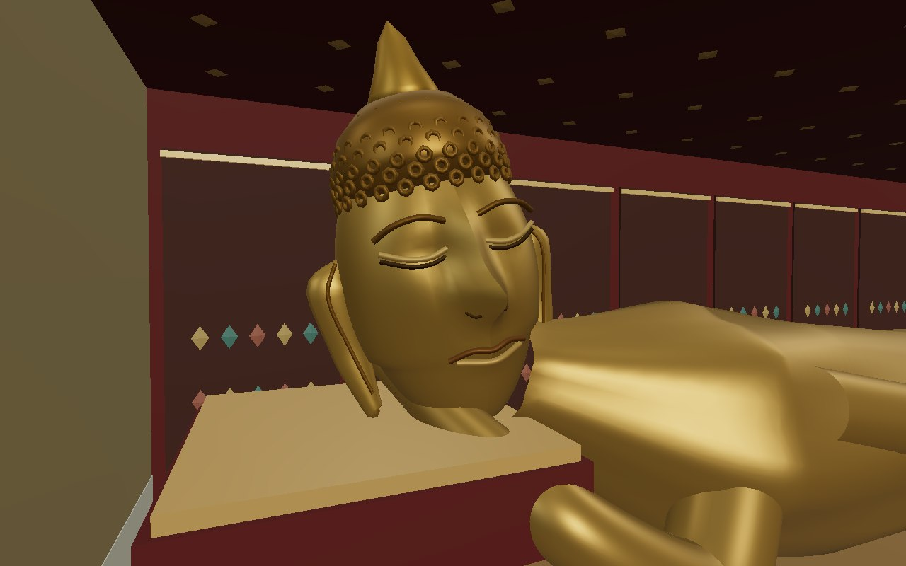
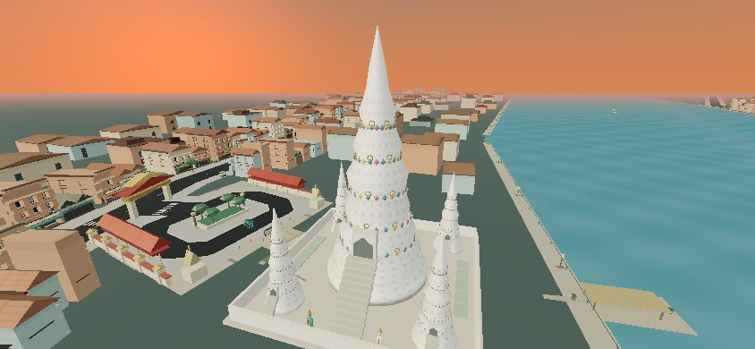
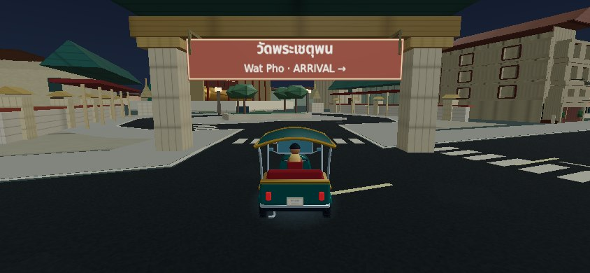

# Bangkok landmark, look-mode and wayfinding review

Base: current `main` at `1d85bee` (PR #16, including merged #15). One draft PR; no deployment or merge. All new sculpture, architecture, ornamental patterns and sign artwork are original repository code. No reference photograph, downloaded model or operator logo is distributed.

## What changed

- A reusable look camera replaces the two per-frame fixed-camera exceptions. One finger orbits, two fingers zoom/pan, double tap/Home/Reset restores the composition, and Escape/Return restores driving. Exterior views blend over 450 ms. Interior views use a short fade into a valid viewing aisle, avoiding camera travel through the hall roof. Interior viewpoints stay in authored viewing aisles; exterior cameras use facade/roof envelopes, a bounded sightline search and pitch/radius limits. Tall models use a full-height default composition; retail views start from the connected visitor approach. Input ownership and focus cancellation isolate driving controls. Shift, fare, boost and rail clocks remain frozen during inspection. Returning in portrait keeps the game paused behind the rotation prompt.
- Wat Pho and Wat Paknam use anatomical section meshes, sculpted facial surfaces, elongated ear geometry, eyelids/lips, separate fingers, hair detail and controlled gilding. Wat Pho has original pearl-style sole inlay, decorated columns, ceiling and mural-inspired panels. The camera offers head, body, feet and chedi views. The decorative sole grid interprets auspicious lotus/chakra motifs; it does **not** reproduce all historic emblems.
- Thai roof authoring adds curved eaves, gable inlay, finials and roof ribs. Wat Pho's four colored chedis, Wat Arun's five prangs, Palace roof hierarchy, Wat Traimit's stepped hall, Saket's hill/stairs, civic monuments, Odeon Gate and Hua Lamphong each receive distinct compositions. Commercial sites retain their driveways and gain glazing/framing; skyline silhouettes and distant LODs are preserved.
- Visitor boards hang forward of the gate beam at a measured clearance above 4.4 m. Seven selected municipal street signs use blue faces with Thai over English. Explicit front-facing faces eliminate mirrored back-side lettering. New Chinese specialist-business phrases diversify the existing Yaowarat cabinets. The shipped font subset is checked against every new Thai/Chinese string.
- Existing central BTS/Gold Line geography and simulation are preserved. Station canopy structure, lighting strips, train fronts, door steps and bellows are refined. A modest chase-camera horizon adjustment applies only near actual rail corridors. The map lists and centers on nearby stations, explaining where to encounter the network.

## Player-visible evidence

All images are actual game-runtime renders. No isolated model-viewer renders or new videos are included. Baseline cameras are matched for the close-up and arrival comparisons; the newer reusable inspection mode can also move away from those compositions.

| Subject | Current main | This PR |
| --- | --- | --- |
| Reclining Buddha face | [Before](before/pho-head.jpg) | [After](after/pho-head.jpg) |
| Reclining Buddha body/hand | [Before](before/pho-body.jpg) | [After](after/pho-body.jpg) |
| Pearl-style soles | [Before](before/pho-feet.jpg) | [After](after/pho-feet.jpg) |
| Wat Arun | [Before](before/arun.jpg) | [After](after/arun.jpg) |
| Wat Paknam | [Before](before/paknam.jpg) | [After](after/paknam.jpg) |
| Grand Palace | [Before](before/palace.jpg) | [After](after/palace.jpg) |
| Wat Pho entrance board | [Before](before/arrival-pho.jpg) | [After](wayfinding/pho.jpg) |
| Asok from a public road | [Before](before/bts-asok.jpg) | [After](after/bts-asok.jpg) |

[Touch landscape UI](interaction/look-844x390.jpg), [portrait UI](interaction/look-375x812.jpg), [blue Yaowarat sign](wayfinding/street-yaowarat.jpg), [blue Khao San sign](wayfinding/street-khaosan.jpg), [Chong Nonsi beneath the guideway](after/bts-chong-nonsi.jpg), [Gold Line / ICONSIAM](after/bts-charoen-nakhon.jpg), and [all named-site photographs](after/) provide the wider review. Moving-train proof consists of [two runtime stills and route states](transit/transit-detail.json), captured three actual engine seconds apart: [before](transit/bts-moving-before.jpg) / [after](transit/bts-moving-after.jpg).

See [validation and remaining review gates](qa.md) and the [performance comparison](performance/README.md).

## Art inventory

One output material is shared across spatial cells for each source material identity. Texture, emissive, transparency, shader hooks and color data remain intact; shared resources are released once.

The machine-readable [inventory](inventory.json) records all 27 named sites, both resident LODs, geometry costs, camera bounds and disposal tests.

| Fidelity | Sites and treatment |
| --- | --- |
| Close-view hero | Wat Pho (sculpture/hall/royal chedis), Wat Paknam (seated sculpture/pagoda), Wat Arun (porcelain prangs/guardians), Grand Palace (varied royal/temple roof composition) |
| Site-specific | Wat Traimit, Golden Mount, Giant Swing, Democracy Monument, Victory Monument, Odeon Gate, Hua Lamphong, ICONSIAM, Siam Paragon, MBK, CentralWorld, Terminal 21, Asiatique, flower/food/Chatuchak markets |
| Preserved neighborhood setting | Khao San's guesthouse/courtyard composition; its sign vocabulary is expanded |
| Skyline | Mahanakhon's cutout ribbon, Baiyoke's tiers/crown, State Tower's dome; podium/glazing refinements retain coarse silhouette LODs |
| Intentional open space | Sanam Luang, Lumphini, Benjakitti: existing park landscaping retained; no building fills |

These are stylized, compressed architectural interpretations. Ornamental geometry is selective, secondary facades remain simplified, and the Buddha meshes still merit specialist character-art critique. Increased polygon count alone is not a claim of museum-replica fidelity.

## Research and provenance

Primary references informed silhouette, composition and appropriate access; none is used as a texture:

- [Wat Pho Reclining Buddha](https://www.watpho.org/en/buddha/detail/204): requested official reference; direct retrieval timed out during this session. Cross-checked hall, pearl inlay and posture using TAT's official temple article and photographic reference inspection.
- [Wat Pho royal chedis](https://www.watpho.org/th/architecture/detail/262): official indexed account describes green, white, yellow and dark blue chedis, glazed ceramic treatment and stone guardians.
- [Tourism Authority of Thailand: Bangkok temples](https://www.tourismthailand.org/Articles/top-5-must-visit-temples-in-bangkok-once-in-a-lifetime): Wat Arun ceramic decoration, Wat Pho hall/inlay/chedis, Wat Saket stair hill and Wat Traimit's elevated hall.
- [Grand Palace official history](https://www.royalgrandpalace.th/en/discover/history) and [official site/virtual-tour inventory](https://www.royalgrandpalace.th/en/home): distinct Chakri, Phra Mondop and Sri Rattana forms. Existing restricted perimeter arrival remains an arcade adaptation, not unrestricted royal-compound vehicle access.
- [ICONSIAM facade contractor](https://seele.com/project/glass-front-iconsiam-bangkok) and [glass manufacturer](https://www.sedak.com/en/architecture/facade-glass/iconsiam-bangkok-thailand): pleated glass/fins and folded river facade informed the retained/refined commercial composition.
- [TAT Democracy Monument](https://www.tourismthailand.org/Attraction/democracy-monument), [Victory Monument](https://www.tourismthailand.org/Attraction/victory-monument): four-wing/central constitution composition and obelisk/pedestal hierarchy.
- [Official BTS structure](https://www.bts.co.th/eng/library/system-structuer.html), [system design](https://www.bts.co.th/eng/library/system-design.html): elevated structure and Siam directional levels. PR #15's geographically compressed central routes remain unchanged; this PR does not model the whole metropolitan network.
- Street names come from the existing road-corridor data. Composite Rama I and Sukhumvit corridors use appropriate central/eastern sections. English names follow the familiar spellings in the game's Bangkok layout; Khao San uses “Thanon Khao San”.

Existing Noto Thai/Chinese font subsets and their OFL notices remain in `public/assets/fonts`. No paid assets, proprietary meshes, external logos or watermarked imagery were added. Interior mural panels and ceramic motifs are original decorative interpretations rather than reproductions of particular sacred narrative paintings.

## Reproduce in Replit / iPhone review

1. Check out the PR branch and allow the existing post-merge dependency initialization to finish. Run `pnpm install --frozen-lockfile` if dependencies are absent. Use the normal Replit Run workflow. No database migration, deployment or road regeneration is needed; the road graph and committed polygon bake are unchanged.
2. Select Bangkok free roam. Use the map's **BTS / Gold Line** layer and **Find the Skytrain** station buttons to locate modern-city corridors. Drive near Siam, Asok, Chong Nonsi, Saphan Taksin and ICONSIAM; Old Town intentionally has no fictional BTS.
3. Enter Wat Pho's visitor forecourt, stop, and tap **LOOK**. Drag, pinch, pan, reset, switch head/body/feet/chedi views, then return. Repeat at Arun, Paknam, Traimit, Palace and ICONSIAM. The closed religious precincts remain vehicle obstacles.
4. Check the approach signs before entering; try landscape and portrait inspection. Pause/resume, background Safari, restart, open/close the map, use gas + steering + boost, and brake during boost.
5. Night arrives about four minutes into the unchanged 24-minute shift. Look at warm temple surfaces, station lights and passing trains in both sunset and night.

Physical iPhone hardware is unavailable in this environment. Browser viewport/touch emulation and software-WebGL timings are documented separately and must not be described as native Safari certification.
