# Bangkok living cityscapes

Base: merged PR #12, `d8597be90685073a80581b7abc3dbbaf739adbe8`. This is an original arcade interpretation of Bangkok, not a surveyed replica. The PR remains a draft; physical iPhone acceptance is unverified.

## Initial architectural and visual audit

| Finding | Implementation decision |
|---|---|
| PR #12's fourteen building typologies, recessed frontage, shared atlases and trade signage already provide useful variety. | Preserve the building grammar. Author destinations and their surroundings rather than add another general facade system. |
| Broad asphalt, low sidewalk slabs, empty corners and sparse approaches dominate the driving view. | Retain road widths/IDs/centerlines; raise and articulate edges, drainage, paving, crossings and safe roadside concentrations. |
| Ordinary parcels obstruct four civic arrivals. | Remove six frontage parcels and their colliders together, retaining the landmark plots and access nodes. Plant and pave those approaches. |
| Priority tourist models still use blockouts. | Replace five flagships with original curved roof, lathed prang/chedi and faceted retail artwork. Keep secondary foundations. |
| River craft, banks and park tree grids have weak silhouettes. | Use shaped boats on bounded validated loops, quays, piers, bridge profiles, irregular groves, paths and ponds. |
| Flat sky and uniform darkness hide architecture. | Add a gradient atmosphere, readable night fill, bounded light spill and signal lenses following the existing traffic phase. |
| PR #12 already costs 127/224 calls, 165,626/226,494 triangles and roughly 89.9 MiB scene buffers in its published software-browser survey. | Reuse spatial batches/atlases; shorten near-detail ranges, use 20-triangle foliage lobes and an ordered collision broad phase. Measure equivalent scenes again. |

The audit covered `world`, `mesh`, `architecture`, `buildingGrammar`, `architecturalBatch`, `landmarkArchitecture`, `urbanLayers`, `clearanceIndex`, `signage`, `Renderer`, `streetLife`, `streetscape`, `landmarkArt`, `staticBatch`, layout/traffic/road helpers and PR #12's architectural-character captures/QA. Asphalt, enclosure and activity placement address scale impressions without altering the playable graph. Landmark silhouettes and public arrivals need authored art. Existing fonts, material tiles, facade/core batching, pedestrian parts and disposal ownership are reused.

## Implemented systems and destinations

- Deterministic regional environment sites; solid cart, scooter, planter, pole, bench and workshop footprints are registered before physics and pedestrians.
- Raised curbs, gutters, drains, covers, paving seams, graph-derived crossings/stop lines and arrows aligned with the existing lane convention. One original 128×128 asphalt pattern uses world-space UVs.
- Four structurally different food setups, vendors/customers from the existing street-life renderer, irregular tropical planting and screened sagged cable spans above vehicle height.
- Shared bridge rail footprints for rendering and collision, screened against all neighboring road corridors and cut back at actual junctions.
- Seven closed boat loops with continuous position/heading; longtail, ferry and working hulls; cheap ripples/wakes/reflection approximations and safe banks/piers. No planar reflections or point-light grid.
- Original sky and local light footprints. Fast retains defining assets; Pretty adds nearby surface/fitting details and more displayed people.

| Flagship | Authored result | Remaining limit |
|---|---|---|
| Yaowarat / Gate | Food scenes, scooters, vendors, overhead infrastructure, warm activity; red pillars, curved green ceremonial roofs and gold trim on the protected island. | Long modular rows remain regular at distance. |
| Talat Noi / Song Wat | Workshop parts, quiet tea/cafe scenes, plants and inherited heritage/warehouse frontage. | Murals and individual courtyard stories remain sparse. |
| Wat Pho / Old Town | White compound, gates, columned halls, tiered red roofs and four green/white/yellow/blue chedis. No outdoor Reclining Buddha. | Compressed compound; no temple interiors. |
| Siam / Ratchaprasong | Paragon glazing, jewel entrance/canopy, layered retail, planting and the established aligned elevated corridor. | Secondary malls and the broader retail precinct remain simplified. |
| ICONSIAM / Chao Phraya | Pleated glass, folded gold crown, articulated entrance/river elevation, planted approach, promenade, piers and moving craft. | Compact approximation; no fountain show. |

**Chinatown Scala:** one authored override of a real Yaowarat parcel near the opening drive. Stacked green tile eaves, pink-red columns, broad glazing, gold geometric friezes, a cream central billboard and projecting illuminated red SCALA sign follow the user's reference. Geometry and lettering are original; the photograph and its watermark are not shipped. The collider retains its footprint and matches the taller building.

Additional original improvements: pixel-cut Mahanakhon, hill-mounted Golden Mount and Giant Swing. Other secondary landmarks retain earlier simplified artwork.

## Evidence and validation

The survey uses the same road coordinates, heading, camera (height 4.5 m, 10 m behind the player), 844 × 390 viewport, quality and shift time on both branches. Pose manifests: [PR #12 baseline](before/measurements.json) and [new branch](after/measurements.json). These are paused art inspections, not recorded driving. Supplemental Scala facade views use the same higher target on both branches so the upper eaves and projecting sign fit.

| Location | PR #12, Pretty sunset | New branch, Pretty sunset |
|---|---|---|
| Chinatown | 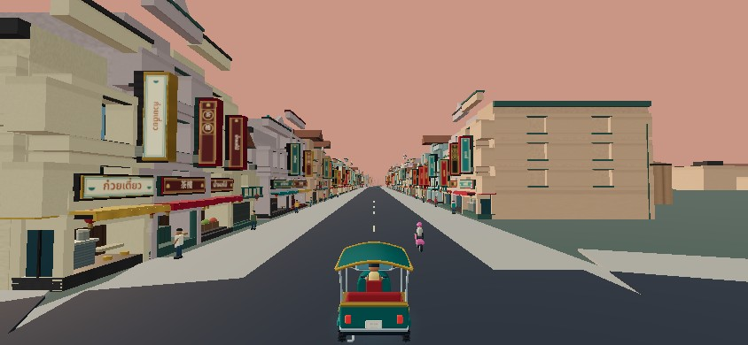 | 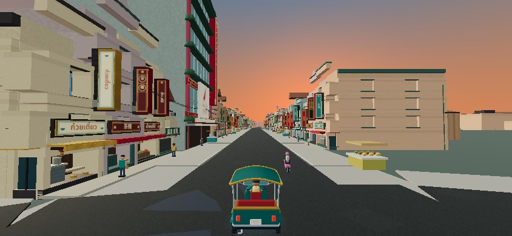 |
| Chinatown Gate | 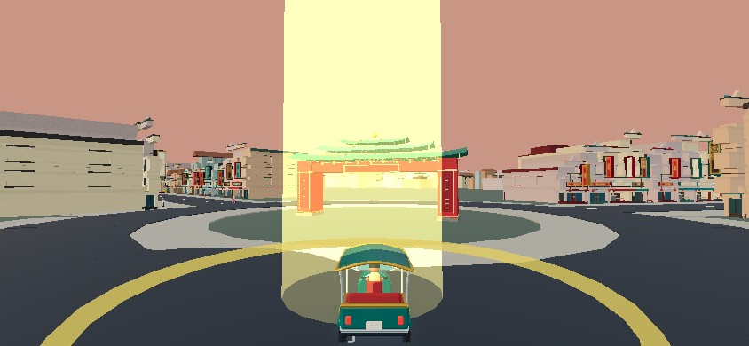 | 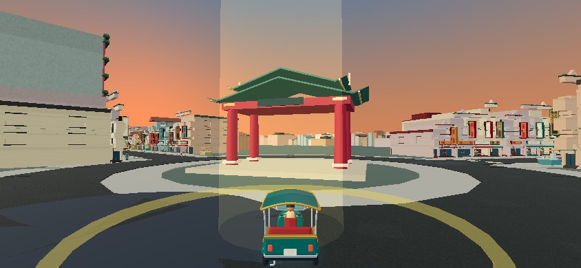 |
| Scala (normal camera) | 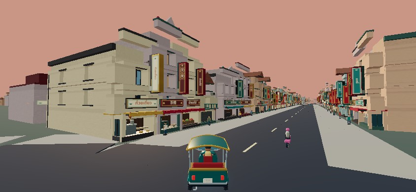 | 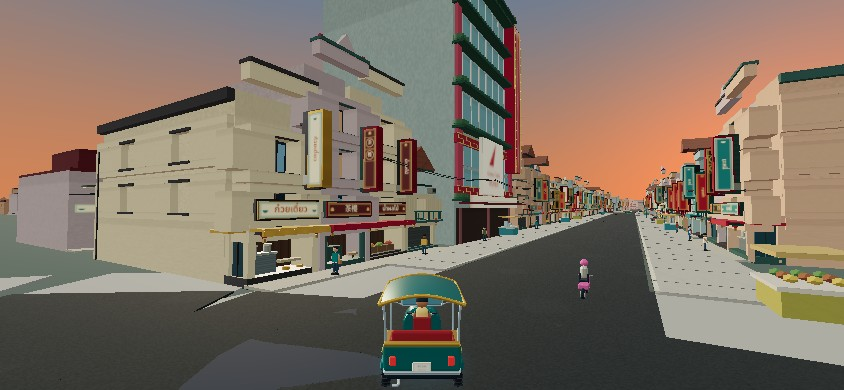 |
| Talat Noi | 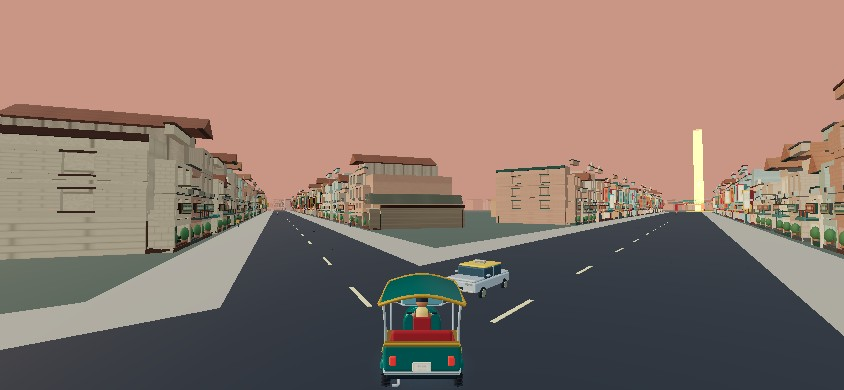 | 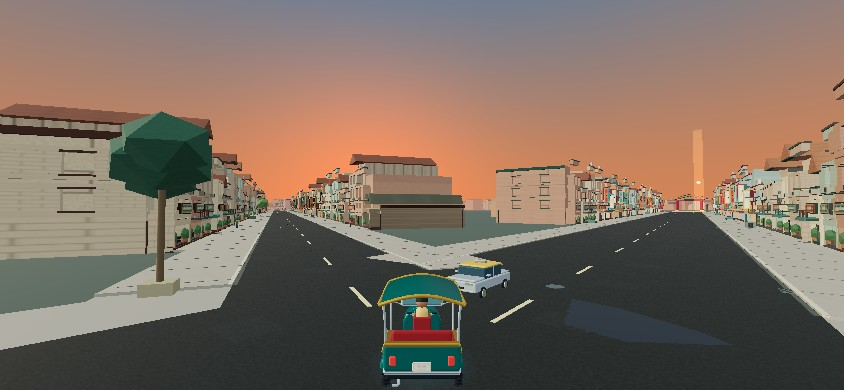 |
| Wat Pho / Old Town | 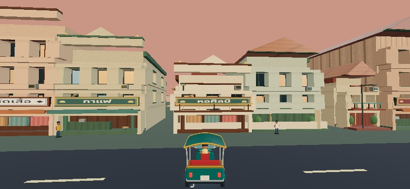 | 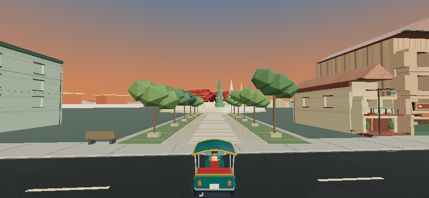 |
| Wat Arun approach | 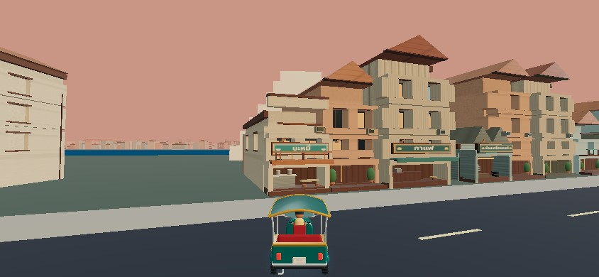 | 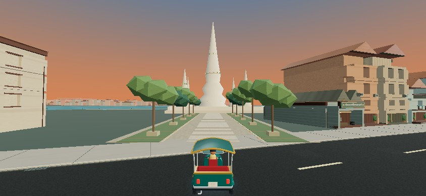 |
| Wat Arun from river road | 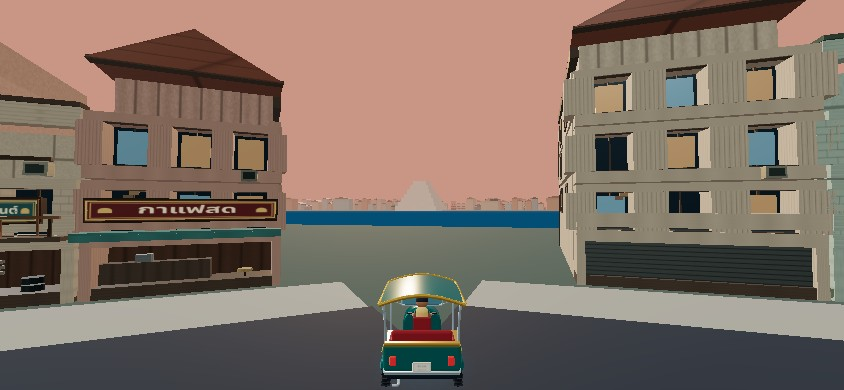 | 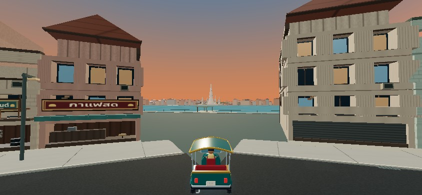 |
| Siam | 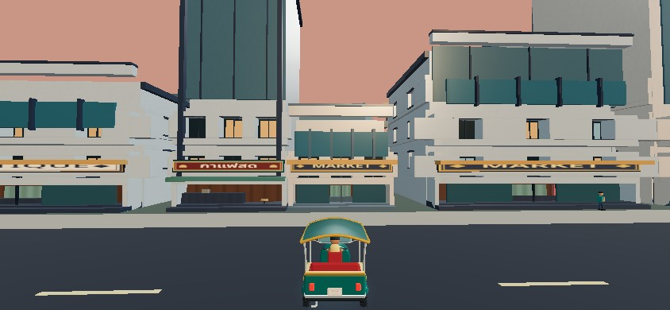 | 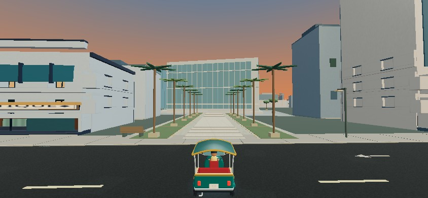 |
| ICONSIAM | 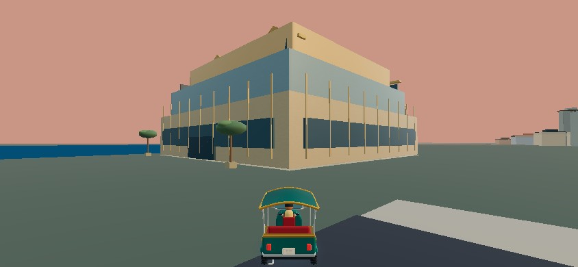 | 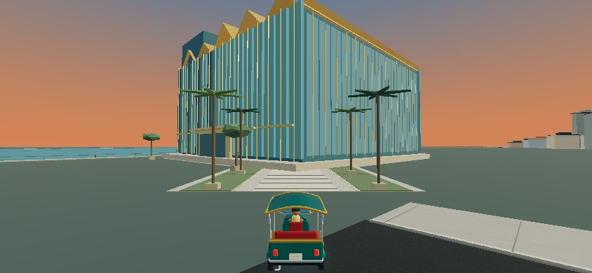 |
| Bridge approach | 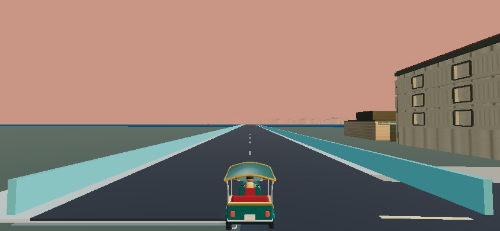 | 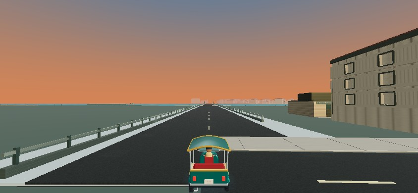 |
| Bridge over water | 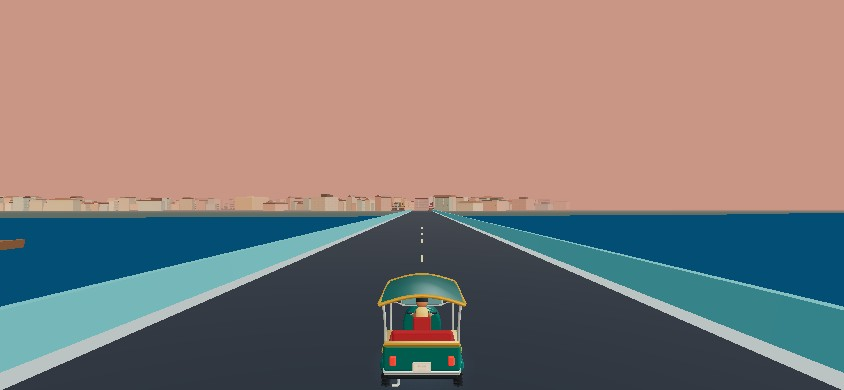 | 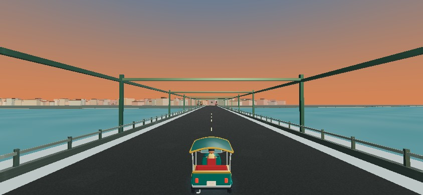 |
| Quiet residential street | 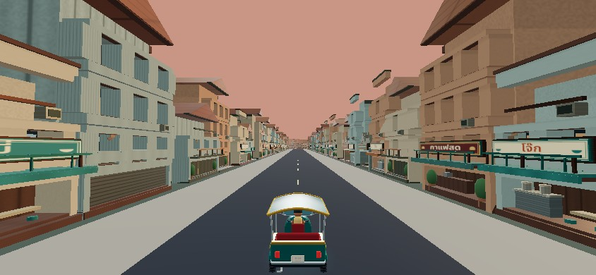 | 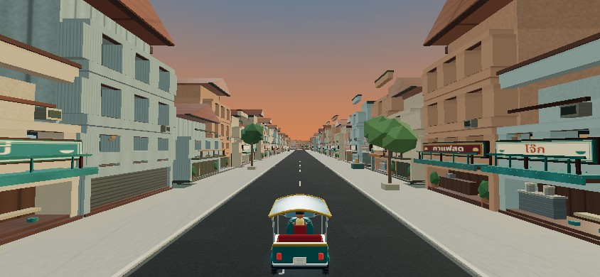 |
| Major intersection |  |  |

Scala reference response: [sunset facade](after/scala-facade-sunset.jpg), [night facade](after/scala-facade-night.jpg), [matched baseline facade](before/scala-facade-sunset.jpg). All geometry and sign artwork are original.

| Same Chinatown pose | Sunset (0 s) | Twilight (360 s) | Night (600 s) |
|---|---|---|---|
| Fast | 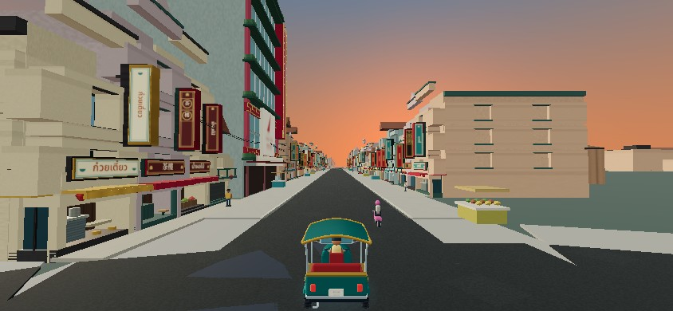 | 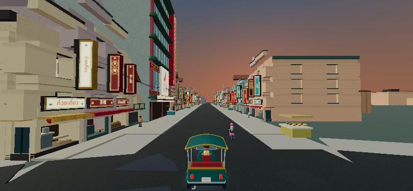 | 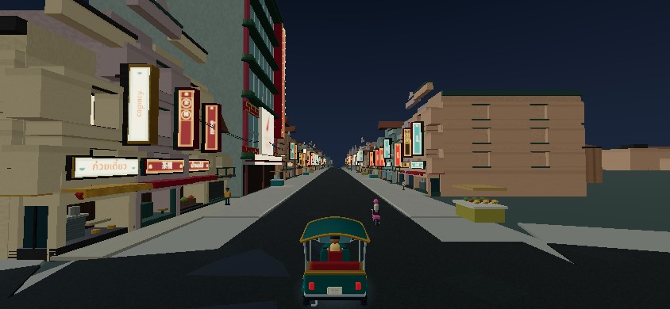 |
| Pretty |  | 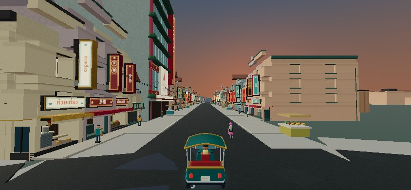 | 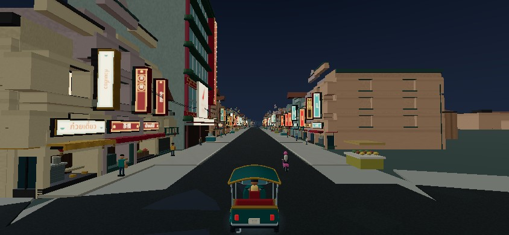 |

Every surveyed location has the same six sunset/twilight/night × Fast/Pretty files. [Before folder](before) · [After folder](after). The 24-minute shift length is unchanged.

The [six-corridor CI recording run](https://github.com/sunsetseast/TukTukRushBangkok/actions/runs/38515297664) passed on runtime source `6db4998`. Clips use actual browser keyboard throttle/brake and pointer events through the existing steering widget, with traffic enabled and the normal chase camera. Each setup position/route is documented in its manifest; no player or camera transform is edited during driving. The first-player run starts at the actual new-game spawn.

| Controller clip | Simulation seconds | Metres | Contact frames | Complete video + trace archive |
|---|---:|---:|---:|---|
| first-player | 30.01 | 247.4 | 0 | [Download MP4s and JSON](https://github.com/sunsetseast/TukTukRushBangkok/actions/runs/38515297664/artifacts/11871623353) |
| yaowarat-gate | 25.00 | 303.7 | 0 | [Download MP4s and JSON](https://github.com/sunsetseast/TukTukRushBangkok/actions/runs/38515297664/artifacts/11872600089) |
| talatnoi-songwat | 25.01 | 313.7 | 0 | [Download MP4s and JSON](https://github.com/sunsetseast/TukTukRushBangkok/actions/runs/38515297664/artifacts/11871904312) |
| watpho-oldtown | 25.01 | 285.5 | 0 | [Download MP4s and JSON](https://github.com/sunsetseast/TukTukRushBangkok/actions/runs/38515297664/artifacts/11871842979) |
| siam-ratchaprasong | 25.03 | 317.8 | 0 | [Download MP4s and JSON](https://github.com/sunsetseast/TukTukRushBangkok/actions/runs/38515297664/artifacts/11872203371) |
| iconsiam-riverfront | 25.01 | 308.6 | 0 | [Download MP4s and JSON](https://github.com/sunsetseast/TukTukRushBangkok/actions/runs/38515297664/artifacts/11872089146) |

Total: **155.08 simulation seconds, 1,776.6 m, zero contact frames**. [Combined trace](browser/drives.json). Archives contain an 844 × 390 H.264 clip retimed to simulation time, a 676 × 312 wall-time clip, final gameplay image and full input/position samples. Native clips render at 15 video FPS; that is an export setting, not game/device FPS. The measured wall durations range from 183.6 to 540.1 seconds under software rendering.

Repository copies: [first-player](browser/first-player.mp4), [Yaowarat](browser/yaowarat-gate.mp4), [Talat Noi](browser/talatnoi-songwat.mp4). Their `-wall.mp4` counterparts and JSON manifests are alongside them. The earlier [local ICONSIAM loop](browser/iconsiam-riverfront.mp4) is a separately measured 308.0 m run; the table above uses the uniform CI set. CI archives require GitHub access and expire **12 January 2027**. This retention limit is explicit; the gallery and committed recordings remain in the branch.

The existing ICONSIAM loop leaves the access point and tours Khlong San. A separate arrival was already completed before recording work stopped: 25.02 simulation seconds, 251.7 m, one turn and a full stop at the existing access road, zero contacts. [Actual stopped arrival image](browser/iconsiam-arrival-driven.jpg) · [controller trace](browser/iconsiam-arrival.json). No additional recording was started after the request to wrap up.

Selected driving frames were inspected for progression, traffic encounters, turns, roadside readability and the unchanged HUD/camera. These clips also expose remaining long modular rows. Wat Pho and Siam's closest hero facade views are in the matched access-pose survey; their drive clips spend more time on surrounding streets. They are not presented as exhaustive footage of each forecourt.

Verified CI: [full graphics/gameplay regressions](https://github.com/sunsetseast/TukTukRushBangkok/actions/runs/38515297551) and [existing WebGL art inspection](https://github.com/sunsetseast/TukTukRushBangkok/actions/runs/38515297588) passed. Earlier recording attempts stalled on terminal-banner readiness; the shared HTTP readiness helper fixed that, and run 4 above completed all six jobs. Final documentation/test-tooling delivery commits use `[skip ci]`; game runtime behavior is unchanged from the verified source. Full recording/survey workflows are available through manual dispatch; routine source regressions remain automatic.


[Browser UI/context results](browser/qa.json) cover 844 × 390, 932 × 430, 1280 × 800, 375 × 812 and 430 × 932; gas touch release; map pan/pinch; portrait map access and rotation hints; pause/resume; four restarts without uploaded geometry/texture growth; intentional WebGL context loss/restoration; and the original Chinatown mode. There were no console errors or failed HTTP responses. [Viewport and recovery captures](browser).

[Full source regression output](validation/checks.log) and [production build output](validation/build.log) retain the existing suites and add environment-specific checks. Ten fares were driven through the existing controller/physics in deterministic simulation: 18,321 m, 1,872 simulation seconds, zero collisions; traffic is disabled only for that deterministic certification. Browser clips retain traffic. The base map contract SHA-256 remains `5ed882d40914d62c46672f0e13a52419fc4194030e1a91b6fb03bc7f5a324497`: nodes, roads/widths, landmark plots/access, river, spawn, bounds and regions agree with current main.

Focused checks validate all 885 environment sites, 3,537 solid footprints, 332 pedestrian routes, 1,792 samples on seven continuous boat loops, river/bank/bridge clearance, actual signal phase, deterministic generation, authored landmark envelopes, shared bridge art/physics, 800 indexed/full-scan contact steps, text/font loading and exact resource disposal with a fresh rebuild. Geometry counts establish coverage only; the images and controller footage establish visual evidence.


## Performance

Equivalent measurement: five flagship poses at night, 844 × 390, pinned Fast/Pretty, 12 warm-up and 40 sampled frames each. Versions ran sequentially without screenshot/video encoding. Raw [baseline](before/isolated-profile.json), [branch](after/isolated-profile.json) and [summary](performance-summary.json) retain every sample. These shared-container SwiftShader intervals include software rendering and scheduling; they are not GPU timer measurements and cannot establish iPhone FPS.

| Pose / mode | Calls before → after | Triangles before → after | Median frame interval ms | p95 interval ms |
|---|---:|---:|---:|---:|
| chinatown / Fast | 200 → 235 | 328,976 → 307,390 | 323.2 → 317.7 | 625.9 → 697.1 |
| chinatown / Pretty | 300 → 340 | 453,006 → 429,166 | 392.9 → 401.8 | 680.3 → 621.7 |
| talatnoi / Fast | 165 → 196 | 279,836 → 253,252 | 348.7 → 264.1 | 609.6 → 694.9 |
| talatnoi / Pretty | 333 → 360 | 523,808 → 470,846 | 398.2 → 400.1 | 785.4 → 804.2 |
| oldtown / Fast | 133 → 140 | 191,620 → 174,678 | 196.0 → 153.2 | 764.8 → 796.9 |
| oldtown / Pretty | 245 → 267 | 371,044 → 338,176 | 308.8 → 236.0 | 608.1 → 480.0 |
| siam / Fast | 156 → 165 | 165,662 → 172,848 | 229.3 → 210.1 | 573.4 → 544.9 |
| siam / Pretty | 229 → 252 | 224,314 → 220,461 | 248.1 → 243.5 | 471.3 → 525.2 |
| icon / Fast | 78 → 85 | 70,358 → 79,526 | 66.2 → 92.2 | 278.0 → 258.0 |
| icon / Pretty | 120 → 147 | 94,154 → 111,512 | 75.7 → 93.1 | 113.2 → 151.1 |

| Whole-scene resource | PR #12 | New branch |
|---|---:|---:|
| CPU geometry + instance buffers, MiB | 90.07 | 104.60 |
| Unique scene geometries | 3,831.00 | 4,293.00 |
| Scene materials | 1,376.00 | 1,733.00 |
| Texture objects | 11.00 | 11.00 |
| Texture pixels | 2,199,552.00 | 2,478,080.00 |
| Approximate browser JS heap, MiB | 414.85 | 527.38 |
| Dev-server first scene readiness, seconds | 5.53 | 6.63 |

Across these five poses, Fast averages 12.2% more draw calls and 4.7% fewer triangles.
Across these five poses, Pretty averages 11.3% more draw calls and 5.8% fewer triangles.
CPU scene buffers rise from 90.07 to 104.60 MiB (+16.1%). The count includes unique attribute/index arrays and every instance matrix/color array, including hidden assets. Texture pixels, JS heap and driver allocations are separate. Texture objects stay at 11; RGBA base pixels rise from approximately 8.39 to 9.45 MiB before mipmaps. Driver VRAM/render-target memory was not measured. Construction retains temporary arrays; these are not equal to uploaded GPU buffers.

Optimization accompanies the additional artwork: 20-triangle foliage lobes, shared vertex-colored landmark batches (two materials per site), bounded people/boat/light presentation, shortened near-detail ranges, removed primitive river/park duplicates and an ordered physics broad phase. The contact test queries a median nine solids rather than scanning all 3,537, with the same 800 tested contact responses. Source inspection suggests the additional calls/materials primarily come from environmental cell layers, original landmark surfaces and Scala/sign lighting; the base facade/sign system remains a major cost. The measured mall riverfront cost rises despite the overall triangle reduction, so device testing is still required.

Four warm restarts preserve the same scene and uploaded geometry/texture counts in the paused UI test. Isolated-profile restarts also finish with stable 1,021 uploaded geometries and 11 textures, after all sampled locations have warmed. This detects repeat-session resource growth in these checks, not every possible mobile leak. Source disposal checks exercise release and rebuild separately.

Fresh Node 24 processes, three builds per version, with forced GC after construction, no DOM signs, WebGL upload or other local browser job. [Baseline raw builds](before/construction.jsonl) · [Branch raw builds](after/construction.jsonl). Medians:

| Construction measure | PR #12 | New branch |
|---|---:|---:|
| World build, ms | 702.24 | 722.38 |
| Scene build, ms | 1,710.41 | 2,264.31 |
| Node heap after GC, MiB | 39.04 | 44.38 |
| Node array buffers after GC, MiB | 97.02 | 108.69 |
| Process RSS, MiB | 556.19 | 616.20 |

Node array buffers include construction allocations as well as retained render data. Scene construction is slower and uses more memory; a mobile cold-start/load budget still needs physical-device measurement. Browser scene readiness uses the development server and is not production network load time.


PR #12's historical 127/224 calls, 165,626/226,494 triangles and 89.9 MiB used a different survey; they are retained for context, not used as the denominator above. No stable 30 FPS, thermal, Safari GPU or memory-pressure claim is made without physical iPhone testing.


## Acceptance and remaining work

The art inspection finds a substantial improvement over the inherited environment, with some visible limits still requiring judgment rather than an object-count score.

| Acceptance area | Implemented / inspected | Remaining limit |
|---|---|---|
| Street enclosure and corners | Raised edges, crossings, drainage, trade activity, plants and cables add structure while retaining road widths. Opening Chinatown has a taller Scala anchor. | Long avenues and some blank corner/rear walls remain regular or open. No claim that every road is fully dressed. |
| District identity | Commercial Yaowarat, workshop/tea Talat Noi, red-roof/chedi Old Town, glazed Siam and golden riverfront retail use distinct assets and surroundings. | Talat Noi's individual courtyards and the broader retail precinct are less authored than the hero assets. |
| Landmark recognition | Wat Arun's tall central/four subsidiary prangs, Wat Pho's halls/compound/colored chedis, ceremonial Gate and two contemporary retail assets have distinct silhouettes. Scala follows the supplied facade composition. | These are compact stylizations; retail approach width and context are compressed. Secondary landmarks remain uneven. |
| Public space, vegetation and river | Formal paved approaches with planted strips; shade groves/park paths and ponds; visible river walls/piers, shaped craft and bridge rails/trusses. | Large green areas beyond the authored approach envelopes and some block interiors still look spare. |
| Sunset / twilight / night | Gradient sky, readable cool fill, warm windows/signs, landmark trim and bounded ground spill make night visibly different. | Landmark-area spill is restrained; no expensive reflections, fountain show or dense real-time lamps. |
| Driving and readability | Original lanes, routes, pickup/drop-off, graph and controls preserved; meaningful controller runs and map/context tests accompany the art. | A guide-driven clip is not a substitute for human iPhone play, thermal testing or every route/traffic encounter. |
| Fast and Pretty | Both retain prangs/rooflines, mall masses, food silhouettes, primary signs and vegetation. Pretty adds nearby fitting/paving detail and more presented people. | Fine decorative detail is intentionally absent in Fast. |
| Engineering | Full local suite and production build pass; CI graphics/regression checks pass on the runtime source; exact disposal/rebuild, deterministic contacts and restarts checked. | Mobile VRAM, background OS eviction and sustained 30 FPS are device-unverified. |

**Fully implemented:** shared environment planning, road edges/markings, four food families, validated roadside solids, existing-system vendors, tropical planting/park compositions, five authored flagship assets, Scala, river/boat presentation, bridge barriers/art, sky/night effects, near/far culling and ordered physics broad phase. **Partially implemented art coverage:** public-space context beyond cleared approaches, secondary destinations, individual courtyard/mural stories and broader skyline composition. **Tested:** map/gameplay/traffic, ten fare simulations, clearance, deterministic generation, font/asset loading, modes, disposal/rebuild, browser controls/context recovery. **Visually inspected:** selected matched opening, temple, retail, river, bridge and sunset/night views, plus sampled controller footage frames and the actual stopped ICONSIAM arrival. **Device-unverified:** physical iPhone Safari frame pacing, load/VRAM, thermal behavior, memory pressure and OS background/resume. **Optional later additions:** seated/food-service gestures, murals, bus shelters and richer selective light/reflection effects after profiling.


1. Required: sustained physical iPhone Safari Fast/Pretty driving, thermal/frame pacing, memory pressure, background/resume, touch rotation and repeated sessions.
2. Important art work: finish large green/plaza areas beyond the cleared civic approaches, then improve secondary landmark sites and open block interiors.
3. Important composition work: break up long avenue repetition, blank rear/corner walls and distant roofline uniformity; expand direct-arrival QA for Wat Pho and Siam.
4. Optional: richer food-service gestures, seated people, murals, bus shelters and selective reflection/shadow refinement after device profiling.

## Reference and asset provenance

All new meshes, patterns, shader effects and lettering are authored in code. No commercial models, reference photographs, copied shop textures or paid assets are shipped. Existing Noto subsets and SIL OFL provenance remain intact.

- [UNESCO Wat Arun](https://whc.unesco.org/en/tentativelists/6821/): central/four subsidiary prangs and porcelain composition.
- [Wat Pho official four great chedis](https://www.watpho.com/en/architecture/detail/262): color, compound and architectural context.
- [ICONSIAM official River Park](https://www.iconsiam.com/en/attraction/river-park) and [facade project reference](https://www.irisfmg.com/projects/public-areas/iconsiam-mixed-use-complex/): river setting, pleated glass and folded-leaf inspiration.
- [Siam Paragon official](https://www.siamparagon.co.th/en) and [entrance photograph](https://commons.wikimedia.org/wiki/File:Siam_Paragon_entrance.jpg).
- [Tourism Authority: Talat Noi](https://www.tourismthailand.org/Attraction/talat-noi), [Chinatown](https://www.tourismthailand.org/Articles/the-adventure-through-bangkok-s-chinatown).
- [Odeon Circle reference context](https://en.wikipedia.org/wiki/Odeon_Circle), [Express Boat official](https://www.chaophrayaexpressboat.com/chaophrayaexpressboat).
- [JICA bridge inventory](https://openjicareport.jica.go.jp/pdf/11988862_01.pdf), [Memorial Bridge photographs](https://commons.wikimedia.org/wiki/Category:Memorial_Bridge,_Bangkok).
- User-provided Chinatown Scala reference, Alamy image DF1GKK: proportions and composition only. No claim to reproduce current operation or exact surveyed geography.

## Reproduce

In `artifacts/tuk-tuk-rush`, use the existing dependencies:

```sh
node --import tsx scripts/check-cityscapes.ts
node --import tsx scripts/check-environment-art.ts
CHROMIUM_PATH=/path/to/chromium CAPTURE_LABEL=after node scripts/capture-cityscapes.mjs
CHROMIUM_PATH=/path/to/chromium UI_ONLY=1 node scripts/browser-cityscapes-qa.mjs
CHROMIUM_PATH=/path/to/chromium DRIVE_NAME=yaowarat-gate node scripts/record-cityscapes-drive.mjs
```

The matched baseline uses an isolated worktree at the base commit and the same capture script. Survey poses are paused art inspections, distinct from controller recordings.
