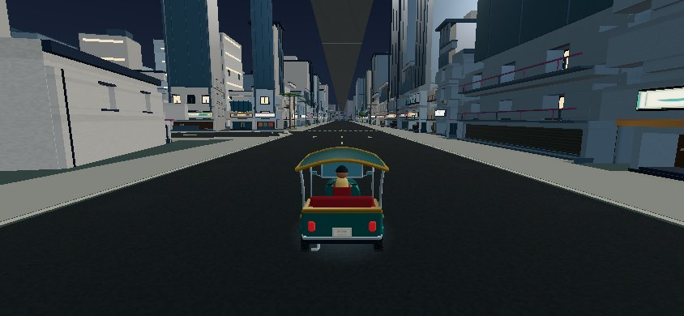
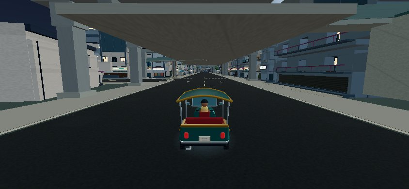
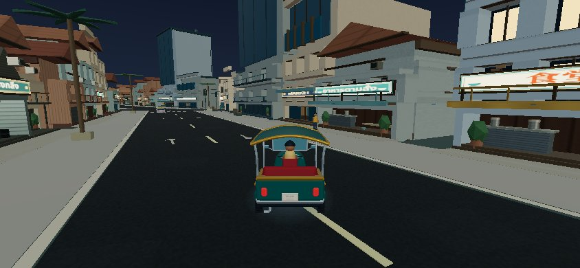
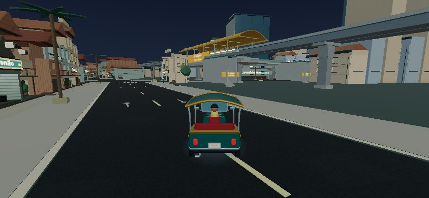
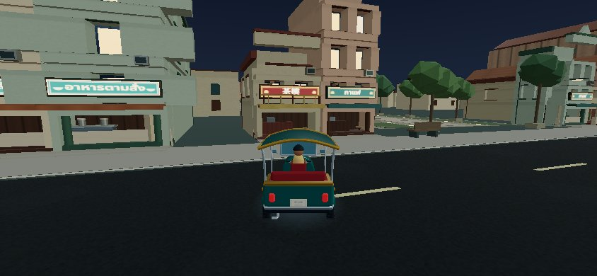
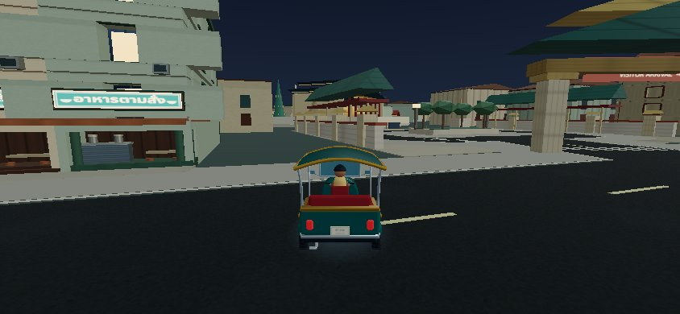

# Matched scene-cost comparison

Main `040bdde` and the PR branch were measured sequentially in Chromium 138 / SwiftShader at 844×390, night elapsed 240s, using the same six public-road poses, the normal game camera, explicit Fast/Pretty quality, 12 warm frames and 30 sampled frames per view. No video encoding. A single cold development-server load is reported for each version; load values are noisy, not production startup guarantees.

Geometry/index and instance typed arrays are counted once per resident scene resource. This is not browser RSS, GPU VRAM or total memory. The new station/arrival atlas adds 1024×2048 RGBA pixels (8 MiB before mipmaps); shared material/texture counts and raw pixel totals remain available in the JSON. Native iPhone Safari was not tested.

| Measure | Main | PR |
| --- | ---: | ---: |
| Resident scene buffers | 127.17 MiB | 125.52 MiB |
| Resident materials | 1257 | 1330 |
| Resident geometries | 4473 | 4583 |
| Texture objects | 11 | 12 |
| Initial scene readiness | 10.01s | 11.61s |

| View / quality | Calls main → PR | Triangles main → PR | Software frame interval main → PR |
| --- | ---: | ---: | ---: |
| siam / low | 145 → 158 | 160,489 → 170,590 | 30.6 → 293.8 ms |
| chong-nonsi / low | 131 → 144 | 182,622 → 181,309 | 305.2 → 320.9 ms |
| asok / low | 99 → 112 | 121,799 → 122,050 | 281.3 → 271.2 ms |
| taksin / low | 94 → 87 | 89,283 → 94,256 | 148.4 → 172.0 ms |
| icon / low | 148 → 145 | 195,086 → 167,555 | 221.3 → 208.0 ms |
| pho / low | 154 → 154 | 237,467 → 228,558 | 275.2 → 239.7 ms |
| siam / medium | 255 → 268 | 259,248 → 256,997 | 371.7 → 241.0 ms |
| chong-nonsi / medium | 144 → 156 | 207,982 → 197,733 | 370.7 → 323.8 ms |
| asok / medium | 139 → 142 | 158,833 → 154,860 | 315.4 → 296.8 ms |
| taksin / medium | 130 → 133 | 106,723 → 119,712 | 167.7 → 288.8 ms |
| icon / medium | 207 → 207 | 245,488 → 215,973 | 333.0 → 274.4 ms |
| pho / medium | 278 → 262 | 431,821 → 416,820 | 373.8 → 323.2 ms |

Across the six views, median draw calls were 138 → 144.5 in Fast (+4.7%) and 175.5 → 181.5 in Pretty (+3.4%). Median triangles were 171,556 → 169,072 in Fast and 226,735 → 206,853 in Pretty. The additional atlas means lower scene-buffer bytes must not be described as lower total GPU memory.

Software timing is noisy: the first Siam/Fast baseline is a conspicuous 30.6ms outlier, while Taksin/Pretty increased from 167.7 to 288.8ms. Those results remain visible in the table rather than being hidden by an aggregate. A physical-device pass is needed to determine actual runtime impact.

Frame intervals here come from a desktop software renderer. They do not certify iPhone FPS or thermals. Compare the actual scene costs and per-view hotspots; an aggregate median can hide a station-heavy view. The production bundle still emits the existing large-chunk advisory. Geometry and texture allocation counts remained stable across browser restarts/quality changes (see `../evidence/qa.json`).

## Matched normal-camera views

### Siam

| Main | PR |
| --- | --- |
|  |  |

### Icon

| Main | PR |
| --- | --- |
|  |  |

### Pho

| Main | PR |
| --- | --- |
|  |  |

## Review gate

The additions remain mobile-oriented: reused train prototypes, spatial static batches, shared roof/track modules, bounded train culling and one signage atlas. Review the measured increases at station hotspots and perform a physical landscape iPhone Safari drive before merging. No native-mobile performance claim is made.
