# Before and after

Before images are committed PR25 game renders. After images are actual current WebGL renders. This is an architectural/context comparison, **not a pixel-aligned benchmark**: reconstructed sites can move, proportions change, and the documented QA cameras frame the new dimensions. Matched performance poses are recorded separately.

| Place | PR25 | Reconstructed |
|---|---|---|
| oriental |  | 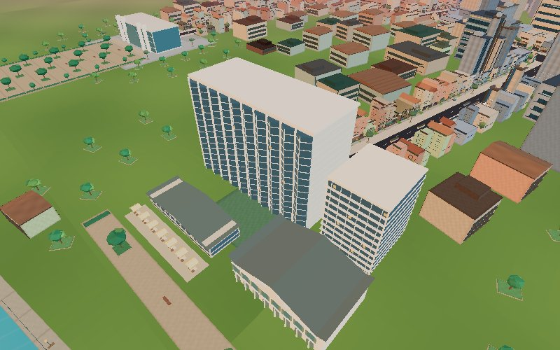 |
| shangri | 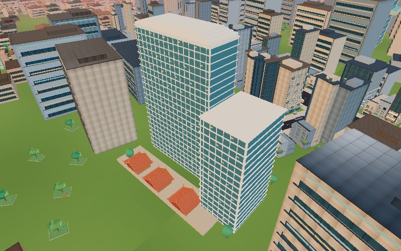 | 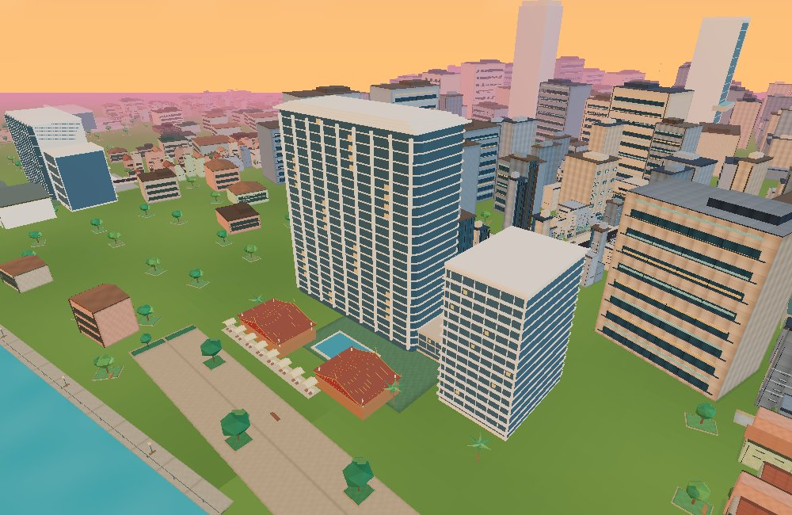 |
| four-seasons | 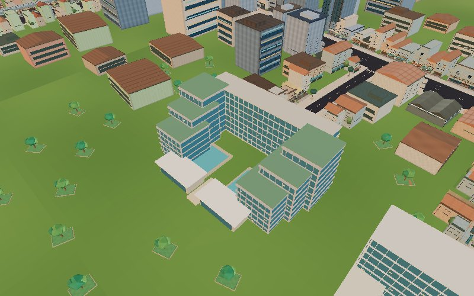 | 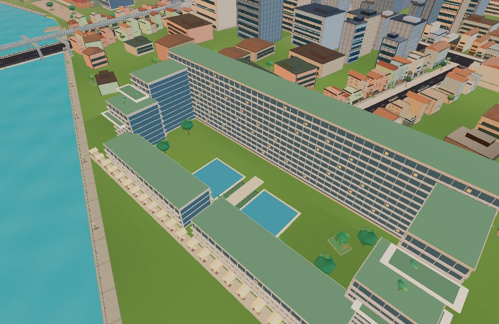 |
| embassy | 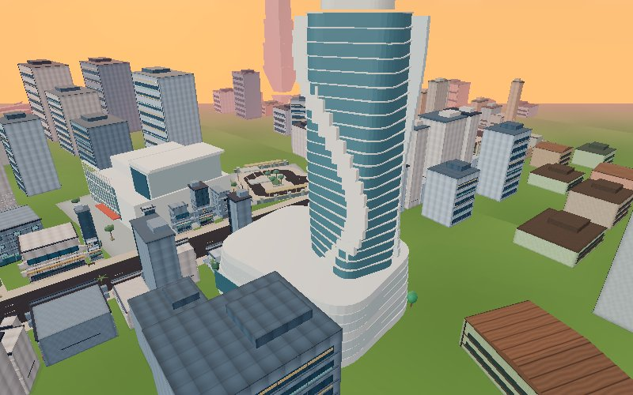 | 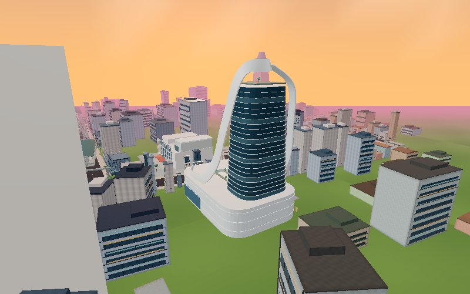 |
| mahanakhon |  | 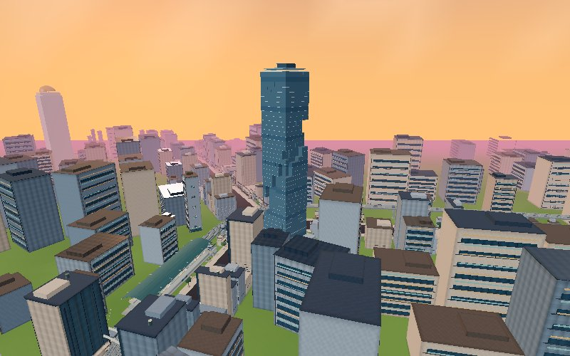 |
| paragon | 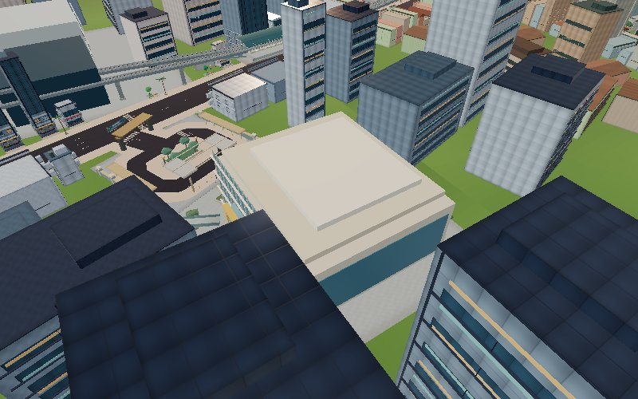 | 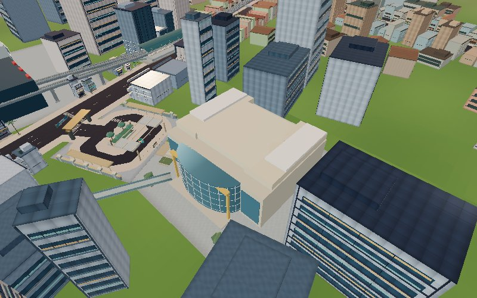 |
| central | 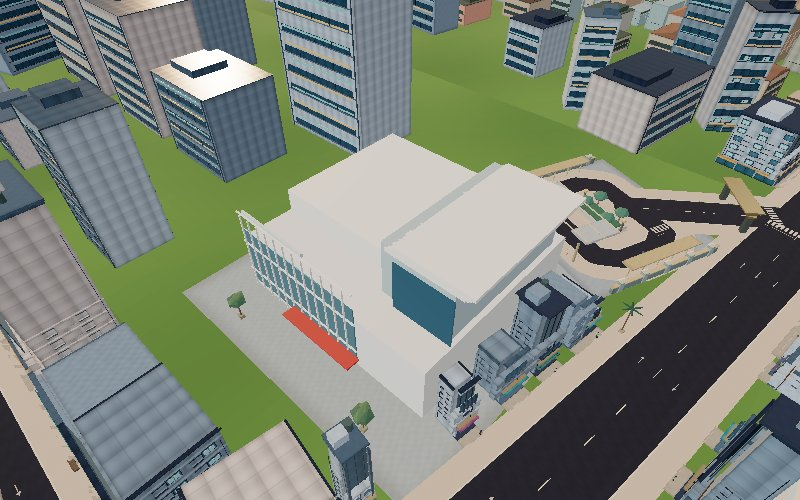 | 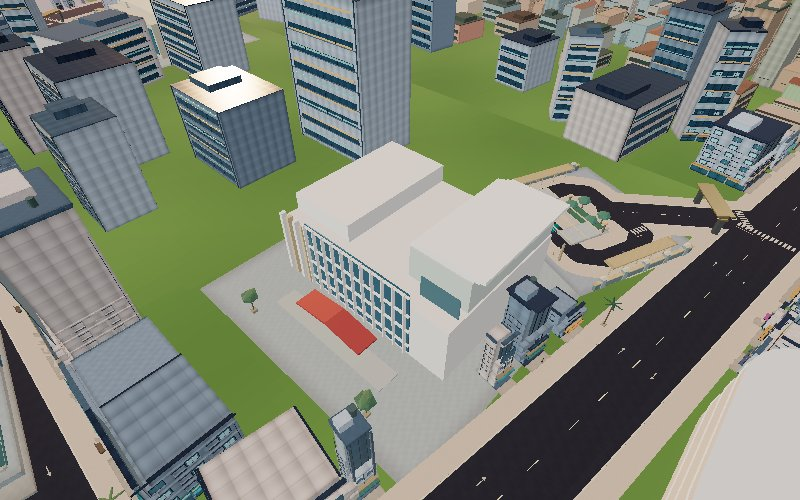 |

## Current architectural evidence

| Place | Approach | Elevated | Alternate / river | Night |
|---|---|---|---|---|
| oriental | [road](after/oriental-road.jpg) | [elevated](after/oriental-elevated.jpg) | [river](after/oriental-river.jpg) | [night](after/oriental-night.jpg) |
| shangri | [road](after/shangri-road.jpg) | [elevated](after/shangri-elevated.jpg) | [river](after/shangri-river.jpg) | [night](after/shangri-night.jpg) |
| four-seasons | [road](after/four-seasons-road.jpg) | [elevated](after/four-seasons-elevated.jpg) | [river](after/four-seasons-river.jpg) | [night](after/four-seasons-night.jpg) |
| capella | [road](after/capella-road.jpg) | [elevated](after/capella-elevated.jpg) | [river](after/capella-river.jpg) | [night](after/capella-night.jpg) |
| embassy | [road](after/embassy-road.jpg) | [elevated](after/embassy-elevated.jpg) | [front](after/embassy-front.jpg) | [night](after/embassy-night.jpg) |
| mahanakhon | [road](after/mahanakhon-road.jpg) | [elevated](after/mahanakhon-elevated.jpg) | [front](after/mahanakhon-front.jpg) | [night](after/mahanakhon-night.jpg) |
| icon | [road](after/icon-road.jpg) | [elevated](after/icon-elevated.jpg) | [river](after/icon-river.jpg) | [night](after/icon-night.jpg) |
| dusit | [road](after/dusit-road.jpg) | [elevated](after/dusit-elevated.jpg) | [front](after/dusit-front.jpg) | [night](after/dusit-night.jpg) |
| one-bangkok | [road](after/one-bangkok-road.jpg) | [elevated](after/one-bangkok-elevated.jpg) | [front](after/one-bangkok-front.jpg) | [night](after/one-bangkok-night.jpg) |
| okura | [road](after/okura-road.jpg) | [elevated](after/okura-elevated.jpg) | [front](after/okura-front.jpg) | [night](after/okura-night.jpg) |
| anantara | [road](after/anantara-road.jpg) | [elevated](after/anantara-elevated.jpg) | [river](after/anantara-river.jpg) | [night](after/anantara-night.jpg) |
| paragon | [road](after/paragon-road.jpg) | [elevated](after/paragon-elevated.jpg) | [front](after/paragon-front.jpg) | — |
| central | [road](after/central-road.jpg) | [elevated](after/central-elevated.jpg) | [front](after/central-front.jpg) | — |

Actual reference photographs and perspective coverage are linked in the [research inventory](references.md). Fidelity grades and shortcomings are in the [manual review](visual-review.md).
