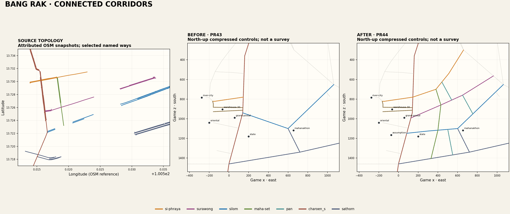

# Geographic completion and migration

[Blueprint](BLUEPRINT.md) · [Sources/confidence](SOURCES.md) · [Production plan](district-plan.json) · [Canonical controls](../../../artifacts/tuk-tuk-rush/src/game/bangkok/bangRakCompletionPlan.v1.json) · [Exact migration](../../../artifacts/tuk-tuk-rush/src/game/bangkok/bangRakCompletionMigration.v1.json)

The left panel is attributed source geography. The other panels use compressed game metres and different axes; they are not overlaid surveys. The source snapshots omit some minor connectors. The comparison establishes selected topology and makes the former Silom bend visible; it does not certify surveyed lengths, building outlines or every current restriction.

## Scope and transformation

Bang Rak occupies the east bank, with Phadung Krung Kasem/Rama IV northern context and Sathon southern context. River City/Talat Noi adjoin it in Samphanthawong. This implementation connects selected principal corridors within that larger administrative context.

The existing canonical longitude/southing knot transform and all old model origins remain. Local controls fit between verified existing game anchors: Charoen Krung, Sam Yan/Rama IV, the retained eastern Silom approach, Sathon and the river-facing compounds. New roads are explicitly fitted arcade interpretations. Uniform geographic scale is not claimed.

| Corridor | Before | Implemented relationship | Direction / limit |
|---|---|---|---|
| Si Phraya | Western seam ending at Charoen Krung | East to Maha Set, Naret and existing Sam Yan/Rama IV anchor | Eastbound; compressed bends/lengths |
| Surawong | Missing | Charoen Krung ↔ Maha Set/Mahesak axis ↔ Decho ↔ Rama IV | Westbound through selected fit |
| Silom | Western chord began at Postal/Warehouse latitude | Western start `(84,1148)` beside State Tower, continuing through `(300,1125)` to retained `(600,1100)` eastern approach | Bidirectional game arterial; division simplified |
| Maha Set | Missing | Si Phraya to Surawong | Opposing OSM carriageways represented as one two-way road |
| Mahesak | Missing | Surawong to Silom | Interpreted two-way; source road identity verified |
| Surasak Road | Missing | Mahesak/Silom axis to Sathon | Interpreted two-way; distinct from BTS Surasak |
| Pan | Missing | Silom to Sathon | Map-derived topology; current real restrictions unverified |
| Decho | Missing | Surawong to Silom | Map-derived topology; current real restrictions unverified |
| Naret | Missing | Si Phraya to Surawong | Map-derived topology; current real restrictions unverified |
| Sathon / Naradhiwas | Existing legacy spellings | Retained and connected to the expanded network; bilingual names exposed | Existing geometry/directions retained |
| Captain Bush / Soi30 / Soi32 | PR42/43 built | Retained, including northern return and separate River City arrival | Captain Bush one-way retained |

There are **2,405 road records / 2,333 nodes**, versus **2,260 / 2,196**. Eighteen obsolete western Silom edges are retired; two Sathon edges are explicitly subdivided. The replacement/addition ledger has 165 edges and 154 new nodes. Seventeen orphan nodes from the retired chord are removed, so missions cannot select disconnected obsolete stops.

## Exact property migration

Ninety-eight existing building bodies are identified by geometry/identity in the immutable manifest. They conflict with a new road/sidewalk, a new named site or a bounded public pedestrian approach. They are not selected through a deletion rectangle.

Only three approved Chinatown frontages (`ctparcel:ctblock:0:1:6`, `:7`, `:8`) and two PR42 merchant frontages (`br:charoen-east-3`, `br:charoen-east-4`) are part of that migration. The former have no associated rear buildings requiring owner reassignment. Cached block and court lists are reconciled with the remaining physical objects. All other inherited buildings and all old landmark model origins/rotations are checked against the baseline.

State Tower's model remains `(200,1180)`. Its public stop changes explicitly from Charoen Krung node `bkk:650` to corrected Silom node `brc:1920000:11365000`. This is an arrival migration, not a concealed relocation of the tower. Its small northern entrance strip and the cathedral's street-to-entrance walk are protected from new frontage fitting.

The road bake retains the exact prior water/land payload. Old western Silom asphalt is retired only within that edge ledger's collar; all crossing retained roads and the new public corridors are re-unioned. Tests compare differences outside the exact old/new segment collars with integer-millimetre polygon operations. No collision envelope, steering or hazard rule is weakened.

## Transit and waterfront

Existing BTS order, station geometry, stair/entry locations, guideway supports and trains remain. The new ordinary parcels avoid swept rail/station envelopes, and legal lane samples include transit colliders. Existing MRT identities remain; none are fabricated.

Saphan Taksin and the scenic Sathorn landing are inherited. Their roughly 325-game-metre station-to-pier separation is an unresolved compression/access deficiency; this PR does not claim a fully rebuilt Sathorn interchange. Dedicated public Si Phraya ferry/express-pier infrastructure is also deferred. Existing River City/Oriental/Shangri-La scenic landings retain their identities.

## What this does not establish

The selected network is now connected and playable in the tested journeys. Pan/Decho/Naret and some central direction/turn rules remain map interpretations. The district is not a street-for-street survey, and every historical school, embassy compound, service court and contemporary hotel wing is not modeled. Those exceptions are carried into [remaining work](REMAINING.md).
