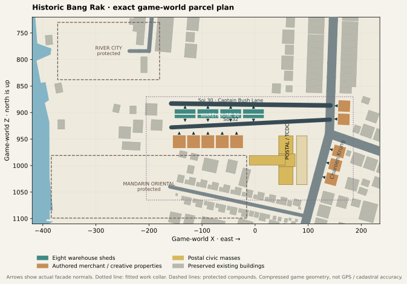
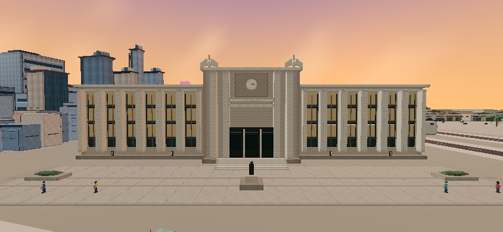
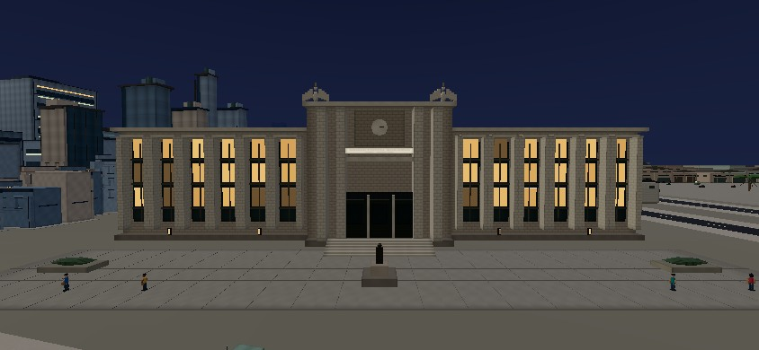
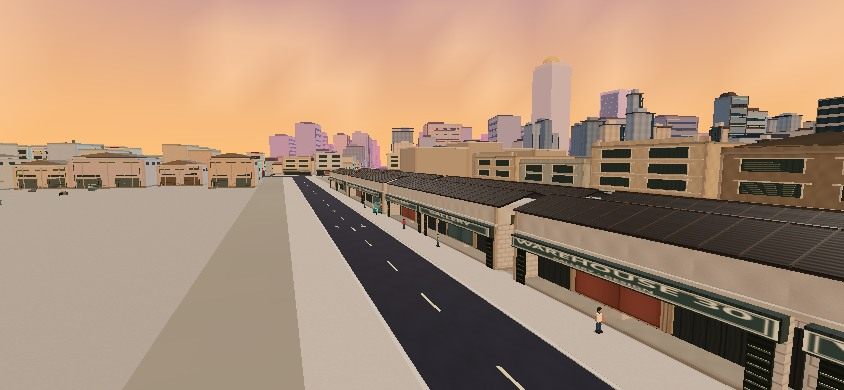

# PR42 — Historic Bang Rak environmental certification

Implemented and reviewed 24 October 2026. **Draft; do not merge or deploy.**
Base: PR41 merge `14919cdc70e4cd832cb3cfbc124603c2385ad932`.
This delivers a connected Postal / Warehouse 30 core. It does **not** certify the
entire River City–Oriental corridor as a finished premium environment.

## Delivered environment

* Grand Postal / TCDC: east-facing, 92 m civic frontage, three articulated front
  masses and a shortened rear T wing; deep piers/window bays, central entrance,
  clock, original simplified Garuda ornaments, stairs, monument and fitted
  pedestrian forecourt. Selective warm night panels reuse shared materials.
* Warehouse 30: eight low industrial sheds with ribbed pitched roofs, structural
  bays, recessed doors, gallery displays, cafe/design thresholds and loading
  details. This is an original compact interpretation, not an exact tenant map.
* Eighteen authored properties across six compositions: warehouse, merchant,
  timber, gallery, workshop and cafe. They replace 42 explicitly ledgered mutable
  buildings; obsolete block courts/furnishings are retired with their owners.
* Public Soi 30 / Captain Bush Lane and Soi 32: 26 appended nodes and 26 edges,
  baked road/sidewalk surfaces, bilingual identity, navigation, map and ordinary
  destination/discovery access. Both lanes are dead ends before private grounds.
* Thirty-two purpose-specific pedestrian candidates, including forecourt visitors,
  gallery browsers and workers, within the existing global/near/mobile budgets.
  They do not add 32 always-visible characters or individual lights.

The bounded planner runs inside the existing authoritative world pipeline. Art
uses existing instancing, materials, architectural batches, culling and disposal.
There is no parallel city generator, downloadable landmark model, imported
reference photograph, per-shop material, new point light or render-order sign hack.

## Geography and preservation

Read [the baseline audit](BASELINE.md), [reference register](RESEARCH.md),
[machine-readable parcel ledger](district-plan.json) and [exact game plan](district-plan.svg).
North is −Z; these are inherited compressed game metres, not surveyed GPS positions.
The fitted `approvedBoundary` encloses complete changed footprints and lane aprons.
It is an audit extent: separately protected property inside retains its ownership.
`plan.boundary` preserves the initial fitting seed; `protectedParcels` records
final civic/warehouse footprints and the narrowed 20 m forecourt.



Every old road record (2,210), all existing landmark origins, river geometry,
bridges, transit and authored protected compounds are retained. All 798 Chinatown
frontages and 111 rear buildings survive exactly. River City, Holy Rosary,
Mandarin Oriental, State Tower and downstream anchors retain their identities.
The Postal rear stem is shortened to avoid the Oriental grounds. A conflicting
east arterial corner proposal is rejected rather than squeezed into the junction.

Soi 30 and 32 are compressed approaches from existing arterial junction nodes.
Their relative order, westward orientation and street-facing entrances are
preserved; their widths, lengths and internal shed arrangement are not cadastral
copies. Existing Wanit 2/northern graph access to River City remains. The missing
direct Si Phraya cross-connection is **not** silently invented through approved
Chinatown lots. Assumption Cathedral/campus and Customs House are researched and
deferred; neither is represented by an inaccurate substitute in protected land.

Initial seeded traffic remains exactly the same 38 vehicles for seeds 982, 41 and
67. New narrow lanes are excluded only from initial spawn sampling; ordinary
traffic routing and legal left-lane traversal remain enabled. No old no-traffic
rules, one-way rules, traffic counts, missions, boost or controller physics are
weakened. Postal and Warehouse use the existing roadside access-node fare and
discovery mechanism, not a new mission subsystem or a private-courtyard pickup.

## Matched production-geometry WebGL gallery

These are original game-rendered JPEGs. The actual production world/engine is
rendered through the existing development QA hook to fix pose, clock and camera;
the final built bundle is checked separately below. No screenshot is cropped,
painted, generated, composited or substituted with a reference photograph.

Both sides use Medium, DPR 1, identical FOV/viewport/time/player/camera and all 38
cars. After the same 30 controller ticks, the after capture explicitly restores
the complete baseline car/player fixture so traffic pose is identical. Physical
gameplay is independently certified by continuous-controller route tests. Static
inspection angles are labelled; they do not stand in for chase-camera evidence.
Several before cameras encounter buildings that occupied the proposed new site;
those occluded frames are retained honestly.

| View | Before | After | Review context |
|---|---|---|---|
| North corridor entrance | [JPEG](before/north-corridor.jpg) | [JPEG](after/north-corridor.jpg) | Production chase; preserved Chinatown handoff |
| River City / northern connection | [JPEG](before/river-city-connection.jpg) | [JPEG](after/river-city-connection.jpg) | Existing protected anchor; direct Si Phraya remains deferred |
| Historic Charoen Krung frontage | [JPEG](before/historic-frontage.jpg) | [JPEG](after/historic-frontage.jpg) | Authored east streetfront |
| Postal approach / oblique | [JPEG](before/postal-approach.jpg) | [JPEG](after/postal-approach.jpg) | Central entry, wings and depth |
| Postal forecourt / sunset | [JPEG](before/postal-forecourt.jpg) | [JPEG](after/postal-forecourt.jpg) | Monument, steps, visitors and frontage |
| Postal dusk / oblique | [JPEG](before/postal-dusk.jpg) | [JPEG](after/postal-dusk.jpg) | Restrained transition lighting |
| Postal night / direct | [JPEG](before/postal-night.jpg) | [JPEG](after/postal-night.jpg) | Shared warm window panels |
| Warehouse exterior | [JPEG](before/warehouse-exterior.jpg) | [JPEG](after/warehouse-exterior.jpg) | Low pitched shed silhouette |
| Warehouse connecting lane | [JPEG](before/warehouse-lane.jpg) | [JPEG](after/warehouse-lane.jpg) | Recessed bays / public approach |
| Creative storefront cluster | [JPEG](before/creative-storefront.jpg) | [JPEG](after/creative-storefront.jpg) | Signs, doors and workshop detail |
| Side street / rear blocks | [JPEG](before/side-street-rear.jpg) | [JPEG](after/side-street-rear.jpg) | Merchant front normals now face Soi 32 |
| Riverfront / merchant transition | [JPEG](before/riverfront-merchant.jpg) | [JPEG](after/riverfront-merchant.jpg) | Existing river interface retained |
| Oriental handoff | [JPEG](before/oriental-handoff.jpg) | [JPEG](after/oriental-handoff.jpg) | Approved hotel and surrounding skyline |
| Sunset driving | [JPEG](before/sunset-drive.jpg) | [JPEG](after/sunset-drive.jpg) | Production chase |
| Night driving, 844×390 | [JPEG](before/night-drive.jpg) | [JPEG](after/night-drive.jpg) | Production chase, traffic, HUD/minimap |
| Night, 1280×800 | [JPEG](before/night-1280x800.jpg) | [JPEG](after/night-1280x800.jpg) | Production chase |
| Portrait, 375×812 | [JPEG](before/night-375x812.jpg) | [JPEG](after/night-375x812.jpg) | Existing rotate guard; **not portrait driving certification** |
| Portrait, 430×932 | [JPEG](before/night-430x932.jpg) | [JPEG](after/night-430x932.jpg) | Existing rotate guard retained |





[Comparison manifest](validation/comparisons.json) verifies all 18 matched camera,
clock, quality and replay tuples and records original image SHA-256 digests.
Both `capture.json` files contain camera coordinates, FOV, traffic snapshot,
sign-depth sampling and renderer statistics. The captured runtime source hash is
`8fb845e2d29a11f3800a5b52f46545e4e615032b4421024c95e0f2fe3ac20c28`.
Runtime files have not changed since that capture.

## Gameplay and regression evidence

| Check | Result / evidence |
|---|---|
| Package checks | **49/49 pass**; [summary](validation/suite/summary.json), [individual logs archive](validation/package-logs.tar.gz) |
| TypeScript / production build | Pass; [typecheck](validation/typecheck.log), [build](validation/build.log). Existing large-chunk warning retained. |
| Old legal traffic matrix | **42/42**, seeds 982/41/67 × 14 journeys, 38 vehicles, zero physical contact frames |
| New legal district matrix | **24/24**, same seeds/count × 8 journeys, zero physical contact frames |
| Historical non-yielding diagnostic | **10 traffic contact frames / 9 encounters**, separate from legal acceptance; PR41 recorded 11/10. Still a known failing-behaviour diagnostic, not a clean route claim. |
| District geometry/ownership | 18 properties, 8 sheds, 6 families, 1,857 art pieces; no sampled spatial/property conflicts; foreign-owner negative control still rejects overlap |
| Road/traffic/navigation | Both lane directions, left-lane positions, continuous NPC traversal, junctions, walls, roadside destination approaches and bilingual current-street identity pass |
| Sign contract | 6,721 commercial faces, including 24 Bang Rak faces, zero geometric mounting failures; actual WebGL depth samples retained per view |
| Old waterfront foundations | Frozen city features preserved semantically; water/land bake and water key exact; road polygon XOR restricted to new-lane collars; no old asphalt removed |
| UI/state/resource replay | [Engine/renderer report](validation/browser-state.json): long name, map/back, both new LOOK targets and return, career/discovery save/load and 8 restarts pass, no JS/GL errors |
| Built-bundle UI | [Separate report](validation/production-ui.json): actual built JS/CSS, visible controls, four viewports and fullscreen map/back pass |

The full package run preceded the final five square merchant-body facade
rotations. All affected district, sign, ownership, master-plan, city-completion,
landmark and waterfront groups were rerun; each result retains its checkout
commit. Source CI subsequently passed the complete active workflows at the exact
final runtime tree. [Source CI snapshot](validation/source-ci.json):

* [Canonical approval / benchmark gates](https://github.com/sunsetseast/TukTukRushBangkok/actions/runs/40102750154): success.
* [Chinatown geography / driving certification](https://github.com/sunsetseast/TukTukRushBangkok/actions/runs/40102750232): success.
* [Yaowarat art inspection](https://github.com/sunsetseast/TukTukRushBangkok/actions/runs/40102750182): success.
* [Full graphics checks](https://github.com/sunsetseast/TukTukRushBangkok/actions/runs/40102750163): success.

Two inherited optional/manual workflows are skipped; no CI steps were removed.
The final evidence-only commit triggers another CI run; consult the PR for that
head's status rather than interpreting the saved source snapshot as a future run.
The API-published source commit is `f918a0f426f92d8e6c7ecc670138e8e8c6b4b242`,
with tree `930efbc04b481b93a5110bd5280065b35d6db137`, exactly matching local
capture commit `76cc354ff103746e281271909fb13f0bc8454189`.

The [route index](validation/routes.json) points to the six lossless
`*-legal-*.json.gz` reports and `historical-nonyielding.json.gz` in the same folder.
Save/load verification covers the existing career/discovery ledger, including
both new landmarks; the existing design resets driving position on reload.
The screenshots in [ui/](ui/) include HUD, minimap, fullscreen map, bilingual long
name and LOOK views. Portrait guards remain supported; portrait driving does not.

## Performance and resource certification

Same sequential host method, Node scene construction including all retained
levels/chunks, excluding browser canvas labels. Decimal MB, not total JS heap or
GPU allocation. Software Chromium 131 / ANGLE SwiftShader provides real WebGL
rendering evidence, **not physical iPhone/Safari FPS**.

| Retained scene metric | PR41 before | PR42 after | Change |
|---|---:|---:|---:|
| Geometry / instance buffers | 117,073,964 B | 116,942,912 B | −0.11% |
| All retained triangles | 14,828,558 | 14,798,778 | −0.20% |
| Instances | 987,093 | 984,747 | −2,346 |
| Geometries | 9,951 | 9,970 | +19 |
| Materials / Node textures | 410 / 9 | 410 / 9 | unchanged |
| Sequential construction wall time | 36,542 ms | 38,779 ms | **+6.12%** |
| Construction CPU | 42,516 ms | 44,595 ms | +4.89% |
| Emitted JS, raw | 2,432,986 B | 2,455,477 B | +22,491 B |
| Emitted JS, gzip level 9 | 792,512 B | 800,965 B | **+1.07%** |

All retained geometry/material/texture disposal events equal their respective
inventory totals. Eight engine restarts retain stable geometry/texture counts
and produce no GL errors. This is useful cleanup evidence, not a whole-browser
heap leak proof. Texture residency from canvas labels is reported separately in
capture statistics. After CSS is 136,632 B / 24,709 B gzip.

At the matched 844×390 night-driving camera: calls **460→464**, submitted triangles
**630,721→593,131**. At the Postal forecourt: calls **384→399**, triangles
**462,382→413,678**. The [full per-view table](validation/comparisons.json)
discloses other angles; no single view is presented as citywide FPS.

The construction increase is real in this host measurement and remains a
deficiency. Bounded ownership checks and a refreshed street survey add one-time
work while replacing old lots reduces retained geometry. There is no new
per-frame reconstruction. A single sequential pair does not isolate timing
variance or prove mobile startup. No frame-time speedup or target-device frame
rate is claimed. Physical Safari thermal behaviour, memory pressure and sustained
driving are **unverified**; use [the device route](DEVICE-ROUTE.md).

## Environmental art review — human visual assessment

Grades describe rendered results, not automated test completion.

| Category | Grade | Assessment |
|---|---|---|
| Real architectural resemblance | B− | Postal silhouette, symmetric piers, entrance and T plan read clearly; Garudas, masonry and sculpture remain simplified. |
| Geographic credibility | C+ | Named street order and facade directions defensible; strong compression, direct Si Phraya and wider heritage campus incomplete. |
| Street continuity | B− | Two usable connected lanes and deliberate ownership; broad pavements and distant block transitions still look underworked. |
| Facade variety | B− | Six structural compositions; merchant row and gallery fascias still repeat. |
| Warehouse identity | B | Eight low pitched industrial sheds distinguish the quarter; roofs and restored plaster lack richer weathering. |
| Landmark visibility | B | Civic entry unobstructed and readable from approach; surrounding generic skyline reduces historical atmosphere. |
| Sign mounting | B+ | Shared PR41 relief/depth/clearance passes; oblique small text naturally loses readability. |
| Day/night lighting | B− | Warm restrained civic/gallery openings; broad pavement and some backgrounds remain flat. |
| Street-life authenticity | C+ | Purposeful workers/browsers/visitors, safe paths; sparse visible population and inherited simple character animation. |
| Riverside integration | B− | Existing river/landmarks preserved, no invented private drive; waterfront handoff still needs more authored frontage. |
| Performance efficiency | B− | Slightly lower retained buffers/triangles, unchanged materials; construction +6.12%, hardware unverified. |

The completed core is suitable for draft review and further local art iteration.
It is **not an AAA/premium district-wide certification**. Important weaknesses are
visible in the side/rear, Oriental and northern matched comparisons, and are not
hidden behind hero-only images. No supported claim of fully reconstructed Bang
Rak, exact historical surfaces, physical-device acceptance or complete pedestrian
simulation is made.

## Reproduce / extend

From `artifacts/tuk-tuk-rush` after the repository's normal frozen dependency install:

```sh
../../node_modules/.bin/tsc -p tsconfig.json --noEmit
BASE_PATH=/ node_modules/.bin/vite build --config vite.config.ts
QA_WORKERS=2 python3 scripts/certify-bang-rak.py
node scripts/check-chinatown-legal-traffic.mjs
for seed in 982 41 67; do
  BANG_RAK_ROUTES=1 CHINATOWN_TRAFFIC=1 CHINATOWN_LEGAL=1 CHINATOWN_TRAFFIC_SEED=$seed CHINATOWN_OUTPUT=../../../docs/qa/bang-rak/validation/legal-$seed.json node --import tsx scripts/check-chinatown-drives.ts
done
node --import tsx scripts/approve-bang-rak.ts
CHROMIUM_PATH=/path/to/chromium node scripts/browser-bang-rak.mjs
CHROMIUM_PATH=/path/to/chromium node scripts/browser-bang-rak-state.mjs
CHROMIUM_PATH=/path/to/chromium node scripts/browser-bang-rak-production-ui.mjs
python3 scripts/certify-bang-rak-evidence.py
python3 scripts/render-bang-rak-plan.py
```

The evidence certifier checks shipped immutable route archives by default. Set
`REFRESH_ROUTE_EVIDENCE=1` only after regenerating both complete route matrices and
the historical diagnostic. Baseline capture: create a separate worktree at the
stated PR41 commit, copy only the browser harness and `webgl-sign-depth.mjs` there,
reuse installed dependencies, set `VISUAL_LABEL=before VISUAL_PORT=24682`, and run
the same harness. Copy its resulting `before/` evidence back, then capture after.
Before is captured first; replay metadata must be available for after matching.
`profile-city-inventory.ts` supports `CITY_CHECKOUT` and
`CITY_INVENTORY_OUTPUT`; run baseline and current sequentially. Full package
scripts write their inherited QA locations; do not mistake those generated files
for changes requiring approval or rebaseline them indiscriminately.

## Recommended PR43

Reconstruct the **Si Phraya / River City northern seam**, with a researched,
explicit ownership migration of the conflicting interface lots before adding a
direct named junction. Finish the broad pavement/curb and merchant rear edges
that remain visible here, diversify gallery fascia compositions, and profile
startup on a physical iPhone before expanding the scene budget. Assumption /
Customs House should follow only with verified campus/riverfront boundaries,
not as isolated models inserted into this PR's protected compounds.
