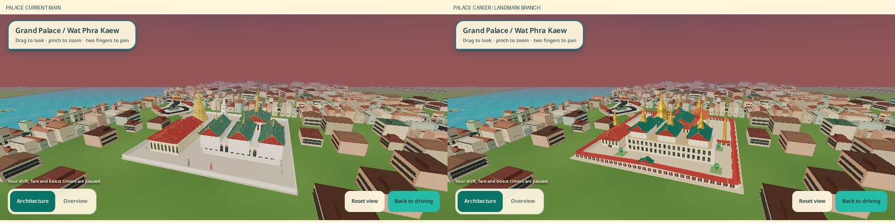
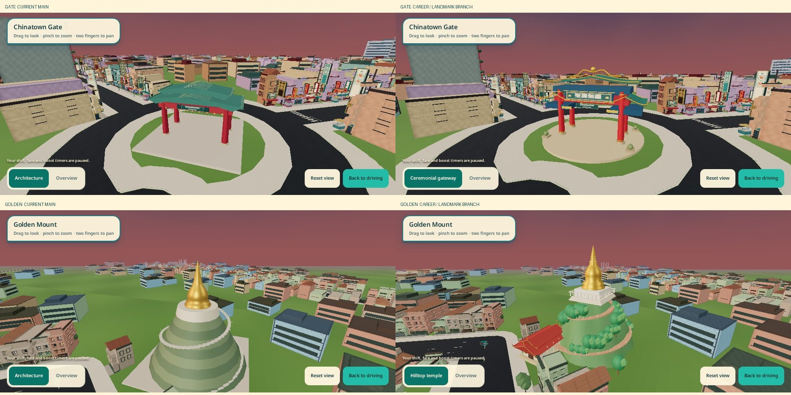
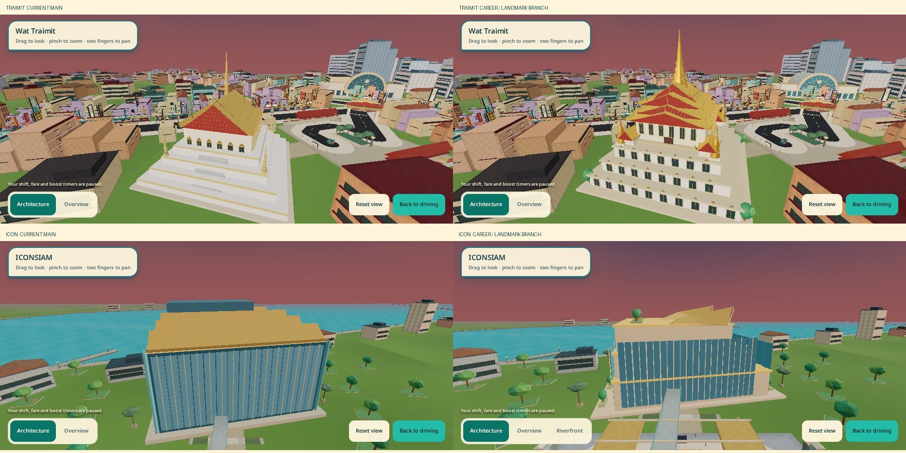
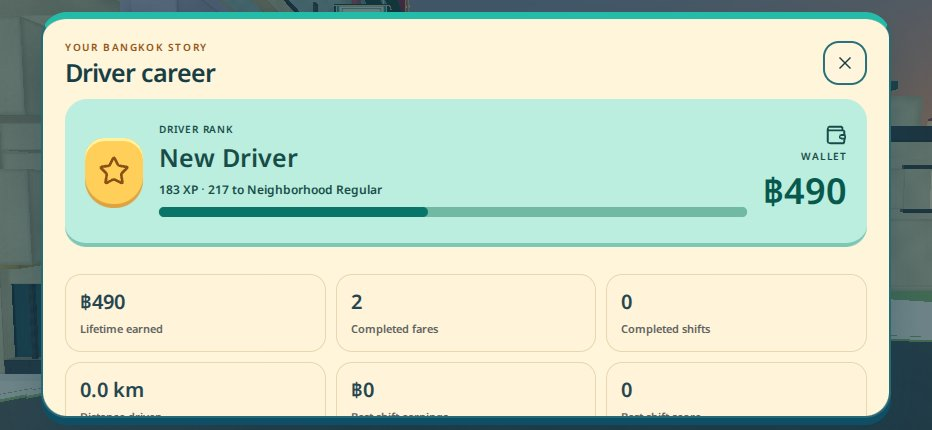
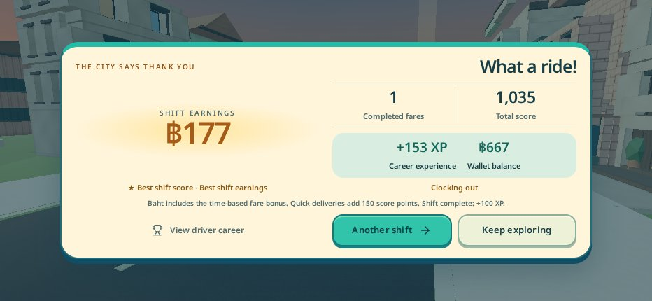

# Driver career and landmark environments

The career ledger is local to the same browser/origin. A new career starts at ฿0; existing discoveries are imported without inventing historic earnings or XP. Shift totals are separate from wallet/lifetime totals. Completed Shift and Free Roam fares pay immediately; quick delivery adds **150 score points**, while the existing time-based fare supplement is baht.

`career.ts` owns validation, two save slots, a preserved unreadable copy, future-version protection and session/fare transaction identities. Restart abandons session statistics and keeps earnings already credited. A completed shift commits once. Distance checkpoints every five seconds and at pause/pagehide; an abrupt process kill can lose the last few seconds of distance, not a successfully saved fare. Denied/full storage falls back to memory with a notice in Career. Clearing browser data removes the local career; no cloud service or purchase UI is included. One active drive per browser profile is supported; older session transaction IDs are rejected.

Five XP ranks, eleven achievement milestones, optional drive goals, personal records and discovery progress are available from the colorful **Driver career** screen on Title, Pause and Results. Closing Career from Pause leaves the simulation paused. No career reset control is exposed.

## Landmark changes

- Grand Palace: northern chapel precinct/upper terrace, Emerald Buddha hall, chedi/Mondop/Pantheon composition, galleries, gates and southern Chakri/Dusit-inspired halls.
- Odeon Gate: taller ceremonial gateway, lower side roofs, curved eaves, red columns, blue/gold brackets and the photographed royal inscription using the existing font atlas.
- Golden Mount: irregular continuous planted terrain, winding stairs, white terrace and hilltop chedi, replacing stacked cylinders.
- Wat Traimit: marble-colored levels, lateral stairs, corner pavilions, cruciform roof and slender central prasat spire.
- ICONSIAM: connected stepped retail masses, pleated glazing, thin folded gold canopies, roof planting and a lower facade-focused LOOK preset plus riverfront view.
- Wat Paknam: retained Buddha/chedi sculptures, additional planted courts, side salas and defined paths within the canal-side compound.
- Khao San: varied small guesthouse/shop bays, awnings, counters, locally lettered signs and bunting; LOOK frames the street.
- Giant Swing: paired structural timbers, curved crossbar, plaza and compressed Wat Suthat-inspired hall context.
- Democracy Monument: wing profiles, relief silhouettes and central turret/offering bowls.
- Hua Lamphong: arched glass framing/clock, articulated wings and barrel-vault shed with paved forecourt.

These are original, compressed cartoon interpretations, not dimensioned replicas. Existing plots, vehicle collision boundaries, arrival loops, roads, discovery IDs and transit routes remain authoritative. New art uses the existing static batching/material ownership and near/far LODs; old replaced builders were removed. No new full-scene rendering effect or runtime dependency.

Reference photographs and plans informed geometry; no photographs, downloaded models or logos are distributed. Sources: [official Grand Palace plan](https://www.royalgrandpalace.th/download/plan_eng.pdf), TAT photographs for [Odeon](https://www.thailandtravel.or.jp/chinatown-gate/), [Wat Traimit](https://www.thailandtravel.or.jp/wat-trimit/), [Wat Saket](https://www.tourismthailand.org/Attraction/wat-saket-and-the-golden-mount), [Paknam](https://www.thailandtravel.or.jp/wat-paknam/), [Khao San](https://www.thailandtravel.or.jp/khao-san-road/), [Giant Swing](https://www.thailandtravel.or.jp/sao-chingcha/), [Democracy Monument](https://www.thailandtravel.or.jp/democracy-monument/) and [Hua Lamphong](https://www.thailandtravel.or.jp/hua-lamphong-station/); [seele's ICONSIAM facade documentation](https://seele.com/project/glass-front-iconsiam-bangkok). Your ten LOOK screenshots guided the audit. The Chinese subset adds four inscription characters under the existing SIL OFL license; `scripts/subset-career-signs.py` reproduces the pinned, fixed-weight font.

## Verify

Run `pnpm --filter @workspace/tuk-tuk-rush run test:career`, `run typecheck`, `run build`, and the existing test scripts. `scripts/validate-graphics.mjs` runs all 17 groups. Browser checks: `scripts/browser-career.mjs`, `browser-career-landmarks.mjs`, `browser-night-drive.mjs`, and `check-camera-roundtrip.mjs` (set `CHROMIUM_PATH` if needed, `QA_OUT` for output). The camera regression now waits for the actual authored inspection pose instead of assuming ICONSIAM's previous >40 m camera height; its map/restart ground-level assertions are preserved.

For iPhone/Replit: pull this branch, use the normal dev command, and keep the same preview origin. Complete a Free Roam fare, check Career in Pause, reload and verify the wallet. Finish a 24-minute shift to check results/records. Inspect the ten named sites, change viewpoints, exit LOOK, open/close the map and restart. Check Safari storage availability and portrait Career scrolling. **Physical iPhone Safari performance and thermal behavior were not verified.** Software-WebGL counts/frame samples are diagnostics, not phone FPS certification.

## Results

All 17 test groups, TypeScript and production build pass. Native browser checks cover all ten LOOK presets/returns, 15 existing HUD/map/touch interaction groups and five viewport sizes; the career check covers real boarding/delivery, wallet persistence, reload/restart, achievements/results and responsive scrolling. The camera returns to 3.3 m after LOOK, map and restart.

City-root CPU buffers (both LODs, indices/instances; no DOM signs/vehicles/GPU uploads) change from **110.25 MB to 112.19 MB (+1.75%)**; materials 166→183. Landmark attributes alone are 8.53→9.99 MB. JavaScript gzip grows 588.02→595.88 kB; CSS 22.34→23.31 kB, and the Chinese font adds 1,740 bytes. No hardware FPS claim is made. Raw checks/counts and software frame samples are in `validation.json`.

The three comparison sheets show the five priority sites at Fast quality and the same sunset time. Palace and Wat Traimit retain matched viewpoints; Gate/Golden Mount/ICONSIAM include the improved default framing. The driving image uses the normal chase camera. Career/results images come from completed browser gameplay transactions (teleported QA stops, not a claim of human-driven trips).

