# Chinatown completion — PR #39

[Draft PR](https://github.com/sunsetseast/TukTukRushBangkok/pull/39). Do not merge or deploy.
Base: `e765f65d5f5ce4490c463614266448780af469c4`. Final implementation/check-driver commit: `ac7b08c9d7b2fbcde5d7abbabab24f43e15490b0`; subsequent evidence commits preserve that runtime.

## Implemented result and bounded audit

The 798 original frontages remain intact. **111 rear warehouse/workshop buildings and 111 reserved service courts** complete six deep blocks, bringing Chinatown to 909 parcels in the same 24 approved polygons. Street/river/bridge geometry, landmark identities/origins/compounds, exterior footprints and original boost/handling/camera/career systems remain unchanged. No approval hashes were refreshed.

The [site audit](validation/site-audit.json) separates missing fabric from working yards, access and protected open space. Song Wat's largest bank block receives longer rear property runs and bank-aligned warehouse doors, rooflights and selected boundary-wall openings. Talat Noi receives workshop wings, equipment, repaired masonry and planted thresholds. Courts have bounded paving, drains and physical yard fixtures. All are part of the existing block planner, obstacle records and architectural batch; no second scatter generator owns the land. These are game properties, not surveyed legal parcels. Merchant courts are back-of-house spaces, not new public driving shortcuts.

| Block | Rear buildings/courts | Added footprint, world units² |
|---|---:|---:|
| `ctblock:1` | 28 | 10,896 |
| `ctblock:2` | 49 | 46,578 |
| `ctblock:3` | 18 | 6,168 |
| `ctblock:6` | 3 | 1,432 |
| `ctblock:10` | 10 | 4,012 |
| `ctblock:25` | 3 | 1,432 |

Exposed-side detection supplies wrapped shop/service doors, shutters, upper openings, cornices and rain pipes. Ground-floor compositions vary by trade: restaurant cooking counters, café glazing/counters, gold cases and workshop machinery. Selective warm rooms/windows share the existing night material and clock. Yaowarat gains fitted food-cart sites and first priority within the existing bounded pedestrian budget; quieter corridors keep their workshop/merchant character. Hua Seng Heng, Tang To Kang and Scala Chinatown restaurant identities remain source-checked and unchanged.

## Validation and traffic

**45/45 package test groups pass**, plus final game TypeScript and production build. [Suite results](validation/suite/summary.json) and [raw logs](validation/suite/) include geography/exterior preservation, whole-polygon containment including crossing edges and enclosed holes, nonoverlap, actual facade/road volumes, pier/compound/maneuver clearance, sign/font checks, save/career/boost, map/camera/recovery and disposal. The original eleven-fare run completes **11 deliveries / 9,414 m / zero collision frames** unchanged.

| Matrix | Journeys | Static-world contact frames | NPC contact frames | Distinct NPC encounters |
|---|---:|---:|---:|---:|
| static | 14 | 0 | 0 | 0 |
| left-lane | 14 | 0 | 0 | 0 |
| historical-traffic | 14 | 0 | 11 | 10 |
| waterfront-static | 29 | 0 | 0 | — |
| waterfront-left-lane | 6 | 0 | 0 | — |
| legal-982 | 14 | 0 | 0 | 0 |
| legal-41 | 14 | 0 | 0 | 0 |
| legal-67 | 14 | 0 | 0 | 0 |

The historical centreline/no-yield diagnostic remains active: **11 contact frames / 10 encounters**, versus PR38's recorded 13 frames. It is not presented as crash-free. [Original reproduction](validation/diagnostic-original.json) shows the player straddling the centreline beside a stopped left-lane taxi. Other retained traces show junction approaches without yielding. The corrected legal replay uses left lanes, real one-way edges, the same two-phase signals, normal hazard braking and all **38 production vehicles**, with no mid-route teleportation or removed traffic. **All 42 legal journeys under seeds 982, 41 and 67 complete with zero contacts and no timeout/deadlock.** Seeds 982/41 were repeated after the signal-aware driver refinement; only affected checks were repeated.

Production fixes add spawn separation from the player/other vehicles, crossing-approach prediction, stable junction priority, and a complete stop instead of infinitesimal creeping. Following traffic does not stop merely because the player approaches from behind. A deterministic crossing fixture retains >5.95 units separation and releases both approaches. Contact frames are counted once per simulation frame; a distinct encounter starts after more than 60 contact-free frames for that vehicle. Diagnostic event lists are bounded, while frame/encounter counters cover the whole run. [Summary and event records](validation/route-summary.json); full traces are adjacent `.json.gz` files.

Actual production UI checks pass at **375×812, 430×932, 844×390 and 1280×800**, including portrait guards and landscape control separation. The development replay additionally verifies the long bilingual street name, map return and eight stable restarts without a stale art camera or GL error. Restart samples identify their precise source checkpoint in [capture.json](after/capture.json); the final production UI replay uses an unmodified built stylesheet. [Production UI report](validation/production-ui.json).

## Six matched WebGL comparisons

Actual production scene construction in Chromium 138 / SwiftShader, medium quality, **844×390 / DPR 1**, traffic disabled, fixed 40-second sunset or 650-second night. Every pair uses identical world camera/look, lighting, quality and viewport. Two raised views inspect otherwise hidden waterfront/interior massing; four are at driver height. No showcase scene, hidden city bodies, altered river or expanded clip/fog is used. The Yaowarat pair was moved beside the central shops on **both** versions to make trade/lighting details readable. All final images share the final runtime source hash recorded in [capture metadata](after/capture.json).

| View | Before PR38 | After |
|---|---|---|
| yaowarat-sunset | 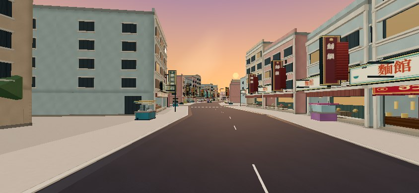 | 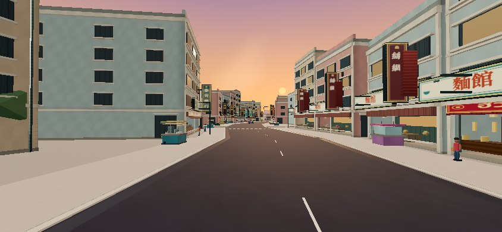 |
| yaowarat-night | 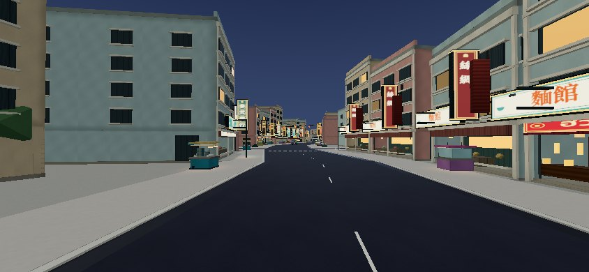 | 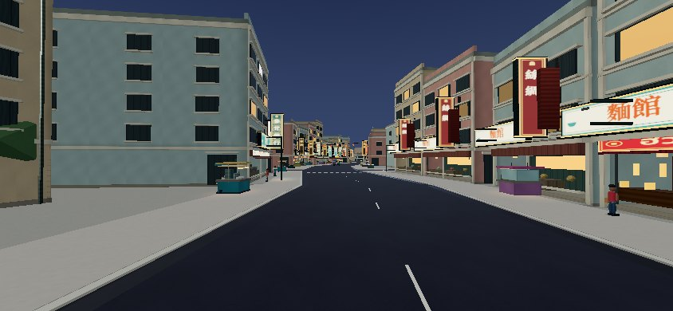 |
| song-wat-river | 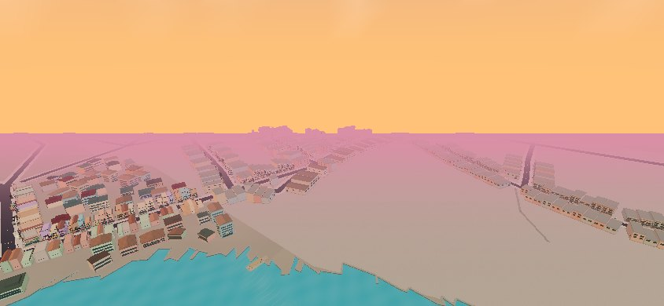 | 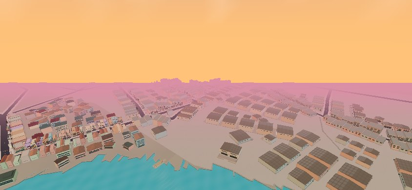 |
| district-blocks | 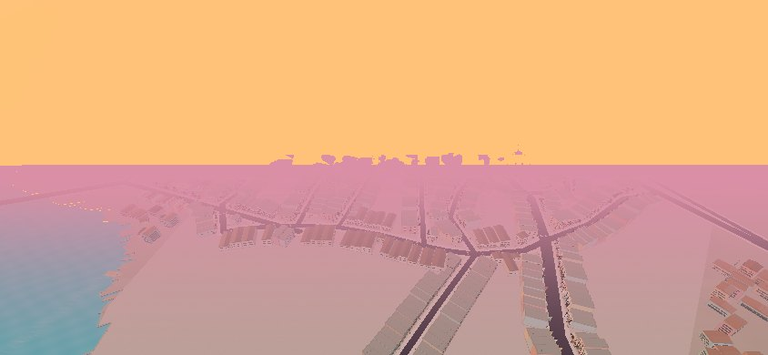 | 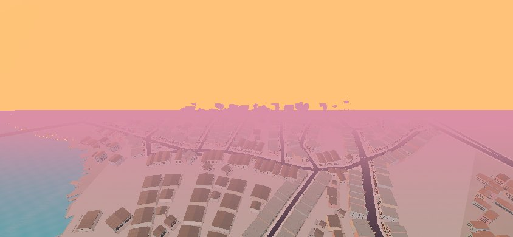 |
| talat-noi | 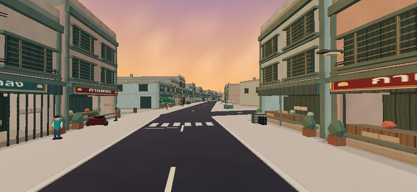 |  |
| ratchawong | 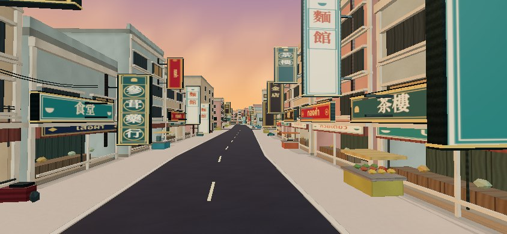 | 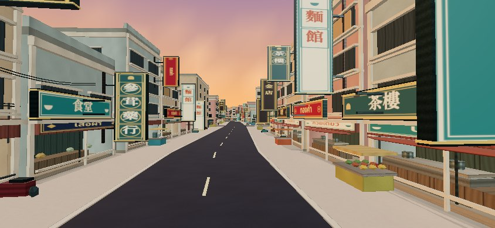 |

## Resource and performance measurements

| Complete retained scene inventory | PR38 | Completion | Delta |
|---|---:|---:|---:|
| buildings | 7,163 | 7,274 | +1.55% |
| geometryBuffersBytes | 109,893,616 | 110,134,588 | +0.22% |
| geometries | 9,839 | 9,998 | +1.62% |
| materials | 410 | 410 | +0.00% |
| textures | 8 | 8 | +0.00% |
| trianglesAllLevels | 14,112,904 | 14,166,626 | +0.38% |
| instances | 934,849 | 936,904 | +0.22% |
| constructionMs | 34,941 | 34,915 | -0.07% |
| constructionCpuMs | 40,357 | 40,131 | -0.56% |

The inventory protocol is identical and includes all retained LODs/chunks without browser-canvas labels. Unique typed-array bytes are an estimate, not VRAM. All counted geometries/materials/textures dispatch disposal. Final construction measurements above are a **sequential, otherwise idle before/after pair**, not a speedup claim. An earlier concurrent observation took 53.7 s; [initial](validation/inventory-before-initial.json) and [concurrent](validation/inventory-after-concurrent.json) observations are retained so host contention is visible. The matched pair is approximately 34.9 s on each side, with 40.4 → 40.1 s CPU; this is not iPhone startup timing.

JavaScript: **2,402,158 → 2,410,252 bytes raw; 780,834 → 783,979 gzip (+0.40%)**. CSS is unchanged. Existing large-chunk warning remains. No per-building dynamic lights, per-frame geometry rebuilding or expanded crowd render budget is introduced.

| Matched rendered view | Draw calls before → after | Triangles before → after |
|---|---:|---:|
| yaowarat-sunset | 489 → 520 | 703,774 → 710,756 |
| yaowarat-night | 488 → 519 | 703,742 → 710,724 |
| song-wat-river | 282 → 373 | 370,454 → 392,606 |
| district-blocks | 360 → 437 | 554,482 → 565,610 |
| talat-noi | 426 → 482 | 620,754 → 632,122 |
| ratchawong | 434 → 450 | 595,850 → 594,022 |

The central Yaowarat night view grows about 6.4% in submitted calls. Elevated waterfront/interior views grow more as previously missing properties become visible; that rendering cost remains explicit. Raw eight-frame software timing samples are retained but cannot establish sustained physical Safari FPS, GPU memory or thermal behavior.

## References, limitations and physical-device route

Architectural motifs were rechecked against the [Thai government Talat Noi/Song Wat walk](https://www.am2026thailand.go.th/explore-bangkok/talat-noi-song-wat-street-art) and [TAT Talat Noi article](https://www.tourismthailand.org/Articles/1-day-in-talat-noi): working warehouses/metal doors, hardware and boat-workshop activity, adapted cafés and shaded thresholds. Use the [PR38 source/licensing register](../chinatown-reconstruction/geographic-sources.md) for unchanged streets, businesses and landmarks. Geometry/art is original; no source photographs are redistributed.

**Remaining limits:** large merchant/service courts and compressed river setbacks remain stylized; no exhaustive cadastral reconstruction or premium likeness everywhere is claimed. The historical non-yield diagnostic still makes contact. Grand Postal/Bang Rak expansion remains deferred. **Physical iPhone 17 Pro Max Safari FPS, memory pressure, thermal behavior and actual safe areas remain unverified.**

Exact device route: on iPhone Safari, use Medium, landscape 844×390 equivalent; start Free Roam and drive west along Yaowarat past the central gold shops, turn through Ratchawong to Song Wat, continue via Wanit 2/Talat Noi to Holy Rosary and River City, then return via Charoen Krung. Repeat for 12 minutes to cover sunset→night. On each circuit open/close the map, pause/resume, use the 5-second boost and verify its 10-second recharge; once inspect ICONSIAM and restart to verify normal camera recovery. Rotate to portrait and back. Record frame-time distribution, heat/battery, any input delay and any camera/contact event. This is the outstanding device gate, not a completed check.

Tooling limits: the initial browser download returned an invalid archive and one software-GPU startup timed out; a bundled Chromium/SwiftShader fallback produced the actual comparisons. A temporary executor disconnection recovered without losing the pushed checkpoint. Errors are preserved in [tooling log](validation/tooling-errors.log). These are distinct from production failures.

Remote CI is recorded separately in [remote-checks.json](validation/remote-checks.json); pending jobs are not represented as passes. No merge or deployment was performed.
