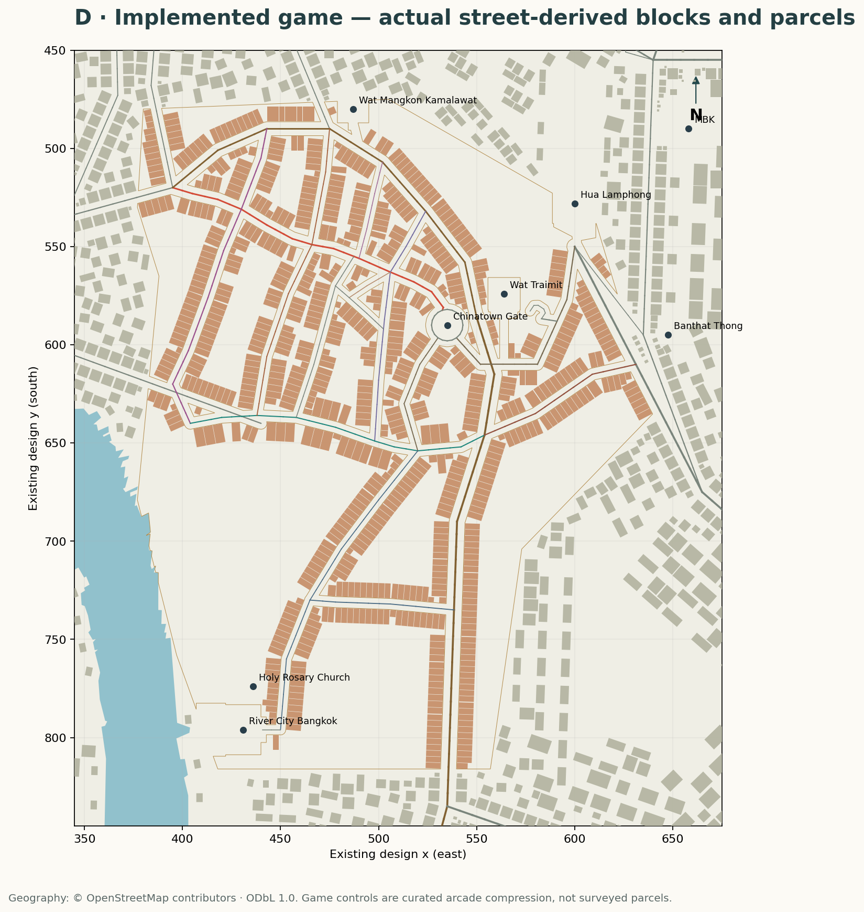

# Four reproducible maps

All panels are north-up. A/C/D use the existing design grid: x east, y south. Runtime world coordinates are `x=(designX-500)*4`, `z=(designY-600)*4`; inverse `designX=x/4+500`, `designY=z/4+600`. The global coordinate system is unchanged. B is WGS84 longitude/latitude, with longitude aspect corrected by cos(13.74°). Axis units differ deliberately; identical orientation does not imply a uniform metric scale.

| Panel | Evidence | Machine source |
|---|---|---|
| A · Current PR37 game | [PNG](maps/current-game.png) · [SVG](maps/current-game.svg) | before-world.json.gz |
| B · Real Chinatown | [PNG](maps/reference-map.png) · [SVG](maps/reference-map.svg) | retained OSM road, building and riverbank geometry |
| C · Approved compressed controls | [PNG](maps/proposed-compressed-map.png) · [SVG](maps/proposed-compressed-map.svg) | chinatownPlan.v1.json over PR37 context |
| D · Final actual game | [PNG](maps/implemented-game.png) · [SVG](maps/implemented-game.svg) | after-world.json.gz and blocks.json |

The curated plan preserves the sequence of intersections and relative north/south and river-side arrangement. Control vertices are individually authored rather than a single affine transform of every OSM point. Protected Odeon, Traimit, Hua Lamphong and River City origins constrain the miniature; Talat Noi is sheared southwest toward the existing River City approach. The real riverbank is a geographic reference; the game's approved PR36 river remains unchanged. These constraints deliberately distort lengths, bearings and some landmark spacing.

Plan review checked the Yaowarat curve, parallel Charoen Krung relationship, Ratchawong/Song Wat connection, Mangkon and Plaeng Nam frontage, opposing Song Wat direction sections, station/gate approach and Wanit 2/Yotha to River City. Discovery of a disconnected Phadung Dao end during graph certification led to adding real Phat Sai and Yaowaphanit local access instead of an invented shortcut. No exhaustive OSM street import was attempted.

Regenerate from the repository root:

```sh
python scripts/render-chinatown-maps.py
```

Game exports are generated from the production constructor by `scripts/export-chinatown-world.ts`. Rebuild approved blocks with `scripts/generate-chinatown-blocks.ts`, then regenerate asphalt with the existing `art:roads` command. Version keys reject stale blocks/surfaces.


