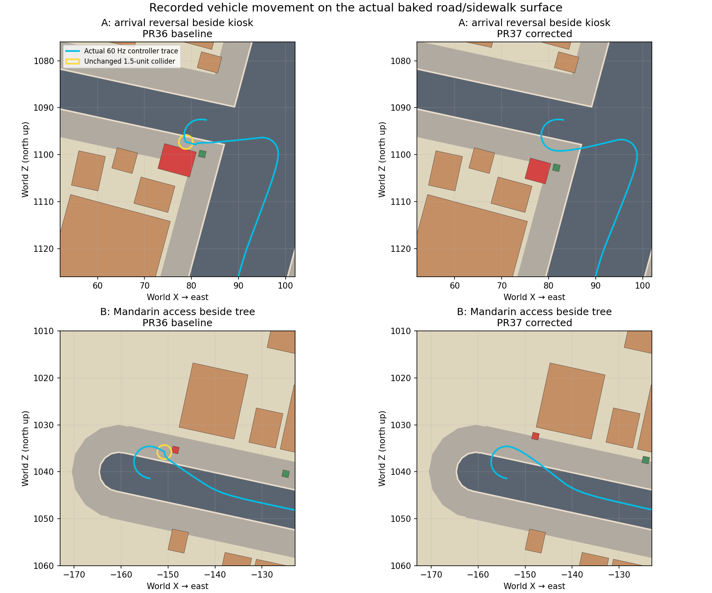

# Implementation, audit and root causes

Base: current `main` at `d3823427bced0b04729beafe87a68ab444f98329`, the merged PR36 commit. [Base verification](base-verification.json) records the merge and failed original graphics workflow. PR36's geometry certification was read alongside its fare-contact report; a passing river-polygon check was not treated as driving certification.

The audit follows `GameEngine` mission selection and lifecycle → `routeFromPoint`/directed road graph → the production `VehicleController` → spatial collision queries. It also follows procedural `streetFabric`/`environmentPlan` objects into their shared visible and physical bodies, authored arrival roads, bridges, landmark access nodes, river surfaces, map geometry and camera/reset state. The canonical source, baked road/water surfaces, landmark registry and premium models remain unchanged. Source and generated-record preservation are enforced in `check-waterfront-clearance.ts`, rather than relying on a successful build alone.

## The two reproduced encounters

The unchanged `check-bangkok-driven.ts` seed-20 journey completes all eleven fares on PR36 but fails its unchanged zero-contact assertion: **119 collision-indicator frames**, from two distinct obstruction encounters. The indicator includes collision cooldown, so 119 must not be read as 119 separate impacts. The recorded local traces contain 73 indicator frames on fare 3 delivery and 46 on fare 10 pickup.

| Encounter | Original physical object | First observed resolver pose | Cause |
|---|---|---|---|
| A, fare 3 delivery | `street-infill:3445522820`, X76.9204 Z1101.2114; 5.5×7 footprint | X78.7939 Z1097.3124; heading −5.59357 rad; speed2.73899; steering−1.0 | Heading reversal near the narrow Mandarin arrival corridor sweeps outside the straight road envelope and clips the rotated kiosk corner. |
| B, fare 10 pickup | `env:tree:-14844:103535`, X−148.4413 Z1035.3476; 1.4×1.4 trunk | X−150.7724 Z1035.8039; heading0.974939 rad; speed2.28404; steering0.189162 | The subsequent access maneuver passes a roadside trunk that cleared the straight road centerline test but not the moving vehicle envelope. |

These were valid graph journeys, with deterministic real steering/acceleration and collision enabled. They exposed missing procedural maneuver clearance, rather than a river-water contact or a fare-number-specific route bug. [Before trace](traces/before-fares.json.gz) and [after trace](traces/after-fares.json.gz) retain route targets, 60 Hz poses near both encounters, heading, steering, speed, inputs, nearby rotated colliders, centerline roads and obstacle clearances. The target sequence is exactly identical before/after.

The figure uses the actual committed road, curb and sidewalk polygons, actual obstacle footprints and recorded controller motion. North is up; coordinates are compressed game-world units. It is not a surveyed Bangkok map.

## General placement correction

`vehicleEnvelope.ts` shares the existing 1.5-unit circular physical collider and steering formula, unchanged: `1.7 - min(abs(speed)/45, .55)`. At the existing low-speed turn target of 5 units/s, the full-lock radius is approximately 3.147 units. The bounded arrival-reversal reservation is `2R + 1.5 + 1 = 8.793706` units. It applies to existing two-way/no-traffic riverfront arrivals, not all streets. Junctions separately reserve legal directed quadratic turn sweeps with a 2.5-unit envelope. Forty independent dense-sample cases check exact segment-to-rotated-footprint distance, including a segment crossing a rectangle while both endpoints are outside.

`roadManeuvers.ts` builds 5,303 short maneuver segments and indexes them in 80-unit cells. A WeakMap caches the result per district. Placement performs exact footprint checks on nearby sweeps at city construction time; driving does not rebuild the index. Existing road/water/protected-place placement checks are retained.

`environmentPlan.ts` fits the complete shared visual/physical body outward or along the road using its existing bounded search. `streetFabric.ts` checks candidates before insertion and tries the existing smaller kiosk types when a larger candidate cannot fit. No object-ID collision exemptions, disabled collisions, vehicle resizing, handling changes, seed changes, teleports or fare-specific routing were added.

At A, a 4.5×4.5 kiosk is retained 2.410536 units away at X77.7039 Z1103.4910, with the same orientation and height. Its generated footprint ID changes to `street-infill:2067870354`; these are procedural object IDs, not destination/progression IDs. At B, the same tree ID/trunk moves 3 units outward to X−147.8062 Z1032.4156. That clearer position lets the existing tropical planner produce a full tree instead of the old constrained understory form. Both objects remain physical; the tests intentionally drive a normal collider into each original solid and require a real resolver contact.

There are 7,205→7,204 buildings and 11,834→11,817 static obstacles, with dense frontage retained. The local Capella group refits three kiosks into two aligned kiosks. No building row or neighborhood is removed. The exact reviewed migration is [placement-approval.json](placement-approval.json): 11 old/10 new kiosk footprints. `waterfront-migration-contract.ts` requires the exact generated delta, a genuine maneuver conflict or immediately affected neighbor within 12 units, local placement and clearance of every replacement. Existing blueprint/historic-fidelity assertions still reject any unapproved unrelated parcel change. They are not globally loosened.

## Physics observability and unchanged foundations

`vehicle.ts` and `engine.ts` accept an optional contact observer, reporting static/prop/bridge/traffic/water/boundary contacts with pose, speed, normal and penetration. With no observer there is no contact-event allocation. Collision resolution and vehicle handling are unchanged. Existing Turbo Boost, missions, left-side navigation, save/reward behavior and sunset/night timing are preserved.

The generated comparison checks every road, node, landmark, destination, river vertex, flow-spine point, river structure, boundary, transit record and spawn against PR36. The twelve frozen source-file hashes include the original fare assertion, canonical blueprint, baked surfaces, water geometry, riverfront geography, premium architecture, navigation, missions and Turbo Boost. See [preservation-contract.json](preservation-contract.json) and [clearance report](validation/clearance.json).

`chao-phraya-osm-v2` and water fingerprint `3216239545` stay authoritative: 1,099 bank-polygon vertices, 60 spine points, 5 approved source-structure exclusions. The dedicated river check finds zero inappropriate road/building/solid-water overlaps, checks all three bridges, 12 piers,3,584 boat samples and2,044 water-mesh rays. Source provenance, bank identities, terrain cuts and map polygons remain the PR36 versions. No fixed-width legacy water geometry is reintroduced.

Asiatique's PR36 location at X−450.8658 Z2046.1940, model/arrival roads, Anantara and southern boundary Z2750 are retained. All principal bridge road IDs and lane rules remain stable. Normal gameplay views, the map, access testing and resource budgets are documented separately.
