# Matched actual WebGL gallery

PR36/main at `d3823427bced0b04729beafe87a68ab444f98329` versus PR37 runtime at `61ce535afa6784721fd4e2b4ef17fb496ba41d40`. These are actual application frames, captured with Chromium/SwiftShader at 768×432, medium quality, elapsed 40 s (sunset) or 720 s (night). Traffic is disabled on both sides. No city objects are hidden, and no extended fog or clip override is active. Three scene families use the normal follow camera; the other explicitly recorded cameras inspect local approaches. The elevated shoreline view is 145 world units high. These are browser frames, not photographs or physical-iPhone results.

The [manifest](gallery-manifest.json) records matching camera/FOV/lighting and SHA-256 image hashes. The approved PR36 [geographic comparisons](../chao-phraya/README.md) remain authoritative; this PR does not redraw the river.

| Scene / lighting | Before | After |
|---|---|---|
| icon-river / sunset |  | 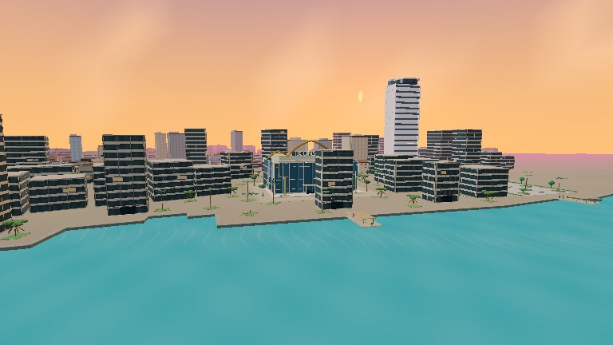 |
| icon-river / night | 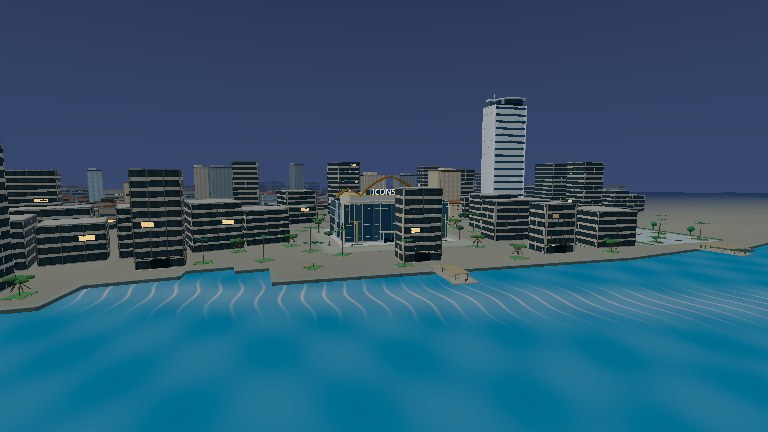 |  |
| icon-street / sunset |  | 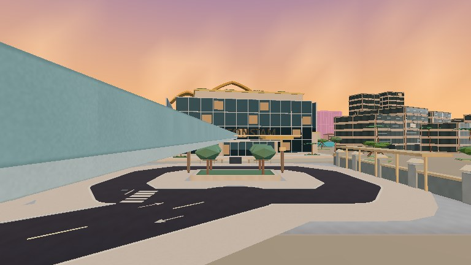 |
| taksin-driving / sunset | 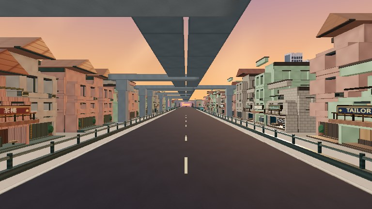 |  |
| taksin-driving / night |  | 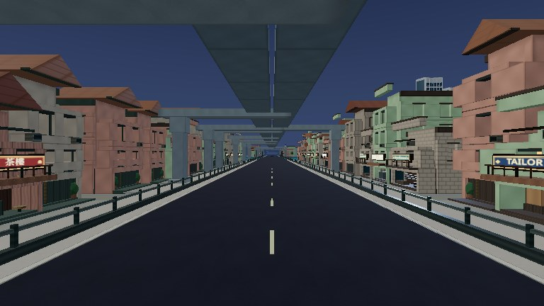 |
| oriental-river / sunset | 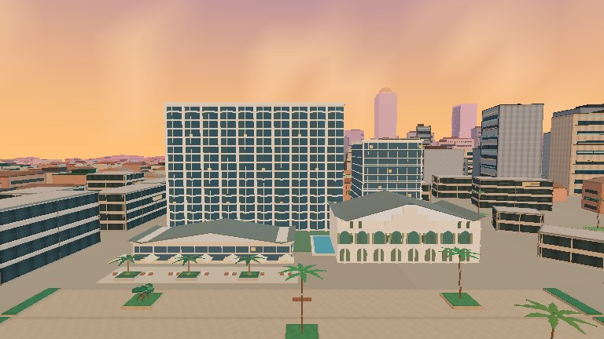 |  |
| collision-building / sunset | 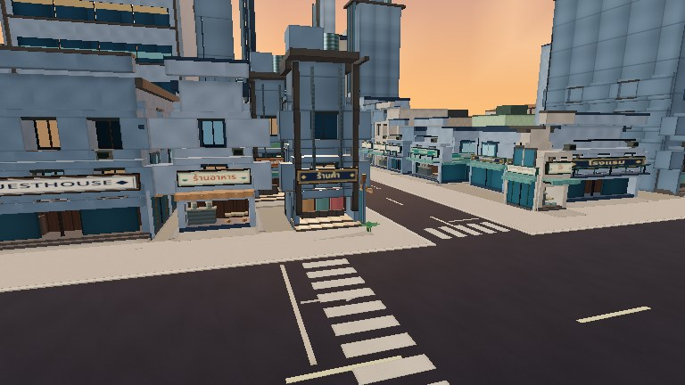 | 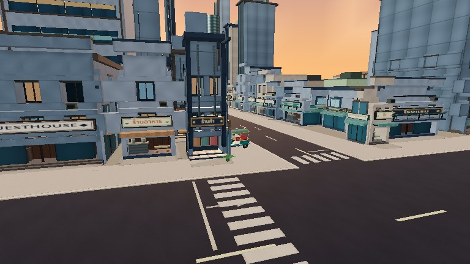 |
| collision-tree / sunset | 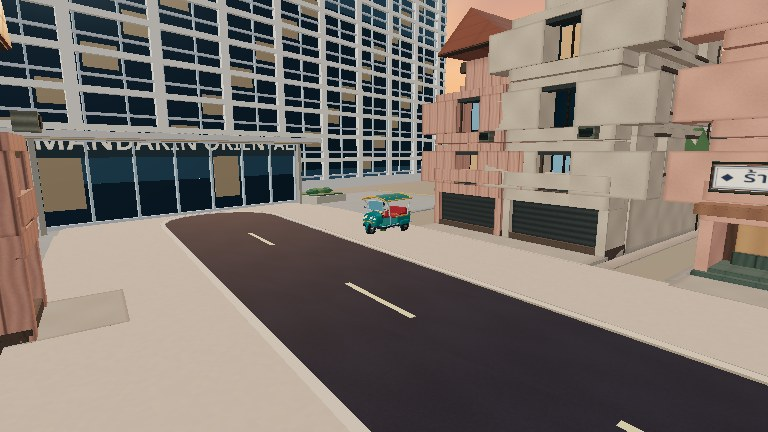 | 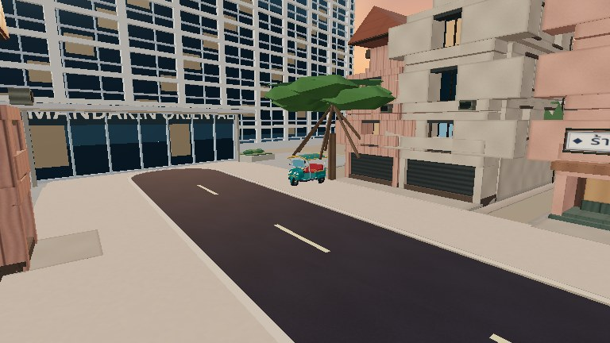 |
| oriental-approach / sunset | 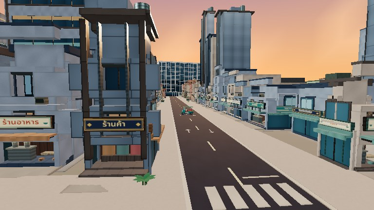 | 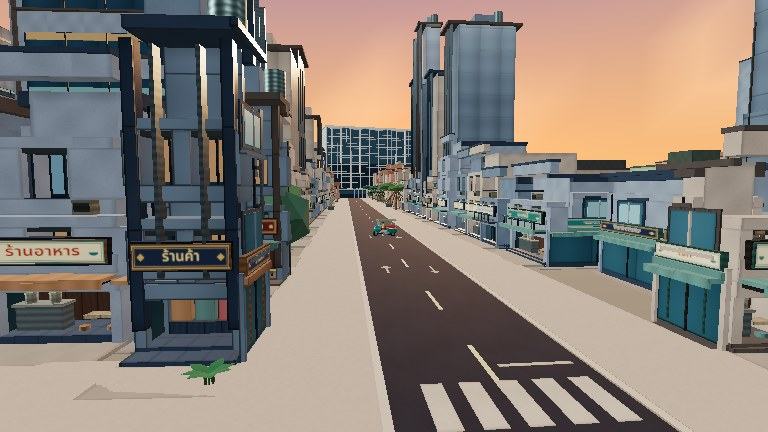 |
| river-city-street / sunset | 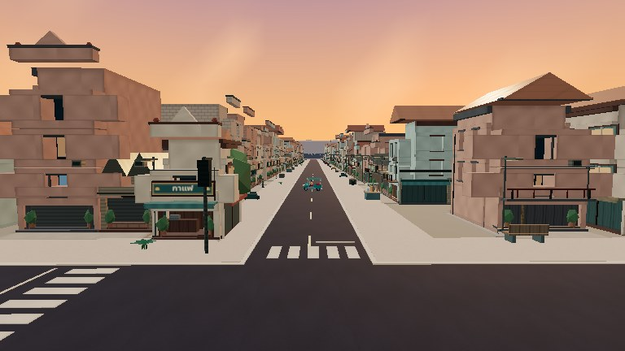 | 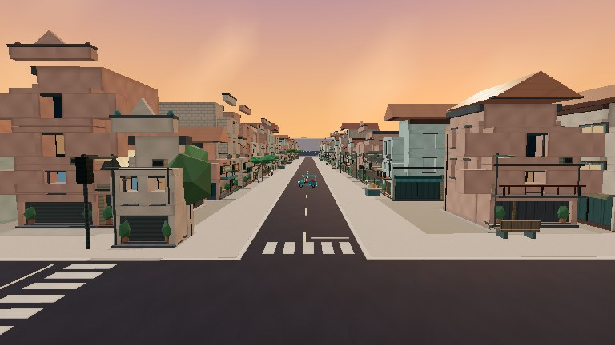 |
| asiatique-entry / sunset |  | 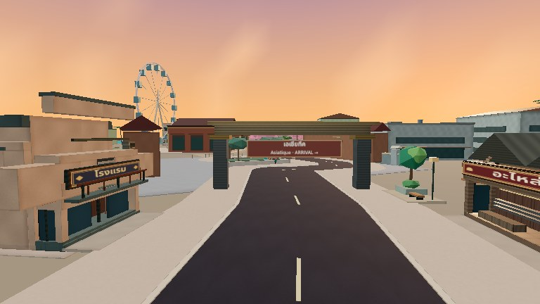 |
| asiatique-entry / night | 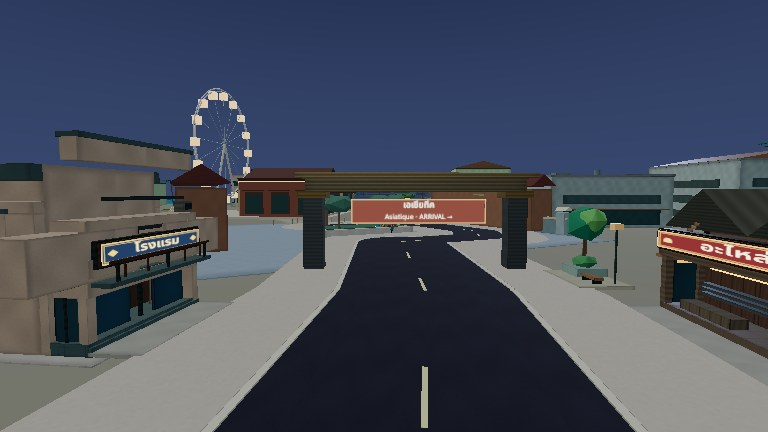 |  |
| asiatique-loop / sunset |  | 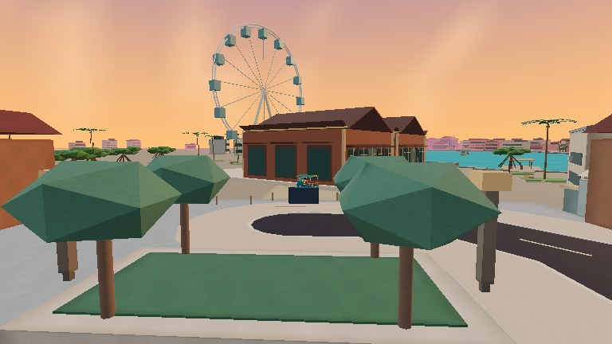 |
| shoreline-local / sunset | 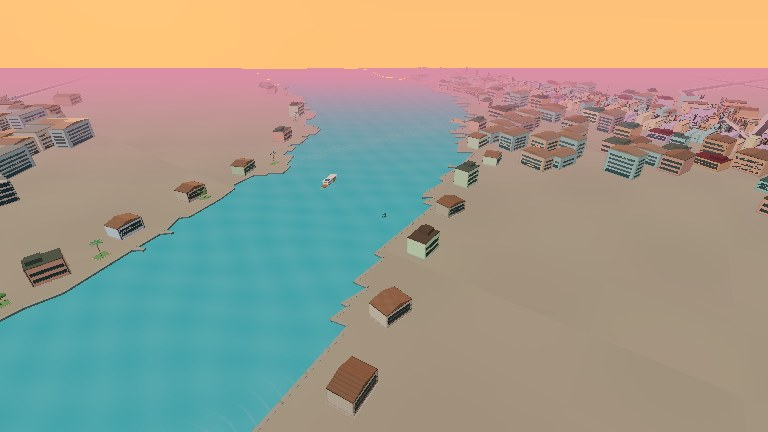 |  |
| river-city-gameplay / sunset | 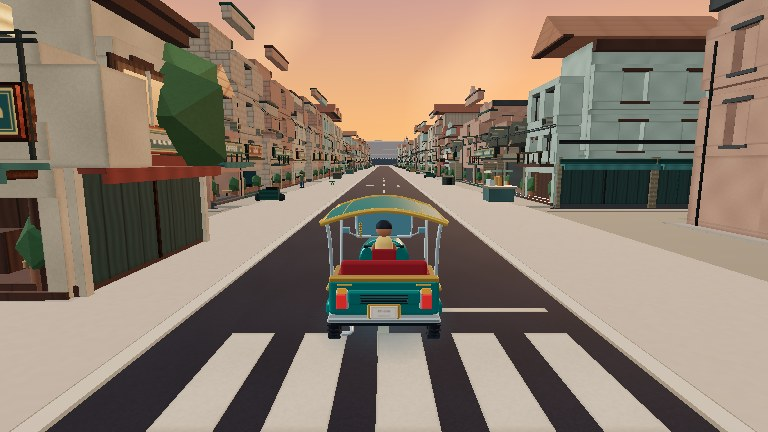 | 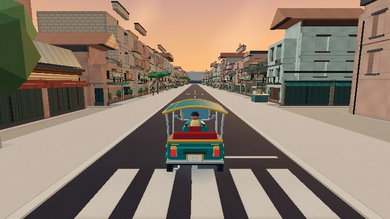 |
| chinatown-waterfront-gameplay / sunset | 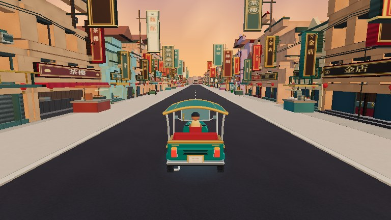 |  |
| chinatown-waterfront-gameplay / night | 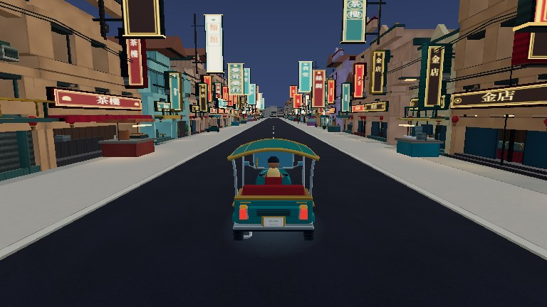 |  |
| asiatique-gameplay / sunset |  | 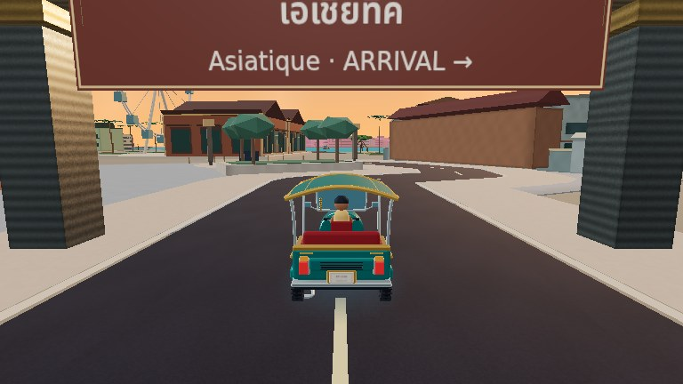 |

The collision kiosk retains a compact street building and the vegetation correction allows the existing tropical tree planner to produce a taller tree. The ICONSIAM Gold Line still overlaps parts of the fixed street-view composition, as on main; this is not hidden for the comparison. Ordinary follow-camera views retain production fog, drawing distance and sunset/night lighting.
