# Chinatown visual transformation — PR40

[Draft PR #40](https://github.com/sunsetseast/TukTukRushBangkok/pull/40). **Do not merge or deploy.**

Base: `997e960295838891c134e7c2caa6253f83f29a24`, verified PR39 merge. Implemented source: `e31c24136108f2f21dbfd8ee32fff9bf030bd575`. Its Git tree is identical to the locally rendered source checkpoint `fe6cfecaabc61cd9f1f5d35d52e5ea02c4b67a82`; evidence commits only add certification files. [Source provenance](validation/source-provenance.json).

## Result and initial assessment

All six PR39 comparison pairs were inspected before implementation. Yaowarat repeated plain cornices, two-column windows, short red blade signs, indistinct counters and pale empty pavements. Almost uniformly illuminated upper facades weakened the night scene. Ratchawong had stronger sign silhouettes but repeated storefronts. Talat Noi repeated green shutters and vague merchandise. Raised Song Wat views demonstrated successful block completion; service courts, passages, pier approaches and protected compounds were intentional open space, not missing decorative infill.

The implemented pass preserves that geography while changing the part of the city seen while driving:

- Seven existing central Yaowarat plots receive individually composed kitchens, a tea balcony, gold displays, an apothecary and wholesale merchant frontage. Hua Seng Heng, Tang To Kang and Scala retain their verified identities and sites.
- Ground floors now have 3.6m shallow rooms, side reveals, ceilings, counters, lit display cases, necklace rails, hanging roast-food shapes, cooking pots, stools, coffee equipment, pharmacy jars, merchandise racks and workshop equipment. They are original game compositions, not business-specific interior reconstructions.
- District-controlled facades gain rigid striped awnings, AC compressors, grille balconies, parapet/cornice variation, weathered brick repairs, rain pipes and workshop scooters. Warehouse backs now have buttresses, high vents and patched masonry instead of blank river-facing boxes.
- Taller, separately mounted blade signs, small secondary cabinets and original horizontal/vertical lettering layouts replace the repeated short cabinet sequence. Generic Thai/Chinese trade labels are used; real names remain restricted to verified plots. Lower-density painted signs distinguish the historic streets.
- Existing collision-fitted food carts gain drawers, trays, condiment bottles, coolers, canopy trim and mounted menus. Twenty-four staged customers occupy selected central shop thresholds; other candidates are dispersed across complete corridors instead of truncating later blocks. The citywide candidate cap stays **360**, with **32 nearby rendered people** (20 on Low), using the existing shared animation assets.
- Evening shading now uses selective colored storefront emission and one original world-space reflected-light texture. Deep blue night skies, darker ambient facades and warm/gold/red/aqua/pink shop light create contrast without bloom or a light per sign.

The new visual test fingerprints the entire initial world: roads, nodes, building/collision records, landmark identities, destinations, river polygons and transit records match PR39 exactly. All **798 frontages, 111 rear buildings, 111 service courts and 24 blocks** remain. No driving, boost, mission, career/save, camera, map or HUD production logic changed.

## Certified local results

**46/46 package groups pass**, including the existing 45 and the new visual/foundation group. TypeScript and the production build pass. Eleven matched WebGL pairs, four production UI layouts, long-name/map/ICONSIAM/restart checks and resource disposal pass. Final captures report zero JavaScript or shader compilation errors.

| Driving matrix | Journeys | Vehicles | Static/prop/water contacts | NPC contact frames |
|---|---:|---:|---:|---:|
| Chinatown static / left-lane | 14 + 14 | 0 | 0 | 0 |
| Legal traffic: seeds982/41/67 | 42 | 38 each | 0 | 0 |
| Historical centreline/no-yield | 14 | 38 | 0 | 11 (10 encounters) |
| Waterfront static / left-lane | 29 + 6 | 0 | 0 | 0 |

Canonical approval/benchmark CI passed on the implementation commit. Other source-commit workflows were still running at the recorded snapshot; skipped optional workflows are identified as skipped. The final evidence push can start fresh checks. **Pending CI and physical Safari are not represented as passes.**

## Research and reference inventory

References were accessed October 23, 2026. Geometry, material patterns, lettering layouts and the light field are original. No source photographs, copied logos, proprietary textures or downloaded models were imported. Architectural dimensions below are game proportions, not surveyed measurements. Existing geographic/business provenance remains in the [PR38 register](../chinatown-reconstruction/geographic-sources.md).

| Source | Observed/reference detail | Implementation informed |
|---|---|---|
| [TAT Bangkok brochure, printed p29 / PDF page 28](https://www.thailandtourismus.de/fileadmin/user_upload/Bangkok.pdf) | Yaowarat street photograph: tightly layered signs, retail fronts, overhead infrastructure and the relationship between tall shop signs and lower stalls. Red/gold commercial identity. | Projecting sign silhouettes, warm gold cases, varied canopy heights; restrained upper-storey color. Screenshot of the reference page was inspected; no photograph is redistributed. |
| [TAT Japan Chinatown guide](https://www.thailandtravel.or.jp/areainfo/bangkok-chinatown/) | Gold-shop facades/interiors use red and gold; Tang To Kang has a distinctive cream historic exterior. Commercial character varies by street. | Red velvet display rooms, cream merchant-house ornament at the existing Tang To Kang plot, separate merchant/workshop styling. |
| [TAT Chinatown walk](https://www.tourismthailand.org/Articles/the-adventure-through-bangkok-s-chinatown) | Busy retail streets become food-vendor streets in the evening. | Food-heavy Yaowarat trade composition, fitted carts and selective stall/restaurant glow. |
| [Thai government Talat Noi / Song Wat walk](https://www.am2026thailand.go.th/explore-bangkok/talat-noi-song-wat-street-art) | Historic trading architecture, operating warehouses, metal doors, hardware/boat shops, old homes and adapted cafés coexist. | Warehouse lintels/vents, subdued green/timber doors, working service elevations and workshop equipment; no invented public promenade. |
| [TAT: 1 day in Talat Noi](https://www.tourismthailand.org/Articles/1-day-in-talat-noi) | Images and descriptions of adapted old buildings, a former lathe shop, café thresholds and riverside community space. | Quieter café glazing/counters, machinery, weathered masonry, planted thresholds and restrained illumination. Specific cafés were not transplanted into random plots. |
| [Hua Seng Heng branch directory](https://www.huasengheng.com/location/) and [official contact details](https://www.huasengheng.com/contact/) | Multiple distinct Yaowarat branches exist; a brand name alone cannot justify assigning a branch anywhere. | Preserves the existing verified identity; applies pale stone/red/gold art at that plot without copying a different branch's photograph or logo. |
| [River City Bangkok](https://rivercitybangkok.com/) | Arts/antiques centre and existing Talat Noi destination context. | Landmark and arrival approach remain protected; nearby industrial detail stays on existing properties. |

Ratchawong's narrow merchant proportions, cloth/retail displays and quieter commercial palette are an art-direction inference from these Chinatown references and the existing approved street/block register; no claim of a photographed replica for every frontage is made.

Original signs use meaningful phrases: 金飾 (gold jewellery), 麵館 (noodle shop), 食堂 (eatery), 茶樓 (tea house), 參茸藥行 (herbal-medicine trade), 絲綢 (silk), and existing Thai trade words for noodles, gold, tea, coffee, household goods and spare parts. Thai remains horizontally shaped or rotates as a complete phrase. Chinese characters can stack vertically. The font test now checks secondary phrases against the actual shipped licensed font cmaps as well as primary sign text; no font assets changed.

## Neighborhood styling

| Street | Architecture / commerce | Signs and evening treatment |
|---|---|---|
| Yaowarat | Dense restaurants/gold shops, deeper counters, layered awnings, balconies, the seven authored shop compositions and staged customer groups. | Tall red/gold, aqua and restrained purple/pink blades, warm light at thresholds; strongest local illumination. |
| Ratchawong / commercial connections | Clothing, wholesale goods, pharmacy/retail fronts, mixed shutters and goods racks; fewer arbitrarily assigned gold shops. | Painted merchant panels and moderate blade signs; less intense than Yaowarat. |
| Song Wat | Warehouse lintels, metal doors, masonry patches, high vents, historic cornices and adapted cafés. Working yards stay open. | Smaller, less frequent painted panels and warm isolated thresholds. |
| Talat Noi | Green/earth-toned shutters, machinery, spare parts, repair benches, parked workshop scooters and compact cafés. | Low-density signs, local warm lamps and darker working elevations. |

## Matched WebGL gallery

**Eight required views plus three additional viewport pairs.** These are the production world and renderer, not an alternate showcase. Primary pairs are **844×390, DPR1, Medium**. Vehicle/controller replay uses the real one-way road and lane graph, 38 production traffic vehicles with seed982, and 120 fixed simulation ticks at 60Hz before freezing for pixel inspection. Driving views use the unchanged production chase camera. Inspection views use the opt-in QA art camera. No traffic is removed. The normal HUD is hidden only in comparison images; separate UI captures retain it.

Elapsed times are fixed at 40s sunset, 145s dusk and 650s full night. Adaptive quality is held at Medium during software rendering; this is necessary for equal settings and is not a device performance claim. Twenty warm-up frames and eight recorded frames are used per view. Camera/pose/traffic/settings/source hashes are in [baseline metadata](before/capture.json) and [final metadata](after-release/capture.json), with explicit fixtures in [scenes.json](scenes.json). The waterfront camera was corrected on **both** versions after the first inspection showed a roof blocking the intended bank elevation. [Match validation](validation/comparisons.json).

| View | PR39 | PR40 |
|---|---|---|
| Yaowarat — sunset, production driving camera | 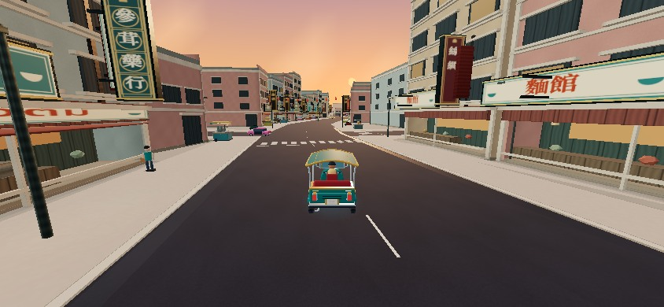 | 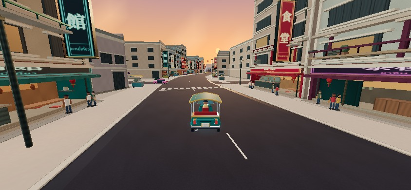 |
| Yaowarat — dusk, production driving camera | 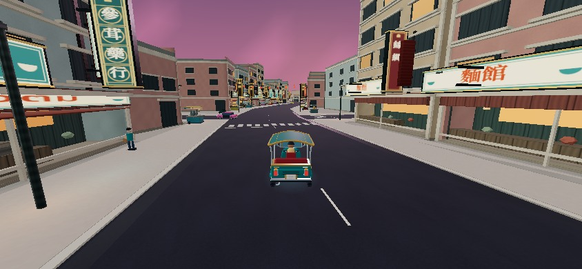 | 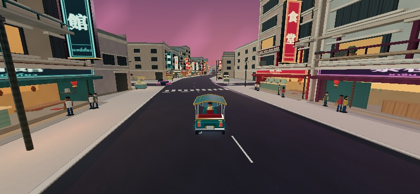 |
| Yaowarat — full night, production driving camera | 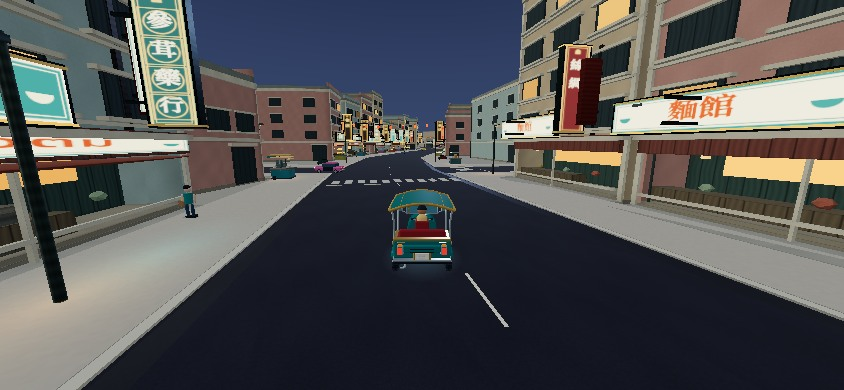 | 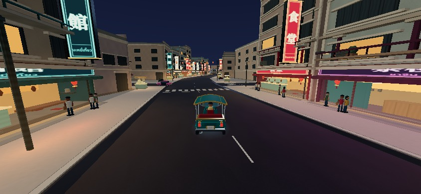 |
| Storefront/sign detail — inspection camera | 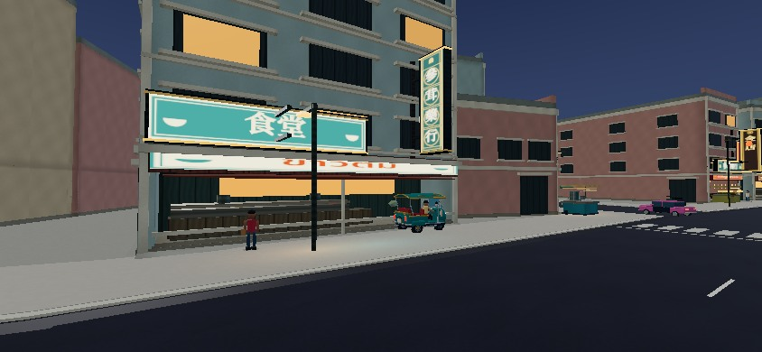 | 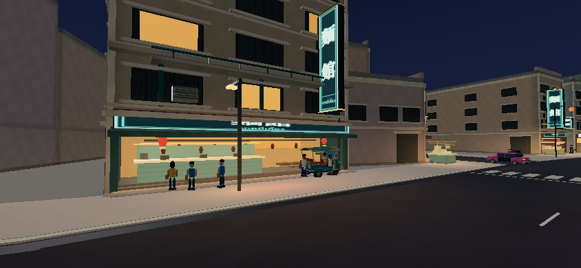 |
| Ratchawong — commercial street | 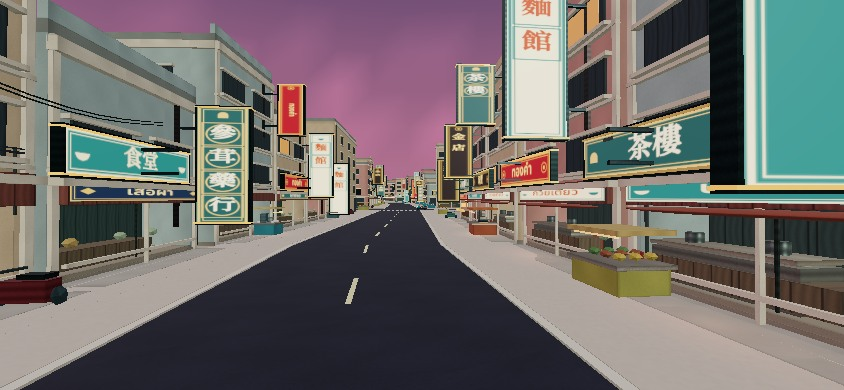 | 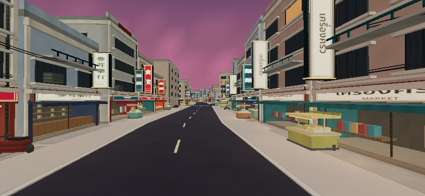 |
| Song Wat — production driving camera | 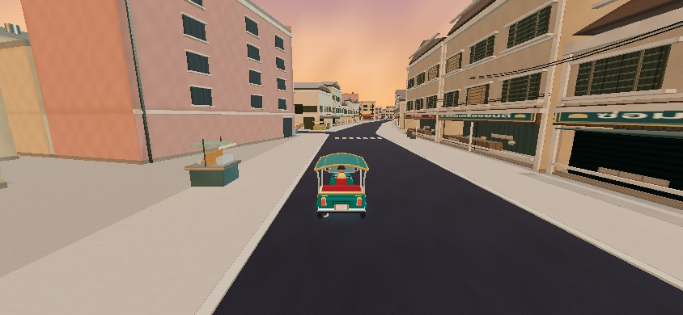 | 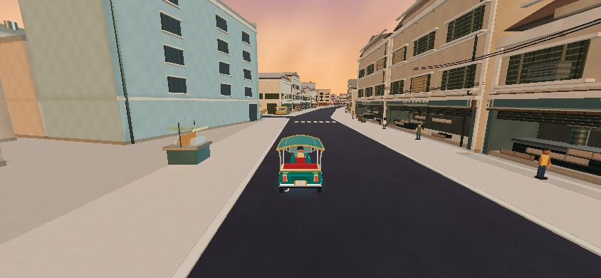 |
| Song Wat — river-facing warehouses | 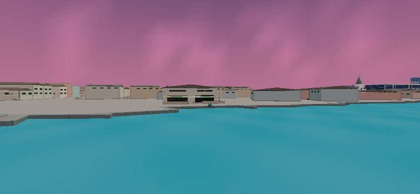 | 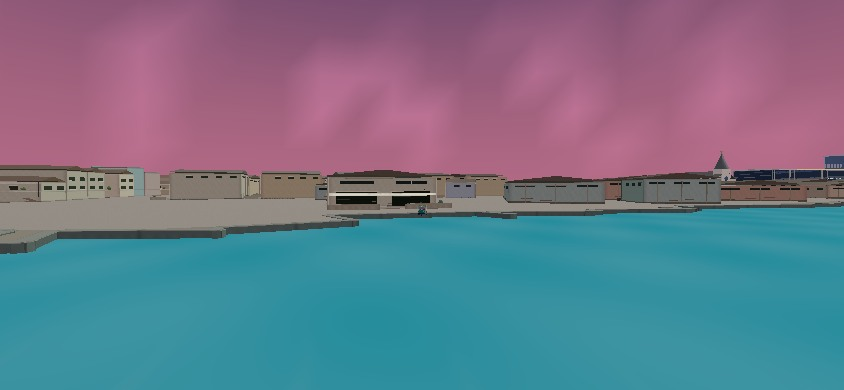 |
| Talat Noi — production driving camera | 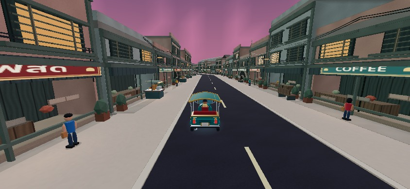 | 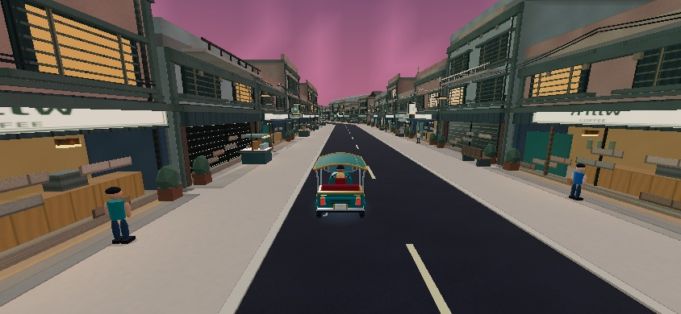 |

Additional night pairs: [375×812 before](before/night-375x812.jpg) / [after](after-release/night-375x812.jpg), [430×932 before](before/night-430x932.jpg) / [after](after-release/night-430x932.jpg), [1280×800 before](before/night-1280x800.jpg) / [after](after-release/night-1280x800.jpg). Portrait images are aspect-ratio render inspections; portrait gameplay still uses the normal rotation guard, shown in the UI evidence.

## Rendering architecture and measured resources

`ArtPiece.glow` is three normalized bytes per architectural instance/vertex, consumed by the existing opaque facade material. Static detail stays in existing spatial/shape/material batches. The original light-field texture is **256×384 RGBA, 393,216 bytes before GPU allocation** and shared by architecture and road/sidewalk materials. It approximates low-height reflected light from real shop and cart positions. It has no shadowing/occlusion solver and is not a real reflection. Shader/texture ownership is included in existing disposal checks.

There are **zero added point lights, transparent illumination overlays, bloom passes, per-frame geometry builds or extra animated crowd draw calls**. Existing district culling and Low quality behavior remain. Global dusk/night sky and ambient-light tuning also affects the rest of Bangkok; illuminated shop materials retain their existing clock.

The [performance comparison](validation/performance.json) contains exact retained-buffer inventory, per-view calls/triangles and production bundle sizes. Materials remain **410**; textures **8→9**; retained geometry buffers grow approximately **4.67%**. JS/CSS use identical build and compression methods on both checkouts. Submitted triangles rise more than retained memory in some close views because the new shop detail is deliberately visible; draw-call and byte counts are reported separately. The existing large-JS-chunk build warning remains.

| Matched retained resource | PR39 | PR40 | Change |
|---|---:|---:|---:|
| Geometry-buffer bytes | 110,134,588 | 115,275,463 | +4.67% |
| Geometries | 9,998 | 9,951 | -0.47% |
| Materials | 410 | 410 | +0.00% |
| Textures | 8 | 9 | +12.50% |
| All retained triangles | 14,166,626 | 14,517,546 | +2.48% |
| Instances | 936,904 | 961,762 | +2.65% |

| Primary matched view | Draw calls PR39 → PR40 | Triangles PR39 → PR40 |
|---|---:|---:|
| yaowarat-sunset | 608 → 593 | 774,014 → 862,586 |
| yaowarat-dusk | 607 → 592 | 773,982 → 862,554 |
| yaowarat-night | 607 → 592 | 773,982 → 862,554 |
| storefront-detail | 484 → 470 | 636,732 → 744,984 |
| ratchawong | 484 → 472 | 596,350 → 662,940 |
| song-wat-street | 522 → 509 | 703,817 → 772,165 |
| song-wat-waterfront | 429 → 427 | 434,008 → 481,044 |
| talat-noi | 475 → 480 | 446,480 → 472,360 |

JavaScript: **2,410,252 → 2,426,123 bytes raw; 787,417 → 793,324 gzip (+0.75%)**, measured with the same Node gzipSync method. CSS remains 136,594 raw / 24,900 gzip bytes. Final sequential host construction: **35.066s → 35.155s**; CPU **40.632s → 40.291s**, ordinary run-to-run variation rather than a speedup claim.

Raw software frame times and host scene-construction observations are retained. They do **not** establish iPhone startup speed, sustained Safari FPS, GPU memory, thermal stability or actual hardware safe areas. Startup wall times are sensitive to concurrent certification work; CPU time and paired inventory observations are identified explicitly in the performance data.

## Regression certification

[Package suite summary and individual logs](validation/suite/summary.json), [new visual/foundation assertions](validation/visual.json), [TypeScript](validation/typecheck-direct.log), [production build](validation/build-final.log), [traffic summary and complete route evidence](validation/routes/summary.json), [browser state/camera checks](validation/browser-state.json), [unmodified production UI](validation/production-ui.json), [CI snapshot](validation/remote-checks.json).

The existing assertions remain intact. Preliminary runs caught oversized sign heights/widths and a reduction below eight shop trades; the implementation was corrected, and the affected checks were rerun. The initial failure logs remain alongside the final successful logs. Fresh geometry checks also validate the complete pedestrian segments, low-detail apron bounds, source ownership and original world fingerprints. Rendering inventory verifies disposal of all retained geometries/materials/textures.

The traffic report distinguishes static, legal left-lane traffic, waterfront routes and the historical centreline/no-yield diagnostic. Legal replay retains **38 vehicles and all 42 journeys across seeds982/41/67**. Historical collisions are reported separately; that diagnostic is neither deleted nor relaxed. Five-minute traffic simulation, extended circle driving, the eleven-fare production controller run and the route matrices provide long-run simulation coverage. This is not a sustained WebGL/device endurance test.

UI checks cover **375×812, 430×932, 844×390 and 1280×800**, long bilingual street-name wrapping, map return, the real ICONSIAM LOOK fixture, and eight restarts with bounded chase-camera position, no stale inspection/art override, stable late resource counts and no GL errors. Production-bundle UI screenshots use the built stylesheet and visible controls.

## Art-direction review and remaining imperfections

Grades are visual judgments from the matched scenes, not automated scores. An A is not awarded merely because tests pass.

| Category | Yaowarat | Ratchawong | Song Wat | Talat Noi |
|---|---|---|---|---|
| Architectural authenticity | B | B− | B | B |
| Building detail | B | B− | C+ | B− |
| Storefront recognition/depth | B+ | B | B− | B |
| Signage/authentic mounting | B+ | B | B | B |
| Night lighting | B+ | B | B− | B− |
| Street life | B− | C+ | C+ | C+ |
| Environmental composition | B | B− | C+ | B− |
| Geographic fidelity/preservation | A | A | A | A |
| Mobile rendering efficiency | B, device gate open | B, device gate open | B, device gate open | B, device gate open |
| Gameplay certification | B+ | B+ | B+ | B+ |

The weakest views were given additional implementation effort: central shops gained staged customer groups, individualized kitchen/tea/merchant elevations and lanterns; river-facing warehouses gained high vents, buttresses and masonry repairs. **Some long upper-storey rows still repeat; merchant shutters and distant warehouse silhouettes remain simple; people use short walks/static browsing rather than rich social choreography; carts and shop merchandise remain stylized low-poly models.** Historic service courts intentionally remain relatively open. Light-field spill is approximate and can soften across nearby wall edges; no physically accurate neon reflections are claimed.

**Benchmark judgment:** the central Yaowarat stretch establishes a substantially stronger, useful benchmark for storefront depth, mounted lettering, evening contrast and bounded rendering cost. The whole of Chinatown is not uniformly at that level yet. It should not be described as a completely finished premium city or as device-certified.

PR41 should first complete the physical Safari route below, then concentrate on the remaining weak Song Wat service elevations/side-street corners and merchant frontages, followed by better vendor/customer poses using the same capped render assets. Keep the approved street/river/footprint foundation and avoid expanding the map before the current quality is consistent.

## Exact outstanding iPhone route

On iPhone 17 Pro Max Safari, choose Medium and landscape. Start Free Roam, drive west along Yaowarat past Hua Seng Heng and the authored shop sequence, turn through Ratchawong to Song Wat, continue through Wanit2/Talat Noi to Holy Rosary and River City, then return through Charoen Krung. Repeat for **12 minutes**, covering sunset→dusk→night. On each circuit open/close the map, pause/resume and use the **5s boost / 10s recharge**. At ICONSIAM, enter/exit LOOK and restart once. Rotate portrait→landscape and check controls and the bilingual street badge. Record frame-time distribution, input delay, heat/battery, memory reloads, contact events and legibility. **This physical-device gate remains unverified.**

Tooling notes: the executor's shell checkout lacked GitHub push credentials, so the connected GitHub API published exact tree-verified source/evidence commits. A pnpm wrapper attempted an automatic install; its incidental workspace edit was reverted and the existing installed toolchain was used directly. Preliminary captures/checks interrupted during iteration are excluded from the delivered gallery; final source hashes and matching checks identify the evidence used above.
