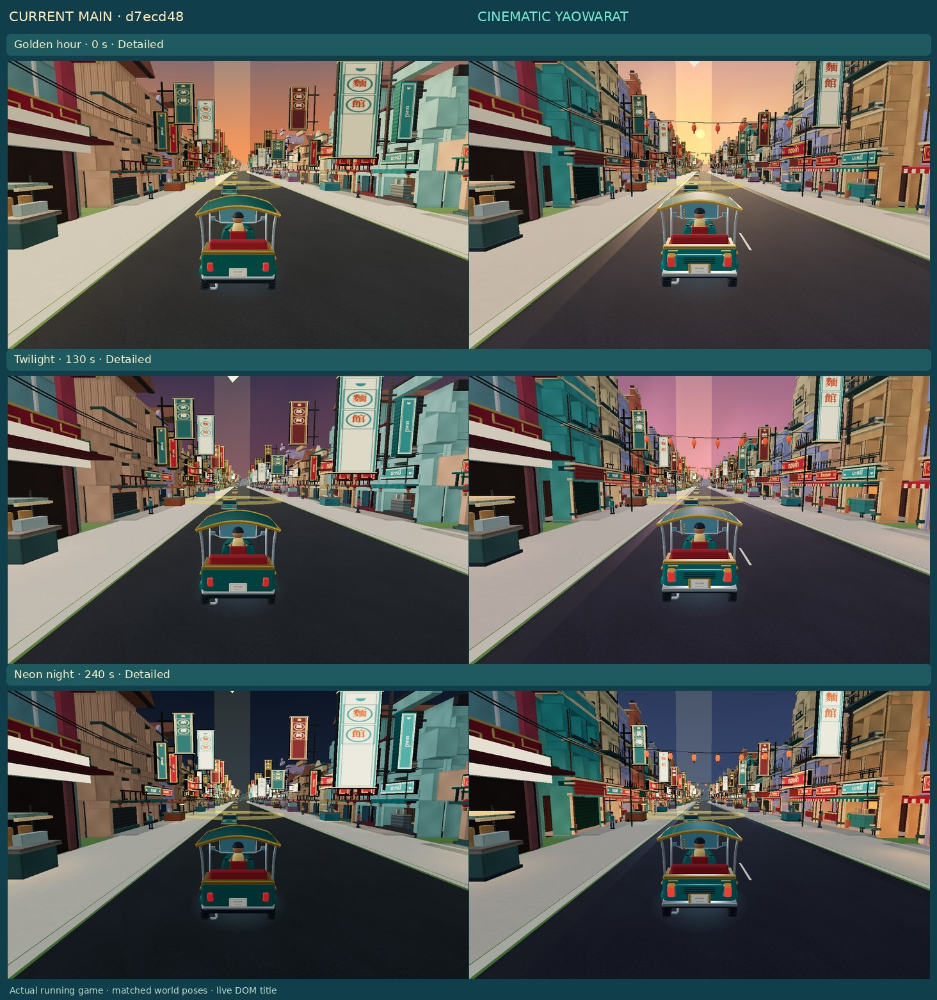
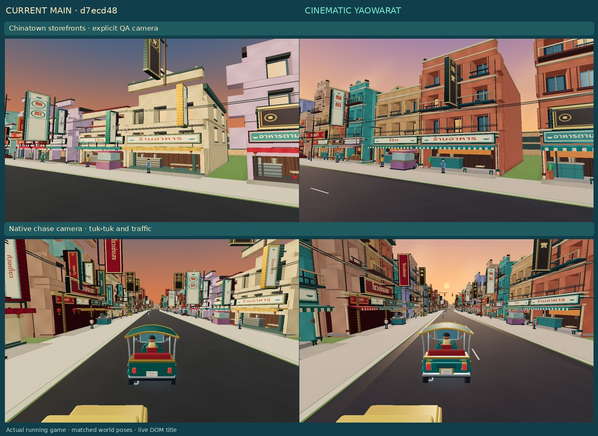
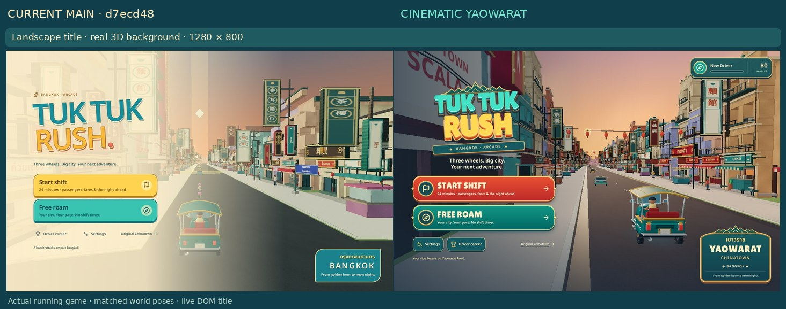
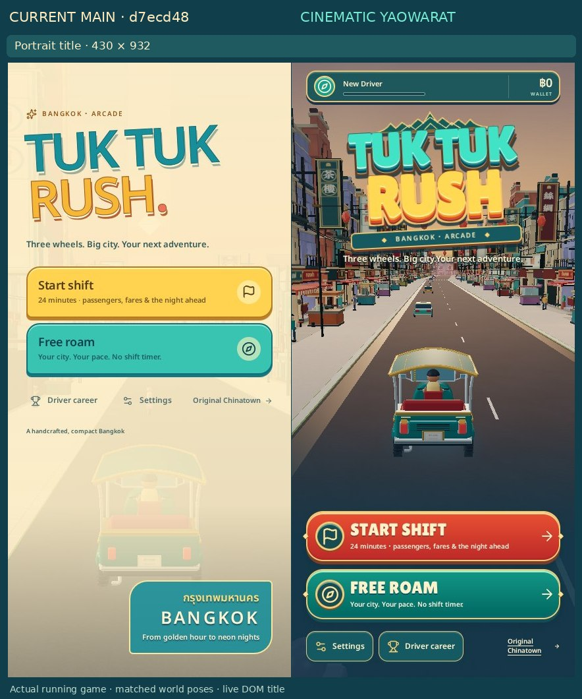
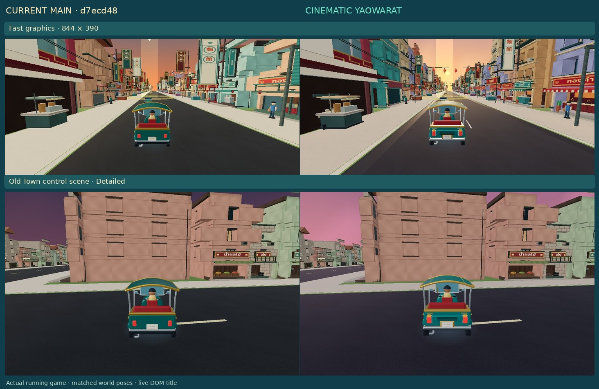

# Cinematic Yaowarat

A fully drivable art pass on the existing one-way Yaowarat corridor, based on main `d7ecd48` (tree `576009f`). Road topology, collision geometry, left-hand traffic, fares, career and BTS remain authoritative.

Twenty frontage parcels are selected; Scala keeps its authored facade. The remaining frontages receive three-to-five-storey shophouses with deep shop rooms, recessed windows, shutters, balconies, cornices, awnings, gold displays, noodle counters, pipes, meters, plants and AC units. These replace the ordinary facade emitter for those parcels. Existing local Thai/Chinese trade lettering gains better proportioned boards and physical supports. Three lantern spans keep their poles outside travel lanes.

Shared rendering separates peach/pink sunsets from cooler shadows, introduces a vertex-shaded cloud dome and restrained occupied-shop bounce, and varies window emission. Both modes retain projected/contact shadows. A trial dynamic sun-shadow pass was removed after profiling its moving-scene cost. Detailed adds near-facade detail and richer materials; Fast preserves complete silhouettes. No postprocessing, SSR, remote decoders or extra point-light array is introduced. Most asphalt stays dry; narrow gutter bands use a different finish. Markings match existing carriageway lanes.

The articulated GLB retains all steering, lean, suspension and passenger pivots. It gains a fabric canopy, ribs, rear louvers, framed lamps/indicators, bumper and garland; night/brake input drives its lenses. The live title composes the actual corridor and vehicle without writing player/chase state. Dimensional DOM lettering, red/teal buttons and an original roof ornament establish the arcade identity. Profile rank/wallet are real saved career data.

## Actual game comparisons

Columns are **current main → this PR**. World stills read the running WebGL canvas, with HUD excluded. This avoids retired DOM paint retained by the software browser after resizing. Title captures include the interactive DOM. The storefront uses an explicit QA camera lease; driving uses the native chase camera. Exact poses/settings are recorded in [validation.json](validation.json).

Picture 3 guided the street depth, projecting signs, warm/cool separation and arcade composition. This remains simpler than the concept's crowds, logo ornament and reflections. The rest of Bangkok keeps its existing grammar: this is a reusable corridor benchmark, not a claimed citywide concept-art match.

## Measurement and checks

| Scene | Mean ms main → PR | p95 ms main → PR | Mean calls main → PR |
| --- | ---: | ---: | ---: |
| Fast stationary | 401.6 → 377.8 | 468.6 → 767.9 | 243 → 269 |
| Fast moving | 417.5 → 400.2 | 807.4 → 842.9 | 251 → 276 |
| Detailed stationary | 506.4 → 541.9 | 1056.8 → 1137.5 | 344 → 374 |
| Detailed moving | 546.3 → 530.3 | 1127.3 → 1105.6 | 347 → 377 |

Results are mixed: mean frame times are comparable, Detailed stationary is 7% slower, and Fast stationary p95 is substantially worse. These small software samples do not establish a hardware speedup. CPU geometry buffers are **115.8 → 116.6 MB**; resident texture counts stay **11 Fast / 13 Detailed**. Detailed resident geometry reaches **399 → 415**, with programs **26 → 31**. The raw JSON includes p50/worst frames, triangles, long tasks and resource counts.

Production first-world-frame probes were **13.93 s main / 13.81 s final PR**; an earlier PR probe was **14.14 s**. Local loading is broadly comparable, not certified mobile startup. JavaScript gzip is **596.00 → 600.71 KB**; CSS gzip **23.31 → 24.71 KB**.

Map click-to-SVG-DOM insertion is **24–50 ms main / 16–40 ms PR** across four samples. End-to-end automation and next-frame callbacks have much larger outliers in both versions, consistent with software rendering/scheduling stalls rather than SVG generation alone. Those samples are retained; physical input/presentation latency remains unverified. No map design or data was replaced.

These are Chromium/SwiftShader diagnostics at DPR 1, not iPhone FPS. Moving samples use native physics at fixed 50 ms steps. CPU buffer accounting deduplicates backing arrays; texture pixels are estimates, not measured GPU bytes. GPU timing/thermal behaviour and sustained 30/60 FPS on iPhone remain unverified.

The GLB grows **606,816 → 657,372 bytes**, **29,068 → 31,432 triangles**. The local OFL display subset adds **7,664 bytes**. No dependency changes. The build retains the existing large-chunk advisory.

TypeScript and production build pass. All **18 automated groups** pass: corridor budgets/clearance/cleanup, career, corrections, graphics foundation, driving, Bangkok roads/maps/architecture, navigation, landmark quality, world completeness, cityscapes, environment, street life, roadside placement, signature signs, layered signs, assets and startup.

Native browser checks pass for simultaneous steering/throttle, pointer release, exact five-second navigation deadlines and hysteresis, map pan/pinch/filters/input isolation, LOOK orbit/zoom/pan/reset, original Chinatown, pause/restart, actual pickup/delivery rewards, reload persistence and shift results. Title checks cover **375×812, 430×932, 844×390, 932×430 and 1280×800**, including 44 px targets, no scroll/clipping and a vehicle centre unobstructed by menu elements. LOOK → map → restart returns chase height to **3.3 m**. Detailed is held through forced context loss/restoration; rendering resumes safely paused with no GL errors.

The context regression forces Detailed through loss/restoration and checks GL errors, paused input and real geometry submission. Generated environment targets are released while the old context is lost and regenerated after restoration. Resource tests verify shared disposal exactly once, bounded culling, unchanged road/collision data and a title pose isolated from gameplay.

## Replit / iPhone check

Open this branch in the existing Replit project and use its normal install/run commands; no new deployment is required. Drive forward along Yaowarat from spawn in Detailed and Fast, from sunset to night. Open/close the map, enter/exit LOOK and restart: chase must recover. Return to title and check saved rank/wallet. On iPhone Safari check landscape touch comfort, quality switching, rotation/UI repaint, heat and prolonged driving. Physical-device testing was unavailable here.

From `artifacts/tuk-tuk-rush`, run `pnpm run typecheck`, `pnpm run test:cinematic` and `node scripts/validate-graphics.mjs`. Browser scripts are `browser-cinematic.mjs`, `capture-cinematic.mjs`, `profile-cinematic.mjs`, `profile-cinematic-map.mjs` and `profile-cinematic-startup.mjs` (after a production build). Set `CHROMIUM_PATH` and `QA_OUT`; `APP_ROOT` lets identical capture/profile protocols target a baseline checkout. The capture emits nine stills, not recordings.

## References / provenance

- [Chulalongkorn University: Yaowarat Lives on the Dragon Road](https://www.arcofmemory.arts.chula.ac.th/yaowarat-lives-on-the-dragon-road/) informed mixed shophouses, gold/medicine/food trades and evening street layers. Geometry is an original compressed interpretation, not surveyed elevations or copied photo textures.
- [Three.js instancing](https://threejs.org/docs/pages/InstancedMesh.html) informed retained shared resources; its [shadow guide](https://threejs.org/manual/pages/shadows.html) explains the repeated scene draws avoided by retained projected shadows. Renderer behaviour was checked against installed source.
- Lilita One is bundled under the [SIL OFL](../../../artifacts/tuk-tuk-rush/public/assets/fonts/OFL-Lilita.txt), with a pinned commit/hash in font provenance and reproducible optional `subset-title-font.py`. Existing local Thai/Chinese fonts remain. Architectural geometry, shaders, vehicle additions and UI ornament are authored in the repository. No concept-art bitmap ships.
