# Colorful Bangkok corrections

Based on current main `7a72554` (merged PR19). These are actual Chromium/WebGL gameplay frames at 844×390, using the same deterministic road/arrival fixtures and evening time. World views use Fast quality. Fixture placement is for visual comparison; the separately driven-fare tests use the real controller. No videos were created.

| Focus | Main | PR |
| --- | --- | --- |
| Title / arcade identity | 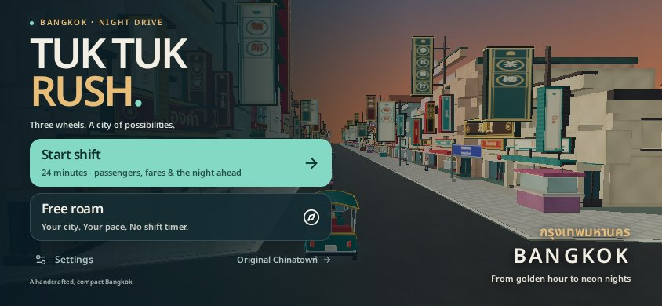 | 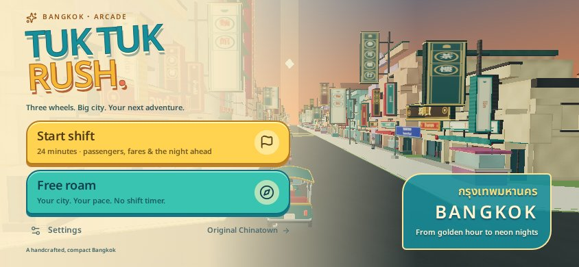 |
| Previously empty bridge approach | 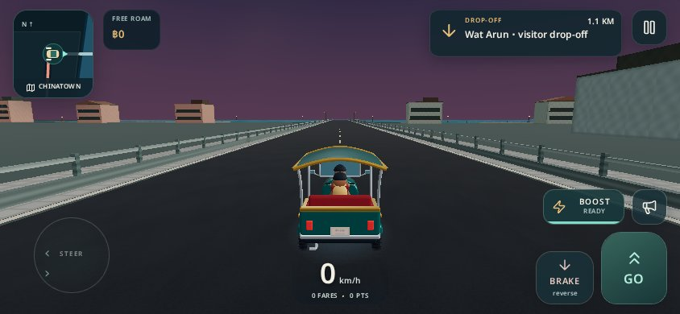 | 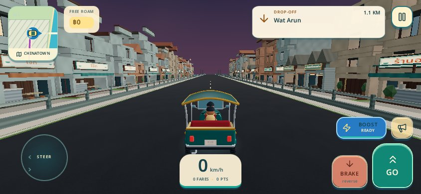 |
| ICONSIAM arrival camera | 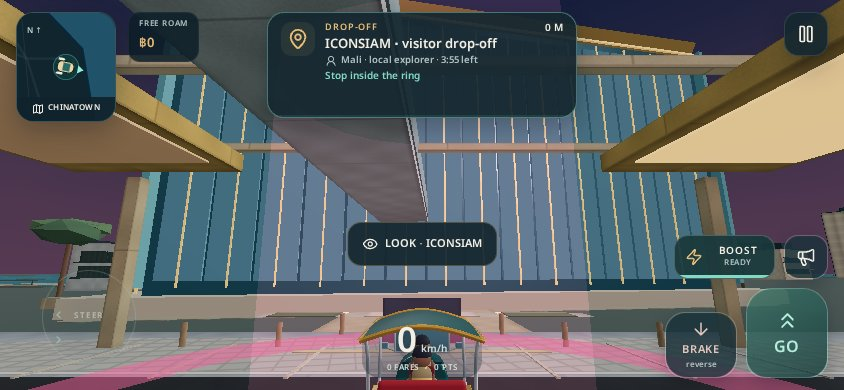 | 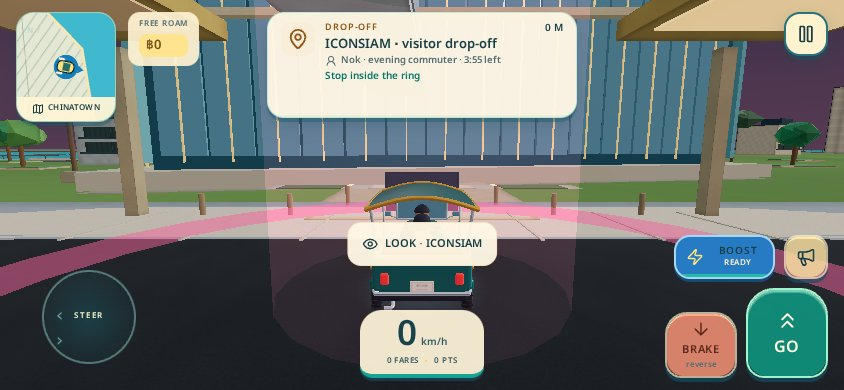 |
| Wat Paknam and canal context | 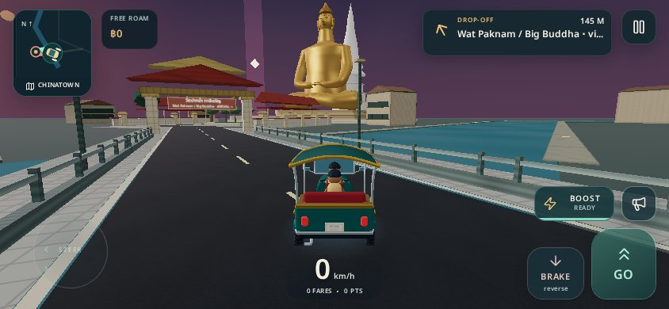 | 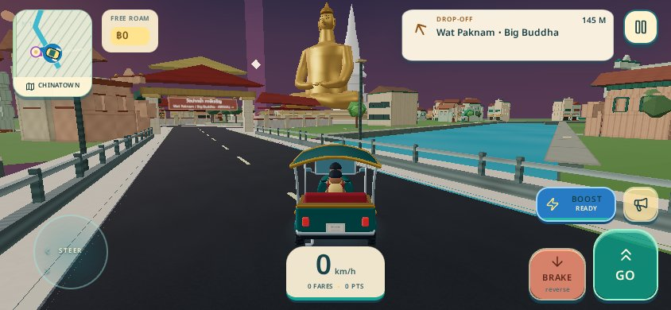 |
| Gold Line station | 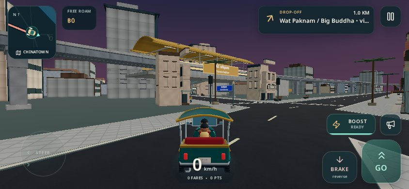 | 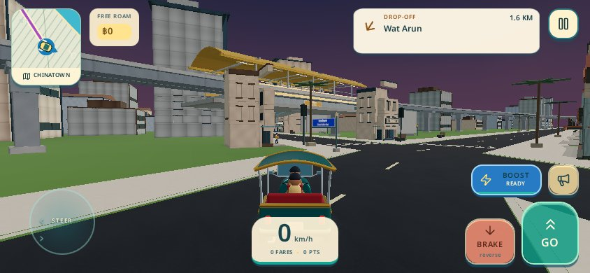 |
| Map discovery | 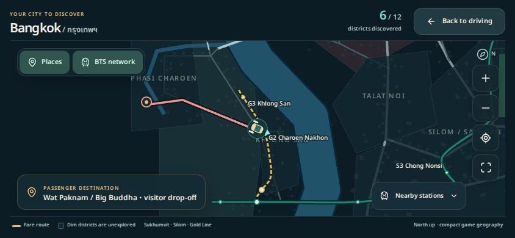 | 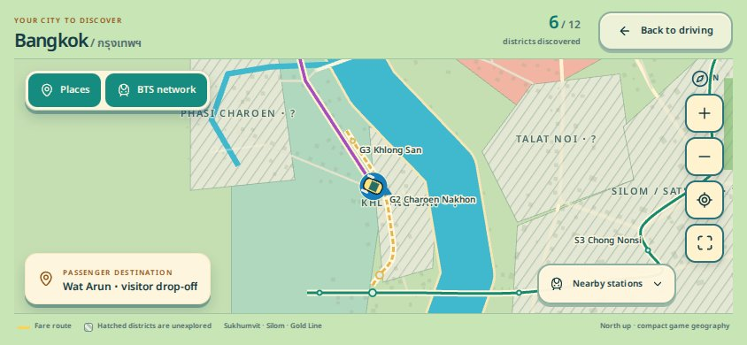 |

[Settings screenshot](after/settings.jpg) · [Test results](validation.json) · [Focused browser checks](after/checks.json)

The bridge infill planner previously skipped all bridge-marked segments, including dry approaches far from the river. It now subjects those land sections to the same exact clearance rules as other streets. Canals and the river are cut out of terrain, allowing water to sit below roads/banks instead of hovering above a continuous ground plane. Small canal residences, temple-edge context and bounded planting retain road, water, park and access clearances. Concrete no longer receives a universal paving grid or dark repeating panel seams; appropriate brick, wood and tile remain.

The camera failure is reproduced on main: LOOK returned to 3.3 m, but opening/closing the map restored the old **47.38 m** inspection pose; restart kept it there. React Three Fiber resets its clock when switching demand/continuous rendering, while the old blend retained a timestamp from before that reset. The fix uses a monotonic presentation clock and resets camera history on lifecycle transitions. [Main reproduction](camera-main.json) and [PR regression](camera-pr.json) show the PR remaining at **3.3 m** after both map closure and restart. The new browser regression runs in the art CI workflow. No physical-device verification is claimed.

Automatic arrival focus is also removed from driving; only explicit LOOK owns inspection. All chase coordinates/FOV are validated and a spatially checked boom retracts around walls. The unrestricted development art override now requires explicit `?qa=1`, has a 15-second lease and clears on lifecycle transitions/unmount.

BTS signs now derive position/size from the actual concourse beam (including narrower Gold Line stations), with physical frames/posts and outward-facing sign faces. The compact navigation sign uses readable place names and two lines, retaining full details on expansion and in its accessible label. Cream, turquoise, gold, coral and blue surfaces replace the old dark theme across menus, HUD, controls and inspection; discovered map districts use distinct colors while unexplored districts use hatching.

Fares use a fresh session seed in ordinary play. The dispatcher chooses connected nearby street/landmark pickups, weights short/medium/occasional longer trips, prevents recent pair reversals, varies passengers, and derives time/fare budgets from directed route length plus curb connectors. Tests can inject a deterministic seed. The 24-minute shift, boost, boarding, discovery and existing traffic physics remain.

Validation: all **16 script groups**, TypeScript and production build pass. The targeted suite checks 288 seeded fares, connectivity/stopping points, camera reset/invalid-state/QA leases, water openings and station mounting. Eleven seeded Bangkok fares covered **9,085 m / 1,002 simulated seconds, zero collisions with traffic disabled**. The original Chinatown driven test also passes using legal directed routes. Browser QA passes all 15 existing interaction groups and five viewports (375×812, 430×932, 844×390, 932×430, 1280×800), plus arrival/LOOK/restart camera recovery, the reproduced map-clock-reset regression and the six longest banner names. The legacy driving test's undirected route helper was replaced because randomized fares can require one-way detours; its distance/collision assertions remain.

Production JS gzip is **588.02 kB** versus PR19's 583.17 kB (+0.83%); CSS is 22.34 kB. No new runtime dependency, dynamic shadow pass, postprocessing effect or per-prop animation loop was added. Camera collision uses the existing spatial index; channel geometry is authored offline. No new hardware FPS claim is made. Physical iPhone Safari and sustained thermal behavior remain unverified; some distant/background assets remain stylized and simple.

Reproduce: run the existing Replit preview on this branch. In landscape Safari test arrivals/LOOK/return/restart at ICONSIAM, Asiatique and Wat Paknam; compare bridge approaches, station signs and the map; try several fresh sessions and verify nearby varied pickups. Locally run `pnpm --filter @workspace/tuk-tuk-rush run test:corrections` and the existing test groups. `scripts/browser-corrections.mjs` captures/checks these fixtures; `APP_ROOT` selects a baseline app, `QA_OUT` selects output, and `CHECK_ONLY=1` skips comparison screenshots.

All added art is original code using existing licensed fonts/assets. Cultural context was checked against [TAT Wat Paknam](https://www.thailandtravel.or.jp/wat-paknam/) and [BTS Gold Line information](https://btsapp1.bts.co.th/website/eng/info/GoldLine-info-history.html); the city remains a compressed stylized adaptation. No merge or deployment was performed.
