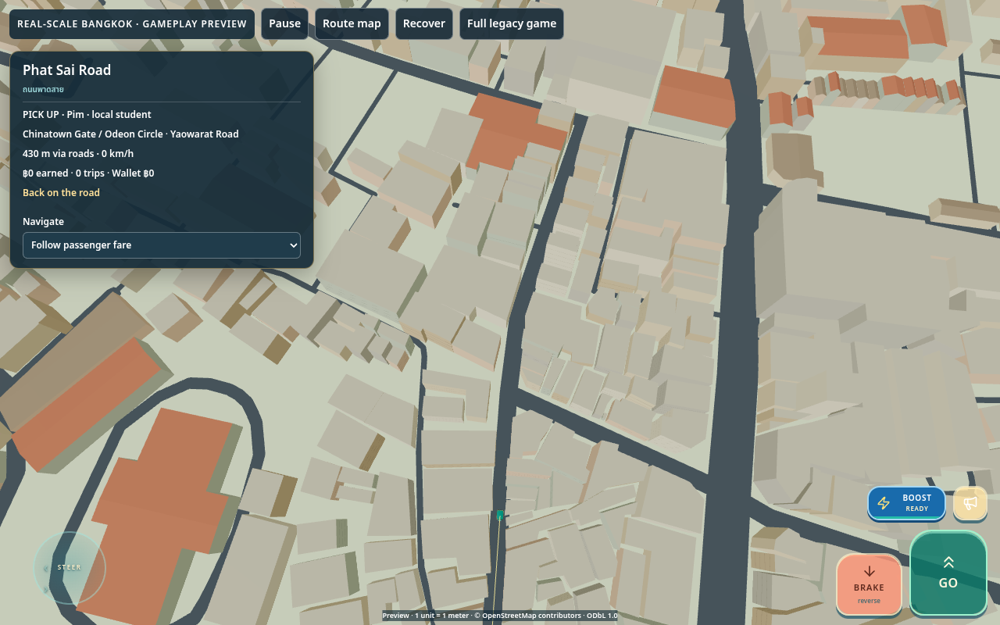
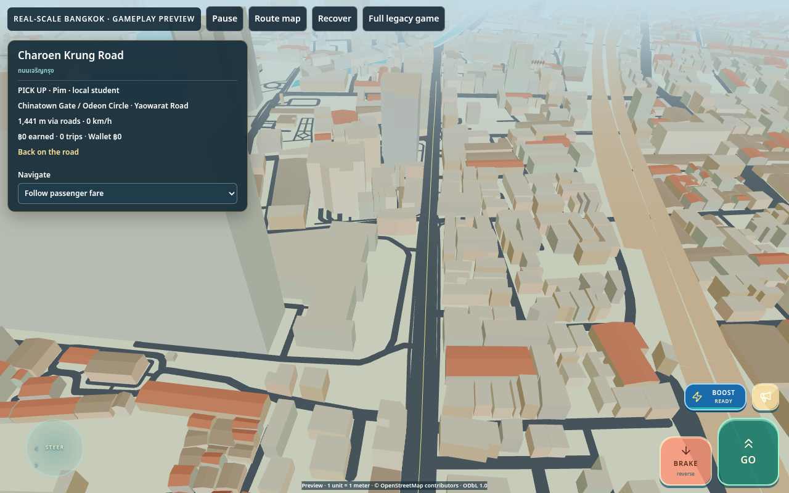

# Geographic Bangkok buildings: engineering certification

**Review status: draft implementation; desktop software-WebGL verification completed, physical iPhone/Safari certification outstanding.** Prepared by Codex, 27 October 2026. This is a reproducible engineering report, not an independent third-party or surveyed GIS certification.

Base: `d7ed15f4c7e5b4df4d4e8eb8dcc6cb28f070a940` (merged PR47; latest main rechecked before delivery). Branch: `codex/geographic-building-architecture`. Delivery: [draft PR48](https://github.com/sunsetseast/TukTukRushBangkok/pull/48). No merge, deployment or publishing is part of this work. [Implementation checklist](checklist.md), [base architecture audit](audit.md), [reproduction commands](reproduce.md).

## A. Geographic building coverage

The compiler uses the **same** Geofabrik Thailand snapshot, `https://download.geofabrik.de/asia/thailand-261024.osm.pbf`, dated **2026-10-24**, SHA-256 `e8373240cf0be47cc641f2c8627e674064d8c47f4ff2a11f6a33fcbfc9a50949`. It was downloaded and checksum-verified once, then relation-complete buildings were extracted on 2026-10-27. Original road/water/rail source bytes and import date are preserved. The country file is not committed or fetched at runtime/CI.

The bounded [building companion](../../../data/bangkok/real-scale/buildings-source.v1.json.gz), SHA-256 `eb9b74dcee6785ab5c67ba093decd72960f6bc6cbd77b75a246af7e71b8121e6`, retains WGS84 outlines, holes, original tags, way/relation IDs, versions, relation members and roles. Osmium assembles complete relations **before** clipping. Projection remains **EPSG:32647, origin 660000 E / 1520000 N, X east / Z south, one unit per meter**. Bounds remain **100.46–100.65 E / 13.63–13.825 N**; this is part of Bangkok, not the entire metropolitan area.

| Source/runtime measure | Result |
|---|---:|
| Usable assembled source objects | 222,286 |
| Whole-building footprints / building parts | 221,045 / 1,241 |
| Building relations / source courtyard rings | 309 / 244 |
| Tagged multipolygon member ways suppressed | 10 |
| Unassembled/open source ways recorded | 6 |
| Height tags present / numeric | 1,546 / 1,546 |
| Level tags present / parseable | 20,992 / 20,969 |
| Roof-shape tags present | 324 |
| Rendered standing building records | 222,123 |
| Documented exclusions / clipped-geometry rejections | 119 / 44 |
| Inferred footprints | **0** |

The 119 exclusions comprise 75 parent footprints fully represented by parts, 22 handcrafted-landmark replacements, 11 residual polygons below 0.1 m², 8 ruins and 1 explicitly underground building retained as references, and 2 duplicate geometries. Every usable source ID has exactly one runtime disposition; [accounting proof](lifecycle-accounting.json). Six unassembled ways are separate rejected source candidates, not usable footprints silently dropped. [Raw source statistics](source-statistics.json), [complete compiler report](../../../data/bangkok/real-scale/buildings-report.v1.json), [special source audit](special-source-audit.json).

Rendered height provenance: **1,526 explicit heights**, **20,212 level-derived heights**, **15 inherited tagged-parent estimates**, **200,370 deterministic type/context estimates**. These counts differ from source tag counts because excluded parents/landmarks and multiple tags overlap. Approximately 90.2% of rendered heights rely on type/context estimation. Meter/foot parsing and reasonable height/level bounds are tested. Heights derived from floors are estimates too; even OSM height tags are not a surveying guarantee. Historical small footprints default to three/four floors rather than randomized towers. Hotels/offices/mixed use use 3.8m estimated floors; other families use 3.2m. Stable source-ID seeds, classification, footprint size and explicit historic-district windows control variation. Raw height, minimum-height, levels and roof tags remain inspectable.

| Coverage sample (explicit rectangular window) | Source objects | Sum footprint area / window area |
|---|---:|---:|
| Yaowarat | 2,566 | 39.52% |
| Bang Rak | 4,488 | 43.51% |
| North | 32,022 | 8.13% |
| East | 57,243 | 10.97% |
| Southwest | 10,593 | 4.08% |

Window bounds are in the compiler report. These are **mapping-density indicators**, not administrative totals or percentages of real buildings mapped. Areas overlap neither a verified parcel inventory nor satellite ground truth; water, parks and legitimate undeveloped land also lower density. Northern/eastern/southwestern windows need completeness investigation. OSM does not contain every Bangkok building, and this PR cannot identify every missing block from the source alone. No parcel or land-use evidence sufficient for safe missing-building infill was established, so no inferred structures are generated. Public spaces, parks, transit and landmark compounds receive no fallback boxes.

## B. City-generation architecture

1. Offline compilation projects full source polygons, validates/canonicalizes rings to millimeter precision, clips to existing bounds, and separates parts from parents. Parent ground plans subtract contained parts; 588 actual parent/part relationships are independently checked for duplicate mass. Other legitimate source overlaps are retained and listed, not silently moved.
2. Each complete footprint has **one representative-point owner chunk**. Full irregular outlines and holes cross seams in owner-local coordinates. **7,287 records cross chunks**, maximum owner reach one tile; existing 3×3 requests include those owners. Original 1,024m chunk coordinates and IDs remain unchanged.
3. Runtime activation builds outward-facing walls and upward triangulated roofs with courtyard holes. Flat, gabled and skillion geometry is supported; hipped/pyramidal shapes use a labeled ridge approximation, and unsupported roof shapes use a labeled flat approximation. Roof-only/carport references do not get invented solid walls. Ground foundations meet the existing flat land surface at -0.25m; no terrain DEM is introduced.
4. Massing uses **256m spatial batches**, street-facing floor courses use **128m batches**, and all share vertex-colored Standard material. There is no per-building mesh/material or per-frame static rebuild. Source-sized irregular volumes, plausible family palettes, floor counts and roofs provide the current architectural variation.
5. Existing low/medium quality settings control 110m/210m street-course detail and existing fog distances. Massing silhouettes remain available; a batch is skipped only when wholly beyond camera-space opaque fog or normal frustum culling. No region is omitted to improve benchmarks. The existing quality system supports **low and medium only**; no unrelated high selector was introduced.
6. Two requests and one synchronous install per streaming tick are retained; chunks evict beyond the existing retention collar. Owned BufferGeometry is disposed and removed, shared material survives eviction and is released on world teardown. The overview remains a coarse independent city view and does not request whole-city building detail.

Implemented families: **8,900 shophouses, 6,524 commercial, 194,563 residential, 1,964 apartments, 599 hotels, 148 offices, 229 warehouses, 204 industrial, 1,324 high-rise, 5,949 mixed use and 1,719 religious**. These are deterministic architectural classifications, not claims that OSM surveyed each use.

`GeographicBuilding` exposes stable ID/version/tags, source and resolved polygons, owner-local orientation, family/classification/neighborhood, height/minimum height/floors/basis, roof and approximation labels, material category, seed, confidence/provenance and wall sections. Each edge includes source-road-facing candidacy and collision eligibility. A future Thai façade engine can consume these sections without reconstructing placement or collisions. Existing rectangular compressed-world building placement is unsuitable for arbitrary source polygons; shared batching/material and Thai palette concepts are reused instead. No full façade shader overhaul or WebGPU migration is included.

## C. Priority district comparison

**Yaowarat / Chinatown:** the former bare road skeleton now has continuous low-rise source-shaped commercial blocks, dense Phadung Dao (Soi Texas) frontage, actual courtyard gaps and rear structures, and river-oriented Song Wat/Talat Noi massing. The elevated view makes irregular block boundaries visible. Gate and Wat Traimit retain their production anchors, source-road approaches and authored meshes. There are no artificial evenly spaced storefront rows. Plain walls and floor courses remain visibly preliminary.

**Bang Rak / Charoen Krung:** heritage-scale roofs and narrow plots coexist with larger hotel/apartment/commercial volumes toward Si Phraya and Silom. River City and ICONSIAM retain their migrated models; their surrounding source volumes establish riverfront context. Grand Postal Building, Warehouse 30 and Captain Bush Lane surroundings use ordinary source massing, not inaccurately transplanted compressed-world artwork. Not every named heritage property has a separately audited architectural identity or custom façade.

Future handcrafted migration must register a reviewed real anchor/orientation, source-road access, replacement source IDs or compound polygons, local model factory and collision envelope in the explicit replacement mechanism. Old compressed coordinates are not valid placements. This contract scales to Grand Postal, Warehouse 30, Wat Mangkon and future landmark compounds; those art migrations are not claimed complete here.

## D. Collision and preservation audit

**792,673 conservative oriented wall segments** are available across all source chunks. They follow actual concavities and courtyard edges rather than enclosing rectangles. Imported walls intersecting road corridors (including bridges), water, and elevated/roof-only parts are withheld as ground colliders. Vehicle broad-phase indexing now invalidates on streamed obstacle-array replacement and applies to geographic driving. No source road, water edge, railway, station, or original landmark anchor was relocated.

The replacement register excludes 22 ordinary source footprints at the four custom sites. Existing model collision radii and road access remain unchanged; the larger replacement envelopes intentionally protect those compounds. More accurate future compound artwork needs reviewed polygons rather than expanding approximate circles indiscriminately.

The source contains **1,469 non-part overlap cases** requiring mapping/stacked-building review. The compressed [exception ledger](../../../data/bangkok/real-scale/building-exceptions.v1.json.gz) records **76,625 road/water conflict records**, including **76,510 road** and **142 water** cases (categories overlap). These are not presented as cleared/surveyed sites. Estimated road-width ribbons dominate: [diagnostic audit](clearance-audit.json) separately counts tagged widths and covered passages. Ten sampled Yaowarat/Song Wat/Charoen Krung/Si Phraya/Silom cases show clear source centerlines or explicit covered passages; this sample does not clear every exception citywide. Conflicting wall colliders are withheld, but source visual massing remains; overhangs, portals and questionable source geometry need targeted subsequent review. No arbitrary displacement of buildings/roads hides these conflicts.

All emitted collider edges pass independent road-ribbon and water-intersection assertions. Source buildings are not fabricated into parks, public squares or transit; existing mapped buildings there remain source references/massing where eligible. Complex vertically stacked parts/podiums are not fully reconstructed by the current 2D parent-subtraction policy. Flat ground, estimated road widths and unverified covered-passage clearances remain material limits.

## E. Performance and resource behavior

Environment: **Codex Cloud Linux, Node 24.19, Chromium 154.0.8037.57, ANGLE SwiftShader software WebGL, 1280×800, two-CPU cgroup**. Local Vite, unthrottled local asset delivery; no hardware GPU, physical iPhone or Safari. Automatic production quality degradation was left active. Gallery frame samples are low quality, short (5–23 frames / approximately 2.5s), and contain considerable scheduling noise. They expose regressions; they are not stable mobile FPS estimates.

The [original pre-implementation baseline](original-before-metrics.json) and [initial baseline images](initial-baseline/) were recorded before building runtime assets existed. Camera QA exposed two poor framing choices; the accepted matched gallery subsequently reran the same final renderer with the **actual base-commit assets** for before, and implemented assets for after. [Before metrics](before/metrics.json), [measured after metrics](measured-after-metrics.json), [machine-readable summary](performance.json), [full ten-view performance table](performance-table.md). The final gallery is refreshed separately against final assets; its timing record is linked in the gallery directory. The preserved matched measurement predates removal of nine reference-only ruins/underground volumes; the policy delta proves every remaining building record unchanged. Final gallery capture ran alongside build/source validation and had slower frame samples (Yaowarat median 917ms); those raw observations are retained rather than substituted into the matched table. Early cold runs were 18.49s before and 20.11s at first implementation; different warmup conditions prevent attributing the later lower absolute times to an optimization.

| Matched observation | Base assets | Building assets |
|---|---:|---:|
| First nine chunks resident | 6.11s | 9.81s |
| Geographic global data/session initialization | 632ms | 665ms |
| Initial nine chunk gzip bytes | 462,156 | 2,264,068 |
| Initial navigation typed-array bytes | 27,354,316 | 27,354,316 |
| Yaowarat JS heap before explicit GC | 114.22 MiB | 246.49 MiB |
| Building attribute allocation upper bound | 0 | 45,330,516 bytes (43.23 MiB) |
| Active scenery meshes / GPU geometries | 84 / 53 | 823 / 108 |
| Chunk activation median / maximum | 67 / 654ms | 396 / 946ms |
| Building-only generation median / maximum | 0 | 299 / 394ms |
| Body transfer/decompression median / maximum | 6 / 11ms | 612 / 1,070ms |
| JSON parse median / maximum | 1.6 / 2.4ms | 26.8 / 66.4ms |
| Yaowarat driving median / p95 frame | 183 / 367ms | 583 / 617ms |
| Yaowarat driving calls / triangles | 37 / 83,398 | 73 / 137,984 |

The JS heap comparison is Chromium performance.memory at the matched first driving sample, without forced GC; it includes temporary allocation and is not retained memory. Separate full-GC travel measurements below assess retained residency. Body/decompression duration includes awaited scheduling while synchronous geometry generation runs; it is not an isolated decoder CPU benchmark. Activation includes existing handcrafted meshes as well as buildings. Attribute byte counts are position/normal/color allocation estimates, not driver-reported VRAM; mesh and GPU geometry counts differ because instanced content shares geometry. Software rendering is already slow on the base game. Added buildings materially increase cost, and synchronous chunk activation still produces substantial hitches.

A measured batch improvement reduced the first 128m-shell implementation's Yaowarat **229 calls / 165,072 triangles / 1,117ms median** to **73 calls / 137,984 triangles / 583ms** by using 256m shells and culling entirely opaque-fog batches. [Earlier measurement](batching-before.log). This improves the first implementation but does **not** erase the regression relative to an empty city.

Total chunk gzip grows **11,816,737 → 36,738,182 bytes (+24,921,445 bytes / 23.77 MiB)**. The offline building source adds 9,358,664 bytes and is not downloaded by the game. Global gameplay metadata is 747,261 bytes (+91), navigation 5,492,682 bytes (unchanged), reference runtime 10,612,414 bytes (+203); the normal game does not fetch the reference runtime. Runtime geographic addition totals **24,921,739 bytes** across chunks and metadata/reference assets. The new offline source/report/exception/replacement companions total 10,034,575 bytes; with runtime changes the geographic asset increase is 34,956,314 bytes (excluding QA images/logs and the small manifest text delta). The chunk streamer, not initial load, carries the rest of the city.

[Six-cycle residency proof](travel-proof/metrics.json) relocates among a sparse northern sample, Chinatown and Silom with the camera following each active district: 18 stops, up to 14 active chunks, 163 evictions, no browser errors. The sparse sample renders 5,449 buildings, 56 calls and 56,507 triangles; the dense Silom residency contains 19,440 buildings, 71 calls and 107,897 triangles at its chase view. Relocations are loading/resource tests, not driven-route evidence. After two full GCs at each stop:

| District | Active meshes on every visit | Backing store MiB | JS heap MiB range | Building attribute MiB |
|---|---:|---:|---:|---:|
| North | 563 | 53.45 | 51.55–52.27 | 15.05 |
| Chinatown | 823 | 86.19 | 75.04–75.67 | 43.23 |
| Silom | 1,242 | 114.54 | 91.07–95.80 | 68.08 |

Backing storage differs by less than 1KiB per same-district visit; active mesh counts remain constant. JS heap has modest variance, particularly the last Silom sample, so this is bounded-cycle stability evidence, not an indefinite-process memory guarantee. A real preexisting leak was found: evicted landmark roots remained attached after geometry disposal and were reuploaded. They now detach before disposal; regression tests assert detachment and resource events. [Stability assertions](memory-stability.json).

Existing low/medium modes were explicitly sampled at the same final Silom residency: low median/p95 **500/533ms** (6 frames), medium **567/700ms** (5 frames), actual sampled quality recorded. No high mode exists. Sustained medium/mobile thermal performance and network startup remain unverified. A physical iPhone Safari pass and reduced activation stalls are needed before a mobile performance certification.

## F. Gameplay and automated verification

[Production-controller results](gameplay-tests.json): all 792,673 imported colliders loaded into the test, a **345m actual driven paid fare**, pickup/dropoff/rewards and legacy save preservation, **zero collision frames on that fare**, **421.24m bridge traversal at the existing 7m deck**, and three source chunk-seam crossings retaining speed. Existing destination access roads and all four landmark coordinates/collision envelopes are checked. This does not claim a manual drive along every street.

[Actual browser gameplay](gameplay-browser/browser-report.json): keyboard movement, LOOK inspection, navigation/mission and wallet persistence, bounded eviction, landscape map, touch-emulated controls/boost, and default legacy startup with zero geographic requests; zero page errors. Touch emulation is desktop Chromium, not an actual phone. Screenshots are in the same directory.

| Requirement | Executed evidence |
|---|---|
| 1–2 reproducible import / source identity | One checksum-pinned PBF extraction; repeated offline rebuilds; 480-file byte equality; source version/tags/IDs asserted |
| 3–5 valid footprints / multipolygons / seams | All-source Shapely validation; split-outer+hole Osmium fixture; source/runtime difference checks; unique ownership and reach |
| 6–7 heights / determinism | Unit/range/tag-priority/historic fixtures; deterministic compiler and all-source Three.js generator checks |
| 8–10 road / water / landmark safety | Independent emitted-edge clearance and replacement-envelope assertions; explicit exceptions ledger |
| 11 parts | 588 real parent/part relationships checked; source IDs/member-way suppression and parent subtraction |
| 12 graphic LOD | Near/far detail and opaque-fog visibility assertions using existing low/medium modes |
| 13–14 streaming / disposal | Existing geographic activation/eviction tests; GPU geometry dispose events, shared-material survival, detached landmark roots; 18 browser stops |
| 15 projection | Existing origin/projection/topology fixtures unchanged and passed |
| 16 vehicle collision | Production controller stops at imported test wall; obstacle-index replacement invalidates cached data |
| 17 geographic gameplay | Driven fare/bridge/seams, rewards/navigation/save tests and browser interactions above |
| 18 legacy behavior | **24/24** existing regression checks passed; [ledger](legacy-regressions.json) and [durable resumed log](legacy-regressions.log) |
| 19–20 TypeScript / build | TypeScript passed; production Vite build passed; [latest build log](production-build.log) and [integration validation log](surface-policy-validation.log) |

[All-source geometry test](geometry-tests.json): **222,123 building records, 18,462,054 generated vertices**, courtyard roof area/winding, deterministic meshes, LOD, production collision and resource disposal passed. Original geography/water/seam and 21-station checks passed; [base geography proof](base-geography-checks.json), [full validation log](final-validation.log). Five Python fixtures include reference-only ruins/underground handling. The final full-source validation also passed after all policy and accounting changes: all 222,123 records and 792,673 collider edges, source geometry/provenance, protected masks and complete lifecycle accounting. [Final source validation](final-source-validation.log), [source results](source-validation.json), [policy delta proof](surface-policy-delta.json), [final accounting/reproduction log](accounting-repro.log).

The cloud environment restarted during the legacy suite: the first 16 successes/timings were observed in execution output before the restart; that raw temporary log was lost. The checkpoint ledger explicitly preserves this provenance, and the remaining eight ran with durable logs after restart. Default reproduction runs all 24; resume is opt-in and was used only for the interrupted validation. No assertion was weakened. CI now regenerates and compares building assets, validates source geometry and runs building/gameplay tests using the existing geography workflow.

## G. Genuine WebGL gallery

All images are **actual game renderer captures**, 1280×800 Chromium software WebGL, daytime/sunset lighting. No OSM screenshots, image generation or conceptual renders substitute for evidence. The before images use exact base assets; the final after images use generated source-footprint assets in the same unified geographic world. Camera geographic inputs and road alignment rules are versioned in `browser-geographic-buildings.mjs`; no separate demonstration map exists. Final metadata: [before](before/metrics.json), [after](after/metrics.json).

| View | Before | After |
|---|---|---|
| Yaowarat at driving height | [PNG](before/yaowarat-drive.png) | [PNG](after/yaowarat-drive.png) |
| Yaowarat elevated overview | [PNG](before/yaowarat-overview.png) | [PNG](after/yaowarat-overview.png) |
| Dense Chinatown side soi (Phadung Dao / Soi Texas) | [PNG](before/chinatown-soi.png) | [PNG](after/chinatown-soi.png) |
| Song Wat / Talat Noi | [PNG](before/song-wat-talat-noi.png) | [PNG](after/song-wat-talat-noi.png) |
| Charoen Krung driving | [PNG](before/charoen-krung-drive.png) | [PNG](after/charoen-krung-drive.png) |
| Bang Rak elevated overview | [PNG](before/bang-rak-overview.png) | [PNG](after/bang-rak-overview.png) |
| Si Phraya frontage | [PNG](before/si-phraya-frontage.png) | [PNG](after/si-phraya-frontage.png) |
| Silom commercial skyline | [PNG](before/silom-skyline.png) | [PNG](after/silom-skyline.png) |
| Riverfront block | [PNG](before/riverfront-block.png) | [PNG](after/riverfront-block.png) |
| Heritage / modern transition | [PNG](before/heritage-modern-transition.png) | [PNG](after/heritage-modern-transition.png) |

## H. Remaining limitations and next phase

The architecture foundation is implemented across all 471 current chunks, with detailed visual QA concentrated in the two priority districts. This certifies reproducible source geometry, working streamed massing and tested gameplay preservation within the stated scope; it does not certify complete Bangkok mapping, final architectural fidelity or mobile performance.

Remaining work includes OSM completeness investigation, the documented road/water/overlap exceptions, correct complex vertical parts and covered passages, more precise landmark compounds, terrain elevation, unknown/approximated roof shapes and basic blank façades. Property-specific heritage identities are incomplete. No safe parcel-derived fallback is enabled. Rare very large owner-crossing objects beyond the measured one-tile reach would require revisiting activation policy; the compiler report/assertions expose that bound.

Recommended next PR: **advanced Bangkok procedural Thai façade engine**, consuming the stable edge/family/seed/provenance contract for windows, shutters, balconies, storefronts and weathering. Preserve source placement/collisions, use neighborhood-specific treatments, and include physical iPhone Safari profiling plus chunk activation/mesh-budget improvements before increasing detail broadly. No merge or deployment recommendation is implied by this draft.

© [OpenStreetMap contributors](https://www.openstreetmap.org/copyright). Bounded source and derived geographic runtime database: [ODbL 1.0](https://opendatacommons.org/licenses/odbl/1-0/). Attribution and source/reproduction records must accompany redistributed data.
