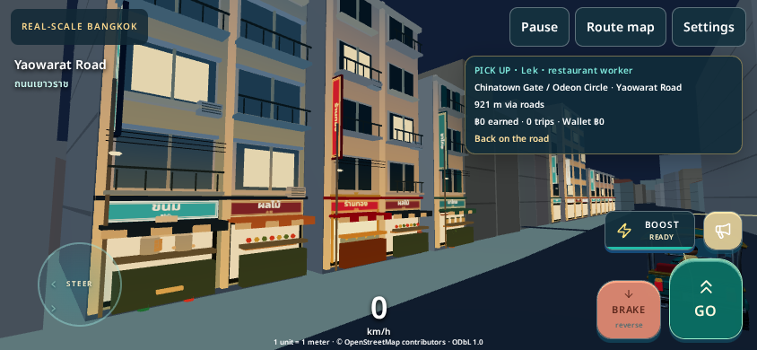
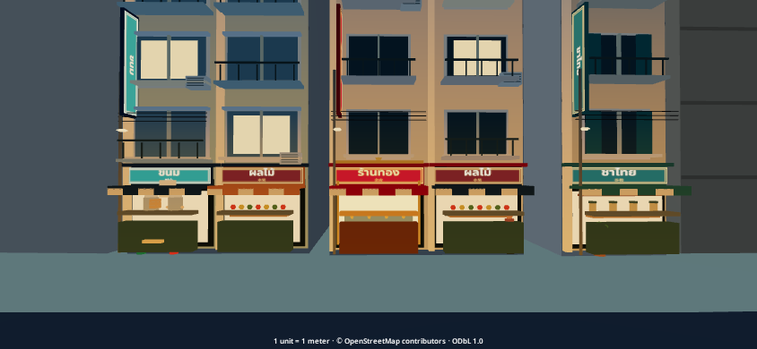
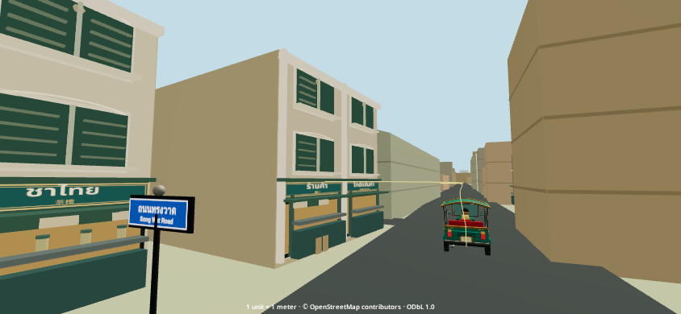

# Actual rendered evidence

Runtime `cfb0ad3e661a21bb1f98e9bc860e3b4ebdfc74d8`; Linux Chromium/SwiftShader, 844×390 touch viewport. Not physical iPhone screenshots. All 14 final views were visually inspected. Close-ups marked HUD hidden use CSS only; actual world geometry, source assets and lighting remain unchanged.

| View | Time / quality | HUD | Source edge |
| --- | --- | --- | --- |
| [Yaowarat daytime](01-yaowarat-day.png) | day / Pretty | Visible | `osm:way/449024152:0:2` |
| [Yaowarat night](02-yaowarat-night.png) | night / Pretty | Visible | `osm:way/449024152:0:2` |
| [Gold-shop close-up](03-gold-shop.png) | night / Pretty | Hidden | `osm:way/449024152:0:2` |
| [Noodle/food storefront](04-noodle-kitchen.png) | night / Pretty | Hidden | `osm:way/1144273181:0:1` |
| [Adjacent varied tenants](05-varied-frontage.png) | day / Pretty | Hidden | `osm:way/449023965:0:4` |
| [Vertical signs and cables](06-signs-and-cables.png) | dusk / Pretty | Hidden | `osm:way/449024152:0:2` |
| [Approved Chinatown Gate approach](07-gate-approach.png) | day / Pretty | Visible | `osm:way/977567143:0:1` |
| [Historic Song Wat](08-songwat-historic.png) | day / Pretty | Hidden | `osm:way/1053934650:0:0` |
| [Fast night](09-fast.png) | night / Fast | Visible | `osm:way/449024152:0:2` |
| [Pretty night](10-pretty.png) | night / Pretty | Visible | `osm:way/449024152:0:2` |
| [Elevated source alignment](11-elevated-alignment.png) | day / Pretty | Hidden | `osm:way/449024152:0:2` |
| [Song Wat night](12-songwat-night.png) | night / Pretty | Hidden | `osm:way/1053934650:0:0` |
| [Live driving, day](drive-day.png) | Day / Pretty | Visible | Recorded production driving segment |
| [Live driving, night](drive-night.png) | Night / Pretty | Visible | Recorded production driving segment |

## Matched before/after

| Source camera | PR59 | PR60 |
| --- | --- | --- |
| Yaowarat daytime | [Before](before-01-yaowarat-day.png) | [After](01-yaowarat-day.png) |
| Adjacent varied tenants | [Before](before-05-varied-frontage.png) | [After](05-varied-frontage.png) |
| Approved Chinatown Gate approach | [Before](before-07-gate-approach.png) | [After](07-gate-approach.png) |
| Historic Song Wat | [Before](before-08-songwat-historic.png) | [After](08-songwat-historic.png) |
| Elevated source alignment | [Before](before-11-elevated-alignment.png) | [After](11-elevated-alignment.png) |

Gate artwork is preserved from the existing geographic renderer; its earlier model proportions are not rebuilt here. Large source masses outside admitted frontage remain simplified. Pedestrians/props are lightweight and static; full interiors and individually verified real businesses remain future refinement.
