# Bangkok visual comparison gallery

Twenty-seven named locations, 61 actual WebGL views per version. Baseline: current main `9e24ada`; after: this draft. No generated concept images or screenshot-only geometry. The initial elevated baseline is 844 × 480 and the desktop after overview is 1000 × 650; corrected road/night/ground captures are 844 × 480. These are corresponding locations and camera directions, **not pixel-aligned metric comparisons**. Road starts are snapped to legal roads in each version; relocated plots and new storefronts can change the actual shot position. Every recorded pose and viewport is in [before/survey.json](before/survey.json) and [after/survey.json](after/survey.json).

Road = normal gameplay chase camera. Elevated, ground, river and night = fixed inspection camera, with no obstruction removal. Individual reference links and perspective coverage are in [references](references.md), [historic](historic-references.md), [commercial](commercial-references.md) and [Victory](victory-references.md). Grades below judge the represented location, not whether its name is visible. See [full review and deferred work](visual-review.md).

## 1. Lumphini Park lake geography — B

| Current main | Draft |
|---|---|
| 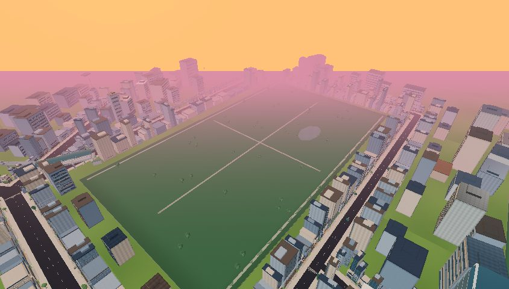 | 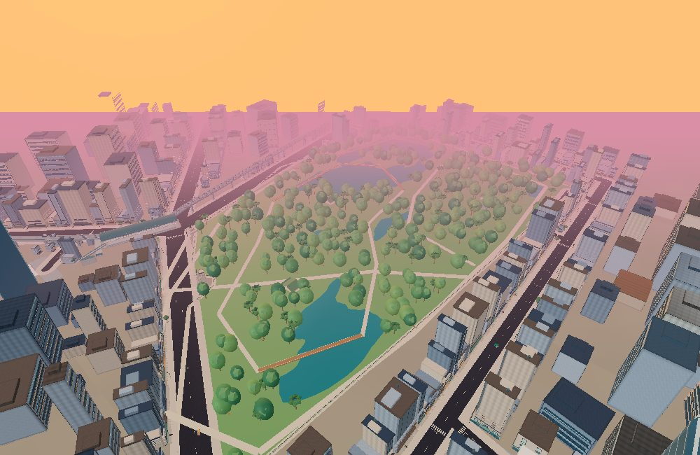 |

Sourced boundary, diagonal southwest edge and irregular lake/island topology now read as a designed park. Affine compression shortens distances; the skyline and plant silhouettes remain simplified.

elevated: [before](before/lumphini-aerial-elevated.jpg) · [after](after/lumphini-aerial-elevated.jpg)

## 2. Lumphini Wireless Road entrance — B

| Current main | Draft |
|---|---|
| 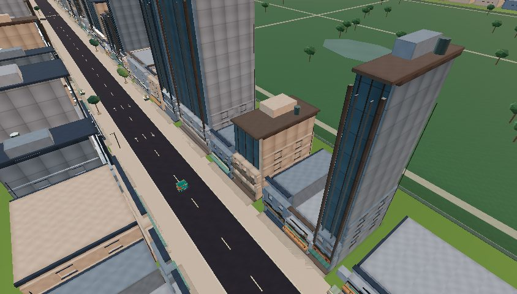 | 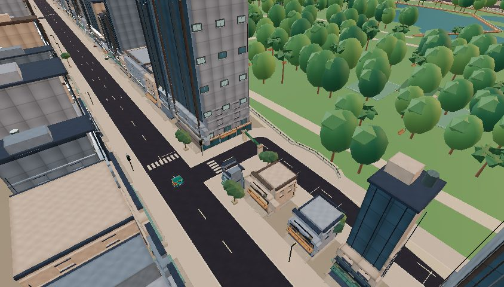 |

Connected school-side parking, a named gate, fence opening and marked parking provide a credible vehicle arrival. This is the Wireless school-side access interpretation, not permission to drive the recreation paths.

road: [before](before/lumphini-entrance-road.jpg) · [after](after/lumphini-entrance-road.jpg) · elevated: [before](before/lumphini-entrance-elevated.jpg) · [after](after/lumphini-entrance-elevated.jpg) · night: [before](before/lumphini-entrance-night.jpg) · [after](after/lumphini-entrance-night.jpg)

## 3. Lumphini lakes and island — B

| Current main | Draft |
|---|---|
| 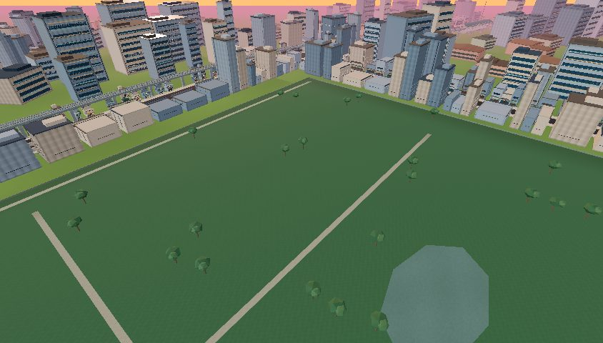 | 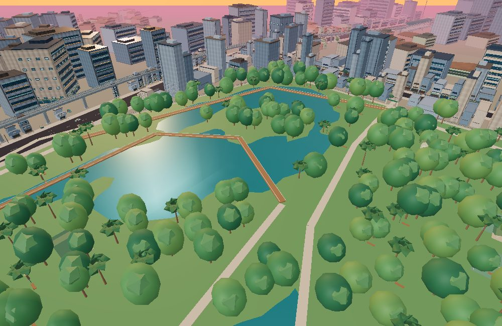 |

Distinct lakes, the main island, paths and bridges replace the former rectangular green block. Water is opaque; the park is less botanically diverse than the reference.

ground: [before](before/lumphini-lakes-ground.jpg) · [after](after/lumphini-lakes-ground.jpg) · elevated: [before](before/lumphini-lakes-elevated.jpg) · [after](after/lumphini-lakes-elevated.jpg)

## 4. Victory Monument roundabout — B

| Current main | Draft |
|---|---|
| 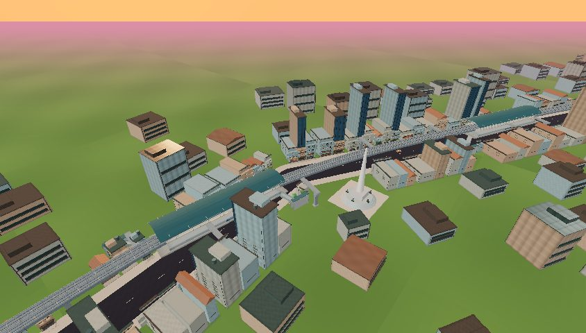 | 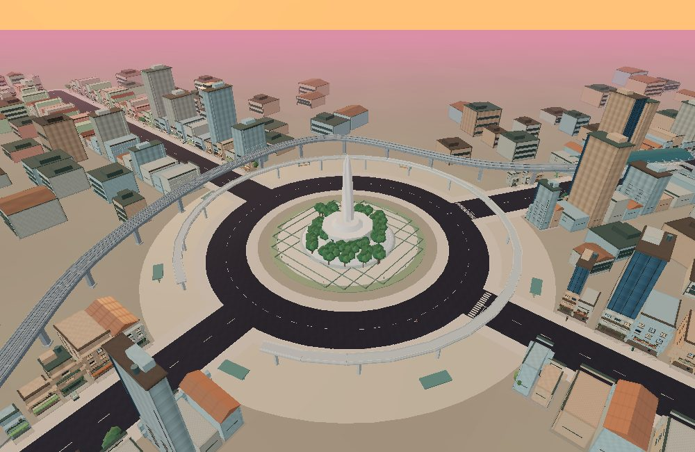 |

The monument now occupies an actual clockwise two-lane circle; four approaches, the west BTS bend and horseshoe skywalk establish the junction. The surrounding bus/commercial district is still sparse and is C separately.

elevated: [before](before/victory-aerial-elevated.jpg) · [after](after/victory-aerial-elevated.jpg)

## 5. Victory Monument Phaya Thai approach — B

| Current main | Draft |
|---|---|
| 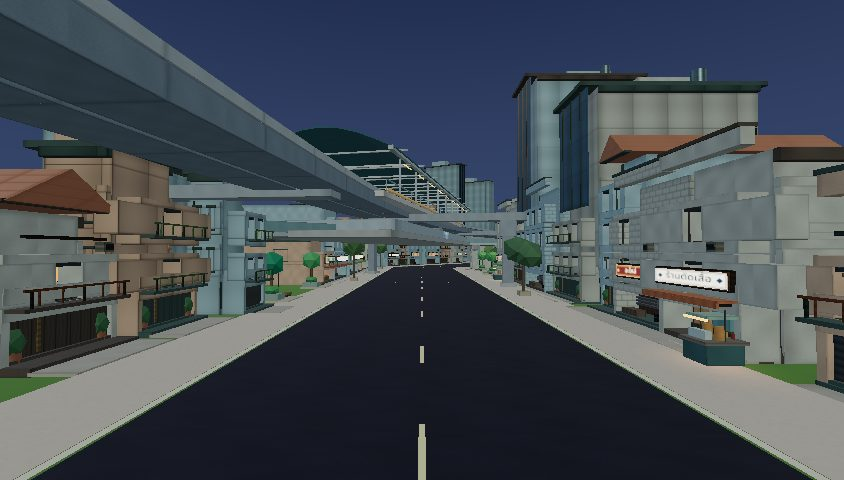 | 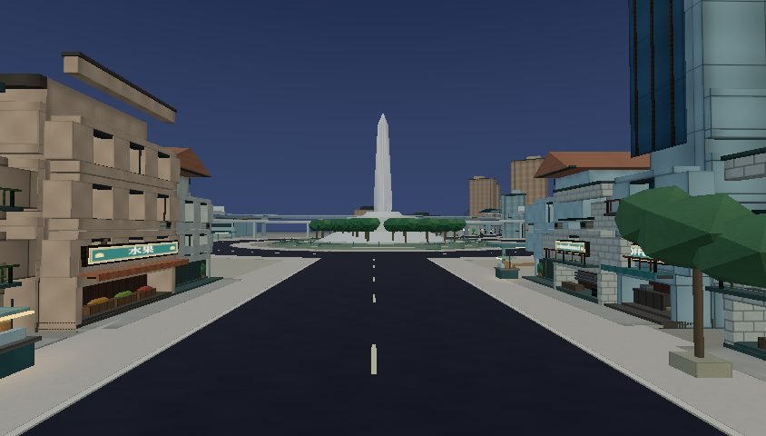 |

Five-ridged bayonet shaft, stepped memorial and bronze group are visible on the driving approach. Sculptural likeness is stylized, and the full bus interchange is not reproduced.

road: [before](before/victory-road-road.jpg) · [after](after/victory-road-road.jpg) · night: [before](before/victory-road-night.jpg) · [after](after/victory-road-night.jpg)

## 6. Sanam Luang ceremonial field — B

| Current main | Draft |
|---|---|
| 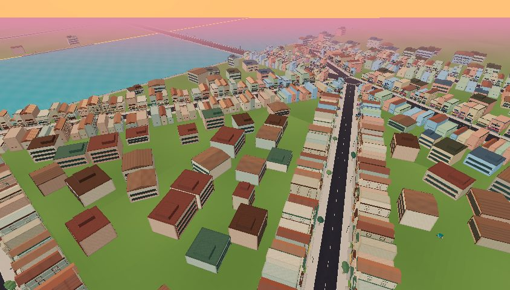 | 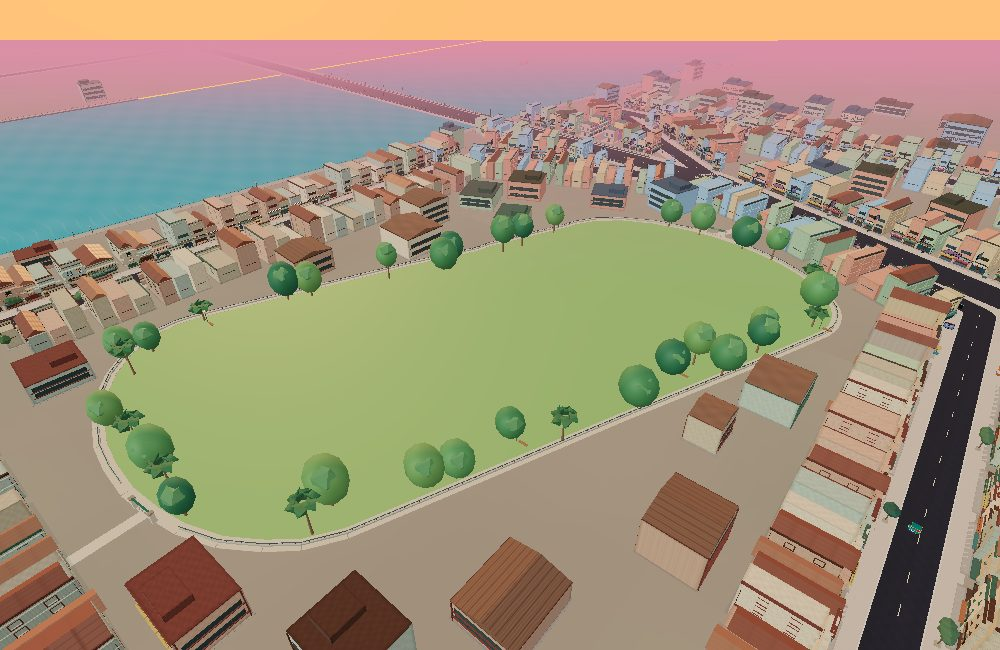 |

The source-derived long ceremonial field is intentionally open, bounded by real road connections and a tree-lined path. University/civic facades and mature perimeter planting are incomplete.

elevated: [before](before/sanam-elevated.jpg) · [after](after/sanam-elevated.jpg) · road: [before](before/sanam-road.jpg) · [after](after/sanam-road.jpg)

## 7. Giant Swing civic square — B

| Current main | Draft |
|---|---|
| 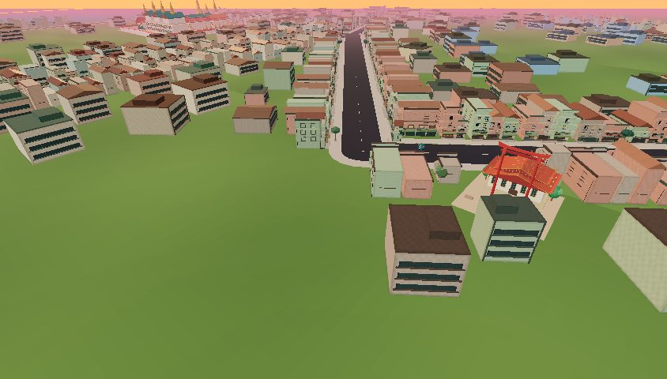 | 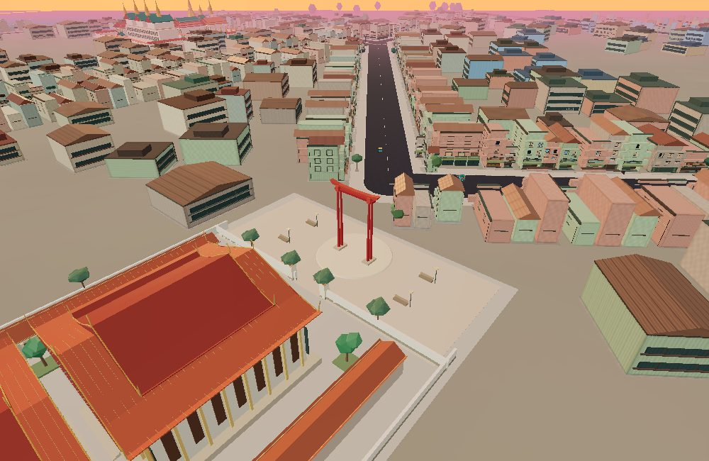 |

Tall red timber pair and curved beam stand north of the temple on a paved square. Surrounding civic architecture remains generic and the square is compressed.

elevated: [before](before/swing-elevated.jpg) · [after](after/swing-elevated.jpg) · road: [before](before/swing-road.jpg) · [after](after/swing-road.jpg) · night: [before](before/swing-night.jpg) · [after](after/swing-night.jpg)

## 8. Wat Suthat compound south of Giant Swing — C

| Current main | Draft |
|---|---|
| 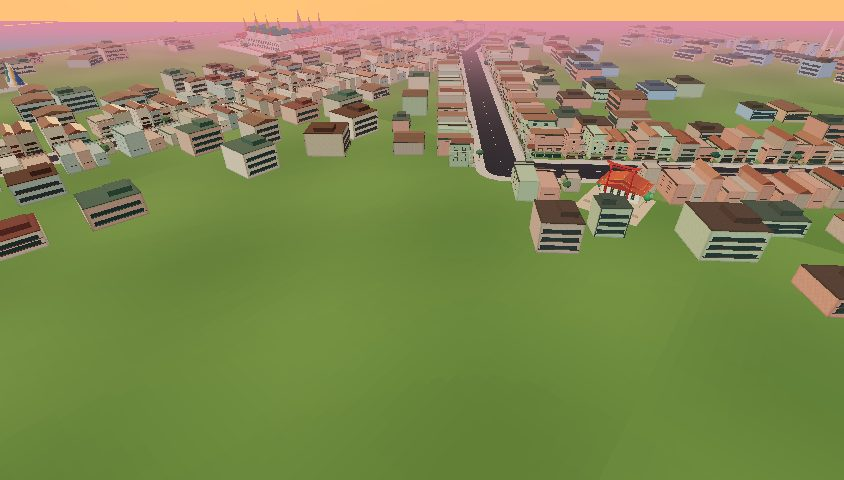 | 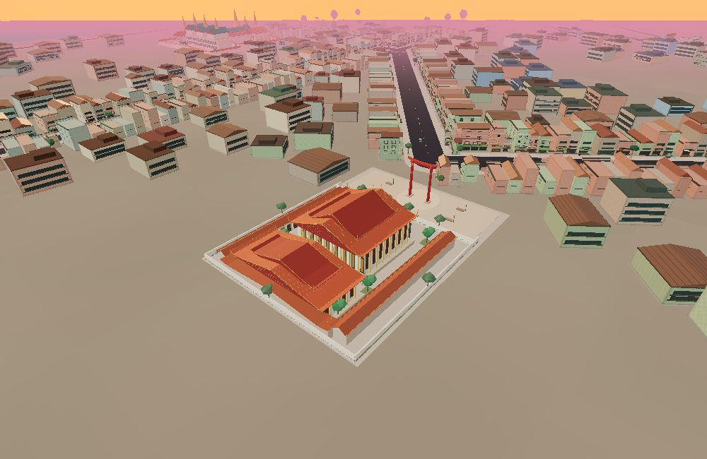 |

Separate halls, cloisters, walls and gates establish a temple compound south of the swing. Hall ornament, precise roof hierarchy and the real civic frontage are still too simplified for a B.

elevated: [before](before/suthat-elevated.jpg) · [after](after/suthat-elevated.jpg) · ground: [before](before/suthat-ground.jpg) · [after](after/suthat-ground.jpg)

## 9. Pak Khlong Talat flower market — C

| Current main | Draft |
|---|---|
| 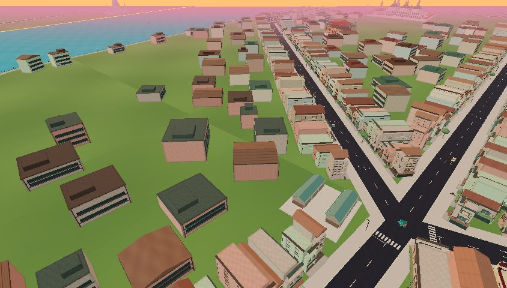 | 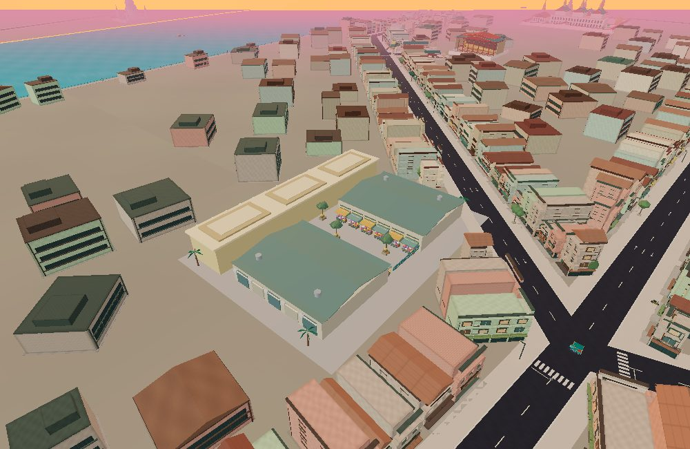 |

Two larger stocked wholesale halls, central loading alley and Yodpiman arcade replace tiny sheds. The wide roof/back view and sparse surrounding blocks do not yet communicate the full dense Chak Phet market district.

elevated: [before](before/flowers-elevated.jpg) · [after](after/flowers-elevated.jpg) · road: [before](before/flowers-road.jpg) · [after](after/flowers-road.jpg) · night: [before](before/flowers-night.jpg) · [after](after/flowers-night.jpg)

## 10. Jim Thompson House canal compound — C

| Current main | Draft |
|---|---|
| 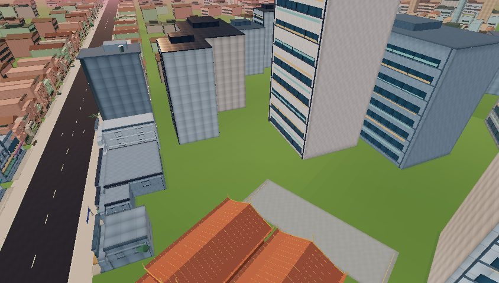 | 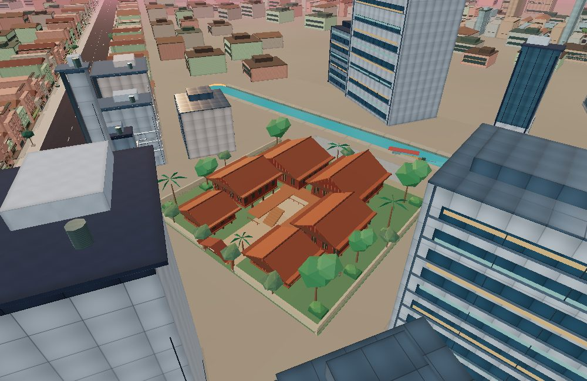 |

Six raised teak houses, links, a pond, wall and canal-side lane improve the compound substantially. The garden lacks the dense mature canopy of the actual museum, and adjacent towers dominate.

elevated: [before](before/jim-thompson-elevated.jpg) · [after](after/jim-thompson-elevated.jpg) · road: [before](before/jim-thompson-road.jpg) · [after](after/jim-thompson-road.jpg)

## 11. MBK Center / Pathum Wan — C

| Current main | Draft |
|---|---|
| 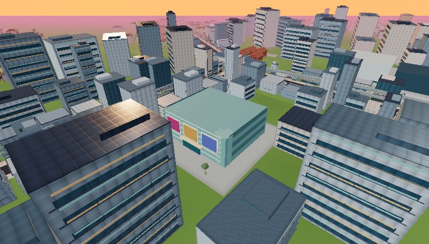 | 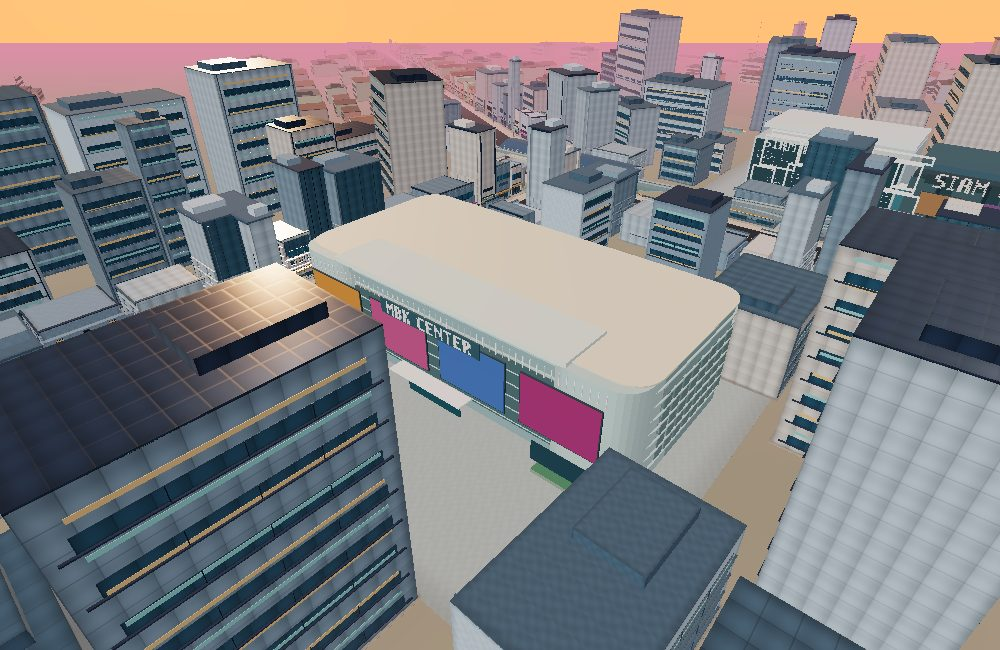 |

Long rounded mass, facade bands and large commercial panels improve the frontage. Its roof/podium composition and street context remain simplified; the name alone does not earn B.

elevated: [before](before/mbk-elevated.jpg) · [after](after/mbk-elevated.jpg) · road: [before](before/mbk-road.jpg) · [after](after/mbk-road.jpg) · night: [before](before/mbk-night.jpg) · [after](after/mbk-night.jpg)

## 12. Siam Discovery — B

| Current main | Draft |
|---|---|
| 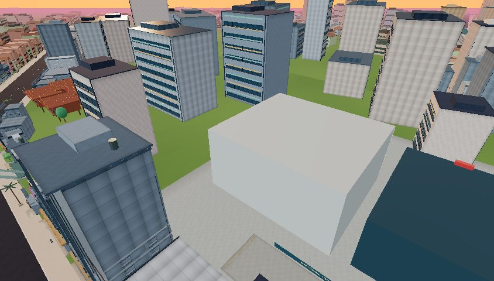 | 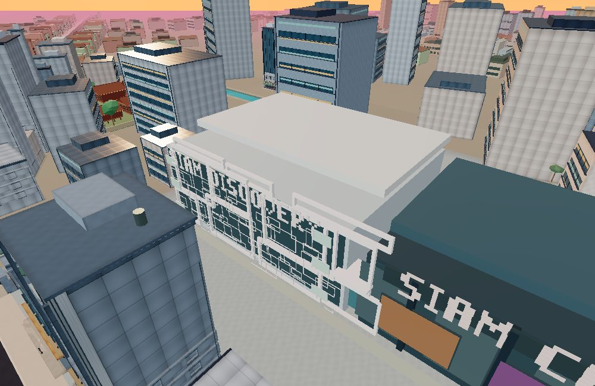 |

Deep irregular pale display frames give the western building a specific identity, separate from Center. Interior light boxes and detailed entrances are abbreviated; nearby generic towers obstruct some angles.

elevated: [before](before/siam-discovery-elevated.jpg) · [after](after/siam-discovery-elevated.jpg) · road: [before](before/siam-discovery-road.jpg) · [after](after/siam-discovery-road.jpg)

## 13. Siam Center — C

| Current main | Draft |
|---|---|
| 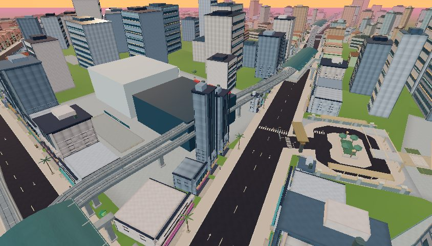 | 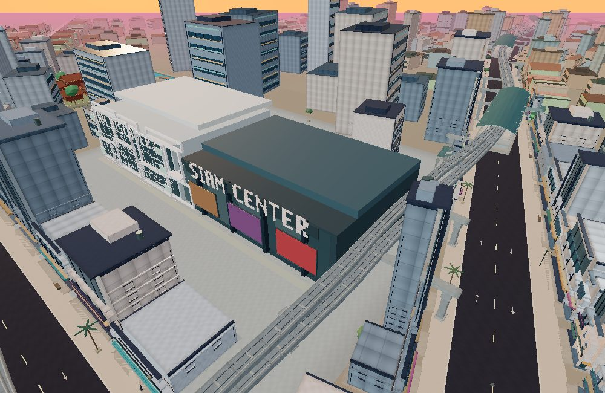 |

Correct east-of-Discovery order and lower dark frontage are implemented. Signage and a dark box still carry too much of the identity; entrance and facade articulation need another pass.

elevated: [before](before/siam-center-elevated.jpg) · [after](after/siam-center-elevated.jpg) · road: [before](before/siam-center-road.jpg) · [after](after/siam-center-road.jpg)

## 14. Siam Paragon — B

| Current main | Draft |
|---|---|
| 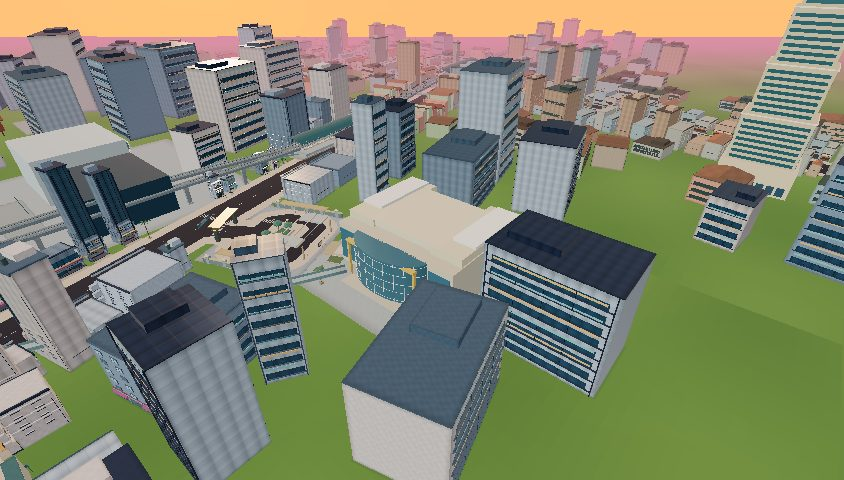 | 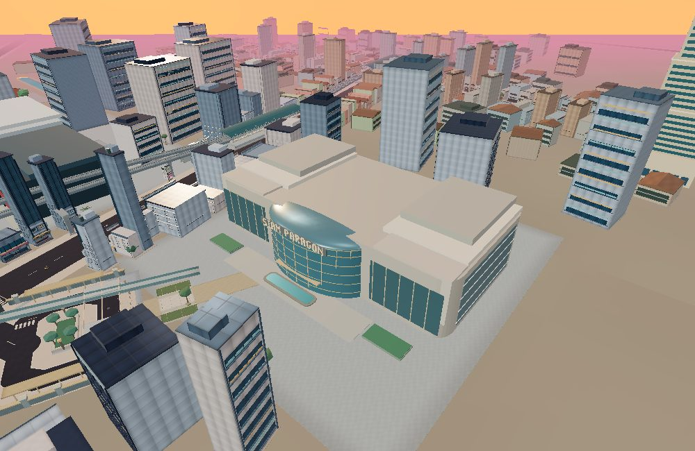 |

The broad mall body, curved glazed entrance jewel, gold mullions and southern plaza are recognizable. Surrounding ground and the complete BTS pedestrian network remain incomplete.

elevated: [before](before/paragon-elevated.jpg) · [after](after/paragon-elevated.jpg) · road: [before](before/paragon-road.jpg) · [after](after/paragon-road.jpg) · night: [before](before/paragon-night.jpg) · [after](after/paragon-night.jpg)

## 15. CentralWorld / Ratchaprasong — C

| Current main | Draft |
|---|---|
| 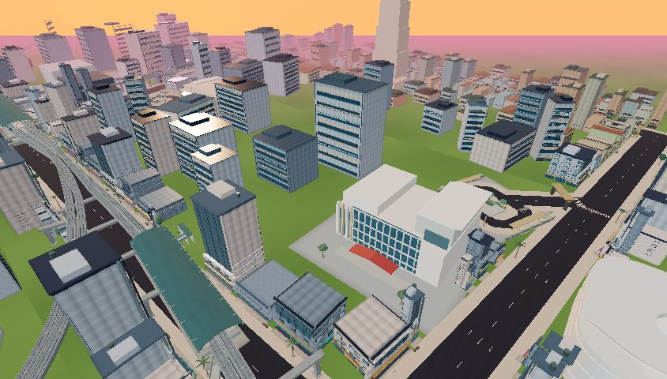 | 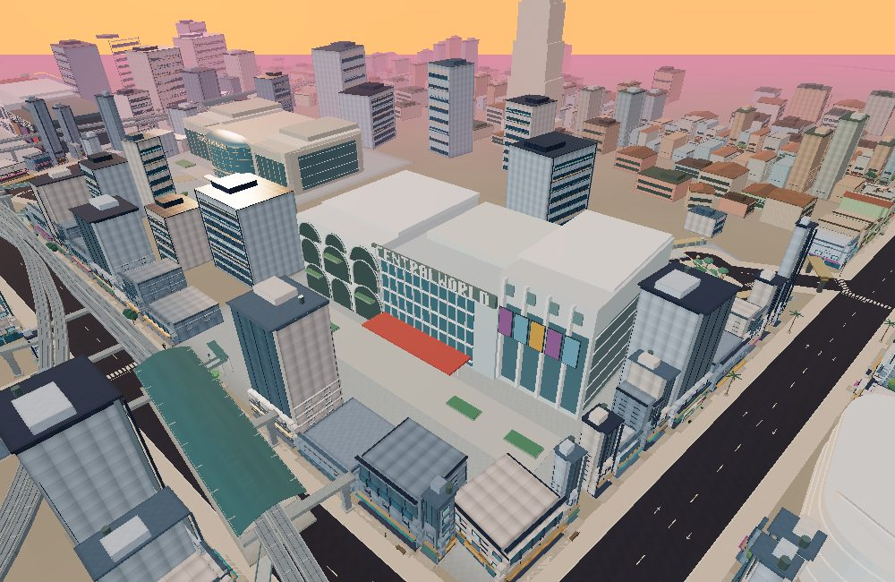 |

Larger varied glazed/fin frontage and a separate public plaza improve the block. The full complex proportions and Ratchadamri-facing composition remain too schematic; generic street-front parcels obscure parts of the mall.

elevated: [before](before/central-elevated.jpg) · [after](after/central-elevated.jpg) · road: [before](before/central-road.jpg) · [after](after/central-road.jpg) · night: [before](before/central-night.jpg) · [after](after/central-night.jpg)

## 16. Siam Square commercial streets — C

| Current main | Draft |
|---|---|
| 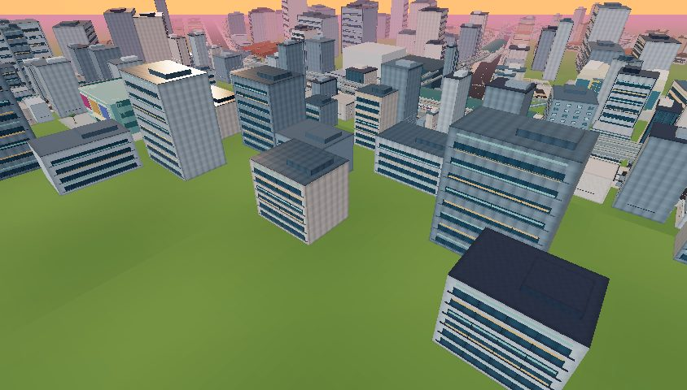 | 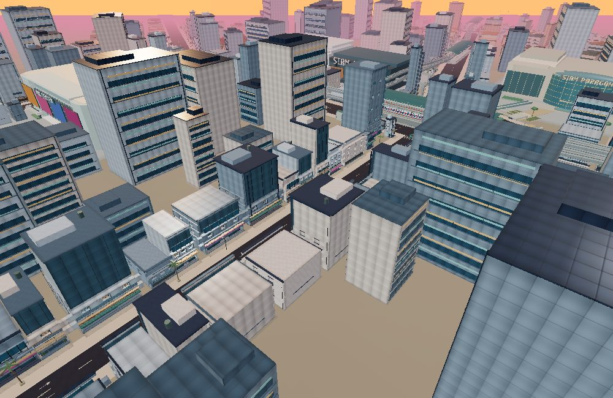 |

Connected small streets and shopfronts make this traversable urban fabric. The repeated tall background grammar does not yet match the real fine-grained low-rise retail neighborhood.

elevated: [before](before/siam-square-elevated.jpg) · [after](after/siam-square-elevated.jpg) · road: [before](before/siam-square-road.jpg) · [after](after/siam-square-road.jpg)

## 17. Terminal 21 / Asok — C

| Current main | Draft |
|---|---|
| 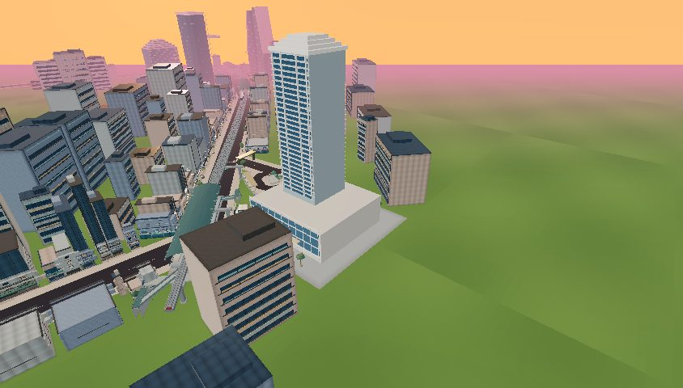 | 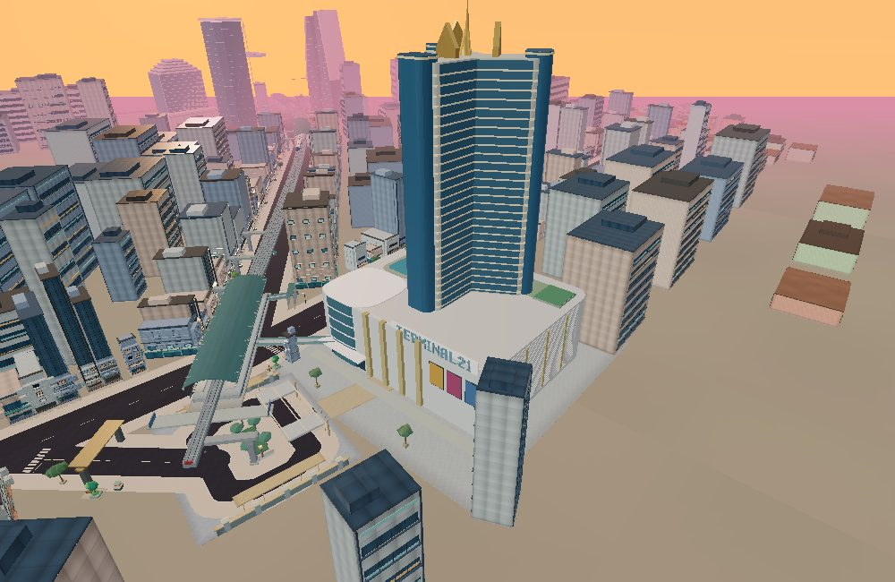 |

The hotel Y-plan, glazing, gold crown and mall podium improve architectural identity, but the property remains on the east side of compressed Asok instead of its real northwest corner. The district cannot pass B geographically.

elevated: [before](before/terminal-elevated.jpg) · [after](after/terminal-elevated.jpg) · road: [before](before/terminal-road.jpg) · [after](after/terminal-road.jpg) · night: [before](before/terminal-night.jpg) · [after](after/terminal-night.jpg)

## 18. River City Si Phraya waterfront — C

| Current main | Draft |
|---|---|
| 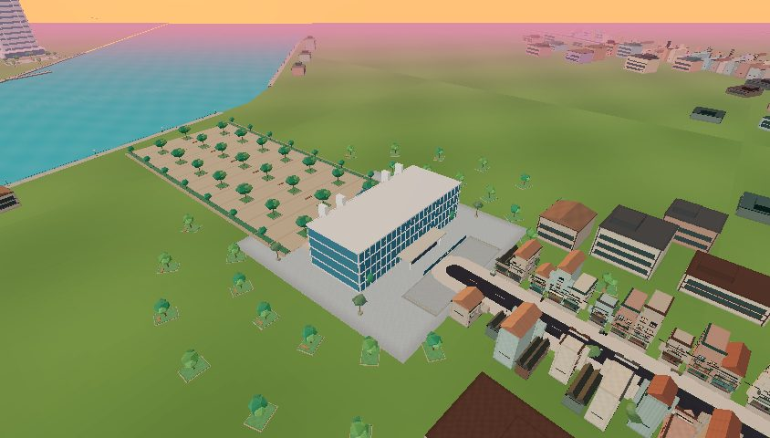 | 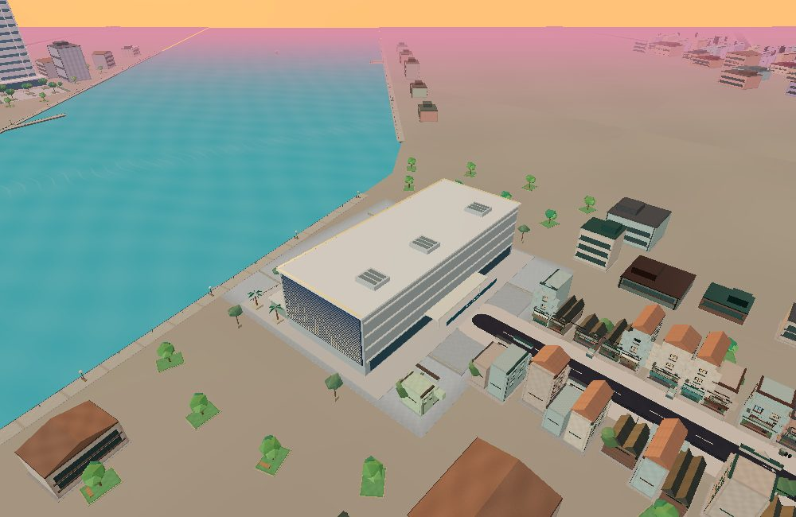 |

The current screened waterfront, four-storey mass, restaurant pavilions and shore terrace replace the inaccurate glazed arch. The facade is B, but the incomplete adjacent piers and large sparse waterfront surroundings leave the overall setting at C.

elevated: [before](before/river-city-elevated.jpg) · [after](after/river-city-elevated.jpg) · road: [before](before/river-city-road.jpg) · [after](after/river-city-road.jpg) · river: [before](before/river-city-river.jpg) · [after](after/river-city-river.jpg)

## 19. 7-Eleven Chinatown storefront — B

| Current main | Draft |
|---|---|
| 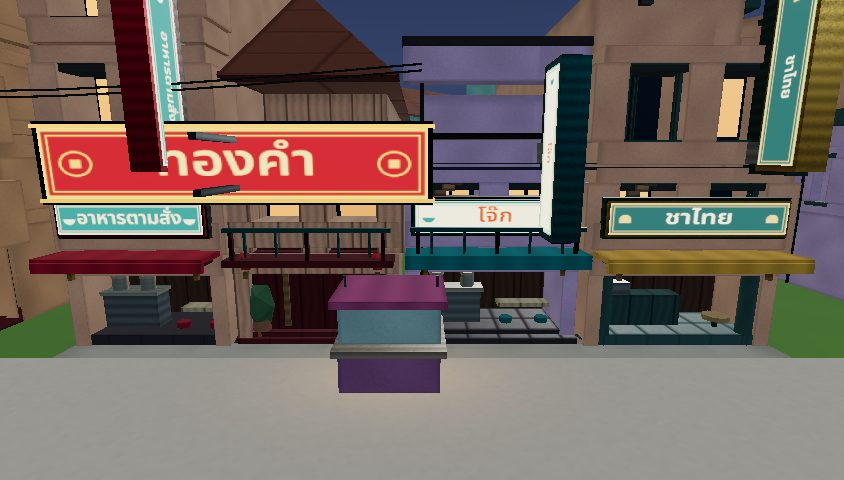 | 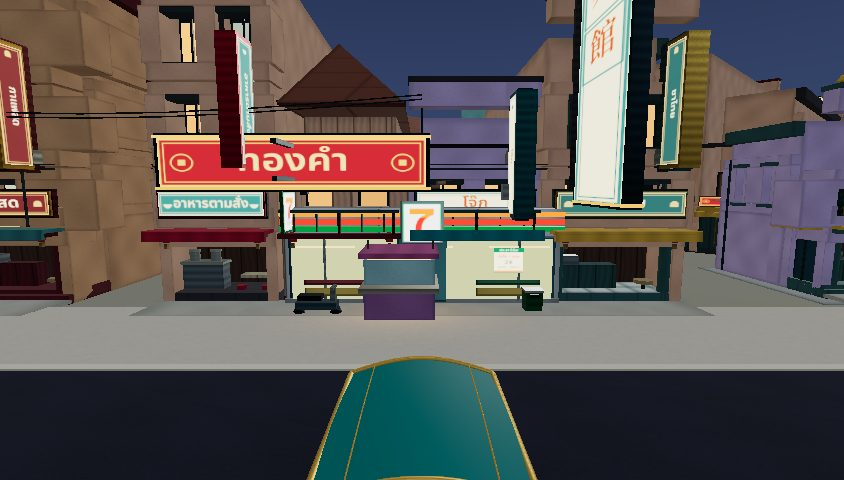 |

Recreated 7-Eleven mark, tricolor fascia, illuminated windows and Thai promotions are identifiable among Chinatown signs. The inherited hanging signs and some street furniture partially occlude the narrow storefront.

road: [before](before/seven-chinatown-road.jpg) · [after](after/seven-chinatown-road.jpg) · night: [before](before/seven-chinatown-night.jpg) · [after](after/seven-chinatown-night.jpg)

## 20. 7-Eleven modern commercial storefront — B

| Current main | Draft |
|---|---|
| 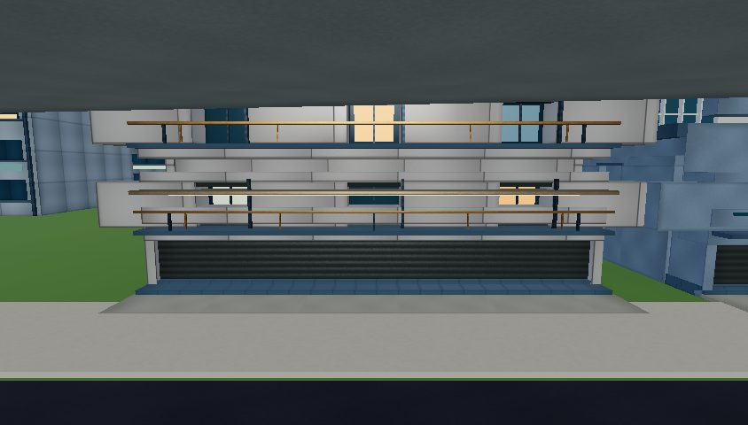 | 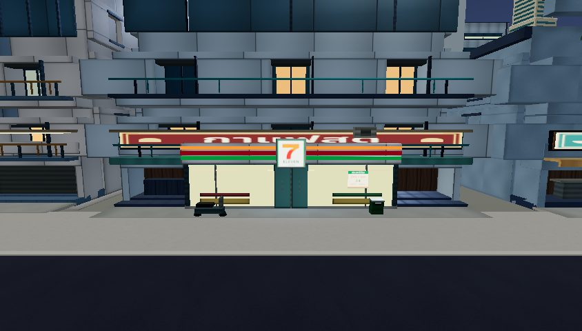 |

A distinct commercial frontage carries the actual name, tricolor strips and lit glass entrance; shared atlas and modular furniture keep it bounded. Product/promotional content is a stylized prototype.

road: [before](before/seven-modern-road.jpg) · [after](after/seven-modern-road.jpg) · night: [before](before/seven-modern-night.jpg) · [after](after/seven-modern-night.jpg)

## 21. Bang Rak Charoen Krung corridor — C

| Current main | Draft |
|---|---|
| 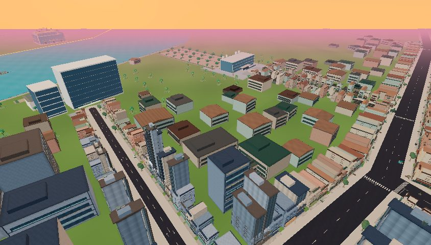 | 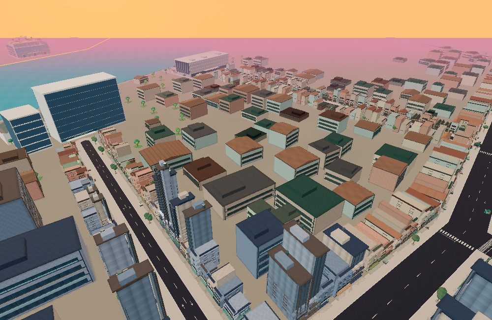 |

Road-facing shophouses and added back-block buildings improve continuity. Broad inter-block mineral ground and repeated low-rise boxes remain unfinished; changing green ground color is not completion.

elevated: [before](before/bang-rak-elevated.jpg) · [after](after/bang-rak-elevated.jpg) · road: [before](before/bang-rak-road.jpg) · [after](after/bang-rak-road.jpg)

## 22. Ratchadamri formerly exposed corridor — C

| Current main | Draft |
|---|---|
| 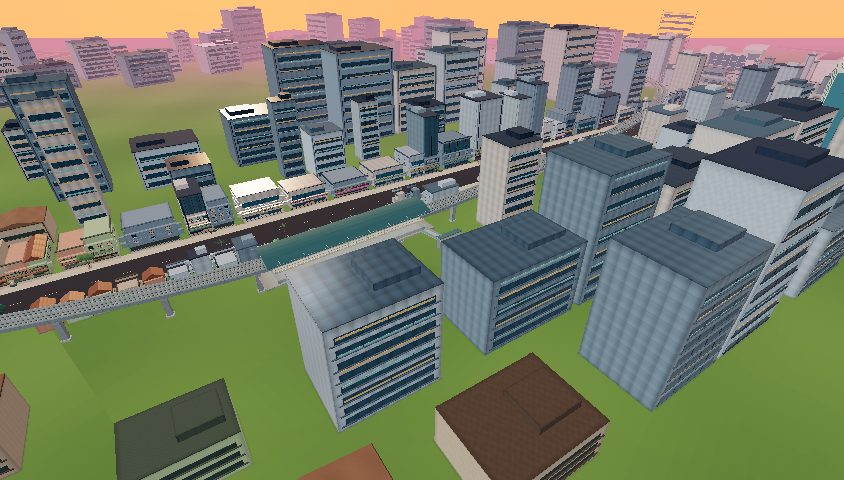 | 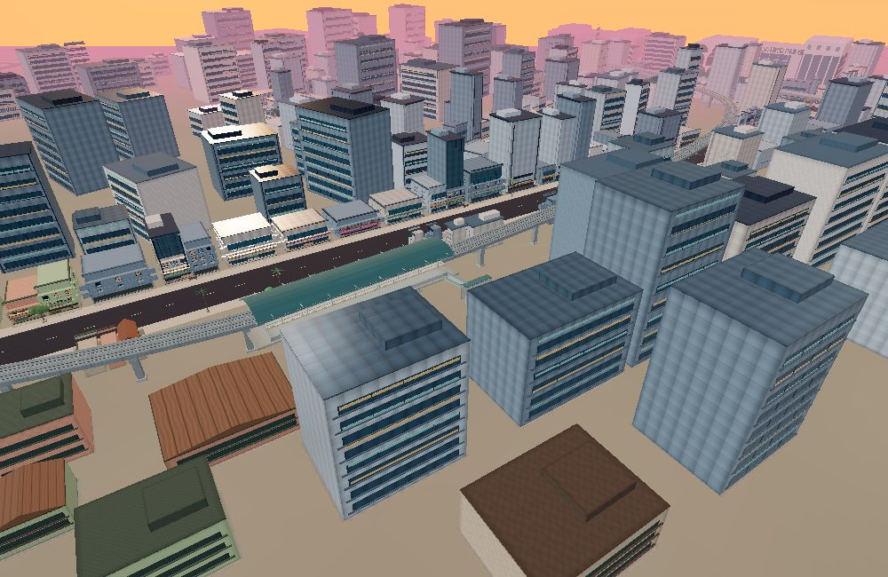 |

Physical frontage fitting and additional back-block parcels reduce exposed roadside gaps. The corridor remains repetitive and sparsely developed behind its first row.

elevated: [before](before/repaired-corridor-elevated.jpg) · [after](after/repaired-corridor-elevated.jpg) · road: [before](before/repaired-corridor-road.jpg) · [after](after/repaired-corridor-road.jpg)

## 23. ICONSIAM / Khlong San surroundings — C

| Current main | Draft |
|---|---|
| 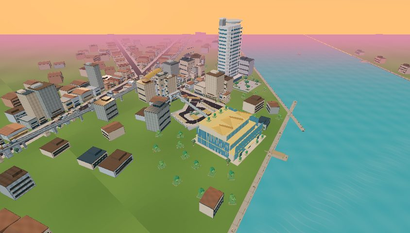 | 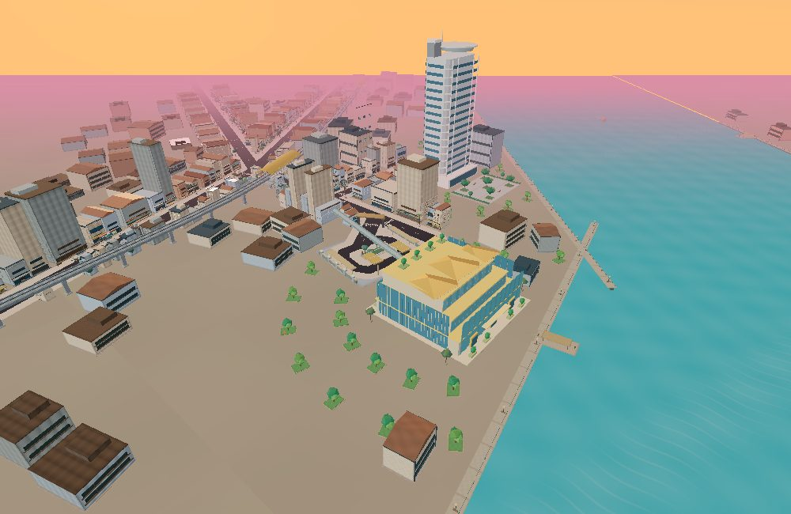 |

The retained riverfront architecture, pier and arrival loop remain functional. Large empty Khlong San parcels are visibly unresolved; this view is included rather than treated as an approved finished district.

elevated: [before](before/icon-surroundings-elevated.jpg) · [after](after/icon-surroundings-elevated.jpg) · road: [before](before/icon-surroundings-road.jpg) · [after](after/icon-surroundings-road.jpg) · night: [before](before/icon-surroundings-night.jpg) · [after](after/icon-surroundings-night.jpg)

## 24. One Bangkok / Lumphini east edge — C

| Current main | Draft |
|---|---|
| 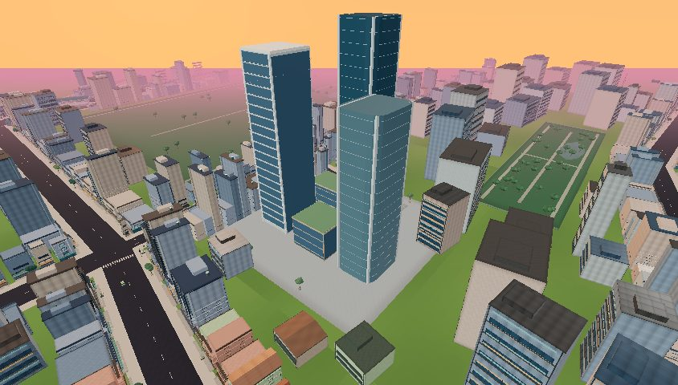 | 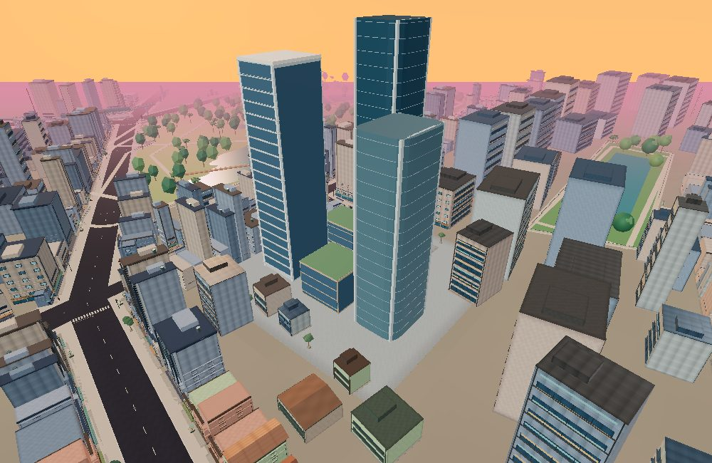 |

The retained cluster is now coherently east of the reconstructed park and connected Rama IV corner. Tower identities and surrounding retail streets remain schematic PR26 work.

elevated: [before](before/one-bangkok-elevated.jpg) · [after](after/one-bangkok-elevated.jpg) · road: [before](before/one-bangkok-road.jpg) · [after](after/one-bangkok-road.jpg)

## 25. Wat Pho historic perimeter — C

| Current main | Draft |
|---|---|
| 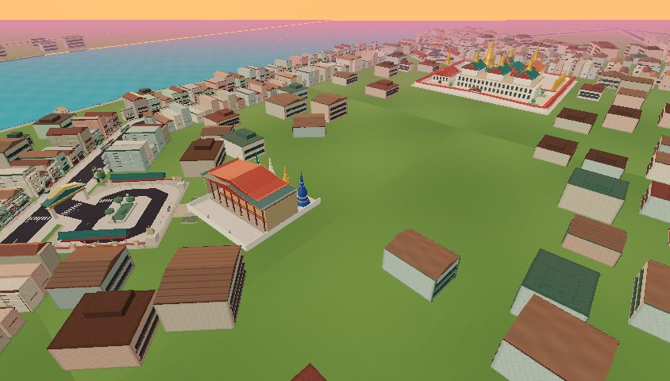 | 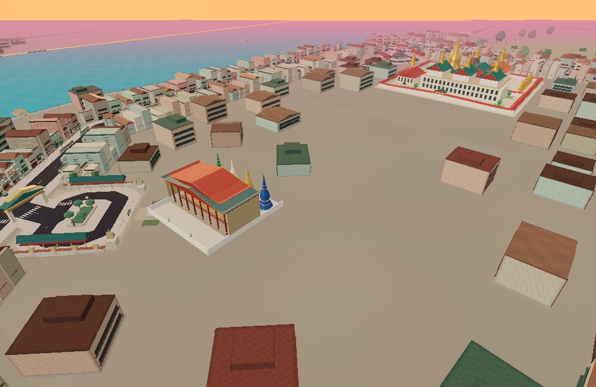 |

The retained outer temple grouping and street access remain functional, but the small generic hall and sparse grounds are not a convincing Wat Pho reconstruction. This PR protects routing; detailed temple architecture is deferred.

elevated: [before](before/wat-pho-elevated.jpg) · [after](after/wat-pho-elevated.jpg) · road: [before](before/wat-pho-road.jpg) · [after](after/wat-pho-road.jpg)

## 26. Khao San urban frontage — C

| Current main | Draft |
|---|---|
|  |  |

Dense low shopfronts and nightlife signs are retained. The broader street geography and building variation are still a generic approximation.

elevated: [before](before/khaosan-elevated.jpg) · [after](after/khaosan-elevated.jpg) · road: [before](before/khaosan-road.jpg) · [after](after/khaosan-road.jpg)

## 27. Benjakitti accessible public space — C

| Current main | Draft |
|---|---|
|  |  |

A bounded park, pond, path and connected perimeter drop-off replace an inaccessible patch. The distinctive forest/wetland park geography is deferred; this is not a faithful full reconstruction.

elevated: [before](before/benjakitti-elevated.jpg) · [after](after/benjakitti-elevated.jpg) · road: [before](before/benjakitti-road.jpg) · [after](after/benjakitti-road.jpg)

## Mobile-size interaction evidence

[Landscape map](browser/city-map-landscape.jpg) · [Portrait map](browser/city-map-portrait.jpg) · [Touch-driven parking, Fast](browser/park-driven-fast.jpg) · [Detailed](browser/park-driven-detailed.jpg) · [Restart after Victory inspection](browser/restart-after-victory.jpg) · [Interaction report](browser/report.json). Chromium emulates touch; this is not physical-device Safari certification.
