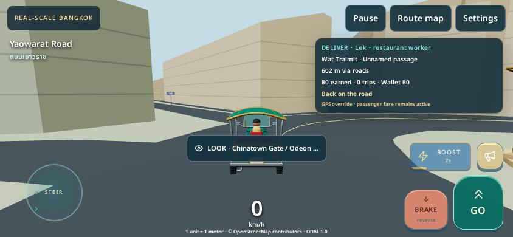
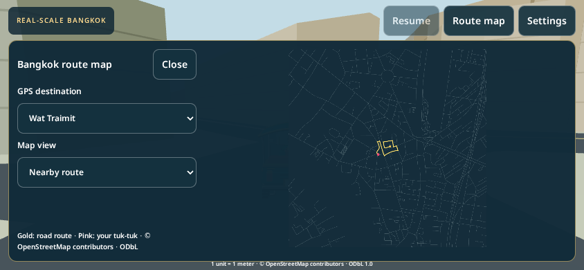

# PR59 — Geographic mobile foundation

Base: `b6a050ba3f21d98c3ea22aac26998eed739ad637` (merged PR58). No geographic source or projection changes. Compact Bangkok remains the default. No deployment, merge, Replit Agent, Replit services or credits.

## Implementation

- Two reusable module workers fetch, decompress, validate and decode the existing compiled building codec, triangulate land/water/roads with the **same** triangulator, and prepare source building collision edges. Vertex buffers transfer ownership to the UI thread instead of cloning. Maximum two jobs, individual abort by termination, 45-second failure deadline, no automatic retry loop, complete unmount cleanup. Existing generated-alias → committed gzip fallback is unchanged and also runs inside workers.
- The four existing migrated artworks are prepared once during initial loading, before Free Roam or Start Shift becomes available. Their fixed CPU trees survive revisits; eviction detaches roots and releases GPU geometry/material/texture allocations. This adds some initialization work and fixed CPU retention in exchange for removing repeated 100–360ms landmark construction during driving. There is no unlimited landmark cache.
- Each scene chunk becomes visible together with its source collider set. Hidden worker preparation never enters the physics index. The existing 3×3 request / 5×5 retention, direction preference, two loads, one installation per update, road/bridge height solver and stream cancellation remain in use. Failed chunks pause driving and expose explicit retry/main-menu recovery instead of leaving a silent hole. Installation timing now includes the resident collision index and metrics refresh; GPU upload and shader compilation are reflected in frame times, not attributed to CPU attachment timing.
- The main welcome screen links to **Real-Scale Bangkok**. Its menu offers Free Roam and the production 24-minute shift. Start is gated until the player's initial visual/collision chunk is installed.
- Compact geographic HUD: source English/Thai street name, fare stage/passenger, destination/road distance, earnings/wallet, trip count, speed, shift time and feedback. Route map pauses and clears input; close resumes only a previously active drive in visible landscape orientation. Nearby-route view is the default, with a touch-selectable city overview. A GPS override does not replace the passenger mission.
- Settings contain Fast/Pretty quality, saved audio preference, optional local AI vehicles and the independent performance monitor. Horn and engine audio use the existing production sound system. Portrait changes pause/clear input. Context-loss and required-asset failures expose retry controls. The existing LOOK inspection and shared career/reward storage are retained.

## Matched results — CPU streaming improved; phone frame target remains unverified

Tested code: `78906b229f274e088e1f485af1104feb99741769`. [Focused browser and runtime suite](https://github.com/sunsetseast/TukTukRushBangkok/actions/runs/42184791817) and [full geographic regression](https://github.com/sunsetseast/TukTukRushBangkok/actions/runs/42184791827) both **passed**. The latter includes production build, source reproduction/integrity, building/collision tests, gameplay, traffic/sign rendering, legacy startup, repeated streaming, performance overlay and WebKit transport. Exact step outcomes are in [ci-results.json](ci-results.json); exact earlier local commands/logs are in [local-tests.json](local-tests.json).

Environment: Linux hosted Actions, Chromium 156 / ANGLE SwiftShader, 844×390 touch simulation, development server. Both variants use the same pinned geography and settings. The 90-frame frame-time windows are **stationary active Free Roam samples**, with medium quality pinned through the public API; they are not sustained driving FPS measurements. The traffic simulation produced seven local actors in both ON samples (unchanged maximum 16; no density increase).

| Measurement | Main before | PR59 after |
| --- | ---: | ---: |
| Network/session/art initialization | 333 ms | 697 ms |
| First installed chunk from page navigation | 2,282 ms | 2,799 ms |
| Playable Free Roam observed | 3,761 ms | 3,726 ms |
| Nine startup chunks settled | 3,986 ms | 3,975 ms |
| Largest startup CPU chunk install | 361.2 ms | 16.6 ms |
| Largest recorded CPU install across four relocations/revisits | 364.4 ms | 32.4 ms |
| AI ON frame p50 / p95 | 133.4 / 316.6 ms | 133.3 / 250.0 ms |
| AI ON worst sampled frame | 466.6 ms | 599.9 ms |
| AI OFF frame p50 / p95 | 133.3 / 216.6 ms | 133.3 / 150.0 ms |
| AI OFF worst sampled frame | 266.7 ms | 250.0 ms |
| Startup draw calls / triangles | 123 / 141,866 | 123 / 141,866 |
| Startup resident buildings / active chunks | 14,874 / 9 | 14,874 / 9 |
| Startup building geometry buffers | 19,528,344 bytes | 19,528,344 bytes |
| Navigation typed buffers | 27,528,506 bytes | 27,528,506 bytes |

The measured startup CPU install maximum decreased about **95%**, and the maximum across the repeated-transition test decreased about **91%**. Moving work off-thread and prewarming landmarks materially reduces the identified CPU activation bottleneck. Startup is not materially faster overall: first-chunk readiness is slower, and prewarming the four landmarks deliberately adds initialization work. The retained four-artwork CPU geometry totals about **2.6 MiB** (buffer bytes only, excluding JS/material/image overhead).

**The 30 FPS / p95 ≤33.3ms target was not met by software WebGL. Worst sampled frame time did not improve.** CPU attachment timing does not include later GPU uploads/shader compilation, and does not prove hitch-free real-device neighborhood transitions. Rendering/upload/shader costs need a physical Safari trace before choosing the next optimization. No physical iPhone test was performed.

Both variants actually evicted 36 chunks over the four tested relocations, returning to nine resident chunks each time. Resident source building buffers matched by location in both variants. WebGL geometry counters varied with the route and visibility (after: 233 → 192 → 281 → 312; initial 275). This is **not a long-duration memory plateau or proof of zero retention**; fixed-camera repeated revisits and a physical Safari heap/GPU trace remain open checks. No stream errors, missing buildings, mission resets or wallet resets were detected by the automated route. Full geographic QA separately passed its bounded-residency check.

### Browser evidence

The final browser script passed touch steering/gas/brake/boost/horn, pause/recovery, map view/destination/close, graphics settings, LOOK, portrait/landscape pause and cleared input, menu/shift entry, fare/XP/wallet persistence, injected context-loss recovery, compact-world Free Roam, HTML generated-chunk fallback inside the actual worker path, and explicit retry after both required metadata sources fail. Signs and bilingual street plaques remained with AI OFF. See [browser-after.json](browser-after.json), [browser-before.json](browser-before.json), [WebKit gzip report](webkit-gzip-report.json), [traffic report](browser-traffic-report.json) and [Thai sign report](browser-thai-signs.json).

Two additional broad workflows (Bang Rak completion and Chinatown certification) were cancelled, so they are not counted as passes. Graphics checks, Yaowarat inspection, canonical benchmark gates, traffic foundation, map loading, focused consolidation and full geographic regression passed on the tested code. Earlier QA attempts failed due to stale UI assertions and a nonexistent legacy debug global; those assertions were corrected and the final suites above passed. No incomplete test is counted as successful.

## Evidence and measurement limits

`cpu-before.json` and `cpu-after.json` are local Node CPU instrumentation with the same nine source startup chunks. `check-geographic-preparation.ts` verifies every mesh attribute and collider is unchanged and that transfer detaches the sender's buffers. CPU preparation runs on the worker in the game; the Node equivalence test itself does not measure thread scheduling or GPU work.

The final matched browser report and screenshots are recorded separately by the Geographic mobile consolidation workflow. These are **Linux Chromium / SwiftShader at 844×390 with touch emulation**, not an iPhone or real Safari WebGL benchmark. Requested medium quality is pinned through the public quality API during the matched 90-frame traffic-ON/OFF samples, avoiding the engine's automatic Fast-mode fallback during a comparison. No physical iPhone was available. No sustained 30 FPS / p95 ≤33.3ms phone certification is claimed.

Repeated-streaming browser checks relocate through the developer QA hook to northern Bangkok, Bang Rak, back north and Chinatown, waiting for the requested coordinates **and** settled residency. They deliberately stress loading/eviction/revisits; they do not claim an organically driven city tour. Browser fare verification relocates to real pickup/delivery nodes and executes the production fare/reward updates. The separate geographic gameplay regression performs a real 598m no-teleport paid trip and three source-road chunk seam crossings with retained speed.

Memory figures are source buffer sizes, navigation typed-array bytes, and WebGL geometry counters. They are not physical RAM, VRAM, Safari thermal or battery measurements. GPU uploads, shader creation and high baseline software-rendering cost remain potential frame stalls after CPU preparation moves off-thread.

## iPhone-only test procedure

Use a preview that has loaded this PR's branch. This PR does not deploy or merge it. No desktop setup is required for the following checks.

1. Open the normal welcome screen, turn the phone sideways, choose **Real-Scale Bangkok**, then **Free roam**. Alternatively append `?world=geographic` to the preview's base URL. Wait for road/collision preparation to enable Start.
2. Hold **GO**, drag **STEER**, test **BRAKE**, **BOOST**, **HORN** and **LOOK** while stopped near a landmark. Tap **Pause**, **Recover vehicle**, and **Resume drive**. Rotate to portrait and back: the drive should stay paused until Resume.
3. Open **Route map**. Driving must pause. Try **Nearby route**, **City overview**, destination selection and **Close**. Select **Follow passenger fare** to restore fare guidance. Start Shift from the real-scale menu and complete at least one pickup/delivery; confirm wallet and fare count survive a reload.
4. Open `?world=geographic&geoPerf=1`. Drive Yaowarat → Song Wat/Talat Noi → Charoen Krung/Bang Rak, reverse and revisit, then try a real river bridge. Run at least five minutes cold and again after the phone is warm. Inspect **p50/p95**, **worst frame**, **frames over 50ms**, **worst chunk install**, **resident buildings**, active/waiting chunks, draw calls and stream errors. A visible freeze when a new area appears is a streaming stall; high p95 while stationary indicates a broader rendering/CPU problem. A title-screen FPS sample is insufficient.
5. Repeat with `?world=geographic&geoPerf=1&geoTraffic=0` and the same graphics setting/route. Signs and bilingual street plaques must remain. Toggle traffic back ON in Settings. Do not infer success from lower attachment time alone: the target remains **30 FPS, p95 about 33.3ms, no disruptive transitions and bounded residence**.
6. Note iPhone/iOS/Safari versions, quality, traffic setting, warm/cold state, duration, p95/worst/install maxima and any missing road/building/bridge, collision, or save problem. Screenshots of the monitor during a stall are useful. Close the optional monitor to compare its overhead.

## PR60 handoff

1. Obtain the above physical-iPhone trace before raising the detail or AI budget. Address GPU/shader-upload stalls first if they dominate the real-device trace. This PR is a CPU streaming improvement, not permission to add citywide high-detail artwork.
2. Build a small **source-edge → facade pieces** adapter for Yaowarat, Song Wat and Talat Noi. Use runtime building `id`, `sourceChunk`, edge/street association, orientation, family/neighborhood, height and source provenance; retain footprints, clearances and road edges. Never rerun the old compressed parcel generator over geographic coordinates.
3. Reuse `ArchitecturalBatch`'s spatial cells, instancing, core/near/coarse/detail/night layers and shared surface/glow attributes. Adapt the existing district grammar and material/atlas vocabulary to chunk-local source edges. Produce decorative buffers offline or in worker preparation, keep shared material ownership explicit, and activate/dispose them with the authoritative chunk. Keep the source collider policy independent of facade decoration.
4. Add a few curated source-anchored hero storefronts, original Thai-Chinese sign atlases and selective emissive night layers before expanding vegetation, vendors, street furniture or instanced pedestrians. Give each layer a fixed local draw/triangle/texture budget and distance LOD. Preserve the original handcrafted models and original world's renderer; do not duplicate that entire world or its synthetic street layout.

Larger deferred differences: geographic lighting/night presentation, district discovery/career screens and upgrades, detailed local minimap styling, observed physical signal timings (current timing is explicitly simulated), and physical iPhone certification.
