# Real photographs and actual game views

All game frames come from the live WebGL renderer. No AI-generated images or selectively hidden city objects are used. HUD and traffic are disabled for architectural capture. Driving views use the ordinary follow camera on a public road, facing along its legal graph direction; they are stationary capture poses, not route-completion evidence. Controller journeys are documented separately.

PR31 baseline frames are 960×540; final frames are 768×432, both 16:9 and medium quality. Road changes require equivalent legal street approaches. Inspection views look toward the architecture; ordinary driving views intentionally retain the normal camera. River frames use a water-level boat viewpoint; elevated frames are inspection views. Photographs have different dates and angles and do not prove a surveyed reconstruction.

| Place | Licensed real photograph | PR31 baseline street view | Reconstructed street view |
|---|---|---|---|
| Grand Palace / Wat Phra Kaew | 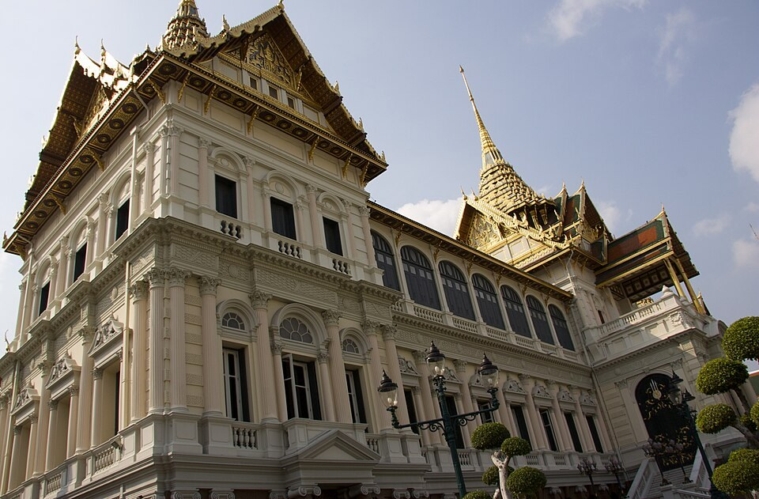 |  | 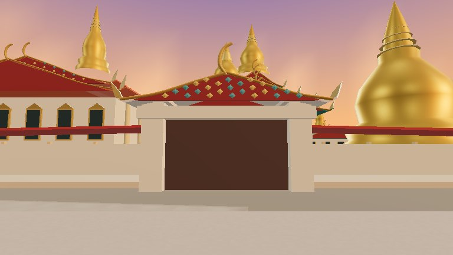 |
| Sanam Luang |  | 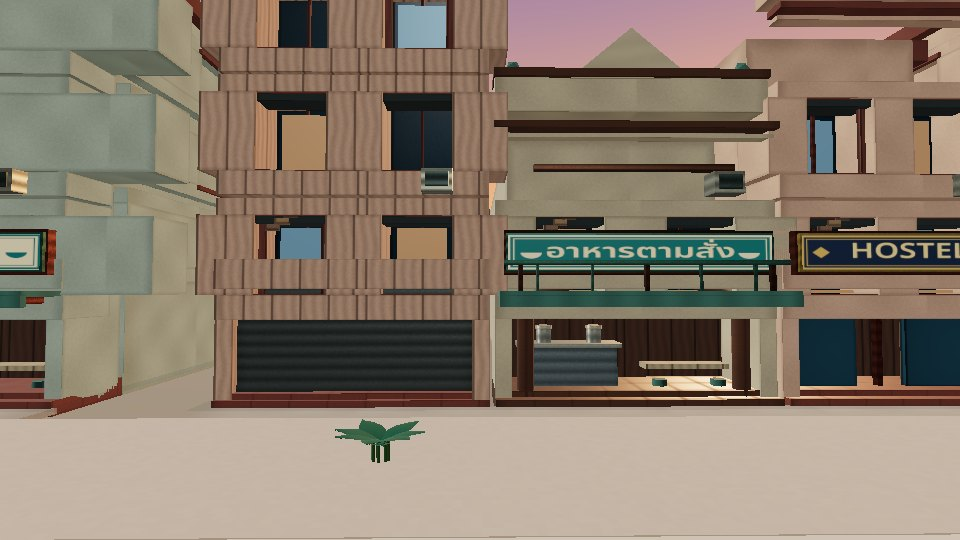 | 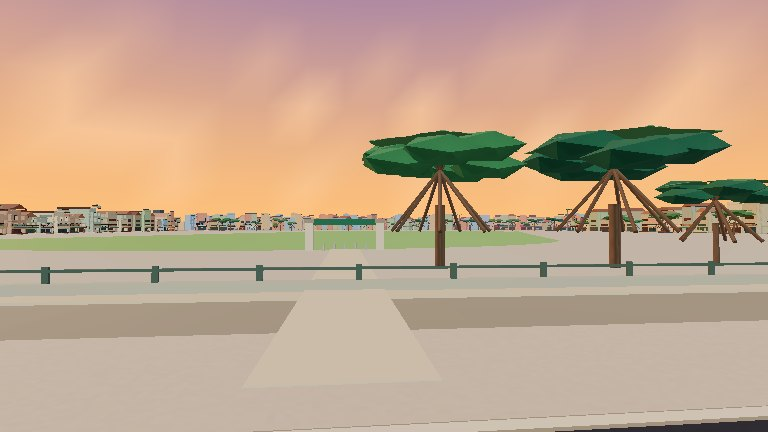 |
| Wat Pho |  |  | 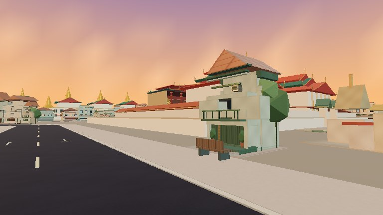 |
| Giant Swing / Wat Suthat |  |  | 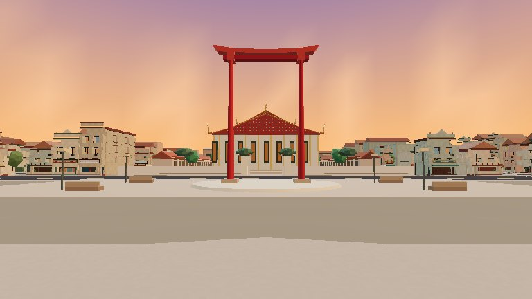 |
| Golden Mount / Wat Saket |  | 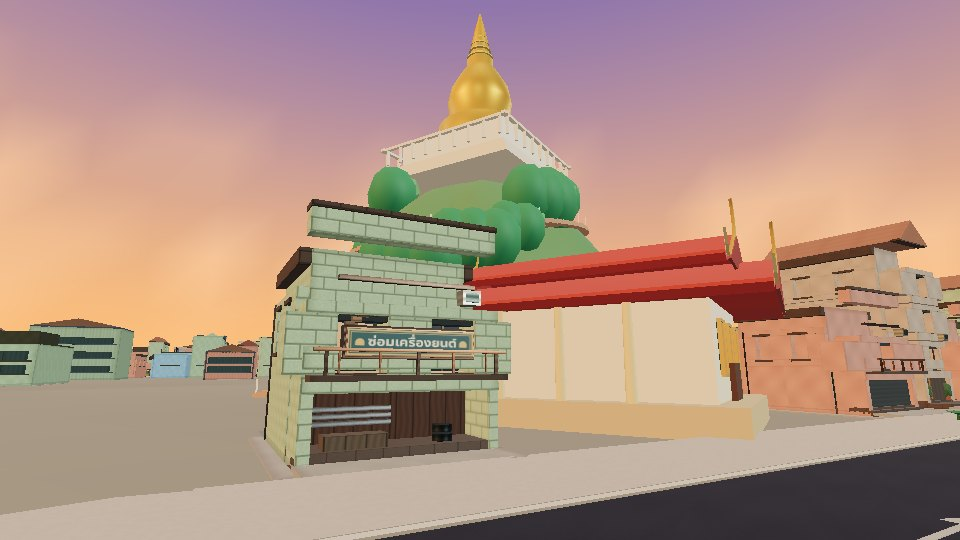 | 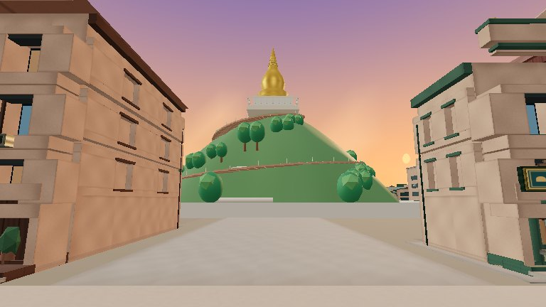 |
| Democracy Monument |  | 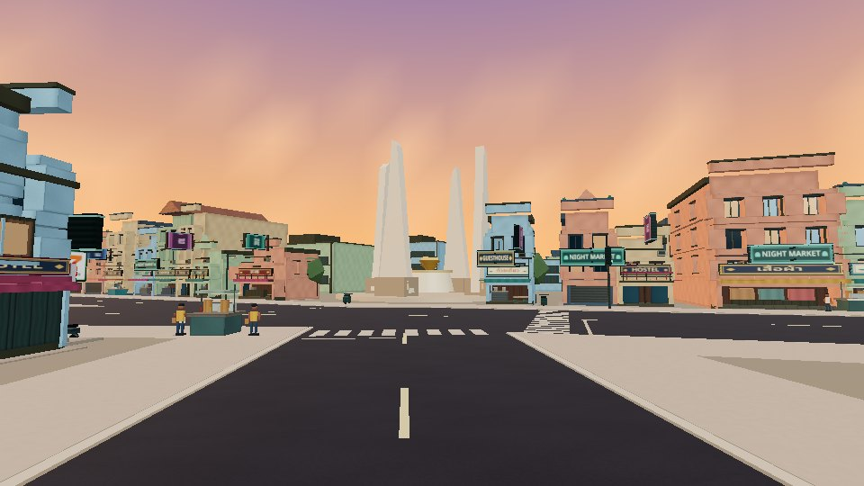 | 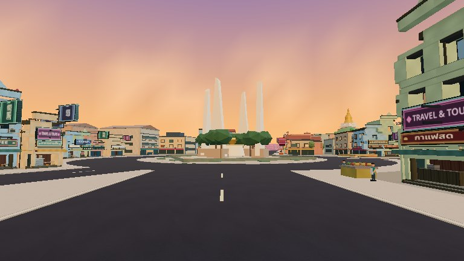 |
| Hua Lamphong |  | 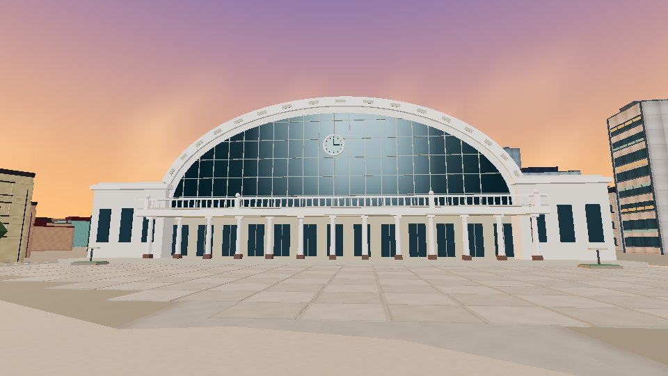 | 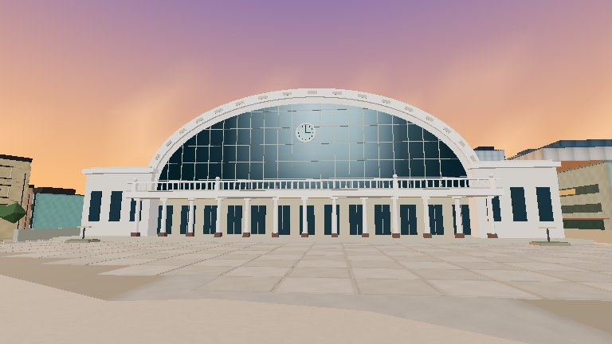 |
| Wat Traimit |  | 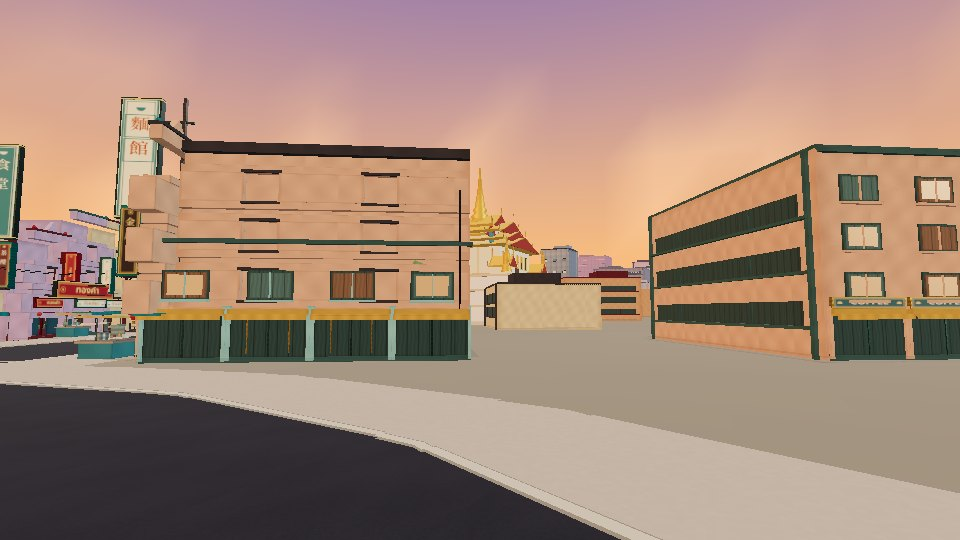 | 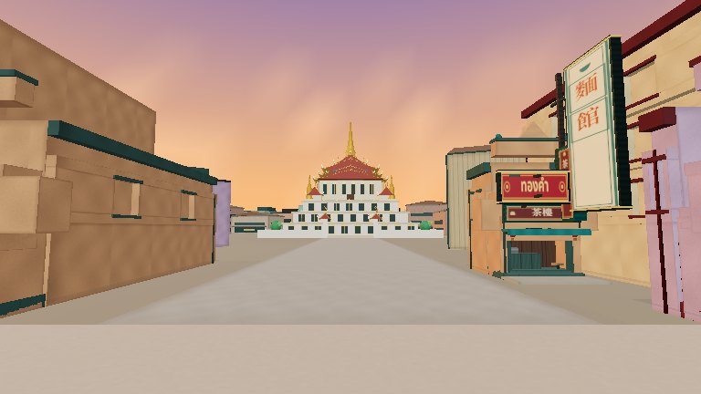 |
| Chinatown Gate / Odeon Circle |  | 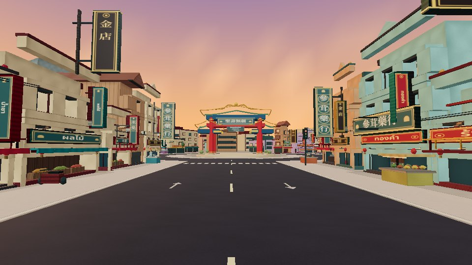 | 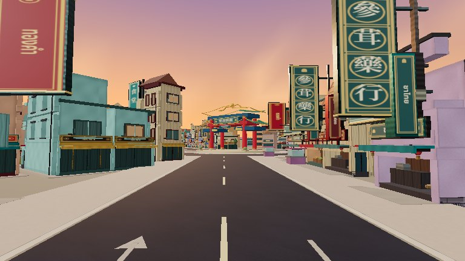 |
| Connecting Yaowarat approach | 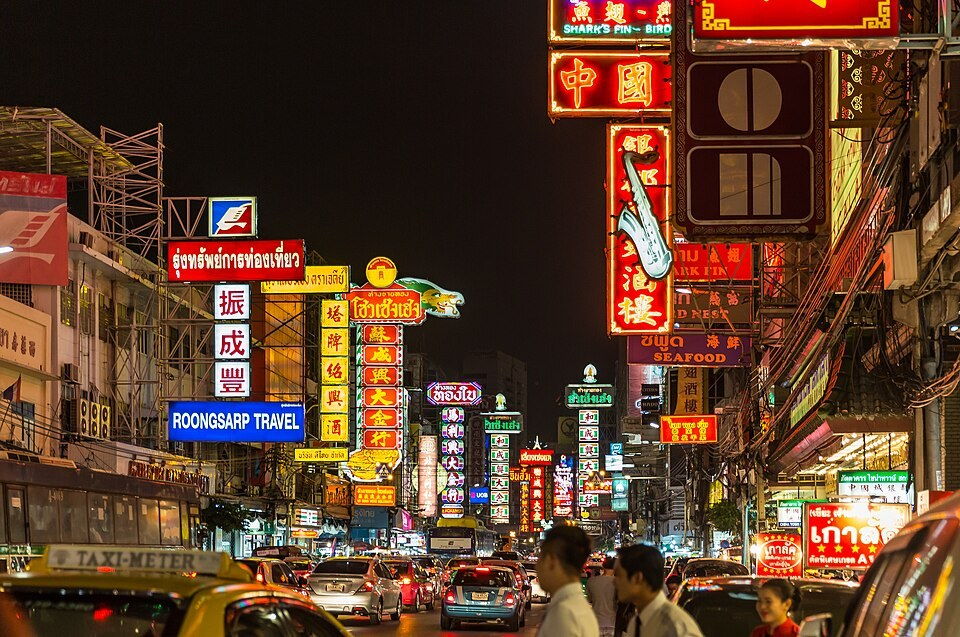 | 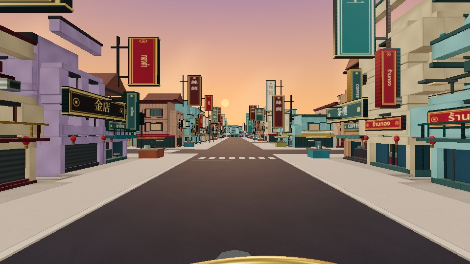 | 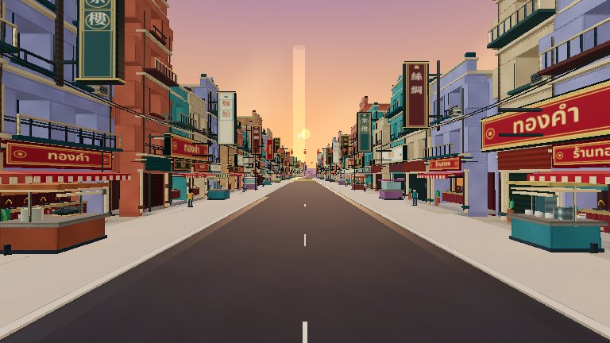 |

[Full comparison gallery](comparisons.html) · [Photographic licences](references/ATTRIBUTION.md) · [Geographic maps](geography-before-after.png)
