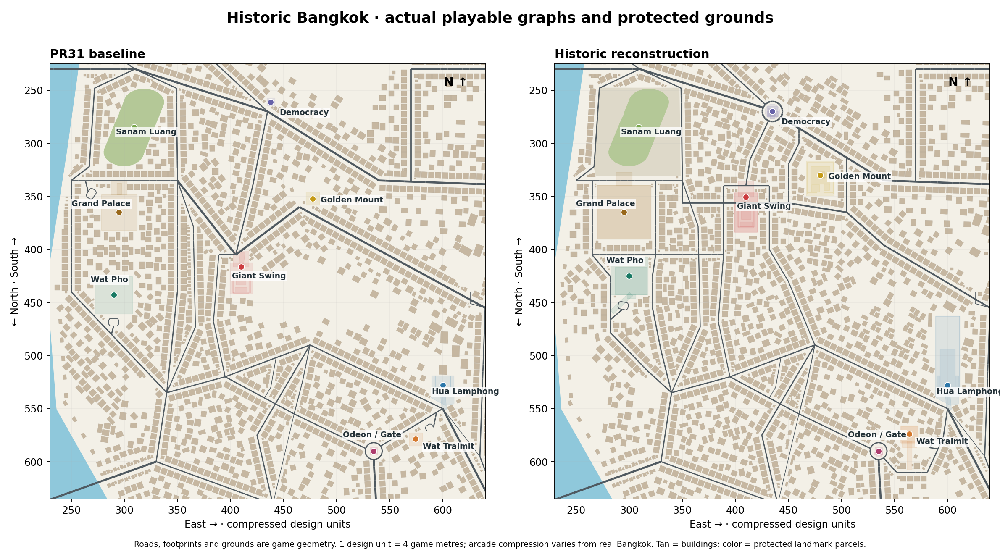
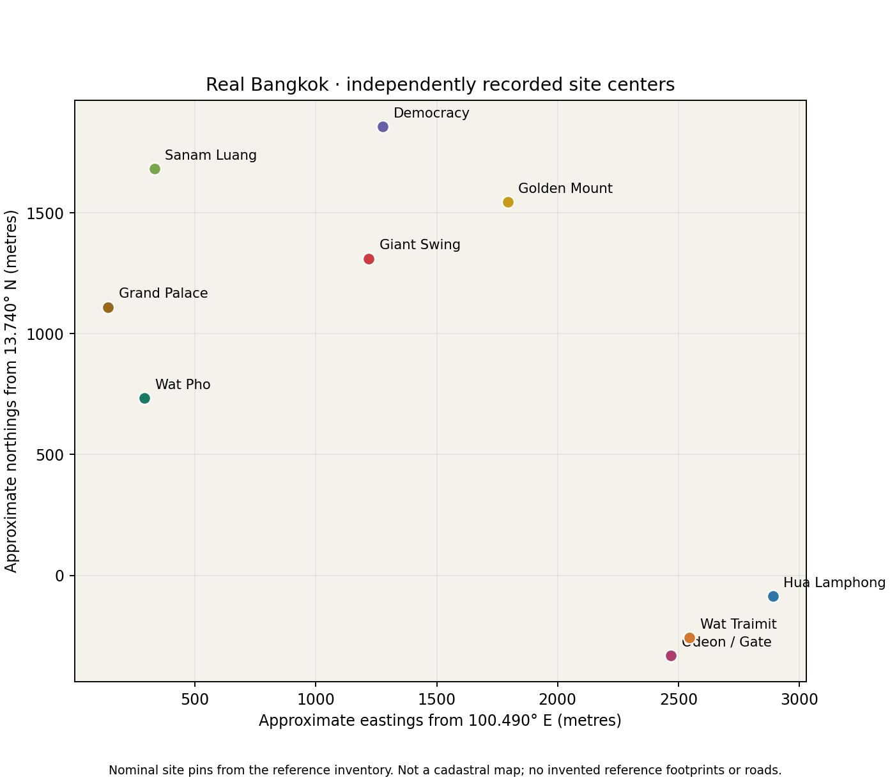

# Localized geographic corrections

North is up in both game maps. Design +x points east and +y south; one design unit is four game metres. Real coordinates are independently recorded nominal site centers. No footprint is claimed to be cadastral or surveyed.

| Site | Real WGS84 center (approximate) | Before game feature / center | After game feature / center |
|---|---|---|---|
| Grand Palace / Wat Phra Kaew | 13.75000, 100.49130 | 295.00, 365.00 | 295.00, 365.00 |
| Sanam Luang | 13.75516, 100.49307 | 309.00, 285.00 | 309.00, 285.00 |
| Wat Pho | 13.74660, 100.49270 | 290.00, 443.00 | 300.00, 425.00 |
| Giant Swing / Wat Suthat | 13.75181, 100.50128 | 410.00, 416.25 | 410.00, 350.50 |
| Golden Mount / Wat Saket | 13.75392, 100.50661 | 477.50, 352.00 | 480.00, 330.00 |
| Democracy Monument | 13.75673, 100.50182 | 437.87, 261.07 | 435.00, 270.00 |
| Hua Lamphong | 13.73922, 100.51676 | 600.00, 528.00 | 600.00, 528.00 |
| Wat Traimit | 13.73768, 100.51357 | 574.55, 578.78 | 564.00, 574.00 |
| Chinatown Gate / Odeon Circle | 13.73701, 100.51286 | 535.00, 590.00 | 535.00, 590.00 |

The visible Giant Swing was at (410, 416.25), south of the Palace at (295, 365). It is now at (410, 350.5), east and north. The combined asset origin remains separately recorded at (410, 365), with Wat Suthat behind the public road to its south. Treating the asset origin as the Swing center would repeat the original registry ambiguity; the registry now exposes both.

Wat Pho moves from (290, 443) to (300, 425), southeast of the Palace. Maha Rat and Sanam Chai follow the actual game compound boundaries instead of leaving entire generic blocks between temples and their named perimeter streets. Thai Wang connects their public exteriors. Palace interiors remain closed, and its old invented loop is replaced by a Na Phra Lan curbside stop.

Golden Mount moves from a fallback plot at (477.5, 352) to the explicit (480, 330), northeast of the Swing and southeast of Democracy Monument. Its wider hill, summit, southern lower compound, Boripat and Maha Chai approaches share protected physical space. Democracy Monument moves from the fallback (437.87, 261.07) to the intersection center (435, 270), with four live road arms and a clockwise ring.

Hua Lamphong's improved PR31 facade stays at (600, 528), facing south. The shed and five ground-level rail pairs extend north into its protected yard. Wat Traimit moves from fallback (574.55, 578.78) to explicit (564, 574), southwest of the station and northeast of Odeon. Tri Mit bends around the compound to a connected outer drop-off. The Gate and Yaowarat alignment remain in place.

Compression remains deliberate: Ratchadamnoen runs diagonally toward Lan Luang; the game is not an exact east–west street trace. Bamrung Mueang and the eastern Rama I connector share an arcade transition. Wat Pho's distance and footprint, the civic plaza, rectangular temple boundaries, station yard length, Tri Mit southern bend and Odeon ring radius are design approximations. No newly drawn reference road line or invented reference footprint is presented as measured Bangkok geometry.
