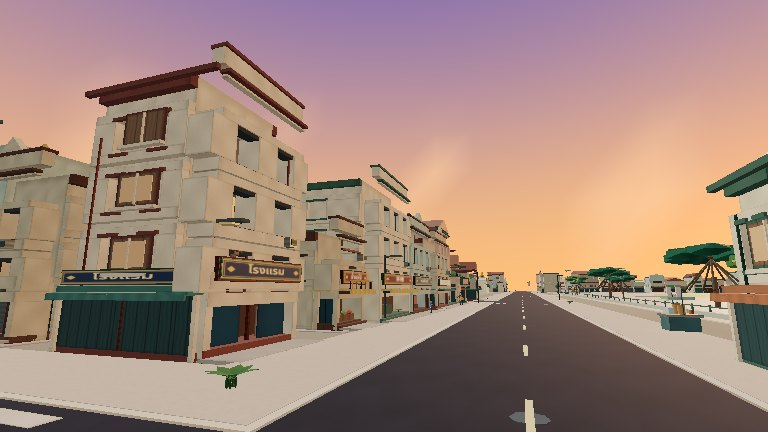
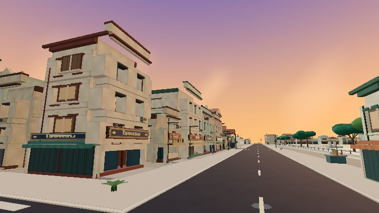
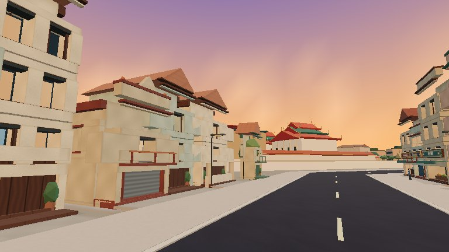
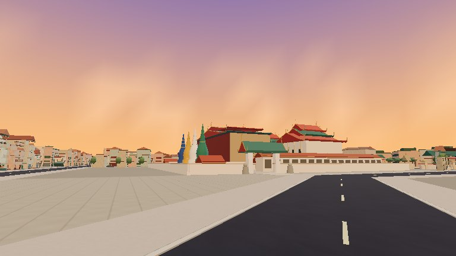
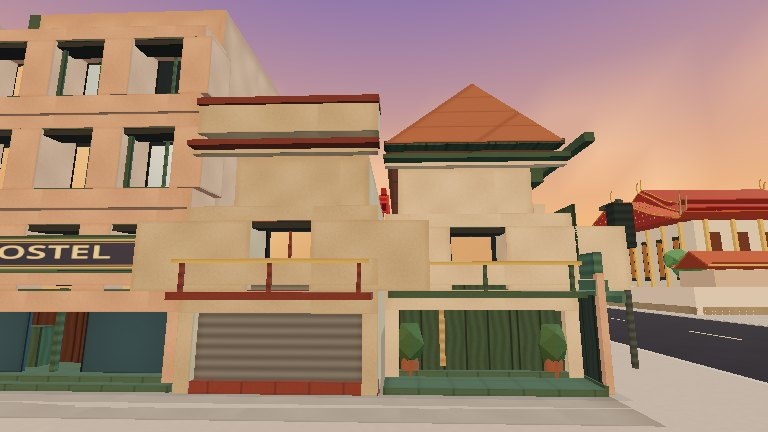
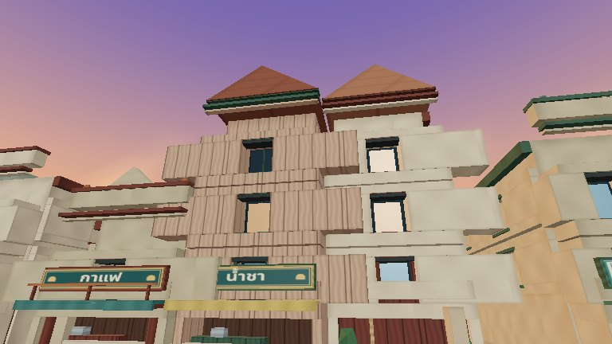
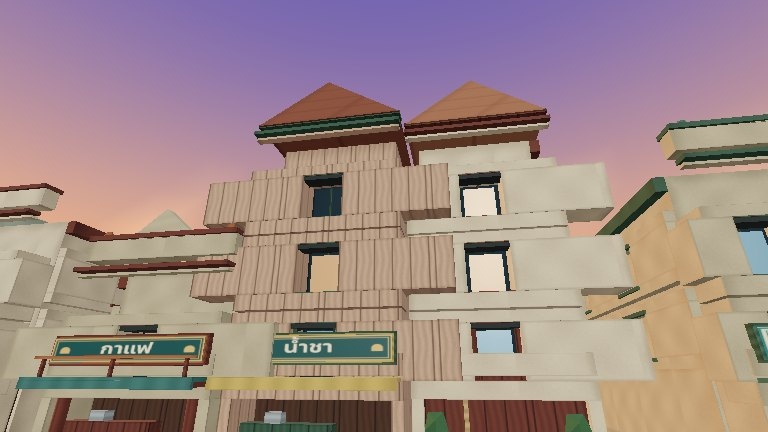
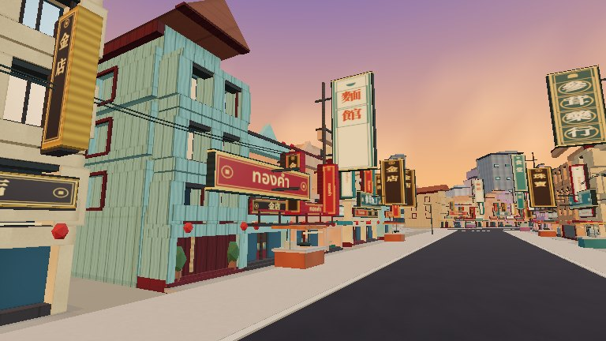
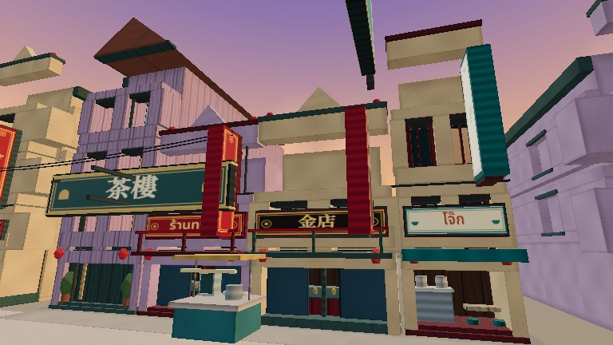

# Actual rendered-mesh findings

All 37 selected poses were evaluated against visible game meshes, with no page errors. These are feature samples, not 37 all-or-nothing landmark visibility verdicts. Multiple targets deliberately hit empty openings or space above/between narrow elements.

| Classification | Samples |
|---|---:|
| named feature visible | 14 |
| foreground obstruction | 8 |
| no rendered surface at target | 9 |
| landmark surface visible; named feature not certified | 6 |

## Six original cameras

| Case | PR32 actual view | PR33 actual view | New mesh result |
|---|---|---|---|
| historic:palace:1 |  |  | foreground obstruction |
| historic:pho:0 |  |  | landmark surface visible; named feature not certified |
| historic:swing:2 |  |  | no rendered surface at target |
| historic:golden:2 |  |  | foreground obstruction |
| historic:hua:1 |  |  | foreground obstruction |
| historic:traimit:2 |  |  | foreground obstruction |

## Entrances and principal features

Palace, Wat Pho, Traimit and Hua Lamphong named entrance surfaces are verified independently. The Golden Mount south-boundary entrance sample remains blocked from Bamrung Mueang; that is retained as a failed feature sample, not counted as a visible entrance. Its exact neighboring property correspondence and preferred public walking approach need further research. The Golden Mount skyline sample hits a different surface on the landmark, so it does not certify the chosen needle point.

The Chinatown Gate principal ray first hits a surface only 0.106m from its target, outside the hero mesh parent. As in PR32, the separate sign/plaque layer is a plausible explanation. The strict owner-based classifier records foreground obstruction rather than certifying the feature; this is not evidence that a nearby city building should be removed.

A low Palace river ray remains screened. The Pho river ray hits the landmark but not the selected center feature. Elevated rays can miss an empty central target or hit another roof: the actual elevated screenshots remain available and a missing point hit is not reclassified as architectural failure.

See [decisions and uncertainties](obstructions.md), [raw final rays](after-rendered-visibility.json) and [raw baseline rays](before-rendered-visibility.json). A roof never certifies a main entrance.
