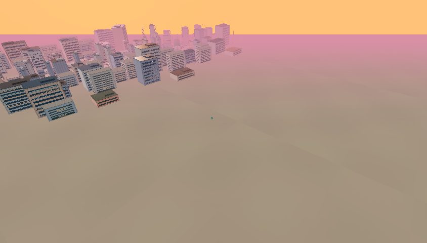
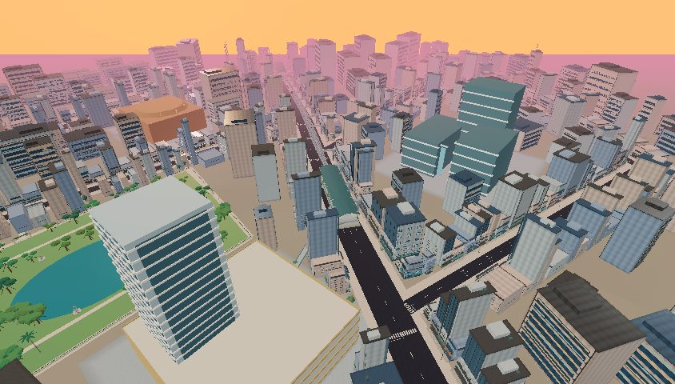
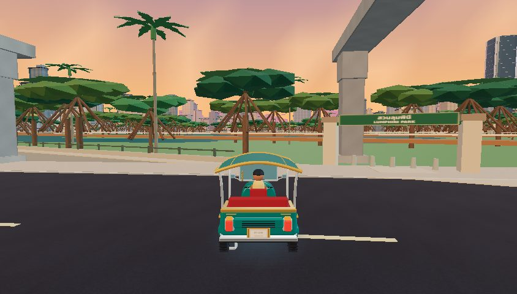
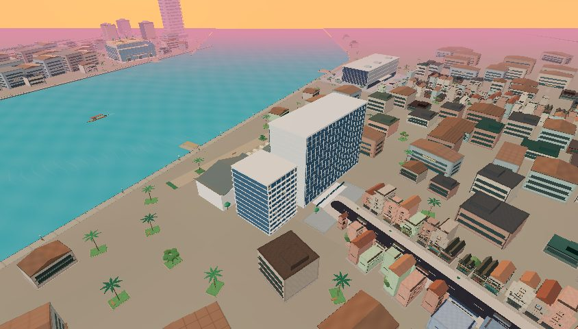

# Actual game screenshots — paired review

All 30 requested locations are captured in both untouched PR28 and this draft, with a normal chase-camera road view and an elevated inspection view: **120 actual game screenshots**. These are local game renders, not concept art. See each revision’s `survey.json` for camera/player poses, draw calls, triangles and rendering counters.

The HUD is hidden for inspection. No city object is hidden or removed for screenshots. Elevated poses are identical between revisions. Road poses snap to the corresponding playable graph, so the new eastern area has a different nearest legal road in PR28. The game is paused at a consistent daylight time. Medium graphics, 844×480, Chromium/SwiftShader software WebGL.

Review: geography, road alignment, building/park placement, architecture, vegetation, transit, driving clearance, street authenticity and visual completeness are recorded for each location in [visual-assessment.json](visual-assessment.json). A retained view is evidence coverage, not a claim that its architecture was rebuilt. The automatic volume/route results support clearance; a screenshot alone cannot prove every lane is safe.

| Location | PR28 | Draft | Reviewed observation / remaining limit |
|---|---|---|---|
| Grand Palace / Wat Pho | [road](before/palace-pho-road.jpg) · [elevated](before/palace-pho-elevated.jpg) | [road](after/palace-pho-road.jpg) · [elevated](after/palace-pho-elevated.jpg) | Retained palace north of Wat Pho, east bank. Arrival furniture clearance corrected. Temple silhouettes remain stylized; the normal-camera pose is obstructed by ordinary frontage. |
| Giant Swing / Wat Suthat | [road](before/swing-suthat-road.jpg) · [elevated](before/swing-suthat-elevated.jpg) | [road](after/swing-suthat-road.jpg) · [elevated](after/swing-suthat-elevated.jpg) | New historic connections improve surrounding access. Swing/temple retained; normal view exposes part of the swing above frontage. Large open interstitial parcels remain. |
| Golden Mount | [road](before/golden-mount-road.jpg) · [elevated](before/golden-mount-elevated.jpg) | [road](after/golden-mount-road.jpg) · [elevated](after/golden-mount-elevated.jpg) | Temple hill retained with local street changes nearby. The mound and normal-camera entrance remain simplified; surrounding vacant parcels still need reconstruction. |
| Chinatown / Yaowarat | [road](before/yaowarat-road.jpg) · [elevated](before/yaowarat-elevated.jpg) | [road](after/yaowarat-road.jpg) · [elevated](after/yaowarat-elevated.jpg) | Curved one-way commercial corridor retained with Mangkon/Plaeng Nam links and restrained planting. Dense signs/shopfronts remain recognizable; exact lane geometry is incomplete. |
| Talat Noi | [road](before/talat-noi-road.jpg) · [elevated](before/talat-noi-elevated.jpg) | [road](after/talat-noi-road.jpg) · [elevated](after/talat-noi-elevated.jpg) | Existing river-side shophouse fabric retained. This is not a new Holy Rosary/warehouse reconstruction; vacant rear parcels and generic supporting roofs remain. |
| Siam Paragon | [road](before/paragon-road.jpg) · [elevated](before/paragon-elevated.jpg) | [road](after/paragon-road.jpg) · [elevated](after/paragon-elevated.jpg) | Retail parcel retained north of Rama I. Relocated northern BTS approach no longer traverses Siam Center. Arrival is visible from the road; complete real-world plaza geometry remains simplified. |
| Siam Center / Discovery | [road](before/siam-center-discovery-road.jpg) · [elevated](before/siam-center-discovery-elevated.jpg) | [road](after/siam-center-discovery-road.jpg) · [elevated](after/siam-center-discovery-elevated.jpg) | Retail ordering retained; northern Phaya Thai/rail approach moves west of the parcel. Model retained. Nearby towers obscure the sampled road view. |
| CentralWorld | [road](before/centralworld-road.jpg) · [elevated](before/centralworld-elevated.jpg) | [road](after/centralworld-road.jpg) · [elevated](after/centralworld-elevated.jpg) | Retained east-facing façade west of Ratchadamri and north of Rama I. Chit Lom anchor shifts east of the junction. Sampled normal view looks along the corridor rather than displaying the whole mall. |
| MBK | [road](before/mbk-road.jpg) · [elevated](before/mbk-elevated.jpg) | [road](after/mbk-road.jpg) · [elevated](after/mbk-elevated.jpg) | Retained southwest Siam retail relationship. Phaya Thai approach and surrounding graph rebuilt; model retained. Road view remains partly obscured by supporting commercial buildings. |
| Asok / Terminal 21 | [road](before/asok-terminal-road.jpg) · [elevated](before/asok-terminal-elevated.jpg) | [road](after/asok-terminal-road.jpg) · [elevated](after/asok-terminal-elevated.jpg) | Northwest Terminal parcel retained. Sukhumvit and service continue east to E5. Distinctive tower/retail silhouette retained; sampled normal view emphasizes the approach street. |
| Phrom Phong | [road](before/phrom-phong-road.jpg) · [elevated](before/phrom-phong-elevated.jpg) | [road](after/phrom-phong-road.jpg) · [elevated](after/phrom-phong-elevated.jpg) | Previously undeveloped eastern ground becomes connected roads, E5, three distinct mall masses and Benchasiri. Normal view is below the viaduct. Malls and sois remain compressed original interpretations. |
| Lumphini Park | [road](before/lumphini-road.jpg) · [elevated](before/lumphini-elevated.jpg) | [road](after/lumphini-road.jpg) · [elevated](after/lumphini-elevated.jpg) | Existing lake/boundary and vehicle parking contract retained. Wide rain-tree/shade crowns and palms replace the generic planting. Perimeter street view remains obstructed by frontage at this pose. |
| Benjakitti Park | [road](before/benjakitti-road.jpg) · [elevated](before/benjakitti-elevated.jpg) | [road](after/benjakitti-road.jpg) · [elevated](after/benjakitti-elevated.jpg) | Eastern lake, forest wetlands and elevated pedestrian paths retained; planting becomes tropical woodland/banana mix. QSNCC/Green Mile and complete wetland ecology remain future work. |
| Chatuchak Market | [road](before/chatuchak-market-road.jpg) · [elevated](before/chatuchak-market-elevated.jpg) | [road](after/chatuchak-market-road.jpg) · [elevated](after/chatuchak-market-elevated.jpg) | Existing market entry and surrounding blocks retained. The nearby new park improves the northern cluster; the actual section-level Weekend Market reconstruction is still missing. |
| Chatuchak Park | [road](before/chatuchak-park-road.jpg) · [elevated](before/chatuchak-park-elevated.jpg) | [road](after/chatuchak-park-road.jpg) · [elevated](after/chatuchak-park-elevated.jpg) | New shaded lake park east of Mo Chit, separate from the market. Mature spreading crowns are visible from the gate. Outlines/path layout are miniature interpretations, not surveyed boundaries. |
| Victory Monument | [road](before/victory-monument-road.jpg) · [elevated](before/victory-monument-elevated.jpg) | [road](after/victory-monument-road.jpg) · [elevated](after/victory-monument-elevated.jpg) | Traffic circle and memorial retained. Rail follows its western approach before the relocated N3 station to the south; roundabout remains a gameplay compression. |
| ICONSIAM | [road](before/iconsiam-road.jpg) · [elevated](before/iconsiam-elevated.jpg) | [road](after/iconsiam-road.jpg) · [elevated](after/iconsiam-elevated.jpg) | West-bank mall and river-facing parcel retained. Tropical riverside planting replaces generic trees. Gold Line connection remains functional; surrounding waterfront gaps persist. |
| Wat Arun | [road](before/wat-arun-road.jpg) · [elevated](before/wat-arun-elevated.jpg) | [road](after/wat-arun-road.jpg) · [elevated](after/wat-arun-elevated.jpg) | West-bank prang and access retained. Complete forecourt decoration fitting resolves the road projection. Coconut/flowering planting is contextual; compound architecture remains simplified. |
| River City | [road](before/river-city-road.jpg) · [elevated](before/river-city-elevated.jpg) | [road](after/river-city-road.jpg) · [elevated](after/river-city-elevated.jpg) | East-bank riverfront model, piers and approach retained with tropical landscape. Street view shows the access corridor. Detailed adjoining warehouses/lanes remain incomplete. |
| Charoen Krung | [road](before/charoen-krung-road.jpg) · [elevated](before/charoen-krung-elevated.jpg) | [road](after/charoen-krung-road.jpg) · [elevated](after/charoen-krung-elevated.jpg) | Connected river-side road/frontage retained with tropical planting nearby. The sampled street is dense but much supporting architecture remains generic. |
| Silom | [road](before/silom-road.jpg) · [elevated](before/silom-elevated.jpg) | [road](after/silom-road.jpg) · [elevated](after/silom-elevated.jpg) | Commercial road and nearby elevated line retained; revised rail anchors share represented corridors. Ground-level shopfront density remains; full real-world street bearing/surroundings are not certified. |
| Sathorn | [road](before/sathorn-road.jpg) · [elevated](before/sathorn-elevated.jpg) | [road](after/sathorn-road.jpg) · [elevated](after/sathorn-elevated.jpg) | Office/tower district retained with corrected shared station anchors and reservation. Road remains drivable; skywalk/station details and entire block fabric remain stylized. |
| BTS Siam | [road](before/bts-siam-road.jpg) · [elevated](before/bts-siam-elevated.jpg) | [road](after/bts-siam-road.jpg) · [elevated](after/bts-siam-elevated.jpg) | Northern branch moves west of retail; straight shared station section and vertically separated directional tracks are coordinated. Moving car bodies pass clearance tests. Interchange/stairs remain miniature abstractions. |
| BTS Asok | [road](before/bts-asok-road.jpg) · [elevated](before/bts-asok-elevated.jpg) | [road](after/bts-asok-road.jpg) · [elevated](after/bts-asok-elevated.jpg) | E4 remains above Sukhumvit at Asok, with the underground MRT interchange entrance represented. Track continues to E5. Station model retained; elevated roofs partially dominate the chase-camera view. |
| BTS Saphan Taksin | [road](before/bts-saphan-taksin-road.jpg) · [elevated](before/bts-saphan-taksin-elevated.jpg) | [road](after/bts-saphan-taksin-road.jpg) · [elevated](after/bts-saphan-taksin-elevated.jpg) | River station, single-throat treatment and Taksin crossing retained with continuous train movement. Pier/bridge relation remains approximate; supporting waterfront blocks need refinement. |
| BTS Victory Monument | [road](before/bts-victory-road.jpg) · [elevated](before/bts-victory-elevated.jpg) | [road](after/bts-victory-road.jpg) · [elevated](after/bts-victory-elevated.jpg) | N3 now sits on the southern road approach, with the viaduct curving west of the memorial circle. The fixed before/after pose shows the station shift; generic surrounding parcels remain. |
| Riverside tropical palms | [road](before/riverside-palms-road.jpg) · [elevated](before/riverside-palms-elevated.jpg) | [road](after/riverside-palms-road.jpg) · [elevated](after/riverside-palms-elevated.jpg) | Riverside hotel setting gains coconut/royal palms and lower tropical layers. Elevated inspection is the useful landscape view; the normal street pose faces the hotel frontage. |
| Mature tropical park | [road](before/tropical-park-road.jpg) · [elevated](before/tropical-park-elevated.jpg) | [road](after/tropical-park-road.jpg) · [elevated](after/tropical-park-elevated.jpg) | Rain trees have spreading crowns, branching, asymmetry and mixed shade/flowering planting. Park gate and water are retained. Low-poly silhouettes remain an artistic miniature treatment. |
| Dense commercial street | [road](before/dense-commercial-road.jpg) · [elevated](before/dense-commercial-elevated.jpg) | [road](after/dense-commercial-road.jpg) · [elevated](after/dense-commercial-elevated.jpg) | Dense Sukhumvit storefronts and elevated corridor retained, with cleared planting and connected eastern extension. Most supporting tower/shop architecture is inherited procedural grammar. |
| Previously intrusive Wat Pho arrival | [road](before/wat-pho-overlap-road.jpg) · [elevated](before/wat-pho-overlap-elevated.jpg) | [road](after/wat-pho-overlap-road.jpg) · [elevated](after/wat-pho-overlap-elevated.jpg) | Shared fitting moves the Wat Pho wall/cap/post assembly clear of the live road and turning caps without disabling collisions. The wide paired inspection establishes context; raw volume contacts provide the precise intrusion evidence. |

## Selected comparisons

Phrom Phong before:

Phrom Phong after:

Tropical park after:

Riverside after:

No physical iPhone Safari testing was available. Screenshot frame times come from software rendering under shared CPU load and are not mobile FPS measurements.
