# Hero reference comparisons

Photographs are external architectural references owned by their publishers; game images are original rendered game geometry. These views show simplified architecture, not dimensioned replicas. Consult the fidelity review for unfinished C grades.

## oriental — C

Historic wing, pediment and broad River Wing added; garden/river wing proportions and full heritage elevation need another reference-matching pass.

[Actual exterior reference / gallery](https://media.ffycdn.net/eu/mandarin-oriental-hotel-group/6rjmEQVuUXB55kFkkCsr.jpg) · [Full reference catalog](references.md)

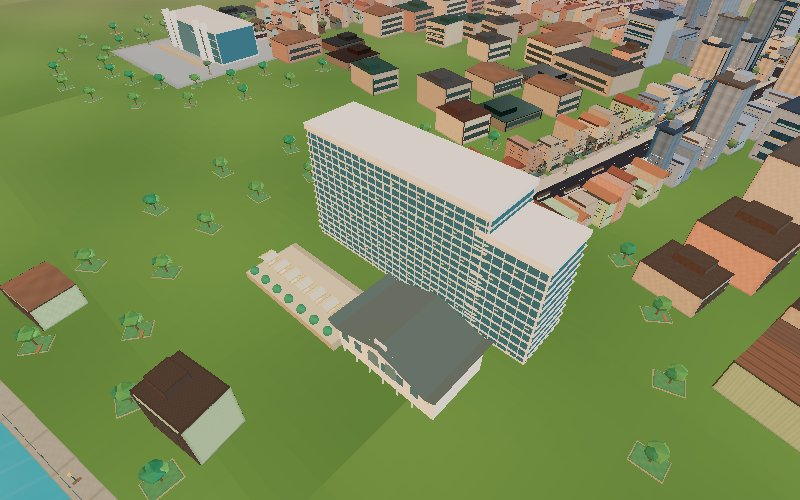

[Normal driving approach](after/oriental-road.jpg) · [Primary elevation](after/oriental-front.jpg) · [Skyline](after/oriental-skyline.jpg) · [River elevation](after/oriental-river.jpg)

## peninsula — B

Wave/W plan, stepped tower shoulders and river terrace are identifiable. Curves are faceted, room counts compressed.

[Actual exterior reference / gallery](https://www.peninsula.com/en/-/media/09---bangkok/the-peninsula-bangkok-presentation.pdf) · [Full reference catalog](references.md)

The official linked PDF/gallery provides actual exterior photography; the Peninsula PDF includes street/entry and riverside views.

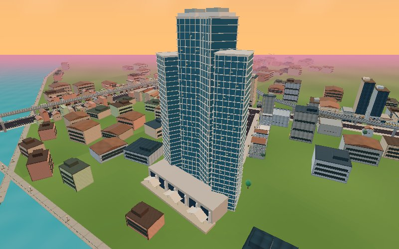

[Normal driving approach](after/peninsula-road.jpg) · [Primary elevation](after/peninsula-front.jpg) · [Skyline](after/peninsula-skyline.jpg) · [River elevation](after/peninsula-river.jpg)

## hilton — B

Rounded pale slab, dark vertical spine and cantilevered roof disc identify Hilton beside ICONSIAM. The roof mast and exact curtain wall are simplified.

[Actual exterior reference / gallery](https://assets.hiltonstatic.com/hilton-asset-cache/image/upload/c_fill,w_1920,h_1080,q_70,f_auto,g_north/g_auto/Imagery/Property%20Photography/Hilton%20International/B/BKKHITW/BKKHI_Exterior_Twilight_05.jpg) · [Full reference catalog](references.md)

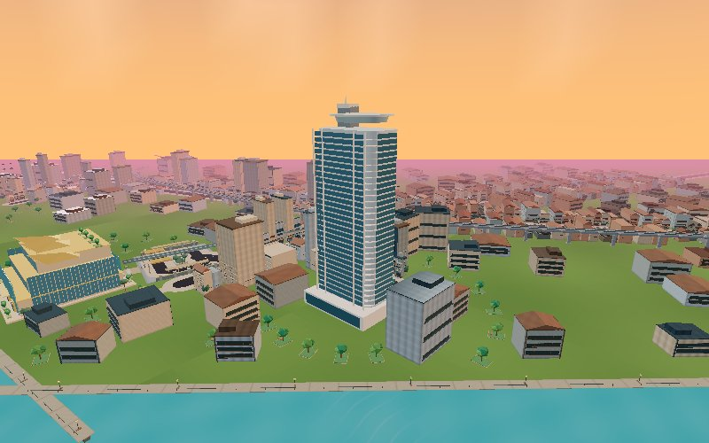

[Normal driving approach](after/hilton-road.jpg) · [Primary elevation](after/hilton-front.jpg) · [Skyline](after/hilton-skyline.jpg) · [River elevation](after/hilton-river.jpg)

## state — B

Golden dome, open rooftop columns, pale setbacks and horizontal balconies. One reused State Tower ID and physical model.

[Actual exterior reference / gallery](https://lebua.com/wp-content/uploads/2026/10/lebua-Aerial-05-412x260.jpg) · [Full reference catalog](references.md)

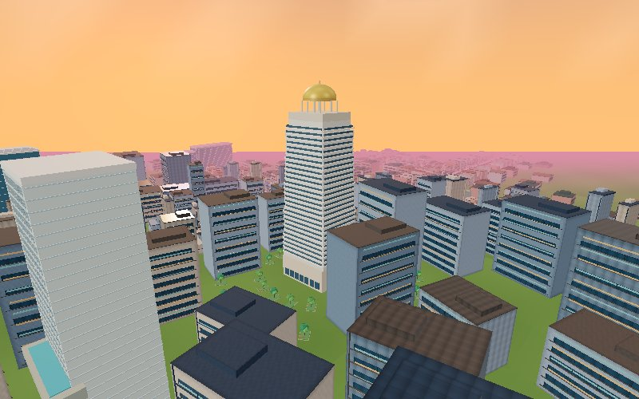

[Normal driving approach](after/state-road.jpg) · [Primary elevation](after/state-front.jpg) · [Skyline](after/state-skyline.jpg) · [River elevation](after/state-river.jpg)

## rosewood — B

Two different sloping wai forms and a genuine open central slot are visible. Garden details and continuous metal cladding remain simplified.

[Actual exterior reference / gallery](https://e1.nmcdn.io/assets/kpf2024/wp-content/uploads/imported-files/RosewoodBKK-900x600.webp) · [Full reference catalog](references.md)

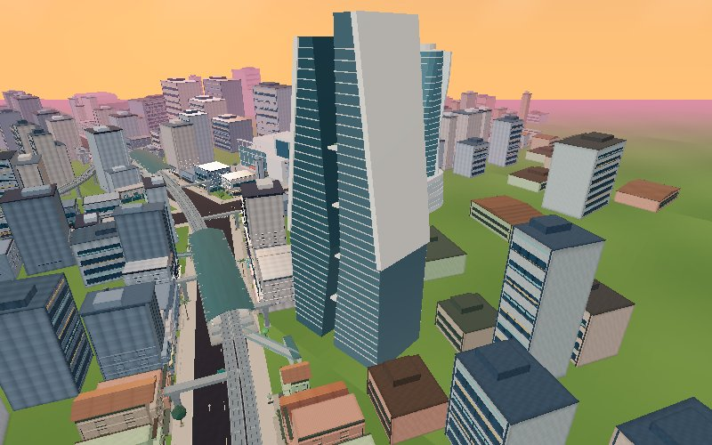

[Normal driving approach](after/rosewood-road.jpg) · [Primary elevation](after/rosewood-front.jpg) · [Skyline](after/rosewood-skyline.jpg)

## embassy — C

Integrated curved podium and ribbon tower exist, but the smooth continuous silver coil/void proportions are not yet faithful enough for B.

[Actual exterior reference / gallery](https://www.ala.uk.com/wp-content/uploads/2024/12/Bangkok-home-page-768x486.jpg) · [Full reference catalog](references.md)

[Normal driving approach](after/embassy-road.jpg) · [Primary elevation](after/embassy-front.jpg) · [Skyline](after/embassy-skyline.jpg)

## icon — B

PR24 folded canopy/pleated frontage reused, river orientation corrected. Hilton district context added; condensed overall scale and residences omitted.

[Actual exterior reference / gallery](https://seele.com/fileadmin/editor/01_References/Iconsiam/Iconsiam-Hero3-1660x833px.jpg) · [Full reference catalog](references.md)

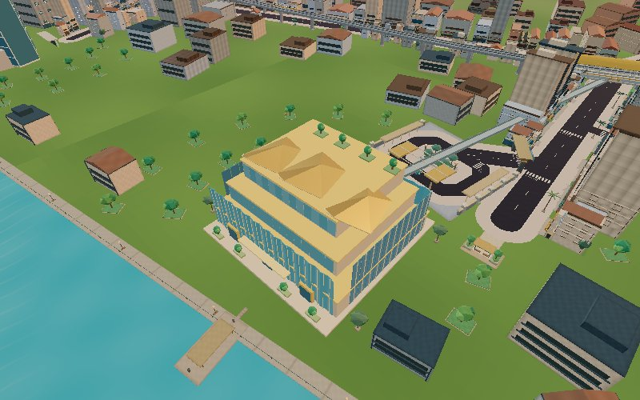

[Normal driving approach](after/icon-road.jpg) · [Primary elevation](after/icon-front.jpg) · [Skyline](after/icon-skyline.jpg) · [River elevation](after/icon-river.jpg)

## mahanakhon — B

Removed square-perimeter pixel ribbon winds through near and far silhouettes; roof deck and glass rhythm. Pixel distribution is stylized rather than a floor-by-floor replica.

[Actual exterior reference / gallery](https://www.buro-os.com/upload/project/55c0dfc218d331c75835c19a82d36d72.jpg) · [Full reference catalog](references.md)

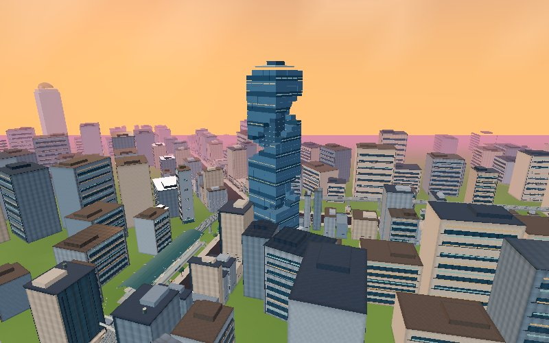

[Normal driving approach](after/mahanakhon-road.jpg) · [Primary elevation](after/mahanakhon-front.jpg) · [Skyline](after/mahanakhon-skyline.jpg)

## baiyoke — B

Tapered profile, observation tiers, deck ribs and mast; small refinement to the existing asset, not a new full reconstruction.

[Actual exterior reference / gallery](https://baiyokesky.baiyokehotel.com/) · [Full reference catalog](references.md)

The official linked PDF/gallery provides actual exterior photography; the Peninsula PDF includes street/entry and riverside views.

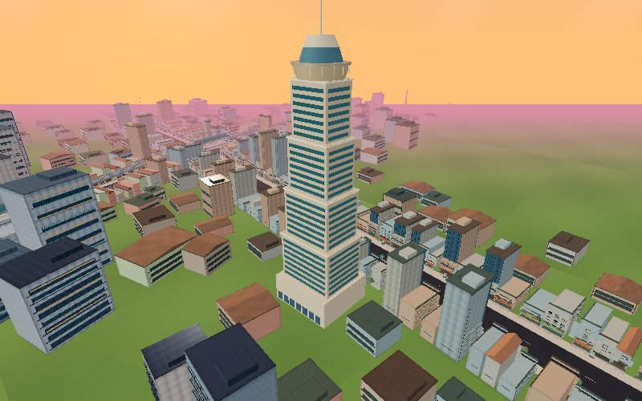

[Normal driving approach](after/baiyoke-road.jpg) · [Primary elevation](after/baiyoke-front.jpg) · [Skyline](after/baiyoke-skyline.jpg)

## Before / after

Matched camera poses are taken from the after survey and reused against the PR24 checkout. The earlier baseline `before/icon.jpg` and `before/palace.jpg` are additional context, not matched comparison pairs.

### icon

| PR24 | This draft |
|---|---|
| 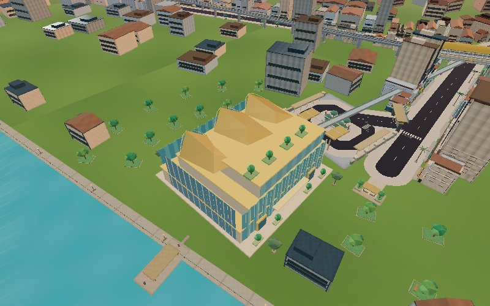 |  |

### mahanakhon

| PR24 | This draft |
|---|---|
| 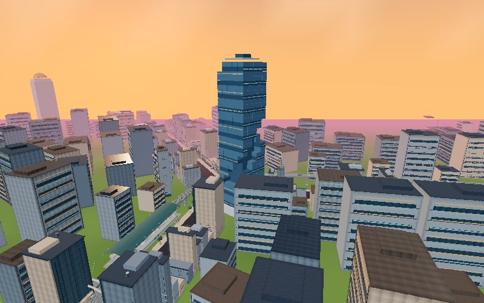 |  |

### state

| PR24 | This draft |
|---|---|
| 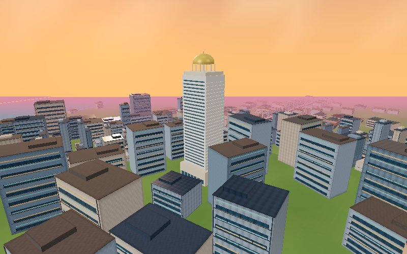 |  |

### paragon

| PR24 | This draft |
|---|---|
| 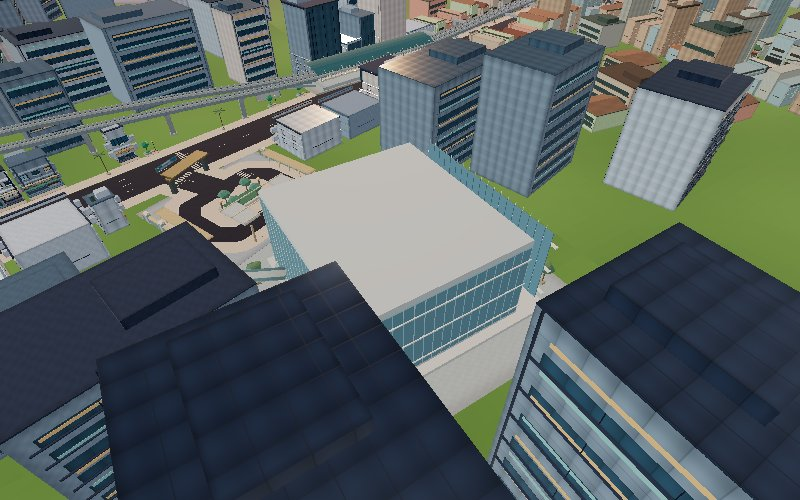 |  |

### mbk

| PR24 | This draft |
|---|---|
| 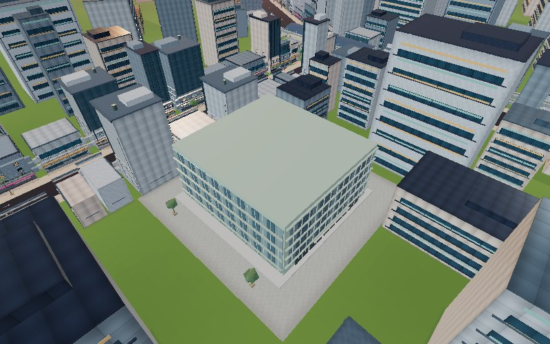 | 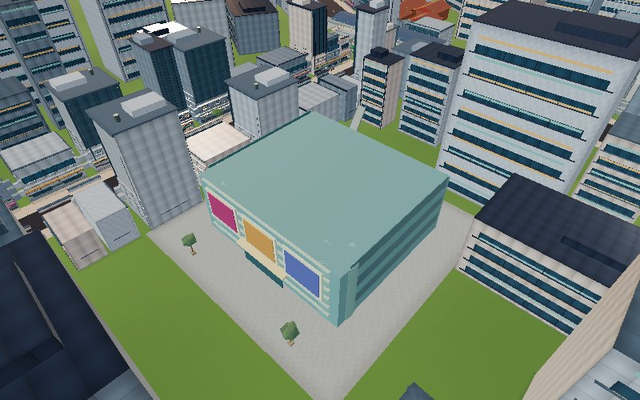 |

### central

| PR24 | This draft |
|---|---|
| 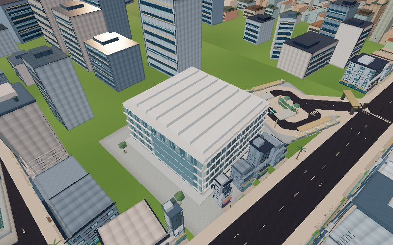 |  |

### terminal

| PR24 | This draft |
|---|---|
| 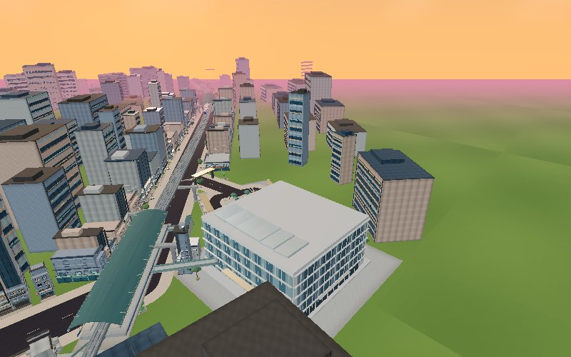 | 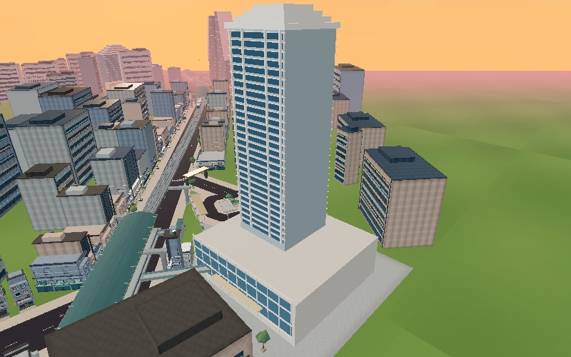 |

