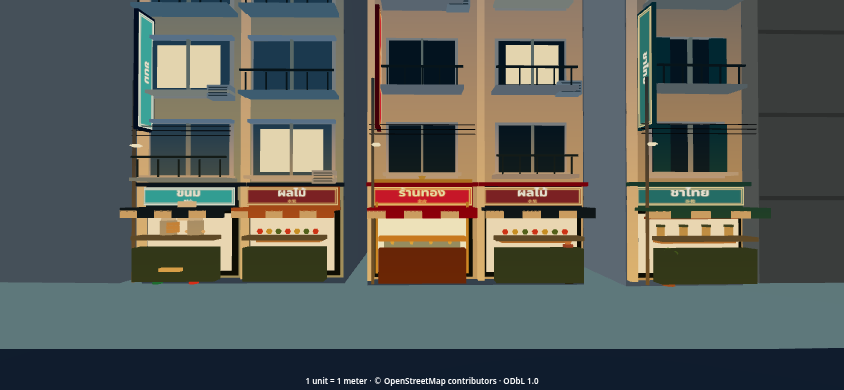
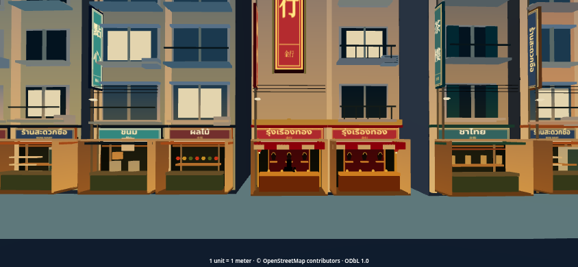
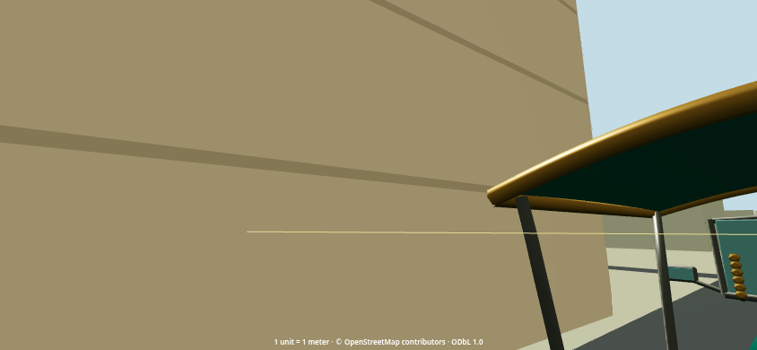
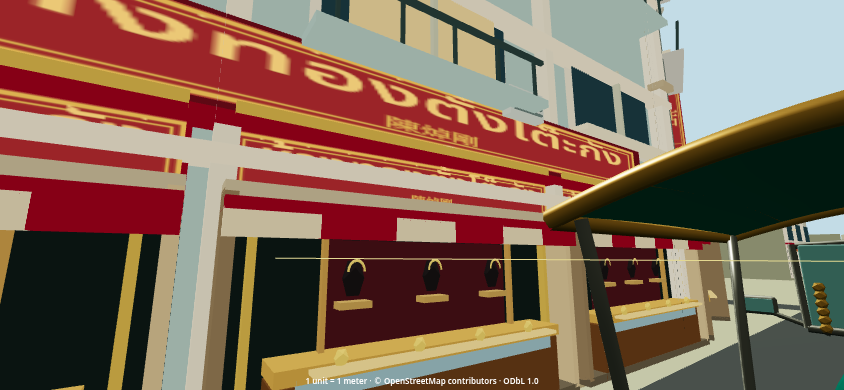
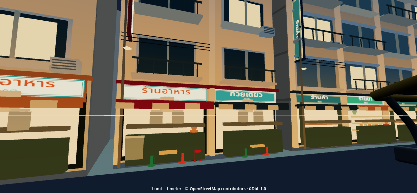
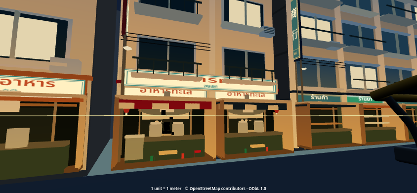
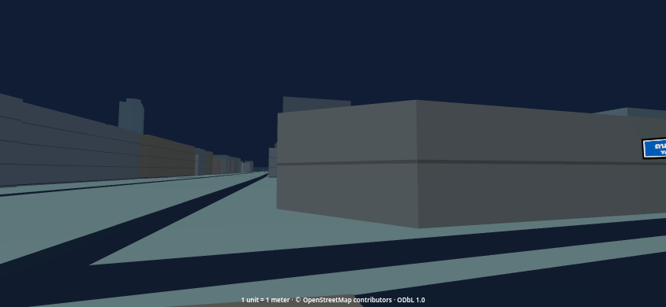
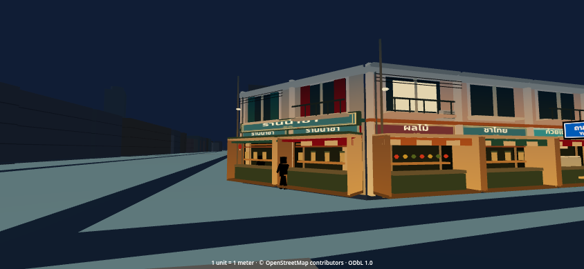

# Genuine rendered browser evidence

Runtime `8697d316d67262a2346ef1e8308b817e917588ee`; pinned PR60 baseline
`0c84000d896922ba512d54f4c52d90881be0f105`. Linux Chromium / SwiftShader,
844×390 touch simulation. These are real browser screenshots, not mockups.
HUD is hidden in staged architectural views; the vehicle/source geometry remain
rendered. Driving views retain the gameplay HUD and AI traffic.

All **46 original PNGs** (23 per version) are saved in [views](views/).
The fixture file records identical geographic camera/player poses in both runs.

| Required view | PR61 rendered evidence |
|---|---|
| Gate approach | [07](views/after-07-gate-approach.png) |
| Expanded commercial drive, day | [01](views/after-01-yaowarat-day.png) |
| Same corridor, night | [02](views/after-02-yaowarat-night.png) |
| Hero gold frontage | [03](views/after-03-gold-shop.png) and [Tang To Kang](views/after-13-tang-to-kang.png) |
| Restaurant display/interior | [04](views/after-04-noodle-kitchen.png) |
| Vendor activity | [wok house](views/after-16-wok-house.png) and [later animation frame](views/after-vendor-frame-b.png) |
| Vertical signs at street level | [06](views/after-06-signs-and-cables.png) |
| Adjoining varied buildings | [05](views/after-05-varied-frontage.png) |
| Song Wat merchant house | [19](views/after-19-songwat-merchant.png) |
| Neighborhood contrast | [Song Wat night](views/after-12-songwat-night.png) vs [Yaowarat night](views/after-02-yaowarat-night.png) |
| Wide source-block continuity | [wide](views/after-20-wide-continuity.png) |
| Fast / Pretty | [09](views/after-09-fast.png) / [10](views/after-10-pretty.png) |
| Elevated source alignment | [11](views/after-11-elevated-alignment.png) |
| Actual driving with AI | [day](views/after-drive-day.png) / [night](views/after-drive-night.png) |
| Matched before / after | Every `before-*` PNG has the corresponding `after-*` camera fixture |

The two vendor views are genuine screenshots from separate animation times,
not a continuous browser recording or a deterministic timestep replay.
Characters remain deliberately simple. Source gaps and undecorated side masses
are visible in the wide views; these are not hidden or filled with invented buildings.

Visual inspection caught the gold tower cutting through balcony rails and
restaurant counters hiding cooking activity. Final code reserves the tower's
wall strip, moves projecting blades to column strips, lowers counter/equipment
heights and supplies missing Chinese glyphs. Final closeups were reinspected.

## Matched examples

| PR60 | PR61 |
|---|---|
|  |  |
|  |  |
|  |  |
|  |  |
